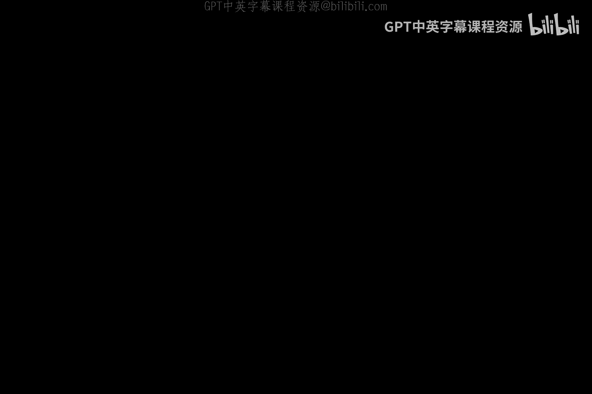
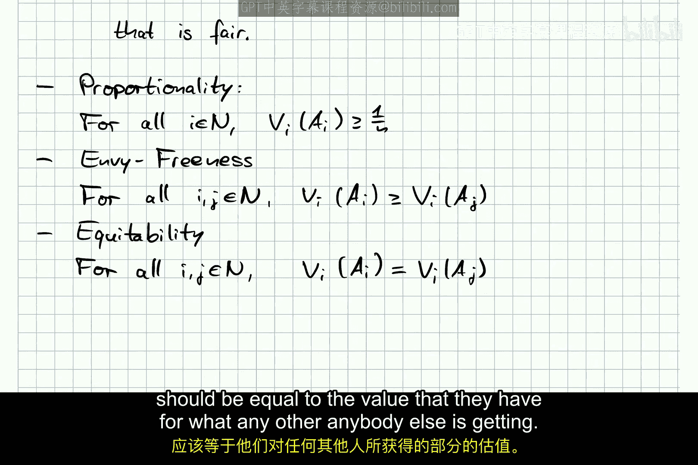
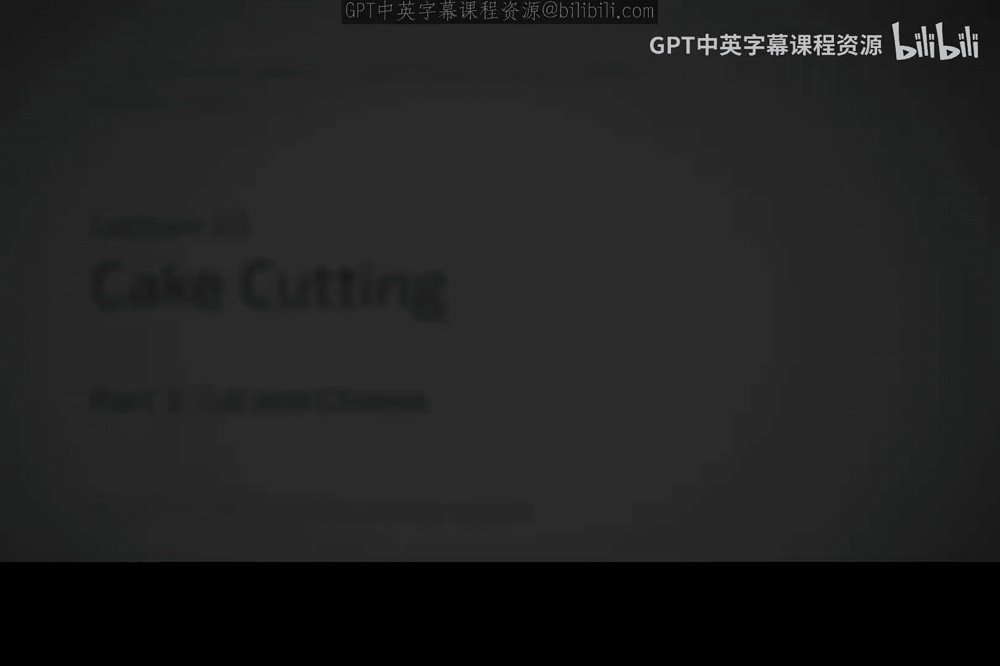
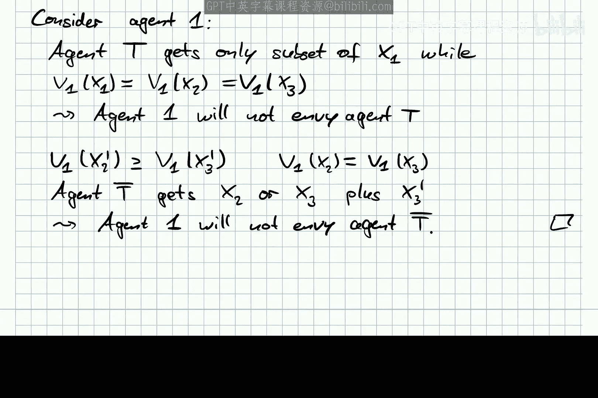

# 波恩大学《算法博弈论｜Algorithmic Game Theory, Winter 2020-21》中英字幕（claude-3.7-s p24 AGT, WS20_21_ Lecture 23 (Cake Cutting).zh_en -BV1m9ZyYoENg_p24-

Welcome back to Agothmic Game theory。Today we are talking about another problem of mechanism design without money。

Which is about fair division。What are these fair division problems without many。

 You'll see them very often in real life。 For example， you might consider a group of employees who。

Have to decide which work shifts two of them works in and some might say， okay。

 I rather work in the morning。 some others may say， okay， I rather work in the afternoon。

 some might say， oh， I' definitely want to keep my weekends free others would say no。

 I'd rather work on the weekend than during the night and。

Just everybody will have their personal preferences。

How do you get to an assignment that makes everybody as happy as possible overall？

We'll be considering this in a very simplified setting， so you could of course， consider this with。

 for example， indivisible items。You know， we've seen indivisible items a couple of times this semester。

But we'll now consider a fully divisible resource， but the thing is people prefer different parts of that resource。

And what does this resource usually look like？Well。

 what people usually are considering is the problem of cake cutting。

So this is the kind of cake you should have in mind。 It is just a linear cake。 and then you may。

Just cut it into pieces and people will prefer different parts of the cake。Some people might prefer。

 for example， this， why chocolate part。Some people may just prefer the plain black chocolate part。

 or somebody might prefer the sprinkles。Depending on what you personally prefer。

 depending on your personal taste。So how do we capture such a setting mathematically？

So this might be our cake。And how do we model this cake will model it just as an interval going from zero to1。

So this will be just the interval zero to1。And we can cut this into pieces。And what is a piece。

 a piece is just a union of subintervals。We'll have。And agents。And。Each agent， I。As again。

 a evaluation function。Which now assigns a non negative value to each piece of the cake。We'll assume。

To to capture this。So this valuation function， this is called capital VI and we'll assume。

That there is a density function。Small VI。Which maps。From01 to the non negative reels。Such that。

Capital V I of X。Is given as the integral overall。X and x， this small VI of x。So in particular。If。

We're assigning you the interval from A to B。Then you value。

For that will be just the integral from A to B of this small function V。

So just integrating over this density。And。If x is a disjoint union of intervals。Then。The value。😔。

Will be just the sum of these。Two integrals。In other words。This valuation function is additive。

Across different intervals。Disjoint intervals， I mean by this。

One thing to notice at this point is that it doesn't actually matter whether we assign open or closed intervals。

 just because the integral from a to a， for example， is 0。 So getting this。

What does this even mean in the sense of a cake that you get？

That you have a cut at A and then you have another cut at A and you get everything in between。

 well that's nothing。So this is why we are。Or we can safely assume something that or。

That sometimes these intervals will be open， sometimes these will be closed。

 so that's actually not the point that matters。We'll also assume that everybody values the entire cake the same way。

 but what matters is what which part。They prefer of the cake。 They prefer most。

 So do they rather prefer the white chocolate part or this。Sprinkles partd or which。

 which part do they prefer？So。We'll also assume that。Capel V。Of the integral from 0 to 1， this is。

 of course， again， the integral。Of this small VR， this density function that this will be simply one。

So what might this now look like in concrete numbers？We might have。

Somebody who just doesn't care which part of the cake they're getting。

So then this density function would just be one everywhere。Or we might have somebody。Wh says， okay。

 I definitely prefer the first half because there， my density is maybe like three halves。

And in the second half， the density is only one half。So they， for example。

 again value the entire cake as one。But the first half of the cake pipe。

 So what this guy now says is just half of the cake。 This guy here says， okay， that's actually。Well。

A quarter versus three quarters of the cake。So that's just the difference of personal perception。

 how much do you value which part of the cake？So what could we do here？For example， we could set。

And we could choose as an allocation。We could said that thee。First。

Agent is getting the first half and the second agent is getting the second half。So， this。

We want to make sure that these are disjoint intervals so that nobody。

 no part of the cake is allocated twice， but as I was saying。

 we don't care whether these are open or closed interval。So from the perspective of Age1。

 this looks like a very fair division。Why that？ Because age1 narcs okay my value for the。

For what I'm getting is's just the same as for what the other is getting。This is。

In both cases a half。But what does the second agent say？Well， the second agent now says。

This is pretty unfair。Because I am getting only a quarter of the cake， whereas you。Are getting。

Three quarters of the cake。And what you realize is if we now switch the two。

If we swapped the allocation of A and B， then。Agent one would still not care。For age one。

 this would be a fair allocation either way， but agent2 would care Age2 would suddenly be super happy because from their perspective。

 they're suddenly getting three quarters of the cake as opposed to the other agent getting only one quarter of the cake。

So what we should discuss is how can we model fairness here？

Why what is it that makes an allocation fair？And。Is there always a fair allocation。

 how can we find it？What is a fair allocation？Well， that's not。Easy to define because。

Every agent has their own perspective of what is a good part of the cake that we're cutting。

So there is just no outside perspective of saying， okay， you not get half of the cake。

 you get half of the cake because there is just always this personal perception of what actually corresponds to half of the cake。

And indeed， this is why there are multiple different fairness properties。Let's see three of them。

So once again， our goal is to find。An allocation。Capital A。Consisting of a12 A N。With is。

AI are disjoint。And the union of them is the entire interval。 And， of course。All of them。

Are subsets of 0，1。And this allocation should， of course， be fair。

But what does this mean this fairness？Well， we could， for example， say。It should be。Proportal。

What does proportionality mean。It means that every agent。Things。

That they are getting at least a one over n fraction of the cake。

There's also the notion of envy freeness。Which means that。For all。

I and J for any two different agents。Agent I is happier with what they are getting。

 or at least as happy with what they are getting as if they were getting what agent J is getting。

Or there's a third property。Namely， this is equiability。Which means that。

Every agent thinks that everybody is getting。The same。So that for any I and any J。

 the value for I that agent I has for said AI should be equal to the value that they have for what any other better anybody else is getting。

 So you see this is something that is stronger than this second property。

Because it is just equality where here we just have inequality。And proportionality。

 that's still weaker。Then envy freeness because。If this does not hold。Then。

 or let me say if en freeness holds， then you definitely think that you're getting a one over n fraction of the cake because everybody else from your perspective。

Shouldn't be getting more than one over n fraction， there are n agents in total。

 so n minus1 other agents。And if any of them got more than what you think is a one over n fraction。

And you got less。Then this would also give you envy。So as you see。

These are proportionality is the weakest of all， en freeness is a little stronger and the strongest of these is equiability。

Is there always an allocation that is proportional？How would we find it？

And how often would we have to cut the cake， How would this。How would a protocol for this look like？

嗯。The first protocol that I'd like to consider is just for two agents。

And this is the famous so called cut and Cho product。

This is I guess， a protocol that many of you know。At least if you have siblings。

 you probably know this， you just want to。Divide one， divisible good。

Among just two agents and how do you do this， one of the agents？Cuts it and the other then chooses。

What theyre getting。And。Why is this perceived a good way of allocating things？

Because the first agent。We'll just try to cut things as evenly as possible so that they are actually happy with whatever they are getting。

So formally。Agent1。Cuts。And。Point。Tea。Such that。Value for the first part is exactly equal to the value for the second part。

From their perspective， so from agent one's perspective。

And this will of course be a half because the entire interval is valued as one。Then。Agent 2。

Chooses between。0 to t。And。ji之王。Which of the properties does this allocation？

Recall that we were asking about proportionality， that we were asking about envy freeness and about equiability。

Is this proportional？Let's see。This allocation is proportional。Why that？

What did this mean to begin with， we would now need that every agent values what they're getting by at least a half。

Why is this true for Agent one？For agent1 will have that。

Age1 actually does not care which of the two。Pieces they're getting， they value both of them at one。

And。For agentnt2， what do we have there there， of course？We have that they are choosing。

 So the value for this。Peace has to be at least the value that they have for that other piece。

And as you see here。In this argument， you also see this will be an envy free allocation because。

Agent1 actually sees a K， I't envy agent2。Same is true for agent， too。So。

Both agents are happy with what they're getting and they don't envy the other agent。

But will this allocation be equitable？What did this mean， this meant that every agent values。

What they're getting exactly the same once again。Each agent values every。

Everything that anybody gets exactly the same。And this allocation will not be。Equitable。Namely。

 we could have， for example。That。The first agent has a value of。

Our density of one everywhere and the second agent。They now have。Density of2 and the first half。

And density of 0 in the second half。Whatoo would。The first agent do。

 the first agent would cut at exactly a half。Because this makes it feel that both parts are valuable exactly the same。

And then the second agent will choose the first of these two halves。

And what are the different values， the different values are。A half。

For the first agent for both of these。Like we always have。

 this is generally a property burned the second agent now。Has value of one。So。

 a value of zero for what the other agent is getting and a value of one for what they are getting。

But there is actually an equitable allocation。Namely。We could said。

A one to the interval of one quarter to three quarters。And a2 to what is left。

 So we'll take the interval from 0 to1， take away a1。This， of course， is。Not。One piece。

 as we might understand it， this is not a contiguous interval what agentnt2 is now getting。But。

You can now figure out that for agent1， this is exactly has value a half for agent2。

 this year also has value exactly a half and the same is true for that other interval。

Just because overall it has to have a value of one。So in this case。

There is no contiguous equitable allocation， but there is an equitable allocation。😊。

And now speaking of cut and shoes。There's one more thing I'd like to remark， namely。If we go back。To。

This protocol， then you'll see。Okay， this will。And not be。

Incentive compatible in a way that will actually that you cannot gain from strategic behavior。

So all that we're talking about today is just how what can a fair allocation look like we are not talking about these strategic aspects that you might be strategically misreporting。

Because this will make you better off。Because this could happen here。

 we in our say that Age1 cuts the cake into two pieces。And we were now saying， okay。

 they just cut the cake so that。They don't care which of the two halves they're getting。

But this does not mean。That there is no smarter way for them to cut the cake， for example。

It might be。In this case here。If you were now acting strategically， what would you do， you。

 of course， as Age one wouldn't cut the cake at a half， but you would say。Okay。

 maybe now I cut it at say a third or so， because then I know even then agentnt 2 will take this from zero to a third and I'll get everything from a third to one。

 so I'll get way more。And this is something that you might consider so strategically cutting your cake so that。

Um you anticipate what other people will be taking so that actually you are best off。

 but this is not the point today the point is just。Is there given that we know these values。

 how can we find an allocation that makes people happy？How do we define happiness。

 we've seen three different properties， and is it always possible to find such an allocation。

 how difficult is it to find that？And indeed。For en freeness for just two。Players， two agents。

 we definitely， it is easy to find such an envy free allocation for coming to an equitable allocation。

 this seems to be a little more difficult。Now what we want to do next is we'll talk just about proportionality。

 which was the easiest of these properties， and then we'll see how we can actually guarantee this even for any number of agents。

Now we want to see how we can get a proportional allocation for any number of agents recall that a proportional allocation is defined in a way that every agent thinks they are getting at least a one over n fraction of the cake。

How can we do this， We'll actually do this in a very similar way as cut and choose。But now。

All of our agents propose one place where to make the first cut so that what's left of that cut is at least a one of our in fractionraction。

 And then we take the leftmost of these cuts。 and whoever said， okay， this is。

This would be enough for me is getting this and then we recurse with the remainder of this cake。是。

So more formally。We。Initialize。T 0 as 0， and。N1 S N。And now。4。😔，K going from 1 to n minus1。

Let do the following。For every agent that is in NK。Let。Tki K i。Bi。The point such that。Tn from。T K-1。

2。TK i。We'll see a value of exactly one over n。Where this notation that I'm now starting to use here means。

I'm now writing V of acom a B， just for the。The I of a comm a B for just the value of the interval from A to B。

So。We have already cut the point， cut the cake up to。T K1。So， only what's。From Tk minus1 to one。

 this is only what is left after the k。And then we're asking， okay。

 where now do we how much would you need to get this one over n fraction？And now， we let。I star。哔啲。

Agent。With the smallest。痴其爱。And we let。T K equal be equal to T K I star and AI star。

Will be the interval from Tk minus-1 to Tk。And then， we'll set。N K plus1。2。😔，N K， take away， I star。

And then。Everybody， except for。嗯。The remaining agent。In has is getting something because this way。

 we're assigning only something to。N minus-1 agents。And then， we will assign。The remainder。

To the remaining agent。yin。And， and。So one other way。

You can think about this as a moving knife protocol。

So what will happen is that there is a knife moving over the cake。And then。People scream， stop。

And whoever screamed， stop。Whoever is the first to screentop then gets the fraction of the cake that is left of that night。

However。As you see， this morph feeds like a first price auction， so once again。

 this is not incentives。Incentivizing agents to report their true values。

 this is not our question today。But nonetheless， we can show that this always gives us a proportional allocation。

How do we show that。Yeah。We claim that the allocation。Computed by the algorithm。

Fulfils proportionality。And。To see why we have a proportional allocation， we should have a look。

Back at this algorithm。 and the thing that we should be asking is。Is this even a feasible allocation。

 is this even a feasible algorithm， is this even well defined？

Is there even such a point TKI such that you value what is left by exactly one over n。

 or could it be that you value everything from TK minus1 up to1 so all that is remaining of the cake that is still not allocated that you。

嗯。Value all of this less than one over n。Could that happen。Or。Also， what about the remaining agent？

Will they value what they're getting at least one R or not？And， indeed。

It is not difficult to show that none of this will happen because as an invariant。

 will have that everybody who is still in the set。MK at every point in time。

Values what is left of the cake， So what has not been allocated。Of the cake。

 and they value at least one over n。And this。Make sure that this is not happening down here that。

Whatever the remaining agent is getting， that they're happy with this。And also。That the。

Agent that everybody can actually say some point TKI for which this is true， and of course。

 then what they are actually getting。This will definitely have a value of one over n just by definition。

So more precisely， we'll show the following invariant and I think I stated this a little incorrectly before。

For any K。And。Any I in N K will have that。The value that。Buyer， I， sorry， not buyer。Agent I。

 we should say today， because they are not buying and they're not bidding and they're not playing。

 They are just some。Agents who want to get something。

And that this will be at least 1 n minus k plus 1 over n。This in particular in particular。

 makes sure that for K。Being equal to N the last。W the last agent remaining will be happy and also in between everybody can say。

 okay， this much of the remainder gives me a one end value。How do we show such an invariant。

 we show it by induction。Namely， we' have。Okay case the K is equal to1。Then， we'll have that。

V I of 0 to1。Will have to be at least one， this is by definition。Because we say okay。

 they value the entire cake by one。Now let's consider some。K plus1， which will be greater than1。

What do we have， we'll have that。For every agent in。The remaining set N K plus 1。

TK I will be at least T K。Because。TK was the smallest such value。This now means that。V I， F T K，-1。

To my TK。It will be at most V I of T K -1 comma T K comma I。And this， we said， is exactly one over n。

And now。By induction are part of this。Agent I value for the remainder from T K to one。 this will be。

Because we're still additive。The value for。What we have from T K minus1 to1。

minus the value that we would have from t k minus1 to t k。Now for this。

 we know that this is at most one or n for this part， we know that it is at least。N minus K plus 1。

Over and。So， would we。Getting in total is that this is at least。And minus。K plus one。Plus one。

Divided by n。And this completes the induction。So once again， how did this argument work。

 we just said， okay， what is the remaining of the cake at any point in time？

Every of the remaining agents values high enough， namely they every of the remaining agents says that。

We can cut it into。Pieces so that。From my point of view。

 every of the agents will get a one over n fraction。And because we can。Do this in every step。

This is a well defined algorithm in the sense that there is always this point for which I myself。

 am getting one over in fractionraction。And also， that。This remainder also has a certain value。

To this。Agent。Whoever is getting this？However， you can see that this is not envy free。

Why isn't this envy free？Because you might be the first agent who's getting something。And then。

You think， okay， I'm not getting one over n fractionra， so maybe it's like three agents。

 I'm getting a third of the cake。And then you can suddenly see okay， actually these other two agents。

 they have weird preferences， so for example， then there is somebody who's taking from my perspective only like a tenthth of the cake。

And then most of the remainder is actually going to one agent， which was so。Two thirds， minus a10th。

 for example， is then going to only one agent， so I will certainly envy this agent So it's not envy free。

 but at least it is proportional。Getting enV free allocations， this is much more complicated。And。

 indeed。嗯。For N agents， this is。At least for now， hopeless to describe。

 although it has been shown that it is possible。But what I'd like to do next is to show you how we can achieve this for three agents。

 how we can achieve en freeness for three agents。Now we'll come to the question how to determine an envy free allocation if we have three agents。

And even this is surprisingly complicated。Maybe so far you've thought， okay。

 this is actually super easy， why do people care about this？And indeed， this proportionality。

 this is indeed extremely easy， but then now you see this envy freeness。

 which sounds much more desirable that I don't envy anybody。This is far more complicated and。Indeed。

 we'll now show a protocol which cuts key the cake into pieces。

So that no every agent gets some parts of the cake， but no agent ens。Any of the other agents。

And the amazing thing is， we only will need。5 cuts， which means we'll get six intervals。

 So it's not like you might be hoping， okay， cut here， cut there。 and then you get this。

 you get this， you get this， but it is already much more complicated。

 And when we are showing why this will be this will be envy free。

 You'll hopefully get an idea why you can't do this in a much easier way。This， by the way。Is。

An algorithm with an interesting history because it was invented independently by John Selridge and John Horton Conway。

 but unfortunately none of them ever published it。So maybe if you find out something。

 you should rather publish it so that you actually get credit for it and not somebody else just finds out the exact same thing。

How does this work。Well， we'll start as follows。Agent1。Cats the cake。Into three pieces。X 1， x 2， x 3。

 such that。Agent 1 has the same value。For each of them。No。We rule。Rename them。So， that。Agent 2。

Whose values are， of course， a lot different。OrM be a lot different， otherwise it gets little easier。

Is。That agentnt 2， Ashley， of these three， prefers。The first to the second to the third。

Where are we so far， so there are three pieces of our cake。

 agent two says I like the first piece best。AndThe second piece are like less and the third piece are like least。

Arian1 says， okay， I don't actually care， I like all of them the same way。no。Agent2。Cauts off。一。

Part of the first piece。Such that the first two pieces are actually。Have the same value。For them。

Things would be much easier if we were allowed to just discard what we are cutting off。

 but we aren't。And this is what makes things very complicated too。So what's the current status？

Agent1 says。嗯。Yeah， x1 takeaway x prime， I don't know that maybe doesn't make me happy。

 that's the other two make me happier， the other two I don't care which of the two I'm getting X1 takeaway x prime I'm not so happy with。

Agent 2 says， okay， I don't like the third piece， but I like。This。

That this trimmed first piece and the second piece are like the same。And so let's now ask Age3。

What they actually prefer out of these three things that we have now。The trim first piece。

 the second piece， the third piece。So this will be our first assignment phase。

Where will will be assigning。Zero1， takeaway x prime x prime this will split agent 2 cut off。

What will happen now？Agent 3。Chooses one。E。X1， take away x prime。X 2。And。X 3。And。If agent。3。Cose。😔。

X 2， or x 3。Then。Agent2。Gets。X1 take away x prime。Otherwise。They get。X 2。And。Agent1。Gets x 2 or x3。

 depending on what is left。So what is happening so far？We had these three pieces。

 x1 takeaway x prime x2 and x3。Now we let Age three choose one of these three Agent3 will of course choose the one he likes most。

And then。Agent2 Gs。Either x1 take away x prime or x2。Why that？This is what agent2 value the same。

There is also this set x3， which。Agent two values， only less， definitely not more。

And then there's Age3， Age1。Who gets？Whatever is left， and the amazing thing is。

And they get x 2 or x 3， but。They don't actually care， so what is not great about this is that。

Agents two and2 and3 so two and one， they will definitely be。

Regardless of what of the two options they're getting that we're writing here。

 they have the exact same value for these。But there is something that is complicated about this。

Namely， there's still this X prime left that we still have to allocate。

 and for this we'll now have a second assignment phase。So this will be the second。Assignment phase。

In which we are assigning。X prime。嗯。To write this， let capital T。Be the agent of God。X1。

Take away X in the first round。And。Tbar。We let them be the other one。Quite importantly。

Agent1 is never the one who's getting x1 takeaway x prime。

Because this is either taken by agent3 or by agent 2。Now well have to also assign x prime。

How do we do that？Agent T。Cuts。X prime into。X1 prime， x 2 prime and x3 prime。Such that。😔。

So that's not agent T， that's agent T bar。Subsstand。They value both all of these three the same。Then。

Agent T。Joseus。One off。The three。Then。Agent1。Joseus。One of the remaining two。And then。Agent Tbar。

Gets the remaining piece。And would we now claim？Instead that， dis allocation。Is。EnV free。ho。

How do we show this？ Well， all we have to do is we'll have to verify the envy freeness inequalities。

 What were these envy freeness inequalities， Age1 should not envy agent 2 and agent one should not be envying and agent 3。

And。So on， so we'll have in total six。Andryri's inequality， all of which will have to verify。

We'll say， first， say that。Without loss of generality。In the second phase。Tea chooses。X1 prime。And。

1 chooses。X 2 prime and。T born。Then gets as the remainder is x3 prime。 Where was this happening。

 This was this last phase。Here we said okay agent T bar cuts this into three pieces which。So far。

 just we said， have all the same value， but we now say， okay， agent T will actually choose this one。

 agent1 will choose this one and agent T bar will choose this one。

This is just to simplify our notation here。So why is it that envy freeness is fulfilled？

Let's first consider。Agent。Qi。What is it that agentT is getting？AgenT is getting。

X1 take away x prime。 This is how agent T was defined。

We let agent to here in the first phase that was somebody takes x1 take away x prime。

And then we call T the one who got this。And then they also got x1 prime。So， they're getting。X1。

Takeaway X prime。Yuning。X1 prime。What will we now have？We will always have that。The value。4。😔。

This is， at least。The value for the set x2。So the value for x1 takeaway x prime。

And this is also at least the value for x3。This is something I argued before because this is something。

That we can see happening here， whoever gets x1 takeaway an x prime。

 they are actually happy with that compared to getting x2 or x3。Good。Now， what else do we have？

You know。Out of these three。Agent T is the first one to choose。So well also have。That the value。4。

X1 prime is at least the value for x2 prime and the value for。

X1 prime is at least the value for x3 prime。And if you now look at this， you'll see， okay。

 regardless of how you combine this， whether you now combine x2 with x2 prime or with x3 prime。

 or if you combine x3 with x2 prime or x3 with x3 prime。Agent T will always be happier with x1。

 takeaway x prime union， x1 prime。Good， this was agent T， which was one of Age2 and3。

 The other one we called agent。Ti bar。So， let's know。Consider。Agent。Ti bar。

Now we'll have to again argue that they don't。That they're actually happy with what they're getting in the first phase。

 So let's just。Shorten this year。In the first phase。Agenency barn。G。The most valuable。

I have the pieces。And in the second phase。Aggenency bar， cats。The pieces。 So that。

They have the same value。So certainly we won't have envy here because。

If you get the most valuable of the pieces in the first phase and then。And in the second phase。

 you were the one to cut the pieces。This means that you won't envy anybody because they are getting only less valuable pieces in the first phase。

And only pieces that are as valuable as yours in the second phase。Now， let's consider。Agent。1。

We'll not have to talk about。Why don't they envy agent T and why don't they envy agent Tbar and maybe let's go back。

Arie1 was the one who。Cut the pieces。Into equal size。 And the first。At the very beginning。And then。

 somebody。Cuts off something of this piece。X 1， and then。Maybe this or maybe the other agent。

 say either agent2 or3。They are taking away this x1 takeaway x prime。

And so regardless of whether agent。1 gets x2 or x3， they certainly won't envy。The agent。

 who's getting。X1 take away x prime plus something else。so。Agent T。Gets only a subset。Of X 1。Well。

Agent1 actually originally cut the pieces so that they are all the same。

So this means that Age1 will not envy agent T。Importantly， because age 1 is getting either x2 or x3。

Now， what about。Agent Qibar。For this， we'll have to look at。The second round。

The second assignment phase and there actually Age1 chooses before Age T bar。The agency bar。

 actually。Or age one prefers。What they are getting to what this other agent is getting。So。

We'll have that。Agent one。Has a value。For x to prime of at least。Value for x 3 prime。And。Agent T Bar。

Gance。X2 or x 3 plus。X 3。And so what we also had was that they were cut。

To the same size by ageged one。And if you now see this together， then。Agent one。Will， not。

And the agent。T板儿。

Good。So。Having another look at this protocol， you see it is indeed complicated。And。For me。

 it was most enlightening when I tried to write this down。

 and I wanted to simplify this when I wanted to say， okay， why do I actually do this stuff。

 And then I realized okay。I will have to do this because otherwise agents will envy each other and because I cannot just discard something。

This is what I meant earlier when I said， okay， if we didn't have this to allocate this x prime。

 things would be much easier because then we would be done after the first assignment phase。

We would have one agent cutting the cake into three pieces， another agent。Cutting off something。

 throwing it out， and then the third agent chooses one of these。

Then and then the other two agents can be made happy because they chose。To cut the cake， so that。

That they， to some extent， don't care。But the difficulty is that we have to actually allocate everything and this is why we are then going through this second assignment phase in which we're doing the same thing again。

 meaning that again will cut somebody cuts the cake into pieces。

 then somebody chooses and then somebody else chooses and only then the one who actually cut the cake or the remainder of the cake then。

Again， get something。And this is the general principle that you have to follow。Indeed。

 it has been an open research question of whether something like this can always be done and it has been answered。

Affirmatively， we some years ago。Namly what was the question， the question was。

 can we at least bounce a number of cuts so here we have in total five cuts？

There's five times something cut of the cake。Can we bound this in terms of N the number of agents。

 Because so far， everything that。Had been known was things that whose the where the number of cuts cuts actually depends on the。

嗯。On on the valuations， this is something that you can do here， of course， as well。

 that you probably just cut the case cake into infinite infinitesimal parts and then you rearrange it so that everybody gets happy。

Everybody gets the same amount， but。How can you ensurer that you're doing this with only finitely many cuts with or this even。

With a number of cuts that is bounded only in n and does not depend on the valuations。

 this is much more complicated。 and as you see， well， even for three agents。

 it all is difficult and it certainly doesn't get any easier if you have more than three agents。

And of course， there's still the。Open question of what happens under misreporting if agents can actually misreport or choose cuts strategically so that they actually gain something because they know that other agents will be choosing something。

I'm not aware of any research on that。I guess this would be also in the context of this entire lecture。

 this would be something very interesting， but I'm not aware of any ongoing research on that。Good。

So this concludes our lecture for today。In usual times。You would now be able to eat the cake。

 but those aren't usual times， so stay safe， see you next time， bye。

