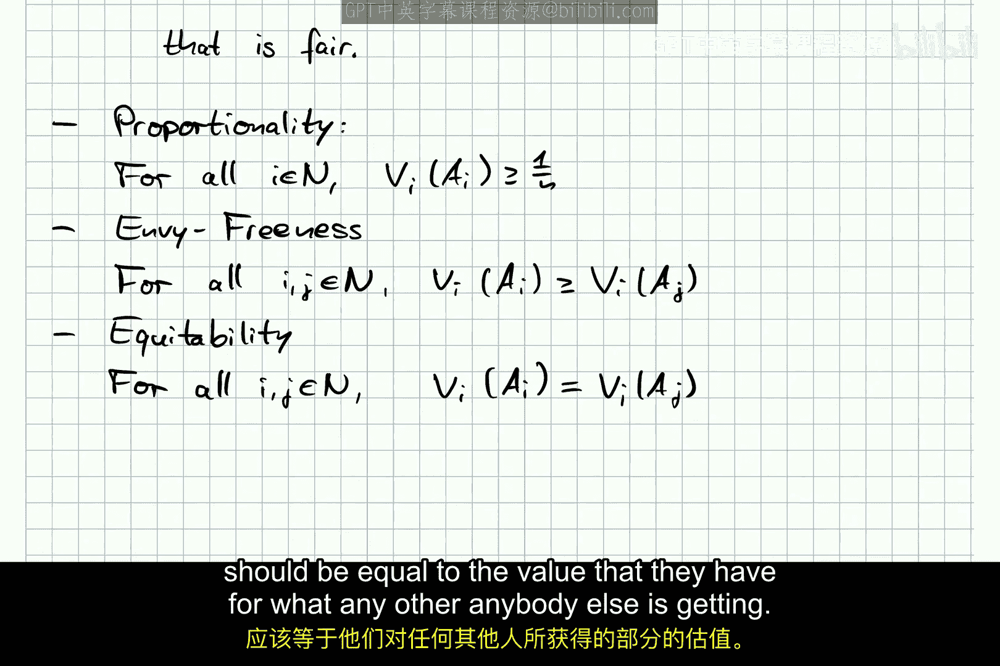
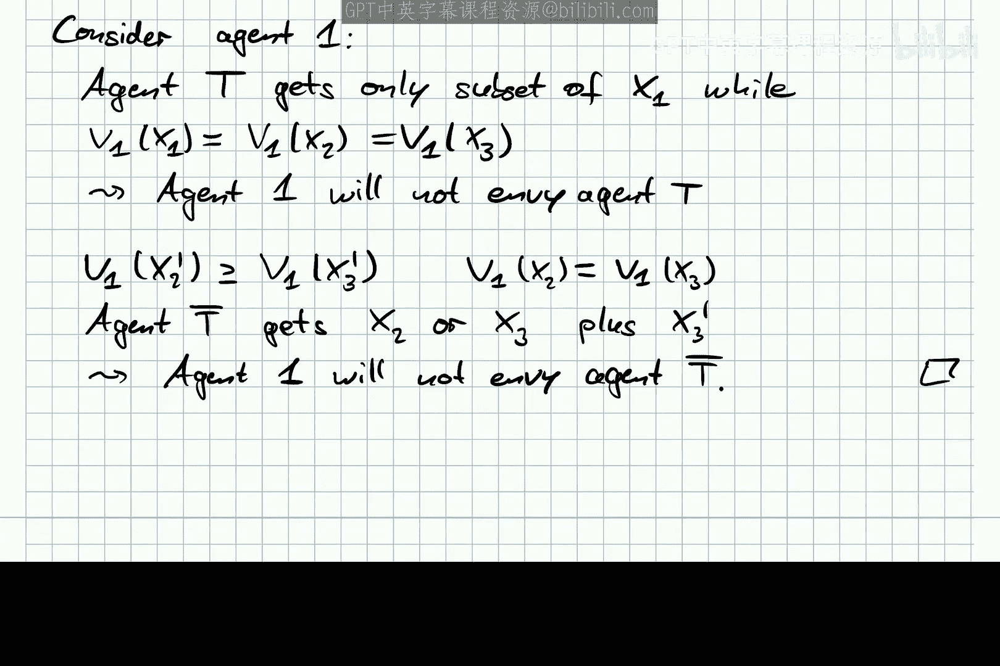

# 算法博弈论：第23讲：蛋糕切割 🍰

在本节课中，我们将学习一个无金钱的机制设计问题：公平分配。具体来说，我们将探讨如何公平地分配一个可分割的资源（例如一块蛋糕），其中每个参与者对不同部分有不同的偏好。

## 公平分配问题建模

上一节我们引入了机制设计的概念，本节中我们来看看如何将“分蛋糕”问题形式化。

我们将蛋糕建模为一个从0到1的区间 `[0, 1]`。一块蛋糕“块”就是这个区间内若干个子区间的并集。我们有 `n` 个参与者，每个参与者 `i` 都有一个估值函数 `V_i`。我们假设存在一个密度函数 `v_i(x)`，使得对于任意蛋糕块 `X`，其估值等于密度函数在该块上的积分：

**公式：** `V_i(X) = ∫_X v_i(x) dx`

这个估值函数在不同区间上是可加的。我们假设每个参与者对整个蛋糕的估值都是1，即 `∫_0^1 v_i(x) dx = 1`。这意味着参与者们对蛋糕总价值的看法一致，但偏好不同部分。

## 公平性定义

在探讨如何分配之前，我们需要定义什么是“公平”。由于每个参与者对蛋糕价值的看法是主观的，公平性有多种定义。

以下是三种主要的公平性概念：

1.  **比例性**：每个参与者都认为自己至少获得了 `1/n` 份额的蛋糕。
2.  **无嫉妒性**：对于任意两个参与者 `i` 和 `j`，参与者 `i` 对自己所得份额的估值，不低于他对参与者 `j` 所得份额的估值。
3.  **均等性**：每个参与者都认为所有人（包括自己）获得的份额价值完全相同。

比例性是最弱的要求，无嫉妒性更强，而均等性是最强的要求。一个均等性的分配必然也是无嫉妒且成比例的。

## 两人分蛋糕：切与选

对于最简单的两人情况，有一个著名且直观的协议：**切与选**。

**协议描述：**
1.  参与者1在蛋糕上选择一个切割点 `t`，使得从他自己的视角看，区间 `[0, t]` 和 `[t, 1]` 的价值完全相等（都等于1/2）。
2.  参与者2从这两块中挑选他更喜欢的一块。
3.  参与者1获得剩下的那块。

**性质分析：**
*   **比例性**：成立。参与者1对两块估值相同，均为1/2。参与者2选择了对他而言价值不低于1/2的一块。
*   **无嫉妒性**：成立。参与者1对两块估值相同，因此不嫉妒参与者2。参与者2得到了他更偏爱的一块，因此也不嫉妒参与者1。
*   **均等性**：不一定成立。例如，若参与者1的密度函数恒为1，而参与者2只喜欢前半部分（密度函数为：`[0, 0.5]`区间为2，`[0.5, 1]`区间为0）。参与者1会在 `t=0.5` 处切割，参与者2会选择前半部分。此时，参与者1对自己和对方份额的估值都是1/2，但参与者2对自己份额的估值是1，对对方份额的估值是0，并不相等。

值得注意的是，切与选协议在参与者可能策略性谎报偏好时，并不是激励相容的。

## 多人比例性分配：移动刀协议

现在，我们来看看如何为任意数量 `n` 的参与者找到一个成比例的分配。思路是“切与选”协议的推广，称为**移动刀协议**或**Dubins-Spanier协议**。

**算法描述：**
1.  初始化剩余蛋糕区间起点 `t_0 = 0`，剩余参与者集合 `N_1 = {1, 2, ..., n}`。
2.  对于 `k` 从 1 到 `n-1`，重复以下步骤：
    *   对于当前剩余参与者集合 `N_k` 中的每个参与者 `i`，计算一个点 `t_{k,i}`，使得从他视角看，剩余蛋糕 `[t_{k-1}, 1]` 中从 `t_{k-1}` 到 `t_{k,i}` 这部分的价值恰好等于 `1/n`。
    *   令 `i*` 为所有 `t_{k,i}` 中最小的那个对应的参与者。
    *   将区间 `[t_{k-1}, t_{k}]`（其中 `t_k = t_{k, i*}`）分配给参与者 `i*`。
    *   更新剩余参与者集合 `N_{k+1} = N_k \ {i*}`。
3.  将最后剩余的蛋糕区间 `[t_{n-1}, 1]` 分配给最后剩下的那个参与者。

**算法正确性（比例性）证明：**
关键在于一个归纳不变式：在每一步 `k`，对于任何仍在集合 `N_k` 中的参与者 `i`，他对当前剩余蛋糕 `[t_{k-1}, 1]` 的估值至少为 `(n - k + 1) / n`。
*   **基础情况 (k=1)**：根据定义，每个参与者对整个蛋糕 `[0,1]` 的估值都为1，即 `n/n`。
*   **归纳步骤**：假设在步骤 `k` 不变式成立。在步骤 `k`，被选中的参与者 `i*` 获得的蛋糕价值正好是 `1/n`。对于其他任何仍在集合 `N_{k+1}` 中的参与者 `i`，由于 `t_k` 是所有候选切割点中最小的，因此参与者 `i` 对区间 `[t_{k-1}, t_k]` 的估值 **不超过** `1/n`。结合归纳假设（他对 `[t_{k-1}, 1]` 的估值至少为 `(n-k+1)/n`），可以得出他对剩余部分 `[t_k, 1]` 的估值至少为 `(n-k)/n`，这正好是步骤 `k+1` 时所需的形式 `(n - (k+1) + 1)/n`。

这个不变式保证了：1) 在每一步，总有一个参与者能找到满足 `1/n` 价值的切割点；2) 最后剩下的参与者对最终剩余蛋糕的估值至少为 `1/n`。因此，最终分配是成比例的。

然而，这个分配**不一定无嫉妒**。第一个获得蛋糕的参与者可能会看到后来的参与者获得了（在他看来）价值远超 `1/n` 的大块剩余蛋糕，从而产生嫉妒。

## 三人无嫉妒分配：Selfridge-Conway 协议

获得无嫉妒分配要复杂得多。这里介绍一个著名的、需要最多5刀（产生6块）的三人无嫉妒分配协议：**Selfridge-Conway协议**。

**协议分为两个阶段：**

**第一阶段：修剪与初次分配**
1.  **切分**：参与者1将蛋糕切成3块（X1, X2, X3），使得在他看来，这三块价值相等。
2.  **排序**：让参与者2对这三块进行排序（从最喜欢到最不喜欢）。必要时重命名蛋糕块，使得参与者2的偏好顺序为：X1 > X2 > X3。
3.  **修剪**：参与者2从最喜欢的X1上切下一小块（称为X‘），使得在他看来，修剪后的X1（即X1 \ X’）与X2价值相等。
4.  **选择**：让参与者3从 {修剪后的X1, X2, X3} 中选择最喜欢的一块。
5.  **分配**：
    *   如果参与者3选择了 **X2 或 X3**，那么参与者2获得 **修剪后的X1**，参与者1获得剩下的一块（X2或X3）。
    *   如果参与者3选择了 **修剪后的X1**，那么参与者2获得 **X2**，参与者1获得 **X3**。

此时，被切下来的小块X‘尚未分配。

**第二阶段：分配修剪块**
1.  令 **T** 表示在第一阶段获得了“修剪后的X1”的参与者（可能是参与者2或3）。令 **T̅** 表示另一人（参与者2或3中不是T的那个）。**关键点：参与者1永远不会是T**。
2.  **切分**：参与者 **T̅** 将小块X‘切成3块（X1‘, X2‘, X3‘），使得在他看来，这三块价值相等。
3.  **选择**：
    *   参与者 **T** 首先从这三块中选择一块。
    *   接着，参与者 **1** 从剩下的两块中选择一块。
    *   最后，参与者 **T̅** 获得最后剩下的一块。

**无嫉妒性简要论证：**
*   **参与者T**：他在第一阶段获得了（在他看来）不差于X2和X3的“修剪后的X1”；在第二阶段他最先选择，获得了X‘中（在他看来）最好的一块。因此，他对自己总所得（修剪后的X1 + 所选X‘块）的满意度，不低于任何其他人可能获得的总组合。
*   **参与者T̅**：他在第一阶段获得了（在他看来）三块中最好或次好的一块（具体取决于参与者3的选择）；在第二阶段，他是切割X‘的人，确保三块在他眼中价值相等，且他最后选择。因此，他也不会嫉妒他人。
*   **参与者1**：他是最初的切割者，三块在他眼中价值相等。第一阶段他得到的X2或X3，价值等于最初的X1。而参与者T得到的是X1的一个子集（修剪后的X1），所以参与者1不嫉妒T。在第二阶段，参与者1先于T̅选择，因此他获得的X‘块不差于T̅所得。结合第一阶段的情况，他也不会嫉妒T̅。

这个协议虽然复杂，但保证了三人情况下的无嫉妒分配。对于更多参与者的无嫉妒分配，存在算法但极其复杂。一个重要的理论成果是，对于任意 `n` 个参与者，存在一个有限步内完成的无嫉妒分配算法，且切割次数有一个只依赖于 `n` 的上界。

## 总结

本节课中我们一起学习了蛋糕切割这一经典的公平分配问题。
1.  我们首先将问题形式化，用密度函数和积分来描述参与者对不同蛋糕部分的偏好。
2.  接着，我们定义了比例性、无嫉妒性和均等性三种公平标准。
3.  对于两人情况，我们分析了简单直观的“切与选”协议，它满足比例性和无嫉妒性，但不一定满足均等性。
4.  对于多人情况，我们介绍了“移动刀协议”，它能保证为任意数量的参与者找到成比例的分配。
5.  最后，我们探讨了更复杂的公平性——无嫉妒性，并详细介绍了需要两个阶段、最多5刀切割的Selfridge-Conway三人无嫉妒分配协议，理解了其保证无嫉妒性的逻辑。

蛋糕切割问题展示了在没有货币转移的情况下，设计满足特定公平性准则的分配机制所面临的挑战和精妙之处。