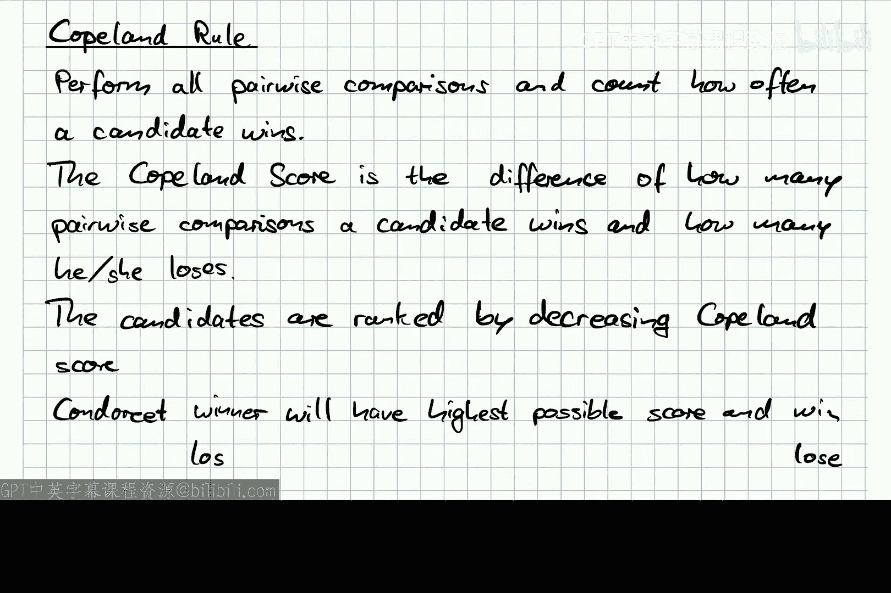
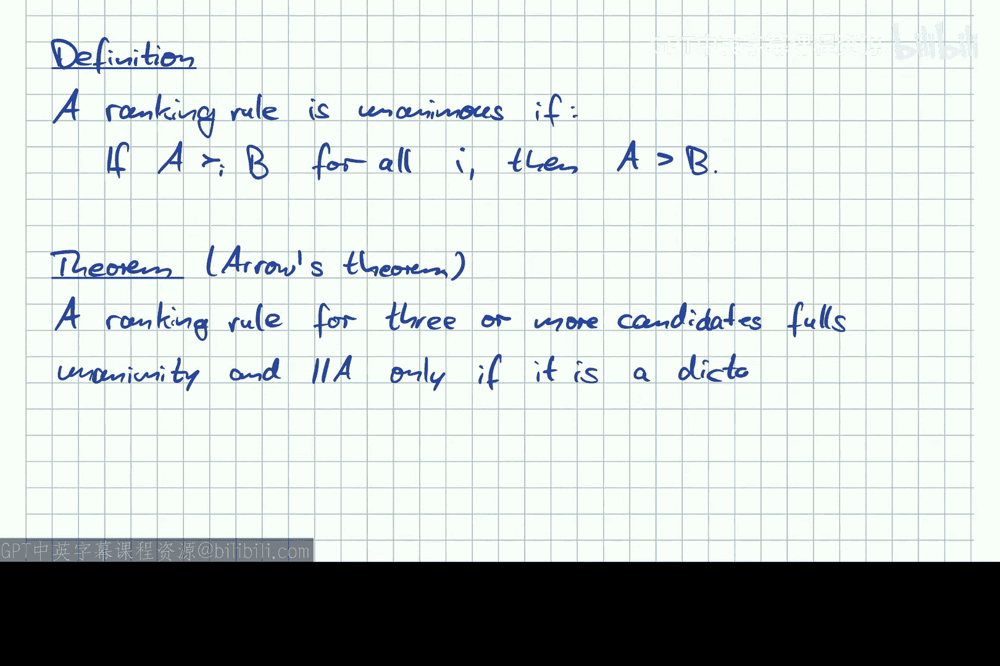

# 波恩大学《算法博弈论｜Algorithmic Game Theory, Winter 2020-21》中英字幕（claude-3.7-s p25 AGT, WS20_21_ Lecture 24 (Voting).zh_en -BV1m9ZyYoENg_p25-

Welcome back to algorithmthic game theory。Today we'll be discussing a topic and mechanism design for which at least for most of us。

 it is clear that it should not involve any money， namely voting。

So what could this mean we might want to design， for example， a presidential election。

 we have multiple candidates， and then we have to determine who will win presidency。

And this might mean that each voter will just say who's their preferred candidate or they may tell us even more that's up to our particular design。

And if you have only two candidates， then there is a very standard format for this， namely。

Who wins the election， the one who got more votes than the other。

 setting now the issue of tie breaking aside because this rarely happens that two candidates would get the exact same number of votes。

And this。Is。Used very widely， and it is also used for a good reason。Why that。

 because only a minority of the voters will not be happy with the outcome。

The majority of voters will say， okay， this is my preferred outcome。

 and in this way there is no better outcome than this one。

But things get much more tricky when you have three or more candidates。

And probably you've seen this also happening。In the elections， for example， for a mayor。

That then suddenly you think， okay， I could now vote for my favorite candidate。

 but he or she has really small chances， so I might want to support my second favorite candidate just because。

 well， he or she is likely to then get at least a plurality。

Of the votes and this way get more votes than the guy that I really don't want to have。

So there there is some strategic voting involved， and that's one of the questions we should ask。

Are there ways to avoid this that。The voters will behave strategically。

 will have to behave strategically。And also， before that， we should ask the question。

How do we even determine the winner， so even if everybody told us？Who they prefer most and。

Whos their second favorite candidate and so on， How would we then determine the winner because there are better and worse rules？

But before we start all this， let's first introduce a formal model。Because。

This is again the problem that we are in a setting without money。

 so there is no just there are no monetary units in which we can express， okay。

 I like this candidate this much， but instead we'll again define a preference order。So formally。

 this will look as follows。We will have N agents。Capital N again， and we have M candidates。

And we call the set of candidates， gamma， capital gamma。Each agent。还是。Complete。Preference list。

Over gamma。We ties。And we will now use the following notation。We will write。

A is preferred over B is preferred over C。With a subscript I if。Agent I。Prefers。A in Gamma。Over。

Be in gama。😔，And。Bi。😔，Oversea。This， of course， implies。That。As I also prefers A over C。

 so we'll have transitivity。And what are now our problems？There is the voting problem。

Which is the following。Given all these preference orders。We'll have to。Determine one winner。

From Gamma。And we'll have the ranking problem。Which asks us not to only determine a winner。

But a full ranking of all candidates。So。Again， we're given all these。Preference orders。

And our goal will be to determine a society ranking。Of all candidates。

This means that besides only finding a winner， we'll also have to say who is in second place。

 who's in third place， and so on。So our goal will be now to design a ranking rule or a voting rule。

 depending on which problem we're in these two problems are very similar。

 the ranking problem of course asks us to do more， but generally you should think of them as very。

 very similar because also the fundamental things are the same。So what makes this difficult？😮，Well。

 we are now given these preference orders of the individual agents。

And somehow we'll have to find a compromise， maybe however you want to call this。

 and we don't have any objective functions so。This is actually up to our design of what we now think is a good outcome。

 for example， for this voting problem。One way you could approach this is to say， okay。

 I'm going take just a random。Winner from Gamma， or I take the one who gets the least number of votes。

In other words， you take these preference orders and then you say， okay。

 and there are now multiple versions of this， for example， who's。Voter who's。

At the worst position in the plurality of these preference orders or whose。嗯。

The first choice for the least number of agents。 All of this， of course， doesn't make real sense。

 but why。Why isn't this a good voting rule to choose。The the candidate who。

The fewed voters actually like。This is something that we'll have to formalize。嗯。

We've all seen examples of voting and ranking rules。

And I'd like to now first discuss these and discuss how they fit into our framework and to what extent they turn out to be good or not a good ranking group。

Or voting room。And the first one I'd like to consider is plurality voting。How does this work？

In plurality voting， you just have one vote each。Voter has one vote， and they just。Tell。

The mechanism， which of the candidates they prefer most。

And then whoever got the most votes wins the election。This。

 we first have to translate into a voting rule in our sentence， because we said okay。

 a voting rule takes us input the。The preference orders。

And how could we now design this plurality voting， we would just only care about the most preferred of the candidates in each of the preference orders。

 and then we would simply count how often is one candidate the most preferred？So what we'll do is。

For each candidate。K。The number of agents。你 prefer。This candidate most。

The candidate with the highest number wins。And if you like。

 you can also turn this into a ranking rule by now saying， okay， who got the？Who's the second。

 whose second ranked second in this counting year， this one then will be second in the society ranking and so on。

Is this good？😮，Well。It does have some advantages。But we've also seen some disadvantages。

 probably if there are two candidates from more or less the same party。

And there is a third candidate who's from a different party than it might be that。

The voters actually prefer the party of the first two candidates， but none of them。Is。

Is then getting more votes than the third candidate， although all voters would prefer。

Or the majority of voters would prefer one of the first two candidates， so more precisely。

We could have the following。We could have that。35% of the voters。Prefer A over B over C。

25% of the voters prefer B B over a。Overs。And 40% of the voters prefer C over verb。A over。Bi。Now。

 what happens here is that。60%。Of the voters。Prefer。One of。A or B。Oversea。Bed sea wins。

And this is exactly the problem that I was alluding to earlier。

 here we'll see an example where you would probably in reality be。

Vote strategically and if you were among these 25%。

 maybe you would decide to also vote for candidate A so that he or she gets above the 40% of candidate C。

One alternative is to change this voting system and to introduce a runner vote and that's something you often see in practice。

 you'll see this in mayor elections in Germany or also in the presidential elections in France that。

You。Do all of this。 But then among the two highest ranked candidates。

 the two candidates who got the the highest number of votes。 among these， you'll have a runoff vote。

 and then whoever gets the majority in that runner vote then wins。

So how does runoff voting fit into our framework？Will， again。Count the preferences。

As in plurality voting。And。Among be。Two candidates。苏泊尔。Rananged highest， most often。

And what we'll then do is we'll ask， are there？More I， for which。X is preferred over y。我。For which。

Y is preferred over x。And。The candidate who gets the majority。Winds。Okay。

 so this why do we implement this， why is this so often seen in practice？

It is just because usually there would be two more polarizing alternatives and often then you'll see then in the runner vote。

 you'll see these two polarizing alternatives and then you still have to decide。Of on one of these。

But given that we have the complete rankings， we can even go a step further than this and not just do this one runner vote。

 but we can do instant runner votes。And this way， eliminate one candidate after the other。

So this is called instant runoff vote。😮，And。What we'll do is we'll iteratively。Eliminate。

The candidate。Who is the ranked highest？Leasst often。Among the remaining candidates。

That's also a format that you might have seen before。

 so at least I know this from casting shows on TV， that what they do is that in each week one of the candidates gets eliminated。

 namely the candidate who got the smallest number of phone calls， for example。

And this seems to be just moving this idea of runnerloading further。嗯。And。In both cases。

 you can ask the question， does this eliminate the problematic strategic behavior that we saw with plurality voting that you actually wouldn't vote for your preferred candidate？

Yes， that can still happen。How so。We might have 30%。Who prefer a。Over B， Over C。Well have 45%。

Preferring B over C over A， and we'll have another 25%。Preferring C over A over B。

And what makes this now？Athlete a。Difficult example is that you see here this strange。

Cyic preferences that。Actually， somebody prefers a over B over C。 and then the next group of people。

 they prefer actually B over C over a， and then it's C over A over B。

 So this clearly does not have this party structure that you think， okay， people say they prefer a。

It was one of a over B compared to C or something like this。

 this is not happening here and indeed what we'll see here is。That who wins？

Who gets eliminated first？C will get eliminated first because he gets the smallest number of votes in the first round。

And then。These here prefer A over B， so we'll have to add these 25 to the 30。

 and so then candidate A wins。But there is the。AndThe 45%。What if they instead they all prefer C？

That if they all voted for C in the first round， then in the first round。A would get eliminated。

And this would make this group of people happier。So， there is。Just some strategic behavior possible。

 somehow strategic behavior will turn out to be in the interest of at least these 45%， of course。

 all of them would have to agree。To do this。 and this would only work in a setting of full information。

What we see here is that a wins。But。😔，If the 45%。Report。That they prefer C over B over A。Then。

 seawins。Which they prefer。Good。😡，Now。What's an alternative， Is there anything that is better。

 Is there anything that avoids strategic behavior？Yes。

 there is an example of a voting rule which avoids strategic behavior。

And I guess you've seen that also。But you don't like it。Namely， this is called dictatorship。

How does this work， this is really easy。As the society ranking。Take the preferences。

Of one sixth agent。Yes， and this。We can also use as a voting rule。

 namely whoever this agent prefers most。This will be the winner of our election。

The amazing thing about this is that here。Strategic behavior boom。Help you。

If you're not this fixed agent。Then it doesn't matter what you're voting， because。Nobody cares。

And this fixed agent。Well， they can just report whatever they prefer most because this is what's going to happen。

But at the same time， we feel， okay， this is maybe not the kind of。

Voting or ranking rule that we like。 So let's now talk about properties of voting or ranking rules that we do like。

 What is it that makes such a voting or ranking actually fair。

Who should win elections What would we consider an appropriate voting or ranking rule？

We'll now introduce a couple of properties and then we'll see whether these are fulfilled or not fulfilled for the examples of the voting route that we've already seen。

 and we'll also introduce further voting rules for which we will verify them or not。

And these properties are as follows。One thing that we might be asking for is anonymity。

What do I mean by that？I mean， that the identities。Of the agents do not matter。

Which means nothing bad than thee。Outcome。on。The preference profile。

For the agents in order1 through n。Is the same。As what we're getting if we're peruting。This profile。

Another one is monotonicity。If one agent？Moves up。One are the candidates？And he's a herb。

Private ranking。Then the candidate should not move down。In the society ranking。Or。In particular。

 if we're speaking only of a voting rule， this also means that。If I now say， okay。

 I actually prefer this candidate more than before everything else remains the same。

 so this candidate just goes up in my personal ranking， then to in my personal preference order。

Then in the society， in the voting outcome， it should not happen that before this candidate was winning the election and now suddenly he or she is losing the election。

There's another。Or there are two more properties， the first one is the so called condse。

Winner criteriaion。Which is the following。If there is。Some a such that。For all B。There are。More I。

We prefer A over。B。Then。B over a。Then a is the winner of the election。Let's once again digest this。

If there is a candidate A。For which the falling holds， we now just。Consider all pair wise。

Votes that we could run for a with any other candidate B。

And we call a a conse winner if a wins all of these pair wise。Votes。And if a always wins these。

 then we call a a conr C winner。And they can of see winner crer in that。For such a conse winner。

It should be that this conse winner is winning the entire election。So also。

 when we now have all candidates together and not just the pair wise comparisons。Annaously。

 we can also define a conse lose criterion。Which is the same thing， but with losing so。

If there is some A。Such that。For all B。There are more I。喂。B is preferred over a。Then。

 a is preferred over。Bi。Then， a。Does not win the election。

So what is this trying to formalize if there is somebody that actually nobody likes in the sense that。

Which is not quite true。 But if there， if this somebody。

Is never preferred in any pair wise comparison by the majority of the people， then this。

Candidates should not win the election。And this can or can not be fulfilled depending on what voting or ranking rules you apply。

And let's now see what how。Our examples perform。Let's come back first to plurality voting。

And let's recall。The example that we had before。Namely that 35% prefer A over B over C。

 25% prefer B over A over C and 40%。Prefer C。Over A。 over B。Is there a conse winner here。

 Is there a conse loser， yes， both。Namely， I claim that A is the Conency winner。

What do we have to now see to verify that A is the conse winner and we'll have to。

See the what happens in the pairwise comparisons。 So how does A perform in comparison to B。

 how many prefer A over B。It's these 35% and these 40% will prefer a over B。

And at least 25% would prefer B over a， so the majority prefers A over B in the pairwise comparison and how about A versus C。

 these 60% prefer A over C， whereas these 40% prefer C over A。

And this way we see that a is the Conse winner。Same thing about C being the conse loser because C will lose。

Both pairwise comparisons B will lose the pairwise comparison against a。Because these 60% prefer。嗯。

A over C。And only these prefer C over a。 and the same you get regarding。

Who prefers C over B or vice versa？So we'll see that。A is the con se winner。C is the con say loser。

Bt。😔，A， but C wins。So this does not fulfill the Con C winner criterion nor the Con C loser crion。

Runner vote an instant run of vote is a little bitter because it at least fulfills the conency loser criterion。

Why that， because the country say loser would never survive the final round of the runoff vote where there's only a pairwise comparison。

However， it does not fulfill the consse winner criteria。Let's have a look at another example。

Namely the。Board account。And positional voting。Positional voting is a pretty general way of designing a ranking or a voting rule。

 namely what we'll do is。We will define。A1。A2 and so on up to AM。If we have M candidates。

And what we'll do now is。Determine。A score。For each candidate。Namely。For every eye。嗯。Rans。

The candidate。At position J。We'll add。AJ。To the score。And then the society ranking。It's just y。

Candidates。我ard。😔，By decreasing score。So one easy example would be。Setting a one to one。

And all other A's。To0， this will be exactly。Pluralality voting。Bt you can also do other things like。

 for example， have a。More refined way of。Defining these scores namely， for example。

 there's the board account。Which says the first。1 to M， the second one to M minus-1。And so on。

 up to the last one， getting one。This is called the board account。And to understand this。

 let's go see what's happened in our example。Well again， have 35% preferring A over B over C。25%。

Will prefer。Be over。A over C。And 40% will prefer。C over a over。B， and if we now have 100 voters。

Then we'll get。35 times。3 points for。Candidate A from the first group plus。25 times。Two points。

for candidate a plus forty times。Two points。So， in total。This will be。235 for candidate a。

And analogously， we get 185 for candidate B。And we'll get。1084 candidate C。So in this case。

 we would have。A being ranked。Over B， over C， And a would be。And the winner of our election。

 if we took the one with the highest。Score in the board account。

Where does this way of choosing the numbers come from。

 it comes from the fact that you could also equivalently say I do all possible pairwise comparisons and I just count how many votes does every candidate get overall so what we'll do is we'll first do the comparison A versus B。

And then we'll do the comparison。A versus C， and then we'll do the comparison B versus C。

And then the ranking that you're getting this way will be exactly the same。Theres also。

There are many other rules like this。😮，For example。You might have also seen this one。A1 is 12。

A2 is 10。A3 is 8。A4。Is 7。A5 is 6。A6 is5。A 7 is4， a 8。Is3。A 9 is 2。A10 is one， and or others。R 0。

This would be。The way that the Eurovission song contest was。

So I don't see any particular reason why to use this way of assigning the scores， why is it that？

D1 who gets the most votes， gets 12 points。And not 20 or whatever you prefer。That's just， I think。

 to some extent， up to personal taste。Now the question of course we could ask and we should ask is how about Conorsse winners and Conorsse loses。

 do Conse winners always win， do Conse losers always lose？The answer is。

Deds consse winners do not necessarily win， so the consency winner criterion is not fulfilled。

And this is true for any of these rules。Why is this？We might have。Something like this。60%。

Of our agents prefer A over B over C and 40% prefer。B over see。Over a。Now。

 who will win the border account。Actually。B。When's the board account？But A is the conse winner。

So we'll see here that agent A。Is actually would win。Of course， both Taiwan comparisons。

 they would always get 60%。So this makes him or her the con say winner。But。

He's not the winner of the board account。And。Maybe that's for good reason because do we actually want a to win the election。

 because these 40%， they apparently don't really like it？

Candid A seems to be much more polarizing than B， B everybody can live with， but A。

 some people love him， some people hate him。So this is just not taken into consideration by the conse winner criterion。

 the conse winner criterion only does these pairwise comparisons。

 and it does not take into consideration how much people like this or that candidate。

 It is only about the。Pairwise comparisons。B。How about a voting rule that actually does fulfill the Con winner criterion。

 how could we build that？This would work as follows。This is just one possible rule to do this。

 this is the so calledled Copeland rule。You will just do。All pairwise comparisons。And。Count。

How often。A candidate。Winds。And then we say that the Coland score。Is。The difference。As how many。

Pairwise comparisons this winner and this candidate wins。And how many you she loses。Then。

 the candidates。Arangeked。By decreasing Copeland score。So if we have M candidates。

Each of the candidates will go into M-1 pairwise comparisons。

 And this means that the Coland score will somewhere be between。And minus1。And negative M minus1。

And by design now， this fulfills the consency winner and the consency loser criterion。

Because a conse winner will have a Coland score of m minus1。

 whereas a conse loser will have the smallest possible score of negative m minus1。

And so the conse winner， if any， if there is a cone winner。

 this conse winner will have the highest possible score。

And nobody else will have this high score and if。There is a。Converse a loser。

 then also this con loser will have the lowest possible score。

Good。So one thing。We've seen is that there are different ways to design voting rules。

And it is actually not quite easy to answer the question， who should win the elections？

As a matter of fact， we didn't even talk about monotonity and anonymity here because they were always fulfilled。

 but that's not quite clear。There have been many examples in the past where。嗯。

Elections happening in reality， somehow if。People just voted differently somehow。 and by that。

 I mean if they。For example， voted。Quite the opposite of what they were voting。

 then somehow their preferred candidate would get would become better。收。

Those are certainly rules that one should keep in mind or criteria that one should keep in mind。

 there are even more criteria when designing a voting rule and what we see is that there are better and worse voting rules。

 although。You'll have to be careful by what you consider the best voting rule， just because。

Is the Conency winner criterion now desirable or isn't it？

Depends on what actually you feel is most important。However， there is one more aspect。To all this。

 namely strategizing。And this is something that even though I myself。

Probably have done multiple times in an election。Not voting for my preferred option。

 but because I saw that my second preferred option had a higher chance of winning than I voted for them。

嗯。Is this。Avooidable， are there。Voting rules thatt avoid this。This is what we'll discuss next。

Do agents want to misreport their preferences so that？Some candidate wins the election that。

Did not win before。When they were reporting the truth and somehow they prefer that candidate that wins now over the one that。

Wins when they report the truth。In this context of voting and ranking the property that agents。

Can improve the outcome in their favor by misreporting is called strategic vulnerability。

And we've seen that。哦。Voting rules we were discussing。

At least all the ones for which I mentioned this， those are at least are actually strategically vulnerable。

 we'll make this formal in just a second。Now， is there a voting rule that avoids all of this？

And unfortunately， the answer to this is no。This is quite a bummer。

And it's it's a very famous result in the context of voting that。Every。Reasonable voting rule。

Willll have to be strategically vulnerable。In the remainder。

 I'd like to give you an idea of how one can actually argue this。And。Also。

 we'll have to discuss the precise statement because there are， of course。

 voting rules which are not strategically vulnerable。But those aren't reasonable， in our sense。

So first of all， let's see。How we would define this。And let's only talk about ranking rules。

And we say that a ranking rule。Is strategically vulnerable。If there are the following。An agent I。

A preference profile。For all agents， so we'll have a preference for all agents。

And we'll also have an alternative。Preference report。For agent I。And we'll have two candidates。

A and B。Such that。Agent I actually prefers A over B。And。Bina gets ranked higher。Then， a。And。

A will get ranked higher than B。Where。This greater。Sign， this is just。The society ranking。Under the。

Zhu。Reports and the one with a prime would be if I now change。Agent I report。To the other preference。

And what we are looking， of course， for， of course， is。A ranking rule。

 which is not strategically vulnerable。Because that would mean that no agent would misreport strategically。

 which would make voting much easier。Then if you always have to keep in mind。

 how does this voting rule perform or this ranking rule？

And what we can do now is we can actually rephrase this property of strategic vulnerability in a different way。

 namely。We can say。An alternative definition。That a ranking rule。Is。Independent。

Of irrelevant alternatives。All for short iia。If。For any two candidates。A and B。

Given two preference profiles。For agents。And these two preference profiles are。

The same with respect to A And B in the sense that。A an agent， I prefers。A over B。

 whenever it does so in the other preference profile as well。So in that sense。

Looking only at A and B and not at the irrelevant alternatives。Then。A will be preferred over B。

If and only if。A will be preferred over B in the outcome of that other preference profile。So。

It takes it some time to digest this。And it's actually hard to write this down formally。

 but the idea is pretty simple。We'll have two candidates A and B。

And now look at the two preference profiles。And。With respect to only candidates A and B。

 they look exactly the same。And then we say， okay， the pairwise ranking of A and B。

That should be the same under both preference profiles。So。

If in this preference profile a is preferred over B。

 then the same should be true in that other preference profile and if it is not the case then to B is preferred over a。

 then this should also be the same in the society ranking， so all of these candidates BCD whatsoever。

 they shouldn't play any role， this is what we call independence of irrelevant alternatives。And now。

 the point is。The following。E a ranking rule。Does not。Ffi。😔，IiaA。It is strategically vulnerable。

So what this means is that。嗯。For roing rule not to be strategically vulnerable。

 it is necessary that this。Ranking rule also fulfills this independence of irrelevant alternatives。

And then to show that every reasonable voting rule is strategically vulnerable。

 all that you have to do is you have to show that it cannot be independent of irrelevant alternatives。

We won't have time to go through all the details of the proof。

 but let's at least talk about how one chose that thislemma， meaning that，If。

Independence of irrelevant alternatives is not fulfilled that then voting rule this ranking rule is strategically vulnerable。

So， if the ranking rule。Does not fulfill。Independ of irrelevant alternatives。

This means that there have to be。These two preference profiles。Such that。One candidate。And no。

Every agent。Prefers。A over B。In。Or the the agents that prefer A over B are the same in the first and in the second。

嗯。Preference profile。B。We'll have that。事实。In one case。

 A will be preferred over a B in the final ranking of society and in the other。

B will be preferred over a。And what you're going to do is。

We consider the sequence of ranking profiles。Which starred with the。Profile without the prime。

 and then they continue with the prime。And now what has to happen？

So what we have now is a sequence of preference profiles of this form。

And what will happen now is we'll start with T being equal to n。

In which case we have this preference profile and so。

A will be preferred over a B in the society ranking。And then reduce n one by one。

And eventually we will arrive at this profile。And then。Suddenly， B is preferred over a。

But what does this mean， This means at some point in between， there has to be a switch。Between。

Whether A wins against B or B wins against A。And the interesting thing is that this only depends on a single agent's report。

 because we are moving。We're changing just one agent's preference at a time。

 and in between there has to be the switch somewhere because this cannot be continuous because we'll always have to say that one of the two will have to win against the other。

And this is exactly the agent that can then misreport。收。There has to be。And I， such that。A。Is ranked。

Before。B。on。😔，The one where。Agent I is using。It's reporting the preference profile without the prime。

And B is ranked before I if we。Change almost nothing。Except for。The report of agent。i。And that。Eve。😔。

This agent actually prefers B over A。Then。Agent I can miss report。The one with a prime， instead。

Of the one without the prime。Or we might also have just the opposite。But then， and。

These are the things that we've seen so many times。That then we just do。

 they can just do mis report the opposite way。This is the kind of argument that we've actually seen before because。

The mechanism doesn't actually know whether B should be B is preferred over A or A is preferred over B。

And。If now the。The mechanism incentivizes truthful reporting。Then。

This has to work both ways so that if my true。If my true preferences are these。

 then I shouldn't report the others and also vice versa。Good。

 so the point that you should keep in mind here is exactly this that is there has to be some lack of continuity。

And some agents has to decide this at some point。And this is why this agent then does have some control over the outcome。

And now we can move forward。To actually stating the Iossibility theorem。To this。

 let's introduce one further。Peace。One further definition。We say that。A ranking rule。Is unanimous。If。

The following condition holds namely dead。If candidate A？Is preferred to。Bi。Byy every。Anc and I。If。

Candidate A is preferred to agent B。For all agents I。Then。😔。

Candidate A will be ranked better in the ranking than B。This feels like a very。

 very natural property for a ranking rule that if you。

If actually everybody agrees that A is better than B， then。Why on earth should。

A not be ranked higher than B in the society rank。But the annoying thing is that all of this together that we're asking now。

 all of this， which feels so natural， doesn't work together。And this is the following theorem。

This is called as theorem。Which says that a ranking rule。For three。Or more candidates。

Ffils unanimity。And independence of irrelevant alternative。Only。If it is。Yi。Dictatorship。

So a dictatorship， that's just a ranking rule， which just takes one agent's ranking and uses as the society ranking。

And now what this theorem is telling us is that， okay， this property， this felt so clearly natural。

But then combining this with the independence of irrelevant alternative， which。

Doesn't feel quite as natural， but is necessary。For a ranking rule not to be strategically vulnerable。

Well， all we end up then with is actually a dictatorship。Unfortunately， won't。

 we won't have time to go through the proof of this， but it's not extremely complicated。

 You've already seen with the， with the argument between。

Strategic vulnerability and independence of irrelevant alternatives。

That how these arguments will work。Because what then happens is that huges。

Compare many different preference profiles， you see that then one agent gets constantly one candidate is constantly ranked at the top or constantly ranked at the bottom。

And then you again go through this and see that one agent will actually make the difference whether this candidate will be ranked at the top or at the bottom。

And this then eventually also means because of the independence of irrelevant alternatives that this agent can also influence the rest。

Because this agent then can decide not to rank this candidate at the very bottom or very top。

 but anywhere in between and this is then due to the independence of relevant irrelevant alternatives。

 suddenly this agent can determine everything。This only works if you have three or more candidates。

 if you have only two candidates， then of course， all of this is not true。

Because what would you do then， well then there are only two rankings and what you then do。

 what you could do， for example， is just do a majority vote， which of the two。

Is actually more preferred。So， the。The crucial point is that the combination of this independence of irrelevant alternative。

Independence of irrelevant irrelevant alternatives， together with。

Three candidates that this will actually be problematic。In the lecture notes。

 you'll find more details about。How this proof works。 And there's also a an analogous theorem for。

Voting， which is the Gioslate theorem， which more or less states the same。

It is a little more difficult， it then relies on a theorem to prove it。But eventually， I guess。

At least I wasn't surprised to see this because。Once you see that you cannot do ranking。

 how should you be able to do voting because voting is so much related and if you had a way to do this。

AVoting without strategic。Without strategic vulnerabilities。

 then you could also translate this into a ranking rule。

So it's a little unfortunate that we have to end our lecture on voting with。These very negative news。

But this still doesn't mean that there's no point in thinking about smarter voting rules。Namely。

 the one thing that you should definitely be asking is who should win the election。

 what is a good way to determine the society ranking or the winner of a presidency？And also。

 maybe you can somehow design。Ranking rules of voting rules。

 which are less strategically vulnerable than others。 And indeed， that has been done。 So if you then。

Only have preferences of the form。Of a form which are maybe expressed in terms of a political spectrum somewhere between left and right。

 And somehow this is the way is a possible way to express all the preferences。

 which means you wouldn't have like。Cclic preferences that somebody prefers A over B over C。

 somebody else prefers B over C over A， and then somebody prefers C over A over B。

 there indeed there are nontrivial strategic voting rules if you have this kind of a structure。

Overall， I think this is still a very important topic to think about and I hope that you have now have at least an understanding of what principles to keep in mind when to design voting or ranking rules and maybe also you've now at least somehow somehow adjusted your expectations that you cannot hope to get everything with your voting。

This is it for today。I hope you enjoyed this， please do let me know if you have any questions。

See you next time， stay safe， bye。