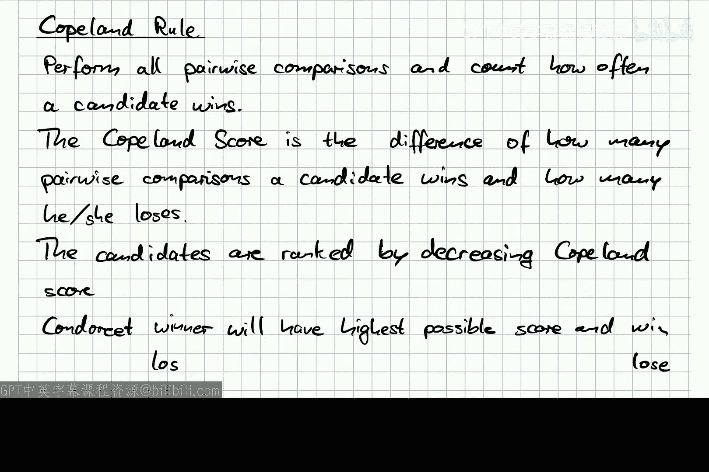
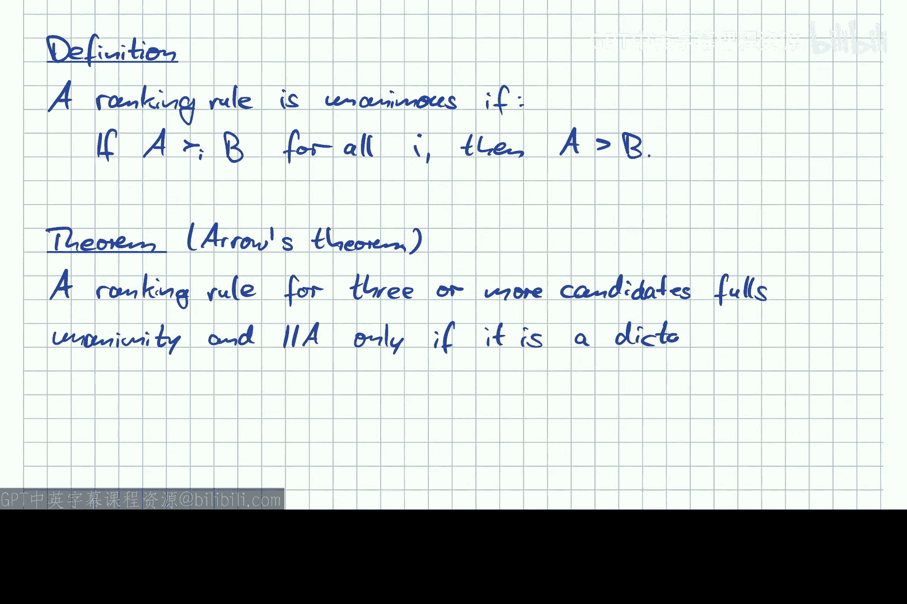

# 算法博弈论：第24讲：投票机制 🗳️

在本节课中，我们将学习一个不涉及金钱的机制设计主题——投票。我们将探讨如何设计选举机制，例如总统选举，其中包含多个候选人，需要决定谁将获胜。我们将介绍形式化模型，讨论不同的投票规则及其优缺点，并分析投票者可能采取的策略行为。最后，我们将探讨是否存在能够避免策略性操纵的“完美”投票规则。

## 形式化模型 📋

上一节我们介绍了投票的基本概念，本节中我们来看看如何形式化地描述投票问题。

我们处于一个没有金钱的环境中，因此无法用货币单位来表达偏好。相反，我们将使用偏好序来形式化模型。

*   设有 **N** 个智能体（投票者）。
*   设有 **M** 个候选人，记作集合 **Γ**。
*   每个智能体 **i** 对 **Γ** 中的所有候选人有一个**完整的偏好列表**（允许平局）。

我们使用以下符号表示偏好：如果智能体 **i** 偏好候选人 **A** 胜过 **B**，偏好 **B** 胜过 **C**，则写作 **A ≻ᵢ B ≻ᵢ C**。这隐含了传递性（即 **A ≻ᵢ C**）。

基于此模型，我们面临两个核心问题：

1.  **投票问题**：给定所有智能体的偏好序，从 **Γ** 中确定**一个获胜者**。
2.  **排序问题**：给定所有智能体的偏好序，确定所有候选人的一个**社会排序**（即排名）。

这两个问题非常相似，排序问题要求我们做得更多。但根本上，它们面临的挑战相同：我们需要根据个体智能体的偏好序，找到一个“折中”或“妥协”的社会结果，而这并没有一个客观的最优标准，完全取决于我们的设计。

## 常见的投票与排序规则 📊

我们已经看到了一些投票和排序规则的例子。现在，让我们系统地讨论它们，看看它们在我们的框架下表现如何，以及它们在多大程度上是“好”的规则。

以下是几种常见的规则：

### 1. 简单多数制（Plurality Voting）

在简单多数制中，每个投票者有一票，他们只需告诉机制自己最偏好的候选人。获得最多票数的候选人赢得选举。

**形式化描述**：
对于每个候选人 **k**，计算将其列为**最偏好**候选人的智能体数量。拥有最高数量的候选人获胜。

**转化为排序规则**：可以按此计数降序排列候选人，得到社会排序。

**评价**：
*   **优点**：简单直观。
*   **缺点**：可能导致“票源分散”问题。

**示例**：
假设：
*   35% 的投票者偏好：**A ≻ B ≻ C**
*   25% 的投票者偏好：**B ≻ A ≻ C**
*   40% 的投票者偏好：**C ≻ A ≻ B**

根据简单多数制，**C** 获得40%的票，**A** 获得35%，**B** 获得25%。因此 **C** 获胜。然而，有60%的投票者（前两组）实际上偏好 **A** 或 **B** 胜过 **C**。这促使投票者可能进行策略性投票（例如，第二组的投票者可能改为投票给 **A**，以确保 **A** 的票数超过 **C**）。

### 2. 两轮决选制（Runoff Voting）

为了缓解简单多数制的问题，实践中常采用两轮决选制。首先进行一轮简单多数投票，得票最高的两名候选人进入第二轮。在第二轮中，投票者在这两名候选人之间进行选择，获得多数票者获胜。

**形式化描述**：
1.  首先像简单多数制一样，计算每个候选人被列为最偏好的次数。
2.  确定得票最高的两名候选人 **x** 和 **y**。
3.  统计偏好 **x ≻ y** 的智能体数量，与偏好 **y ≻ x** 的智能体数量。获得多数的候选人获胜。

### 3. 即时复选制（Instant Runoff Vote, IRV）

这是两轮决选制的迭代版本。在每一轮中，淘汰当前得票最少的候选人（根据当前轮次投票者最偏好的选择），并将该候选人的选票按投票者的次优选择重新分配给剩余候选人。重复此过程，直到只剩一名候选人。

**形式化描述**：
迭代地**淘汰**在剩余候选人中被列为**最偏好**次数**最少**的候选人。

**策略性行为示例**：
即时复选制同样可能引发策略性投票。
假设：
*   30% 偏好：**A ≻ B ≻ C**
*   45% 偏好：**B ≻ C ≻ A**
*   25% 偏好：**C ≻ A ≻ B**

第一轮：**C** 得票25%（最少），被淘汰。**C** 的选票按次优选择转移给 **A**。
第二轮：**A** 得票 30% + 25% = 55%，**B** 得票45%。**A** 获胜。
然而，如果第二组的45%投票者策略性地在第一轮报告偏好 **C ≻ B ≻ A**，那么第一轮被淘汰的将是 **A**（得票30%）。随后在 **B** 和 **C** 的对决中，**B** 将获胜（45% vs 30%+25%=55%？这里需要仔细计算：若第二组改投C，则第一轮：A:30%, B:0%, C:45%+25%=70%，A被淘汰。第二轮：B vs C，原第一组30%投B，第二组45%投C，第三组25%投C，结果C以70%获胜。第二组更偏好C胜过A，因此这个策略是成功的）。这个例子说明了策略性报告的可能性。

### 4. 位置投票法 / 博尔达计数法（Positional Voting / Borda Count）

这是一种更一般的投票/排序规则设计方法。

**形式化描述**：
设有 **M** 个候选人。定义一组分数 **a₁, a₂, ..., a_M**（通常 **a₁ ≥ a₂ ≥ ... ≥ a_M**）。
对于每个候选人，计算其**得分**：每当一个智能体将该候选人排在第 **j** 位，就为其得分加上 **a_j**。
社会排序根据候选人得分降序排列。

**特例**：
*   若设置 **a₁ = 1**, **a_j = 0 (j>1)**，则等同于**简单多数制**。
*   **博尔达计数法** 是一种特殊的位置投票法，设置 **a_j = M - j**。即第一名得 M-1 分，第二名得 M-2 分，...，最后一名得 0 分。

**示例（博尔达计数法）**：
沿用之前的例子（100位投票者）：
*   35人：**A ≻ B ≻ C** -> A:2分, B:1分, C:0分 (每人)
*   25人：**B ≻ A ≻ C** -> B:2分, A:1分, C:0分
*   40人：**C ≻ A ≻ B** -> C:2分, A:1分, B:0分
计算总分：
*   A: 35*2 + 25*1 + 40*1 = 70 + 25 + 40 = **135**
*   B: 35*1 + 25*2 + 40*0 = 35 + 50 + 0 = **85**
*   C: 35*0 + 25*0 + 40*2 = 0 + 0 + 80 = **80**
社会排序为 **A ≻ B ≻ C**，**A** 获胜。

博尔达计数法的思想可以等价理解为：进行所有可能的成对比较，计算每位候选人在所有比较中获胜的总次数。

### 5. 孔多塞规则（Copeland Rule）

该规则直接基于成对比较，并满足某些良好的性质。

**形式化描述**：
对每一对候选人进行多数制比较。对于每个候选人，计算其**孔多塞得分**：**（赢的成对比较次数） - （输的成对比较次数）**。
社会排序根据孔多塞得分降序排列。

**性质**：孔多塞规则天然满足孔多塞赢家/输家准则（见下文）。

## 投票规则的理想性质 ✅

我们已经看到了一些投票规则。现在，我们来讨论一下哪些性质能使一个投票或排序规则显得“公平”。谁应该赢得选举？我们认为什么样的规则是合适的？

以下是几个重要的性质：

1.  **匿名性（Anonymity）**：智能体的身份不影响结果。即，对智能体偏好序进行任意排列，社会排序结果不变。
2.  **单调性（Monotonicity）**：如果一个智能体将其偏好序中的某个候选人**提升**（其他不变），那么该候选人在社会排序中的位置**不应下降**。特别地，对于投票规则，如果某个候选人原本获胜，在他被某些投票者提升偏好后，他不应反而失败。
3.  **孔多塞赢家准则（Condorcet Winner Criterion）**：如果存在一个候选人 **A**，在与所有其他候选人 **B** 进行成对多数制比较时都能获胜（即对于所有 **B**，偏好 **A ≻ B** 的智能体数量多于偏好 **B ≻ A** 的数量），那么 **A** 应该赢得整个选举。这样的 **A** 被称为“孔多塞赢家”。
4.  **孔多塞输家准则（Condorcet Loser Criterion）**：如果存在一个候选人 **A**，在与所有其他候选人 **B** 进行成对多数制比较时都失败（即对于所有 **B**，偏好 **B ≻ A** 的智能体数量多于偏好 **A ≻ B** 的数量），那么 **A** 不应该赢得选举。这样的 **A** 被称为“孔多塞输家”。

让我们用之前的例子检验这些规则：

*   **简单多数制**：在 **35%: A≻B≻C, 25%: B≻A≻C, 40%: C≻A≻B** 的例子中，**A** 是孔多塞赢家（对B: 75% vs 25%；对C: 60% vs 40%），**C** 是孔多塞输家。但简单多数制让 **C** 获胜。因此，它**不满足**孔多塞赢家准则和孔多塞输家准则。
*   **两轮决选制与即时复选制**：它们通常满足孔多塞输家准则（因为孔多塞输家不可能在最终一对一回合中获胜），但**不满足**孔多塞赢家准则（孔多塞赢家可能在前几轮被淘汰）。
*   **博尔达计数法（及其他位置投票法）**：**不满足**孔多塞赢家准则。
    **反例**：60% 偏好 **A ≻ B ≻ C**，40% 偏好 **B ≻ C ≻ A**。此时 **A** 是孔多塞赢家（对B: 60% vs 40%；对C: 60% vs 40%）。但博尔达计数下：
    *   A: 60*2 + 40*0 = 120
    *   B: 60*1 + 40*2 = 140
    *   C: 60*0 + 40*1 = 40
    **B** 获胜。这可能也有其道理：**A** 更具争议性（40%的人非常不喜欢他），而 **B** 所有人都能接受。孔多塞准则只关注成对比较，不考虑偏好的强度。
*   **孔多塞规则（Copeland）**：**满足**孔多塞赢家准则和孔多塞输家准则。孔多塞赢家的得分是 **M-1**（最高可能分），孔多塞输家的得分是 **-(M-1)**（最低可能分）。

关于单调性和匿名性，上述讨论的规则通常都满足，但并非所有想象出来的规则都满足。

## 策略性操纵与不可能性定理 🚫

一个关键问题是：投票者是否有动机谎报自己的偏好，以使得一个更受自己喜爱的候选人获胜？在投票和排序的语境下，智能体能够通过谎报改善结果的属性称为**策略易感性**。

我们讨论过的投票规则（除了一个特例）都具有策略易感性。那么，是否存在能够完全避免策略性操纵的投票规则呢？

令人遗憾的是，答案是：对于三个或更多候选人的情况，**任何“合理”的投票规则都必然是策略易感性的**。这是一个著名的结论。

下面我们来理解这个结论背后的逻辑。

首先，我们形式化定义策略易感性（针对排序规则）：
一个排序规则是**策略易感**的，如果存在以下情况：某个智能体 **i**，在给定其他所有智能体偏好报告的情况下，通过将自己的真实偏好序 **≻ᵢ** 改为另一个偏好序 **≻ᵢ'**，可以使得社会排序结果中，某个候选人 **A** 相对于另一个候选人 **B** 的排名得到提升（即 **B** 排在 **A** 之前变成了 **A** 排在 **B** 之前），而智能体 **i** 的真实偏好是 **A ≻ᵢ B**。

接下来，我们引入一个关键概念：**无关替代独立性（Independence of Irrelevant Alternatives, IIA）**。
IIA 要求：对于任意两个候选人 **A** 和 **B**，社会排序中 **A** 和 **B** 的相对顺序**只取决于**每个智能体对 **A** 和 **B** 的相对偏好，而与其他候选人的存在或顺序无关。换句话说，如果所有智能体在两种偏好分布下对 **A** 和 **B** 的相对偏好保持一致，那么社会排序中 **A** 和 **B** 的相对顺序也应该保持一致。

可以证明以下引理：**如果一个排序规则不满足 IIA，那么它就是策略易感的。** 直观上，如果社会对 **A** 和 **B** 的排序可以因为某些“无关”候选人 **C** 的偏好变化而改变，那么某个关键投票者就可以通过改变对 **C** 的报告（这是一种“无关”的谎报）来操纵 **A** 和 **B** 的相对顺序。

因此，要避免策略易感性，排序规则必须满足 IIA。

现在，我们引入另一个非常自然且合理的性质：**一致性（Unanimity）**。
一致性要求：如果**所有**智能体都偏好候选人 **A** 胜过 **B**（即对所有 **i**，有 **A ≻ᵢ B**），那么在社会排序中，**A** 必须排在 **B** 之前。

最后，我们陈述那个著名的**不可能性定理**（阿罗不可能定理，Arrow's Impossibility Theorem）：

> 对于**三个或更多候选人**，任何满足**一致性**和**无关替代独立性（IIA）** 的排序规则，必然是**独裁的**。

**独裁规则**是指：社会排序完全由某一个固定的智能体（独裁者）的偏好序决定。

这个定理意味着，如果我们希望排序规则满足一致性（极其合理）和 IIA（为避免策略操纵所必需），那么唯一的选择就是独裁规则——而这显然不是我们想要的民主投票规则。

对于投票规则，也有一个类似的不可能性定理（吉巴德-萨特思韦特定理，Gibbard–Satterthwaite Theorem），其结论类似：对于至少三个候选人的情况，任何非独裁的、且结果不是恒定的投票规则，都是策略易感的。

## 总结与展望 📝

本节课中，我们一起学习了投票机制的设计与分析。

*   我们首先建立了投票问题的形式化模型，定义了偏好序以及投票与排序两个核心问题。
*   接着，我们回顾并形式化描述了几种常见的投票规则：简单多数制、两轮决选制、即时复选制、博尔达计数法和孔多塞规则。
*   我们探讨了评价投票规则“好坏”的一些理想性质，如匿名性、单调性、孔多塞赢家/输家准则，并分析了各种规则对这些性质的满足情况。
*   最后，我们深入讨论了策略性操纵问题。通过引入无关替代独立性（IIA）和一致性概念，我们揭示了阿罗不可能定理的核心结论：对于三个或更多候选人的情况，任何满足一致性和 IIA 的非独裁排序规则是不存在的。这意味着，在一般的偏好设定下，完全避免策略性操纵的、令人满意的民主投票规则是一个不可能实现的目标。

尽管存在这些不可能性定理，思考如何设计更优的投票规则仍然非常重要。例如，如果投票者的偏好具有某种结构（如在一维政治光谱上从左到右分布），而不是任意的循环偏好，那么可能存在表现更好的、策略操纵空间更小的投票规则。理解这些基本原则有助于我们在设计现实选举制度或分析其性质时，保持清醒的认知和合理的期望。