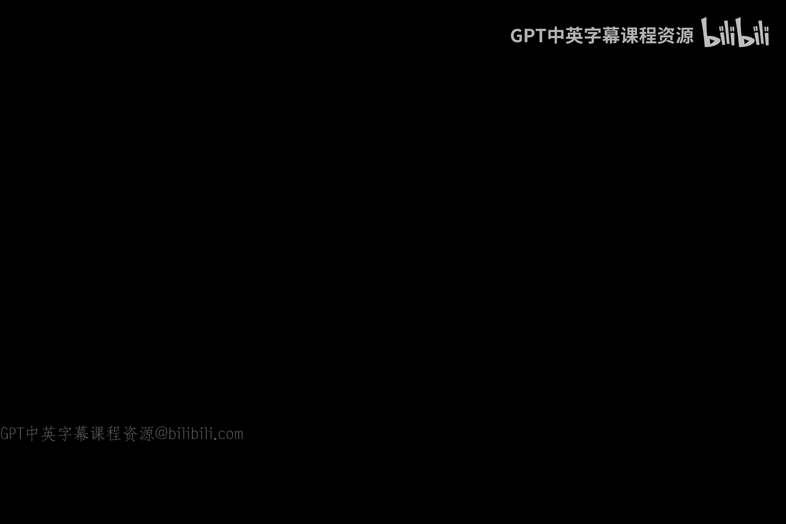
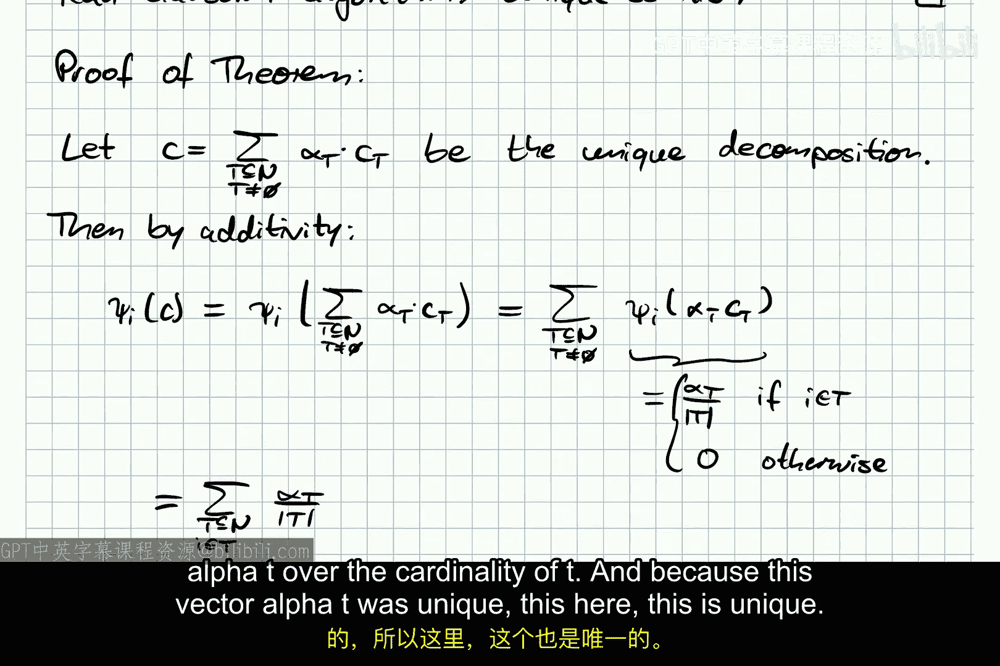

# 波恩大学《算法博弈论｜Algorithmic Game Theory, Winter 2020-21》中英字幕（claude-3.7-s p26 AGT, WS20_21_ Lecture 25 (Cost Sharing).zh_en -BV1m9ZyYoENg_p26-

Welcome back to algorithmgorithmic Game theory this will be our final lecture today。

 thank you very much for staying this lawn。Today we'll be discussing a topic which you could also call fair division。

 but usually it goes by the name cost sharing。What's the general problem？Well。

Suppose you and your friends want to buy a train ticket。

Now you can save money all of you together if you buy a group ticket then rather than buying all individual tickets。

However， the question will be， how do you split up the cost among all your friends？

So that everybody feels treated fairly。There are different ways of defining this。

Some of which have some advantages， other have other advantages。

 and today today will see two different approaches of how to split cost。

And what properties they fulfill？So let's first define a model。We have again， H N agents。

Which we again call capital n， and we have a cost function。That is just one cost function。Which maps？

From all subsets of the agents to a real number。So CFS， this is the。Cost。That。S would have。

On their own。And willll assume that。For the empty set， this is zero but for others。

 the cost can in principle also be negative。So what might that be？We might have a train ticket。

And we might have。5 agents。Then a single ticket。务比。5ive euros。A single ticket will be 2s。

And a group ticket。Will be 5s。So what would that mean the cost of a set of agents？

Will be the minimum。诶。Two times the number of agents in that said。And5。

So if it is just two people who choose to buy a ticket。

 then they'll have a cost of four if there's only one person who wants to buy a ticket will be a cost of only two。

But three or more agents， they immediately have a cost of five because they together can buy a group ticket。

So what will now be our question， our question will be to split up the cost that we have for the entire group of people。

 so CFN we want to split up among all agents。In n。So that。The cost， of course， will be covered。

 the overall cost will be covered。And each of the agents is treated in a fair way。So more formally。

好狗哦。Will be to find。It cost sharing vector。si of C。Which， of course， depends on the cost function。

Which now splits up。The cost among all an agents。And when all agents together。

They exactly cover the cost。Well， clearly there are different ways of defining such a cost vector in our example here。

 how could this look like we could， for example， say the first two agents each pay two euros。

 the next agent pays1 euro。Or the first agent pays all five euros and the other agents pay nothing or。

Each of the agents pays1 euro。Some of these we might consider。More appropriate than others。

 And this is exactly the question that we're asking today。 What is it that makes such a cost sharing。

Backctor， fear or。Appropriate， in any possible sense。The first way of choosing such a cost vector。

 a cost sharing vector I'd like to discuss now is the so called core。

For cost sharing vector to be in the core。Several properties， namely two， have to be fulfilled。

And these are the falling。We say that。Si of C is in the core。Of C。If。It fulfills。On the one hand。

 it should fulfill a property called efficiency。Which。We've already seen。

The sum of the individual cost shares should sum up to one。The sum of the individual cost shares。

Should sum to the cost of all agents together so the sum of the individual costs。

Exactly recover the social cost。And then we also have stability。Which means？The following that。

Some of the costs。Is no more than the cost。Of a set。For any。Sets of agents。

So no coalition pays more by this cost sharing factor than they would if they just did their own thing and。

Just for example， bought triet train ticket just for this group of people。Is there a。

Core outcome in our train ticket example。 Yes， there is。So， we had。C， F S to be the minimum。

Of two times the cardinality of s and5。Now， what might be a core outcome？We might， for example， said。

C I and Psi I of C equal to1。For all I。This will be in the core。Or。We might， for example。

 split up the cost。At the first to。Agents pay two。The next agent。Pace one， and。

The remaining two agents。被。😔，Nothing。This is also in the core。But。Having， for example。

 the first agent。Pay3， the second agent。Pay two and the remaining agents。Pay nothing。

 this will not be in the core。Why that？Because。The first agent。

Might decide to just buy a train ticket only for themselves。

And then this agent will pay only two euros because that was the price for a single train ticket。

 but here we are saying， okay， you'll have to pay three。Or also for the first two agents。

 they could also say our cost together is only four。So c of the set1 and2 is four。

 but here together we'll have to pay five。Good， soap。

While generally this first feels a little better than the second。

 I think this core already captures quite some properties that we would want to see fulfill in cost sharing。

Unfortunately， there is not always a cost sharing vector in the core。

 sometimes the core can be empty。When would that be。We could， for example， have three agents and。

The cost。For a set of agents。Would be the Carinality。And that set， divided by two rounded up。So this。

Maybe looks much more fancy than it is supposed to be。This cost function is zero， of course。

 for the empty set， for sets of cardinality 1 or two， it will be one。

 and for this set of all agents of all three agents， it will be two。

So in the language of train tickets， we can understand this。

Like they're being only group tickets for groups of up to two people now if two agents buy a ticket。

 they pay one for one ticket， but if all three agents want to buy a ticket。

 they have to buy two tickets。In principle， they could also take a fourth person。

 but there is no fourth person。And I claim now there is no cost sharing vector that is in the core。

Why is that？Forsi of c。To be。In the core。We would need。Ld。The cost is covered。

The cost that all three agents have together is covered。

The cost of the first and the second agent together， well， they shouldn't。

Want to buy just a ticket only for themselves， so this shouldn't be more than one。

And that holds for any pair of agents， so also for the first and the third agent。And also。

 for the second。And the third agent。And if you add up all these inequalities， then you'll see， okay。

 two timessi1。FC C plus two times Psi 2， F plus two times Psi 3， F， that'll be。At most three。

And this is， certainly。A contradiction。So。This core， this is a nice idea and sometimes。There is。

 indeed such a cost sharing vector， sometimes there isn't。Unfortunately。Of course。

 you might not ask the question， when is there a。V a cost sharing vector in the core so under what conditions is the core not empty？

But we won't be discussing this question today or in this class。

 but we would rather move to a different way of sharing the costs now。

Now we'll talk about the chapleplain value， which is a。

Different way of finding a cost sharing vector， which forholds a set of properties。And indeed。

 as we will show， not only does it fulfill the properties。

 but it is also the unique choice of a cost sharing record that fulfills these properties。

So what are these？We are talking about symmetry。If we now take two agents。And let's consider any。

Other set of agents。For which neither I nor J is contained。And if now。The cost。

After adding I will be exactly the same as the cost after。Adding J。Then， the cost chair should be。

The same。So。This is somehow representing。嗯。But we， for example。

 see in the example of these train tickets。Then there， all agents are actually exactly the same。

Why should they pay any different amounts。And this we can formalize in the following way。

If two agents have the property that。If we add them to any set， to any set that we might add them to。

 which contains neither of them before， then always the cost will be the same regardless of which of the two we add。

 then they should pay the same。There's another property which is the so called dummy property。

If for're an agent？For all sets of agents。The cost of。Adding that agent。Is equal。To zero。

 meaning that the cost after having added this agent is exactly the cost that we had before adding that agent。

Then。This agent should not be paying anything。This is also a very natural property。bit。

It is hard to come up with an example in reality， for example。

 if kids ride for free on the train then。😊，under all circumstances， even if they are alone。

 they don't pay anything。Then why should they get associated to some cost share in our cost sharing vector？

This is the dummy property。Now， one further property that we've seen a number of times。

We want the cost to be cost sharing vector to be efficient。So it should sum up to exactly the cost。

That all agents have together。And finally。Our third property。If we had take two cost functions。

 C and C prime。We should have that。The cost。That we associate to Age I。

When we are splitting up the cost of c plus c prime。

 this should be exactly equal to the cost that were that we assigning to agent I when we split up C and what we assign them when we split up c prime and so here this is。

The point wise。Some。Meaning that C plus C prime。Of S is nothing but C FS plus C prime of S。

So in other words。This addivity asks us to。Split up the cost so that if we buy， say。

Train tickets and theater tickets， then we should split up the cost exactly the same way as if we were only splitting up the cost of train tickets。

 plus if we were only splitting up the cost of the theater tickets。This also feels very reasonable。

So。Is there a way to always fulfill these properties， yes， fortunately there is， and not only this。

 there is even a unique way。But before we come to this uniqueness。

 let's first see how we can fulfill all these properties。And to do this。

What we'll do is we'll first define。An auxiliary function。Namely。

Let's take any permutation pi of the agents。And I will say P I of C come up high。

Will be equal to the following。Take agents。That are the first K in the order。

Of the permutation and from that， subtract。So take their cost and from that subtract。

The cost if agent K。对。Was not included。😮，Agent pi of K。And。This I wanna do where。K is equal to。

The inverse。Of the permutation of I。This looks very fancy， but it is actually something super easy。

 namely we now take any permutation of the agents， maybe for starters。

 let's just think of the identity permutation。So。😊，Agent1 will be at position one。

 Age 2 will be at position 2 and so on。 And now well take the cost of agents  one through I。

 And from that， we subtract the cost of agents 1 through I minus1。 So this will then be the。

Marginal costs so the cost increase that we incur by including agent I。

And we'll consider this for any possible permutation。

 so rather than just going through the agents in order one， two， three and so on。

 we might also consider them in order54 three，21 or whatever。So， seeing this。Again， in。More details。

With concrete numbers。Let's recall our example of the。Cost sharing function， which was。

Two the minimum of two times the cardinality of the set and5。Now， if we have。Pi of I equal to I。Then。

We have。Bd。Fhi of one。Couldt see come up on will be？Same as phi of2。C come up pi， namely two。

 the first two agents that we add， they will cost two。The third agent。They will still cost one。

And the。Fourth。And the5， fifth agent。They won't cost anything。Well， clearly。

 this does not fulfill our symmetry condition because now these agents。

 which were initially all the same， those now have to pay different amounts。

But this is exactly what the permutation is for， because now we could also alternatively consider them in order5。

4， three21。And then suddenly， agents four and five would have a cost of two。

 Age three would again have a cost of one and agents one and two then would have a cost share of zero。

And。The point of the Shay value is just to try out all possible permutations。

And just take the average of all these functions over all possible permutations。And by this。

 we will then also。Ensure that this symmetry condition is fulfilled。收。We will define。Agent eyes。

 Shaly value。Under cost function C。As。Si of C。Is equal to one over n factorial。Times。😔。

The sum of all permutations。F I F C， come up pie。And here， we mean。Bye。😔，Sn。

The set of all permutations。On end。So， in particular。The cardinality of this will be n factorial。

Good。😡，Now I claim that。The cost vector that we define this way fulfills all these properties that we were naming namely symmetry。

 dummy efficiency and addivity。Sos of C defined by star。Fulfiled。Symmetry。Dummy。Efficiency。

And addivity。Is this surprising？Most of this is not really surprising。嗯。Because these。Fee vectors。

 they actually fulfill almost all of this， namely they already fulfill dummy efficiency and addivity。

Only they do not fulfill this symmetry， so if you now wanted to verify this， for example。

 this dummy condition， let's once again have a very quick look at this。What would happen here。

 tell me， what was that？No matter which set。Of agents， you add this agent to。

This will never change the cost。And this means that for any possible permutation。

This year will be exactly equal to this year because。If。Pi of k is in the set or not。

This doesn't make any difference。 So this is why this already fulfilled this dummy condition。

 And if we now just take。A。An average over these functions， this still maintains the demmi condition。

A little more interesting is maybe the。Symmetry condition， because it is not fulfilled by the。

Fe functions。 So let's have a closer look at why this is now suddenly fulfilled。And of course。

 the reason is that we are taking the average overall。Permutations。So for symmetry。

Consider two agents， I and J。Such that。Cfs。Union I will be equal to CfS Union J。For all S。

With I and J， no in S。Now， we will define。For any permutation pi。There is。Exactly。One permutation。

Pi superscript， I comea J。With the fool。I and J are simply swapped。Namely。Would used to be。Pie of。

J is now P of I and vice versa。So we'll swap the images of。I and G。And everything else。

We just don't change at all。And what will happen now？This p of C comma pi。 this is for for agent I。

 So Phi I of c comma pi， this is exactly equal to p J F C comma pi。I super。

Pi superscript iconmaology。And this means。That。The cost。For agent and J， which we can write as。Also。

This。This the average of these phi functions， but now taking instead of the permutations。

 the permutations where we swapped I and J。Well， then we'll get exactly to。

The same that we were getting to。If we。Considered agent I without swapping ING。

And so this implies that。Ci of I andsi of J will be。Eal。

So what is important here is that it doesn't actually matter whether we take the sum over all possible pi or the sum overall pi superscript IJ。

 because these permutations pi and pi Ij， they are just in one to one correspondence for each permutation pi。

 there is the respective permutation pi superscript IJ and vice versa。

 So this is why we can actually also here just take this sum over all。Pi。

 but still take here the pi superscript IJ。And then here， what we see is what this。I J does is。

 is It is actually just swapping the roads of I and J。

 And this is how we then end up that I and J have to be getting the same。 And as I was saying。

 for the other conditions， we can。Immediately use the fact that already these。

Fe functions fulfill them。Let's maybe just see this very quickly why this is also true。

So we were all already talking about。Dummy， which is extremely boring。

This is the thing I mentioned before。Namely。Well have。That this will be 0。

For any agent I with a property that。Adding him or not。Does not change the cost。And so。

We'll also have that the cost share， which is nothing。But the average of all these fee values。

This will have to be 0。Anlogously， you can do this also for efficiency and for addivity。

 because also there you show this for these fee functions that this is fulfilled。

And this is nothing but。Well， following the calculations。

And then you again take the average of these fees and then you again get to the point that everything works out。

And so。For addivity。And efficiency。I just wanted。Ask you to have a look at the lecture notes。Good。😡。

So now we found the way of sharing a course which fulfills all these nice properties。

 which felt very reasonable。This might be a core outcome。

 but maybe it is not because the core might be empty。But。😔，To what extent？Do we still have a freedom？

We now found。This way of defining the Shaplely value， but could we have done it in a different way？

The point is， no， we could not。The way of defining the Shapleplain value。

 this is actually the unique way that all of these properties are fulfilled。And this。

It is still remaining for us to be proved。This is the way of how we define the Shapleplain value。

And we now verified that it fulfills all these conditions that we were requiring。But。😔。

Are there other cost inors that fulfill all these properties。No， they are。 they aren't。Well。

 so while for the core， we might have multiple or no cost sharing vectors。Here。

 this is actually the only way of how we can choose this cost sharing vector。So thissi of c。

Defined by the star。Are the only vectors？That fulfill。Symmetry。Zammi。😔，Efficiency。

The additivity condition。How do we prove such a claim？Well。

 we will now consider different cost functions。Due to。Additivity， for example， every cost。

 every general cost function。Can be expressed as a sum of these cost functions that we will be considering。

And then， we will。嗯。For such a function derive using symmetry。

 dummy and efficiency that for such a function， the way of setting the values is unique。

And let's start this with a following lemma。Let's consider a set T of agents。And for that。

 let's see T。Be the cost function。Such that。C， if S will be1。If S is a superet of t and0， otherwise。

This might not be the most intuitive cost function because now。Every set of agents costs nothing。

Unless it contains the set S。So。This had tea。So speaking of these train tickets。

 this is maybe not what you're envisioning that groups of five people are for free。

 but six people suddenly they cost one。And。Even worse than this， this particular group of six people。

 they cost one， but if only one of them stays at home， they don't pay anything。Good。😡，But that。

 for these kinds of functions， we can show the following。男。foot。Any。Fixed alpha。And T。The unique。

si of alpha times Ct。That fulfills。Symmetry。Dummy and efficiency condition。Is。The following。Saiai。😔。

F alpha times Ct will be equal to alpha over the size of T。If I is in the set T and0。Otherwise。

What do I mean by this notation？I just mean that this function Ct， we multiply by any alpha。

 and that should be just any real number。 So rather than having。This function， CT F S。

 we now just take alpha times CTt of S， which just changes this to alpha。

And we now claim that for this function， this kind of a function。The way of sharing the costs。

Fulfilling symmetry， dummy and efficiency condition， this is unique， this has to namely be this way。

Why that？Okay， that's actually not so difficult to see because there's actually only two ways。

An agent can influence the cost vector namely is either in the Saee or it isn't。安。

What happens if I is not in tea。Well， then。We'll certainly have that CTFS Union I will always be CTFS。

嗯。Alone for all S。Because all that matters is does this S。Contain all of tea or doesn't it。

And this is true if I is not in T， then suddenly this does not make a difference。So。This means that。

Siai of。Alpha times Ct will have to be 0。By the Dmmy condition。

So the only point is that an agent that does not belong to this he T。

This cost function doesn't really care about， so by our dummy condition。

 it should get a cost chair of zero。Now by efficiency。What else do we have。

 We will have to have that the sum of all。Agents costs。We'll have to sum up to alphapha because。

What's the cost of all agents together， all agents together， they certainly contain the set T。

 so that will be one。 and so here we'll have alpha of T so。alphapha times1。

 so they will certainly have to pay or the cost of all agents togethers will be alpha。Now。

 what we see here is that this will be equal。To the cost share。

The sum of the cost shares of only the agents in tea because all other agents。

Don't pay anything as as we have already derived。Now by symmetry。For any two agents， I and J。

We will have to in tea。We will have to have that。si I of alpha times Ct will have to be equal tosi I of alpha times Cts a J of alpha times Ct。

Which means？Combining this thensi I of alpha times Ct will have to be alpha divided by the coality of t。

For all I in。So nothing spectacular is actually happening here。

 there is the group of people who are not in tea and for those。Well。They don't make any influence。

 so by our deming condition the cost will be and the cost share will have to be zero for the ones who are in T。

 they have to all pay the same。And together they have to pay alpha。

 so the point is they all have to pay alpha divided by the size of T。Good。😡。

So for this kind of a function。Alpha times Ct。We already have derived that。They。

The way of sharing the course is unique， What we'll do now is we'll combine every cost function as just a sum of such alpha times CTE。

And then by addivity， we get to the point that。Okay， the cost share。Of every。

Agent is actually determined， by the way， we're splitting up things here。And how do we do that？

We'll first show the following lemma。We'll show that。For every cost function C。There is。

A unique choice。F。A sequence alpha T。Where all of these are real numbers。Such that。

C can be written as the following。Take some。Overall。Alpha T times Ct。C T。

 those are again the functions for which the cost is  one if all of t is contained and it is0 otherwise。

 and now what we'll effectively do is we'll present C as a linear combination of these。

Or in other words， we just find a vector of these alpha t。Values such that。

The cost function is represented by taking a sum over all possible sets T， alpha t times CTt。

And when we're done with this， we are almost there because then。

By what we've shown in the previous lemma and together with additivity， then we see okay the。

The choice of the costs。Is unique。But。Let's first show that actually。

 there are these unique choices of alpha T。It has to hold。For all S。That CFfS is equal2。

Take the sum of all T that are a subset of n T is not the empty set。Alpha T times C，t of S。Now。

 what is this that we have here on the right hand side CTtFS， I hope you remember that was。

Equal to one。If S was a superet of T and0 otherwise。So what we might hear。😔。

Also just write is we could as well take the sum over T。

 which are subsets of s T shouldn't be the empty set， and then we just get alpha T。

So what we're getting is that。We have a system of linear equations。

Will have c f s will have to be equal to this。And how many？

Variables and how many constraints do we have will have。2 to the n-1 variables。Namely。

 all these alpha T。For T being a subset of n， but T is not the empty set。And we'll also have。

As many constraints。Namely that this， we have the S。

Which are also the subset of n and S should be the empty set because for the empty set。

 all this will be0。So all we have to do is we'll have to see that this system of linear equations actually has a unique solution。

Why is that？Well， the one way you can think about this is what would these alpha values be？

For the singleton sets， for the sets that contain only one element。For these， they will have to be。

Just exactly equal to the cost。Of that particular single agent。Cause。

We'll have to have this year for S being just containing， for example， only。Element 5。

We'll take here the sum overall T which are a subset of this， but not the empty set。

 so this is exactly one set， namely the set that contains only that agent。And then you see， okay。

 this here。This alpha S will have to be equal to CFfS for sets of Carinality1。

Now move on to sets of cardinality too。For sets of cardinality too。

We see here actually everything is fixed。By our argument。A strict subset of s。

 we already know that this has to have a certain value。And then we think， okay。

 there's only one more available。And that is now also fixed because CfS will have to be equal to this。

Alpha。Of S plus whatever we had to fix before。And this way。

 if you just go through this from the bottom up， you see， okay。

 there is actually no choice that you ever have。There are many ways to write this down。Forly。

One way then I now like to write this down is as follows。Will order。The variables。And constraints。嗯。

Bye。Increasing。Cinality of T or cardinality of S respectively。Breaking ties ofbitr， of course。

And what we'll see now is the following constraint matrix。We will have ones on the diagonal。

Above the diagonal will have zeros。And below the diagonal， I don't know， but I don't care。Why that？

So。This year。This will be the variables。And so we have them now for。嗯。This will be the increasing T。

And here we'll have the constraints。And this will be about the sets S。Now。

 what does this first line here say？This is about the set S that contains only one element。

 and for that we see OK here in this sum we'll see。Exactly one。Variable。

 namely the variable that corresponds to that set。S， which contains only one element and。

This means that in our constraint matrix， we'll have exactly one one here。

More generally speaking for any of these rows。We'll have a one here on the diagonal because the respective constraint。

Always includes the variable for t being equal to s。

And then we'll have something here which we don't care about， but right of the diagonal。

 that would mean that。T is bigger or at least the size of S。What is T。Is at least the size of S。

 but not equal to S。 Then this will not。Be part of this system。

This sum is definitely only including sets T， which。

Are either equal to s or which have a strictly smallerer cardinality。

 and this is why the constraint matrix will look like this。And if you now run the Gaussian algorithm。

You will get a unique solution。Because all that you have to do is you only have to eliminate these question marks down here。

😊，And this shows that this system of linear equation always has。A unique solution。Good。😡。

And now we come to the point that we combine these lemmas to show that there is always a。

Or the that the way of splitting the costs is actually unique。 Once again， this was our theorem。

 our theorem said that。嗯。There's only one way of splitting the costs。That fulfills symmetry。

 domain efficiency， and the addivity condition。And what we saw is that this already holds true for these CT or alpha times CT functions。

And now， we have that。Also， every function can be uniquely expressed as a sum。Of these alpha times C。

So this immediately means that。This pi function that has to be unique。And。

What about another point that it has to look like how we derived this before。

 it has to be the Shaplely value Well we just verify that the Shaplely value。

Fulfis all these conditions， so just by uniqueness， this has to be the one。

So let's complete the proof of our theorem。Namely。Let。If we now， let's see。

It being equal to alpha t times Ct be the unique。Decomposition。Then， by addivity。We'll have that。

si I of c will have to be equal tosi I of。This sum that we have here。

Now we can move the sum out of this side。And this year， this will be equal to alpha t over。

Carinality of T。If7。And if I is in T。Or it will be zero otherwise。

So this will be nothing but the sum over all T。With the property that I is contained in T alpha T over the cardinality of T。

And because this vector alpha t was unique， this year， this is unique。

And。This， of course。Does not look at all like this shapley value that we were defining。

But it has to be the same just because we just proved uniqueness。And having proved uniqueness。

 how could this be any other way？Let's wrap up our discussion here。

We've seen two ways of cost sharing today。One being the core。

And there sometimes might be multiple vectors in the core that by itself wouldn't be a big problem。

 but sometimes the core can also be empty， which is quite a bummer。

Then we also got to know the Shapley value and the Shaplely value， of course。

 is always defined and not only that。It is also the unique way of defining the cost share such that these natural axioms are fulfilled。

An open question is， of course， under which conditions is the core not empty？

And under which conditions is the chapley value part of the core， an element in the core？

This is something we unfortunately don't have time to discuss in this class。

 but still there's interesting research on this。You can also think of this in a more general sense。

 namely， you can ask。How can we more generally capture these kinds of settings and indeed？

This game that we have been considering today is a cooperative game with transferable utilities。

And what is interesting to me is that you can also understand questions like as。嗯。

House allocation or stable matching， you can also interpret as a cooperative game。

 but then with non transferable utilities。So in a way。

 we were somehow between mechanism design with and without money today。

Because we had these transferable utilities yet still thinking about all of this in the。

With the perspective of mechanism design without money， at least the way I understand this。

One final remark that I forgot to make earlier is。Is it actually easy or difficult to compute the Shapleplain value。

 unfortunately it is not really easy the way we stated it， this takes like time。

N factorial to compute， if you exploit more symmetries， then you get it down to2 to the n。

This is still not a running time that makes me happy， but it's at least doable。Yes。

 and this brings me to the end of these lecture videos， I hope you enjoyed watching them。As usual。

 if you have any questions， please do get back to me。And let's hope we see each other soon again。

Stay safe， bye。