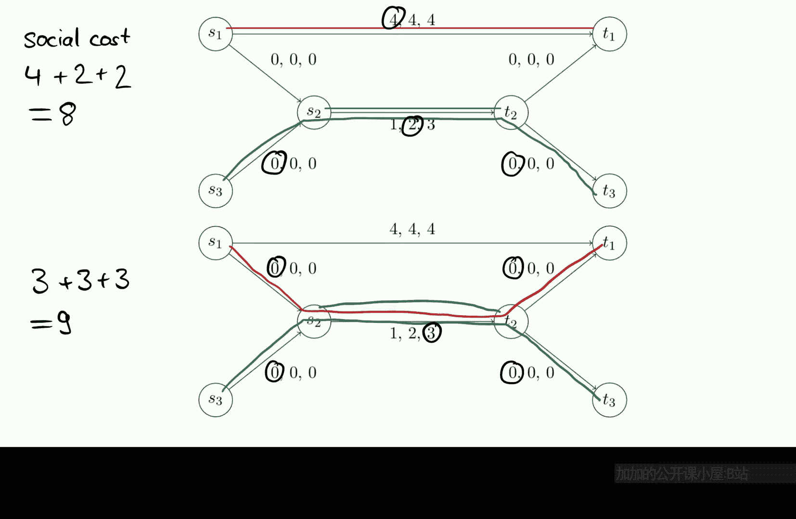
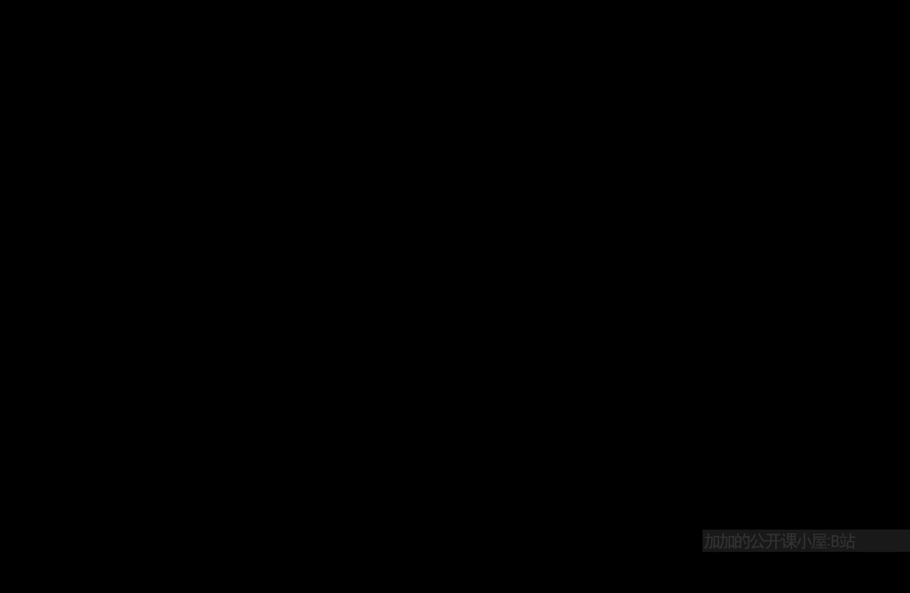
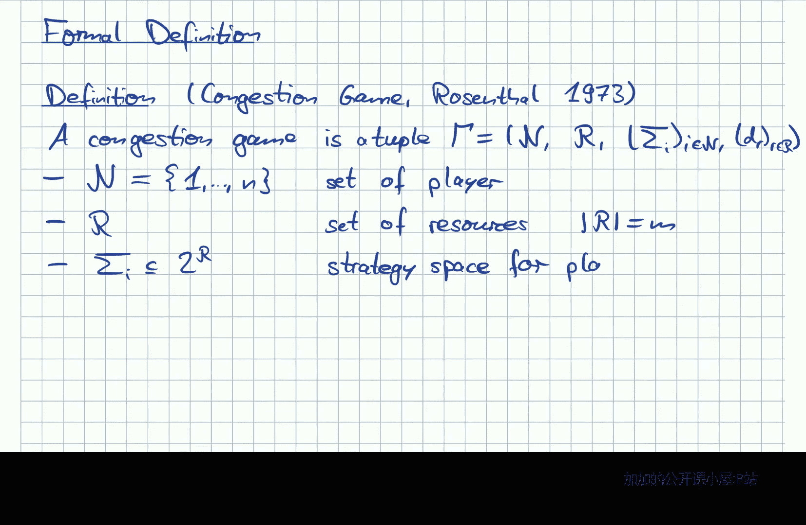

# 波恩大学【中英⚡算法博弈论｜2020-21 Algorithmic Game Theory】 p02 P2 Lecture 1 (Introduction to Congestion Games) -BV1qX86zPEPG_p2-

。Hello and welcome to our class on algorithmic game theory。

 this is the very first lecture and today we'll discuss the question of how to model strategic behavior。

Later in this class we'll also talk about the effects of strategic behavior and what we can do about strategic behavior so maybe that players don't behave strategically at all。

But let's first start with a question of how to actually capture all this mathematically。

And as a general introduction， I'd like to consider the following example。

 which is a very simplified model of road traffic and congestion in this。In such a traffic situation。

I'll have a graph， with。Well， three source and three sync node。

 so player 1 wants to get from S1 to T1， player 2 wants to get from S2 to T2 and player 3 wants to get from S3 to T3。

What choices do the players now have？Maybe let's first consider a player2。

 while player2 doesn't actually have a choice because there's only this direct ad which takes him or her from S2 to T2。

Player 3 doesn't have a real choice either， because there's only one path connecting S 3 to T 3。

 and namely it is go from S2 S 3 via S2。V T2，2， T 3。But then there's also the choice for player one。

 and that is actually an interesting choice because player one can either take the direct edge。

Taking him or her directly from S1 to T1 or。They can go the indirect path via S 2 and T 2。

 Let's first consider the。And directly。Now let's talk about these strange numbers。

 what do these numbers mean？These numbers indicate how long it will take to cross such an edge。

 and this depends on how many players are using this edge at the same time。 So for this edge。

 for example， if theres one player using this edge， it will take one unit of time。

 if there's two players， it will take two units of time and if there's three players it will take three units of time。

Good， so how long does it take for each of the players。

 there's only one player on this top edge here。There is only one player on this edge and only one player on this edge。

 and there's two players on this edge。So how long does it take for player one。

 it takes four units of time。For player two， it takes two units of time。And also for play a 3。

 it takes。Two units of time。 This is what we will call the social cost。If we add this up。

So this is each individual player's cost and if we sum this up。

 then we get the so called social cost， which will be8 to you。O。😊，But。

Can any player change anything here？ Well， yes。Play 1 does have a choice。 Namely。

 Why should play 1 actually take this edge here， This has a cost of4。

 whereas going this way here via S 2 and T 2， this will actually be cheaper。Because。

Even then the cost will only be three， let's see this， what I mean by this。Let's。

Copy this entire thing here。And what can happen well。Player one might use。This path。

And the other play two players。Made you still do the same thing。Now， what？

Will be the cost of each of the players。We'll have one player now on this edge。

 one player on this edge， three players on this edge， one player on this edge。

 and one player on this edge。So player once cost will be three。Player two's cost will be three。

And also player threes cost will be three。 So this sends up to 9。

Okay， this is certainly worse in terms of social cost。But。Here。

 if we once again consider what player that if we once again consider player one。

 player one has a cost of four here and only a cost of three down here。

And it is only player one's choice。Which path he or she is using。

 So why should play  one actually choose。This。And this direct bench。

 if this has a higher cost for him or her。嗯。This means that by strategic behavior。

 well have a higher cost than if we did not have strategic behavior。

 if we assume that all that players care about is actually their individual cost。This， of course。

 you might doubt that maybe in reality， players will actually be not that selfish。

 but this will be one of the core assumptions for everything that we do。嗯。

So what do we want to do today， Well， let's first try to model this kind of games more generally。

 And then let's try to model more specifically。What we can assume or how we can capture the strategic behavior and what the strategic behavior will lead to namely in the case。

We will introduce a notion of an equilibrium。

We will now introduce a formal definition which generalizes these strategic effects we saw in this initial example of strategic behavior and traffic。

And this class of games。Is called congestion leaves。How do we model this？Well。

 we have this definition。As I was saying， this is a congestion game。And this is not， actually。

A very recent notion。But it dates back to way before there were there was。

The notion even of algorithmic game theory， then well even dates back before there was real computer science。

 maybe not real computer science， but this wasn't actually thought of as a computer science problem or model。

What is a congestion view？A congestion game。Is a two pole。We'll have N。R。我 would have。

A vector of sigma eyes。And who had。The vector of D Rs。And what are these？And。

Is the set of all players。We'll have R。As a set of resources。

The number of players we usually call N and the number of resources。We usually call it M。

And usually we'll just number the players one through end。

 whereas the resources that might actually differ how we call them。Good。😡。

And then we have these sigma I。Each of these sigma I is a subset of the power set of the resources。

Which is the strategy space。For player， I。

