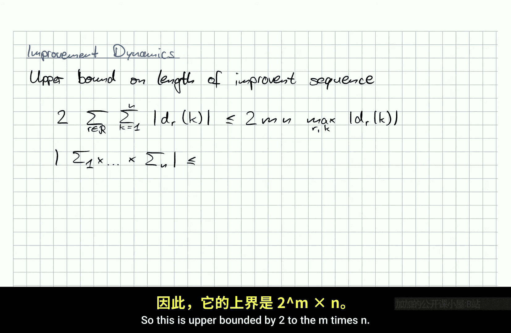

# 波恩大学【中英⚡算法博弈论｜2020-21 Algorithmic Game Theory】 p03 P3 Lecture 2 (Computing Equilibria in Congestion Games) -BV1qX86zPEPG_p3-

Hello and welcome back to our class on Aic game theory In the last lecture we introduced congestion games and we also showed that every congestion game always has a pure na equilibrium。

Today we will start discussing the question whether。

It is easy or hard to compute such an equilibrium。This is actually an important question because。

 well。If an equilibrium is easy to compute， then well it is likely that players actually do play this equilibrium。

 whereas， well， if it is hard to compute in equilibrium， then。Well。

 this is a rather strong assumption。And as a matter of fact， in general。

 as we will show later in this class， it is hard to compute in equilibrium。

 but for some special cases， there are polynomial time algorithms and this is what we will show today for two very interesting but easy special cases。

But before we start with this， let's first。I recap what we learned about congestion games last time。

 so first of all what is a congestion game？A congestion game consists of these four elements。

 namely a set of players and which we usually call one through n， a set of resources。

We always say these are M resources。 These might be edges in a graph， for example， but。

This might also be something else。And then every player has a strategy set。

What is that the strategies are subsets of the resources。

 meaning that the strategy space is a subset of the power set of the resources。

And every resource has a delay function， which maps the number of players using this particular resource to an integer。

And this lets us define the cost of player I in a state。 What is a state。

 the state is just a choice of a strategy for every player。 So this is。

A vector of N strategies coming from the Cartesian product of all strategy spaces。

And what is now the cost of a player in such a in such a state， Well， it is。With defined as follows。

 take the sum of all resources that this player is using in this particular strategy in the state。

 and now add up the delay functions。 evaluated on the number of players that use this particular resource。

 So this is what we write by N R of S。 That is the number of players that use resource R。

 And we now take D R of N R of S。 This is the delay。

A resource R when N R of S players use this resource。And then we defined a Pionac equilibrium。

 a state meaning such a vector of strategies is a Pionna equilibriumum if no player can unilaterally improve his or her cost。

What does this mean， Well， the cost that player I incurs in state S。

Is at most what he or she incurs when switching unilaterally to strategy S I prime。

 while the other players still use strategy S minus I。

 And this holds for all players and all deviations。

 all alternative strategies that this player might be deviating to。😊。

And we showed that there is always such a state， which is a Pionna equilibrium。How did we do that。

 Well， we used this rosent top potential。This roseile potential is defined as follows we take the sum of our resources。

 then we take this sum from one up to the number of players using this resource in the current state。

 and then we add up the value of the delay function for this particular number。

And why was this important， Well， this was because of this following lemma。

 we showed that whenever only one player changes his or her strategy。

 then the change of the potential is exactly the change in the cost of this one player。

And this helped to show that any improvement sequence has to be finite because whenever one player improves his or her strategy。

 well his or her cost goes down， but this also means that the road and top potential goes down by exactly the same amount。

And this means that。Whenever we follow such an improvement sequence。

 the rose andhal potential goes down and down and eventually we have to reach a state at which it cannot go down any further。

So let's now talk about potential algorithms to compute such a Pion equilibrium Actually one of these algorithms is already implicit in our existence。

Namely。We show that any improvement sequence is finite。 So this means that。Well。

 we could just find an equilibrium as follows， start from any possible state。

 and then just fall an improvement sequence。Up to the point where you cannot improve any further。

 and we know that this is a puret equilibrium。Is this a polynomial time algorithm or isn't it？Well。

 as we will see， it depends on what game we are talking about here。

 but this depends on the structure of the game。嗯。Yeah。So what。Whatoo is now important， Well the。

 the important question is， of course。How long will these sequences be？

And we've already seen an upper bound on the length of the sequences， name exactly in our proof。

So let's write this down。The bound that we showed last time was。Two times。The number。

 the sum of all resources。The sum of all numbers from1 to n。

 and then the absolute value of the delay resource are evaluated at K。Or alternatively， we could say。

 okay， this is two times the number of resources times the number of players times the maximum value。

All R and K of D， the absolute value of D R of K。 So this means we are talking about。

The highest absolute value that any delay function ever takes。Is this a polynomial bound， No。

 it isn't。 It is only pseudoponomial in the language of computer science， Why that。

 because this depends on the size of the numbers， So it is easy to represent a number such as 2 to the 10 by only 10 bits。

 So a guarantee that depends on2 to the 10 would be polynomial。

 but it would only be 10 that would count you。Because we are talking only about the number of bits we need to represent this。

So this is not what we're looking for here。嗯。Although this will be helpful in a bit。

There is another upper bound that we can use namely。 What do we know。Well。

We know that any improvement sequence is finite and what's an upper bound on the length of an improvement sequence。

 Well it cannot see any state twice， so the number of states is also an upper bound and how could we write this。

The number of states， that's just the cardinality of the Cartesian product of all strategy spaces。

So this is upper bound by 2 to the M times n。

So clearly this is finite， but it is not a polynomial bound in M and N。So are there actually。

Imrovement sequences this long， or is this just a bad a pro bound。

