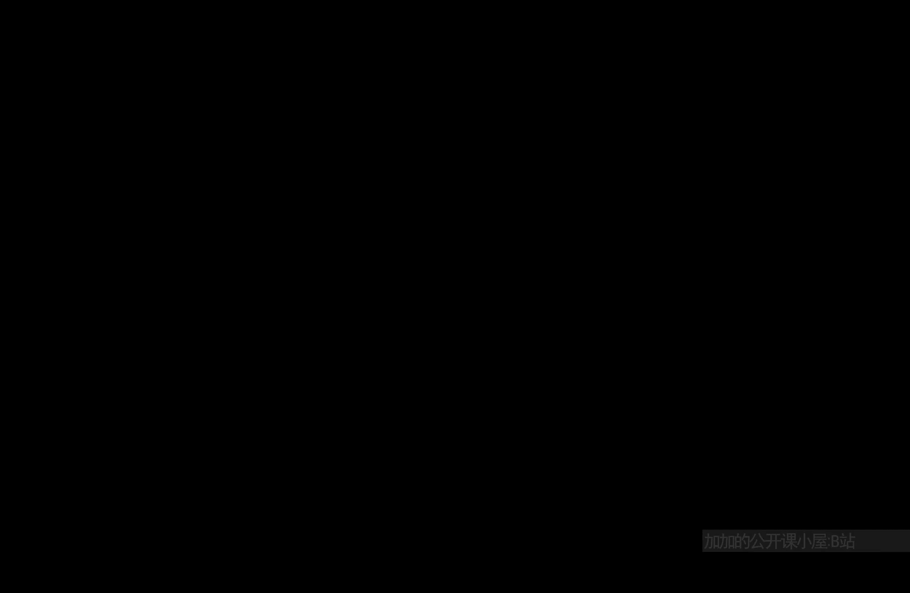
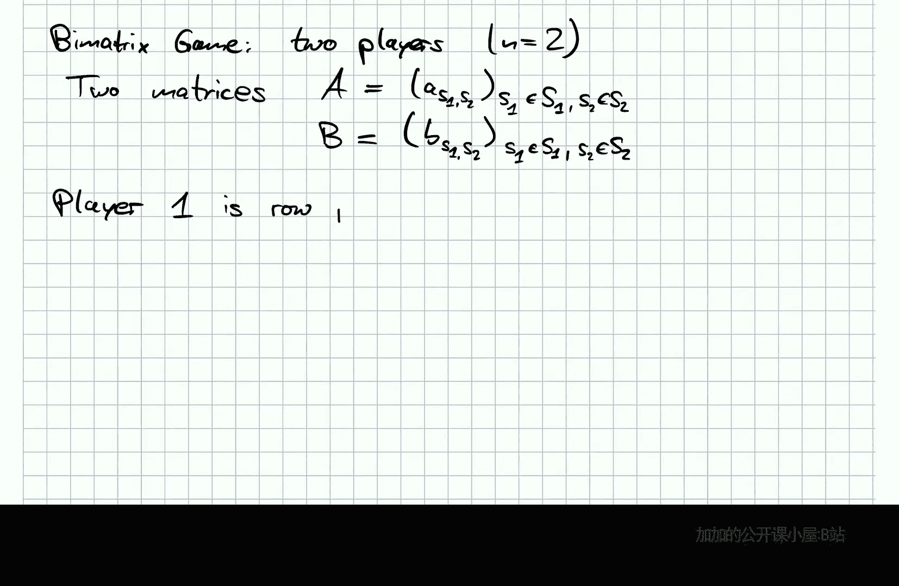

# 波恩大学【中英⚡算法博弈论｜2020-21 Algorithmic Game Theory】 p04 P4 Lecture 3 (Normal-Form Games and Mixed Nash Equlibria) -BV1qX86zPEPG_p4-

Welcome back to our Ro Mc Game theory and great that you're still here。

What did we do so far well we introduced congestion games and we showed that there is always a pure natural equilibriumno in every congestion game。

Today， we will generalize the class of games that we consider towards what is called normal form games。

 and well also generalize the notion of a pureionac equilibrium。But then as we will see。

 not always a Pash equilibrium exists。But what we'll show next time is that always a mixed national equilibrium exists。

But before we get to that， let's first introduce the more general notion of a game。

 a so called normal form game。So what is a normal form game？Let's define this， formally。We say that。

 A normal form。Cost minimization。gaamme。Is a triple。Which consists of N。S， I。And C。What are these。

Well。We'll have n as the set of players。不要。Usually called the number of players N。

And often just right as the players。They said。1 through n。And。For each player。We now have。set S I。

Which is the set of pure strategies of that plan。Yeah。And we'll call。第一。Cartesian product。

Of all these。The set of states or pure states or strategy profiles or pure strategy profiles。So。This。

Should feel somewhat familiar as N as a set of players we also had in the context of congestion games。

And we also had a set of strategies for each player。 The notation is a little different now。

 and I'm just sticking to standard notation here， which may be a little unfortunate from time to time because now capital S I is the set of all strategies。

 whereas in the congestion games， we call。This set of pure strategies， sigma。

Capital S I was an element of this set of pure strategies。

 So this will be consistently inconsistent throughout this class。

 and I apologize for this in advance。 This is the standard anation that we will use for these normal form games。

 or often we might just call them games。And then we again have this Cartesian product of all strategy spaces。

Which is the set of states， or as we also want to call them just strategy profiles or pure strategy profiles。

 so these are all called pure strategies。To distinguish them from mixed strategies。

 which we will see later in this class。Good， now all of the players。Choose。One of these strategies。

And this means that players incur certain costs。And。We write this as follows， so for each player。

We'll have now。CI as a function mapping from S。To the reals。This is the cost function。Of player eye。

So we take as the input a sorry a strategy profile， a profile of pure strategies。

 and then this maps to a cost that this player is incurring。Alternatively。

 you could also define this as a payoff or a utility that the player wants to maximize that's actually sometimes more convenient and we'll switch between the two throughout this class。

 but for today we'll only talk about cost minimization。Good。嗯。

So we can actually capture congestion games in here。How can we do that， well， as I was saying。

 SI will be again the strategies。which were in the context of congestion games。

 were just subsets of the resources。And the cost functions， well。

 those had a particular structure in the context of congestion games。

But now those may be just arbitrary functions。So they are not these underlying resources and delay functions。

 which were exactly the ones that induced this structure in the cost functions of congestion names。

How can we define。Other。Such。Normal form games， well， what we can do for example。

 is a by matrixscape。In a biometric scheme。We'll have always two players。

So this means nothing but that n is equal to 2。And now， this。

The strategy sets are just something we don't actually care。

And the cost functions are now described in terms of matrices。We'll now have two matrices。A。And B。

Which fully describe the cost function。Here now you have to be a little careful because there is now small ss which are strategy and there's capital ss。

 which are these strategy sets， but usually it's just clear from the context。

 which means which that this should be a small S because it is contained in the capital S。

In the capital SI。Good。哎。Now we have these two matrices。 and how does this now induce game Well。

 one player， player one chooses a row of these matrices。诶。

Player two chooses a column in these matrices。And then the cost is defined as the entry at which we end up。

So more formally。Play a one as the row player。

AndPlayer two is the column player。