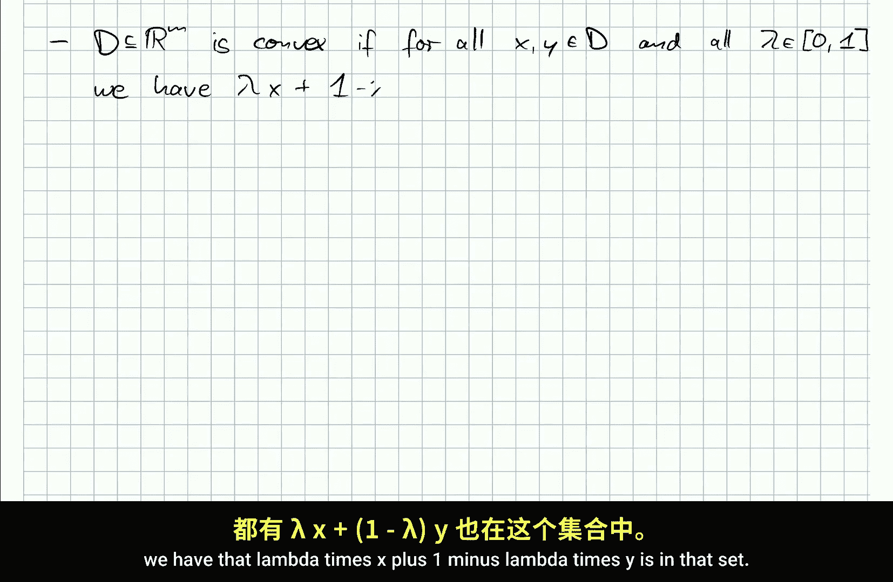

# 波恩大学【中英⚡算法博弈论｜2020-21 Algorithmic Game Theory】 p05 P5 Lecture 4 (Existence of Mixed Nash Equilibria) -BV1qX86zPEPG_p5-

Hello and welcome back。I hope you remember that in the last lecture we introduced Norform games and we also introduced the notion of mixed na color。

Today， we will continue talking about mixed na co Lib， and we will show that they always exist。 Well。

 not， not always always， but。Actually。Hello and welcome back。

I hope you remember that last time we introduced。Mix naa Columbia in Nor form games。

 and today we will show that they always exist in finite games。We'll come to this in a bit。

 but let's first recap what a normal form game is。So far。

 all games that we were considering in this class were actually cost minimization games。

 but you might as well consider payoff maximization games。 and as it turns out。

 this will be easier today to talk about these。Payoff maximization games。

 So what the will this look like。Here this is the definition of a normal form payoff maximization game。

So again， we have N players and each of the players has a set of pure strategies。

But instead of a cost function， the player now has a payer function。

 which we usually write as UI and now in a state S。

 so where each of the players chooses one of their strategies，This player eye has。PF U IFS。

So far we introduced this with cost CI and as a matter of fact。

 this is entirely equivalent because these payoffs may be arbitrary numbers as well as the costs maybe so if we just set CFS to minus UIFS then we're getting exactly a cost minimization game。

 so here the goal would be to maxim your payoff and this would be exactly the same as minimizing minus your payoff。

And this way， the notion of a mixed natural equilibrium and also of a pure natural equilibrium just generalizes in a pretty straightforward way。

But as it turns out for today， it is a little more natural to talk about payoff maximization that you actually want to get out of the game as much as possible rather than minimizing your own cost。

😊，What will also be useful today is thislemma that we proved last time showing that a mixed strategy Sigma I is a best response against some choices of the other player Sigma minus I。

 if and only if the pay of that this player is getting under Sigma I is no less than what this player could be getting。

If he or she switched to any。嗯。Any pure strategy S I prime。

So this means we always to show that a a mixed strategy is a best response。

 We actually only have to compare to。Possible deviations to pure strategies rather than comparing to all possible mixed strategies。

So what do we want to prove today Today will want we will prove Nsh theorem， which。

Tells us that mixed nachoia always exists。But this has a small caveat。

 namely they only exist if there are finitely many players and finite many strategies。

 finally many pure strategies per player。But if we have such a finite normal form game。

 then there is always a mixednaashcher equilibrium。Let's write this down。Every finite， normal form。几。

Has a mixed national equilibrium。And what do we mean by a finite normal form game。

 this means that we have finitely many players。And finite， many。Pure strategies per plan。

How do we prove such a theorem。Well， this now works in a very different way compared to proving the existence of pure natural Lib and congestion games。

Because what we apply now is a fixed point theorem， so we actually only do an existence proof。

 our proof will actually not be constructive in a way that we show， okay。

 this is the way you can find this aholder group。More precisely。

 we will apply B's fixed point theorem。What does that state？Every continuous function。F。From D to D。

Mapping。A compact。And convex。Non empty。でき？Subset。D， which is a subset of R to the M to itself。

Has a fixed point。X star。And wood has to hold for that。

It has to hold that f of x star is equal to x star。So。What does all of this mean。

Maybe let's first just digest this theorem and let's understand what all of these things mean。

I guess you have an understanding of what continues mean。

 I hope you also know what compact and compacts mean， but nonetheless， let's。

Go through all of these things slowly so that we actually see you。

What they mean and why this statement isn't actually extremely surprising。

So let's start with convexity。So we say that a set D。Which is a subset of R to the M。Is convex。If。

For all X and Y， which lie in D。And。哦， lambda。In the interval， from 0 to 1。We have。

That lambla times ax。Plus，1 minus lambda。

T y is in that set。