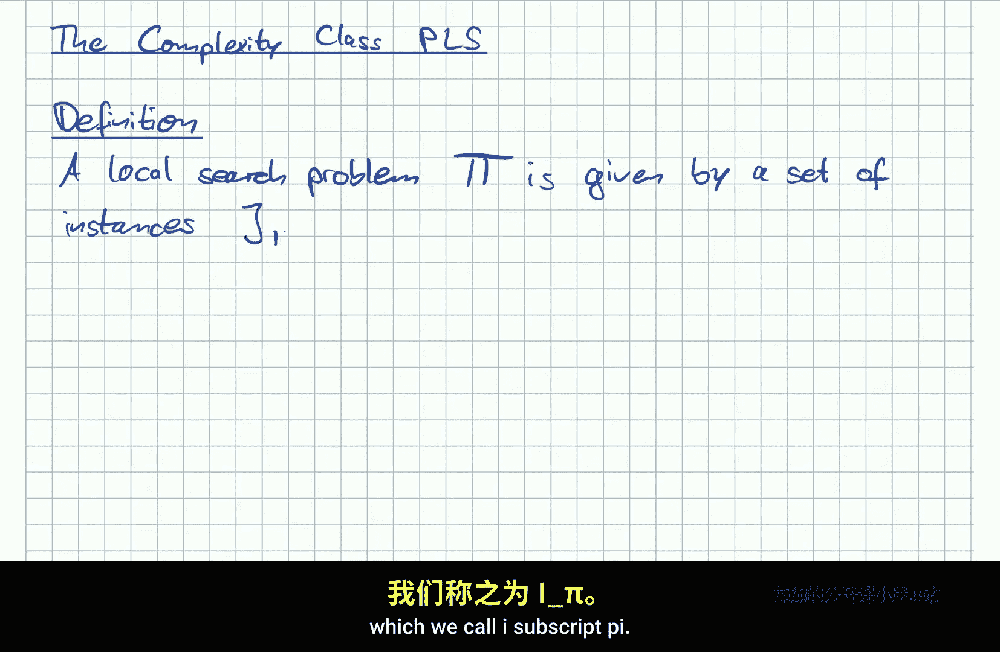

# 波恩大学【中英⚡算法博弈论｜2020-21 Algorithmic Game Theory】 p06 P6 Lecture 5 (Complexity of Pure Nash Equilibria in Congestion Games) -BV1qX86zPEPG_p6-

Welcome back to Arothmic A theory。Where are we so far， well。

 we've introduced congestion games and we've shown that there is always a pure natural equilibrium in congestion games。

Then we've introduced more general normal form games。

 and we have shown that there is always a mixed national equilibrium in such a normal form game if the number of players and the number of strategies per player is finite。

But what we don't have so far is a polynoial time algorithm that lets us compute one of these equilibriumria。

And indeed， that's for a good reason because it is generally hard to compute such an equilibrium。嗯。

But what does this mean to be heart。Does this mean these are NPR problems？Well， no。

 because N what kind of a complexity class is this。

A NP is a complexity class about decision problems， so the answer will always be yes or no。

 but what kind of a question would this be because while the question is there a pure natural equilibrium in this congestion game。

 the answer will always be yes。So instead this is a search problem which is something well fundamentally different than the decision problems that we usually deal with in the context of complexity theory。

 so let's see what complexity theory can offer us for such search problems。

 what are possible complexity classes for search problems。你好。

So what are the problems like well we're always given some kind of an input and then we'll have to search a solution to the problem in our input or。

In general， the answer might also be， well， there is no such solution。嗯。And there is the。

Complexity class， F P。Which。Stands for。Function polynomial。

So this is what you know as SPP for decision problems。

Meaning that you can actually always find a solution within polynomial type。

Then there's all to the class。Of。F and P。Ho this different Well， this is now。

Capturing what you actually know as NP in the context of decision problems。You know， well。

It might be difficult to find a solution， but verifying that you have a feasible solution that is somewhat easy。

 so the bolts finding it is difficult， verifying that it is correct。

 that is can be done in polynomial time， so kind of easy。嗯。B。So what he could now hope。

Is that finding an equilibrium？So finding it。Mix na equilibrium in a normal form game or finding a pure natural equilibrium in a congestion game that this would be F andP hard。

 well this is not quite true， but it is indeed hard for subclasses of F and P。Which are。

 on the one hand， P D。And on the other hand， we have PS。So PPD。

 is this is a subclass of the problems which contains in particular。

 finding a mixed natural equilibrium in a normal form game， and it turns out that。

This problem of finding an equilibrium is actually a PPA complete problem。

 whereas finding a pureash equilibrium in a congestion game， this is a PS complete problem。Today。

 we'll focus on the discussion about P S， but I hope that then you see that while PD is a little more complicated to define。

 but eventually it is very similar to what P S looks like。 And I hope you get an idea of。

How your one can actually model such complexity classes。No。There's one important thing， namely。

 how do you encode the input？And this is something that turns out to be important even in the P versus MP question。

 so in the decision problem， because as you know， there's a notion like pseudoponomial time。

 meaning that if you encode numbers， inary encoding， then suddenly， well。

 the NApsack problem becomes poly polynomial time solvable，And there's a similar effect here， namely。

 how do we encode our problem？And what do we even consider polynomia at time？

And there's one important thing about congestion games， namely that you can actually。

Describe them very succinctly that while for a general Nor reform game。

 you would for a by matrixtrix game， you would usually just write down the entire table。

But to encode a congestion game， you only have to specify the delay functions。

And this takes far less space in the input， and this is why you will actually see。Well。

 going through the entire table of a p matrixtri game。

 figuring out if any of these is a piionnaal equilibrium and which of these are， that's kind of easy。

 But in a congestion game， things are much more complicated just because。嗯。

The input itself is much smaller to represent this entire table。

And we've already seen this in the context of the length of the improvement sequences。

 that we had only one player， we had only M resources。

 but still there were two to the M different states all of which could of course， might of course。

 be a Pt equilibrium。This is very important to keep in mind that it always matters how you encode the input。

So， let's now come to the。Definition of the complexity class PLS。

So how do we define a complexity class for a search problem while this clearly depends on what kind of search problems we want to model and for PRS we model problems which are local search problems and I hope this rings a bell because you might remember。

And that。Pioninatroalgra are exactly local minima of the rosen top potential。

So all this is about is finding these local minima of the rosentar potential。

How do we generally model such a local search problem？A local search problem。嗯。Pie， capital pie。

Is given by a set of instances。Which we call。I。

Subscript pie。