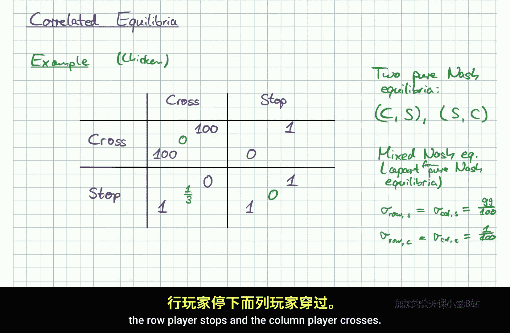

# 波恩大学【中英⚡算法博弈论｜2020-21 Algorithmic Game Theory】 p07 P7 Lecture 6 (Correlated Equilibria) -BV1qX86zPEPG_p7-

Welcome back to algorithmg growthrowth making theory。

So far we've seen purena colria and we've shown that they always exist in congestion games。

 we've seen mixed na col， which always exist in finite games。

But then we've also seen that equilibrium are generally hard to compute we've seen this in the example of purena equilibrium and congestion games。

 but as I was saying， similar hardness results also hold for mixed na equilibrium。

Today we'll get to know another class of Eria namely correlated Eria。

 and we will show that they are actually easy to compute。

Let's just start with a simple example of such a correlated equilibriumli。Namely， I want to consider。

第。By matrixtri game， chicken。Here we have， again two players。And these players， both of them。

 have both the same strategies， namely they can。croross。Or they can stop。

And what's the story behind this game？There are two car drivers approaching an intersection。

And what can they do well， they can decide to cross or to stop and if they cross。

If they both decide to cross， then there will be an accident。

This comess with a pretty high cost for both of them。Namely， let's just say 100 for this example。

Or they can decide to stop。Well， if I'm the one who stops， then I have a cost of one。

 So still a cost， but much less than in the case of。An accident。

Um but the other one who crosses doesn't have any cost because， well， he or she can go right ahead。

So of course， if we are the one two。Cross， whereas the other player stops， then。

The other player has a cost of one because she or she needs to wait， but we don't have to wait。

 so we'll have a cost of zero。Or there's also the unlucky then that both of us stop。 Well， then。

We both have a waiting cost of what。So what are purenaallylib brand this game？Well。

 there are actually two pure a equilibriumary。Namely。

 it is too that one of the two players crosses and the other stops。Okay。

 and there's also another mixed naash of equilibrium。And。Of course。

 the two purena col are also mixed na coria。And in these， well have the probability to。Stop is。嗯。

99 of 100 for both players。And of course。Crossing has the probability of one of the hundred。So。

Is this what we will typically see in a traffic situation？Well。

 maybe we see one of these two pi Nationalal col namely if there's a way of right if well。

 one of the streets actually has the privilege to go first okay that's that's an easy thing。

 I guess we will hopefully never see the situation where well both players just toss a coin before approaching the intersection and then decide。

 okay， I now stop or I don't stop。But what will often happen Well often there will be traffic lights and these traffic lights just tell us what to do。

 and it is actually a good idea to follow these traffic lights。😊，Because。If we don't。

 then there will be an accident。And this is exactly what a correlated equilibrium can be thought of or also a coarse correlated equilibrium。

 these are actually identical in this kind of a game here but we'll come to the difference in a bit。

So what is a correlated equilibrium， a correlated equilibrium is now a probability distribution over the states。

So far， we had。Mix natural colorgra， which were probability distributions over oh no， which are。

And vectors or profiles of probability distributions of strategies。

So this means that actually also a mixed natural equilibrium assigns a probability to each state。

 but the probability is computed in a pretty clear way。

 namely we take the product of the respective probabilities that all of these strategies are played。

So let's see this in the example here， we have a probability of。99。Over 100 times 99， over 100。

Then the bottom right square is played， and then。For the top left。

 we have a probability of one over 100 times one over 100。And then， we have。For the other two。

We have a probability of 99 over 100。Times1 over 100。Good。

 so this is also a way we can think about a mixed national equilibrium。

Namely that these assign probability distributions to each of the states and also a pure National equilibrium does this。

 but it does this in a pretty trivial way， namely it just puts a probability of one to one of the states and zero everywhere else。

Good。😡，Now correlated equilibrium does exactly the same except for not being a product distribution。

So how can this look well？Let's change this example here。We might not say， O。

With no probability at all， both players cross or both players stop。

 and now say with probability D a third， the row player stops， and the column player crosses。

 and with probability  two third， the row player。

