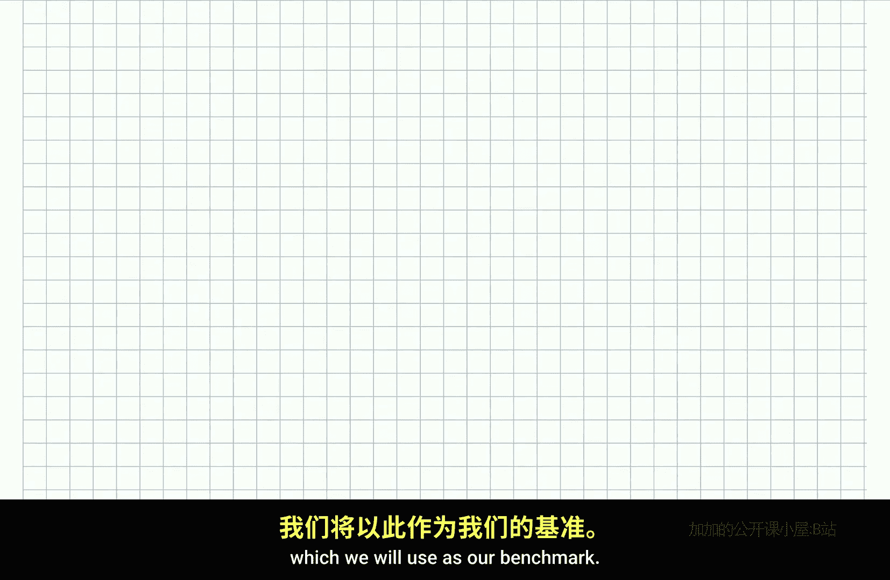

# 波恩大学【中英⚡算法博弈论｜2020-21 Algorithmic Game Theory】 p08 P8 Lecture 7 (Minimizing External Regret) -BV1qX86zPEPG_p8-

Hello， welcome back， this is still algorithmic game theory and as a matter of fact。

 what we will be discussing today will be quite algorithmic。😊。

So where are we last time we introduced correlated and coarse correlated equilibriumibria？

And then we also got to know these no regret dynamics。But for these dynamics。

 the one missing piece was the algorithm that each player uses individually to choose which。

Strategy to play next。And we then saw that this algorithm would have to  fulfill a no regret guarantee so that overall what the players are playing turns out to be a coarse correlated equilibrium。

And the only missing piece， as I was saying， is now， how do these algorithms work？

Let's once again recap what the problem statement is for such an algorithm which we kind of introduced already last time。

As we've seen， we will play this in capital T rounds。And in one of these rounds。The falling happens。

We have one player。And this player。Picks a probability distribution。Which we call。P T。

 which is a vector。P1 through P capital n。O for her strategies。And what is our capital N。 Well。

 that's just the number of strategies。And then after the player has picked this probability distribution。

 the adversary。Takes a cost vector。Which we call LTE。This science。A cost value。

To each of the strategies and these costs， we now assume to be。Between0 and1。And then。A strategy。H二。

His drawn。From P。So according to the probability distribution PT。

 we now draw one of these strategies。うん。The player。Incur。Cost。L。Superscript T， subscript。8。

And gets to know。All of Lt。So。This is very different from all the games that we were considering so far in this class because now we actually just have a player and an adversary。

😊，The player always chooses a probability distribution over her strategies。

 and then the adversary chooses a cost for each of these strategies。And then。

Only then a strategy is drawn from the probability distribution。

 and this is then the cost that the player will in。

So it's really important to understand the order in which things are happening here。

That the player has already committed to the probability distribution when the adversary is choosing the cost vector。

 but what the player has not yet committed to is the particular strategy this is drawn from the probability distribution that the player committed to only afterwards。

What is a good benchmark for such a setting？Well。第。Nt thing for a benchmark would be the best。

Action sequence in hindsight。And what would that benchmark ye like Well， take the sum over all。嗯。

Time steps。And then always in every time step， consider the action that had the minimal cost。

This is what we would call the best。Action sequence in hindsight。But。

This would be far too strong as a benchmark， because what could happen here。For this。

Example to see what can but go wrong here。We just have。2 strategies。 and an adversary。

That chooses L T to be at a cost of one for the first action of0， for the other action。If。

P1 T is at least a half。And。Otherwise。It will be。The 0，1 vector。Why that。

Because the player will always put a probability mass on at least a half on one of the two strategies。

 and the adversary already notes the probability mass that the player is putting on each of the strategies。

 so they can actually adapt to whatever we as the player chose there。

 so this might be one possible choice。And then。What would be the cost of the algorithm。

 the cost of the algorithm。Would be always。So we would now sum up the expectation of all these LT。

And in each of the steps， we would now incur a cost。An expectation of at least a half。

So this would mean we would have an expected cost。Of a half times tea for the algorithm。

 But at the same time。This。Best action sequence in hindsight。

This has a cost of zero because in every step， there is an action of。Pa costt 0。Therefore。

 we'll do something that is slightly different。Which we will use as our benchmark。

