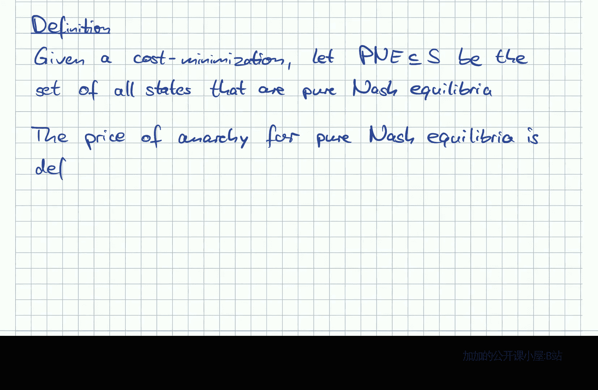

# 波恩大学【中英⚡算法博弈论｜2020-21 Algorithmic Game Theory】 p09 P9 Lecture 8 (Price of Anarchy) -BV1qX86zPEPG_p9-

Hello and welcome back to our class on algorithmmic game theory。

So far we've seen a number of ways to model strategic behavior。

 or more precisely we've seen equilibrium concepts。Wwhich then reflect， well。

 what states might strategic behavior lead to， but what was implicit in these considerations so far was that strategic behavior is somehow bad for society and this is something that we will talk about today and which we will actually try to quantify using the so-called price vany。

So we will be talking about the social cost of equilibrium。What is this， the social cost？Well。

 there are multiple ways to define social cost。The notion that we will be using today。

It's the following？The social cost of a state S， we'd simply write as。The same。

Of costs incurred by all players。Maybe you might also want to take the maximum of all costs incurred by players that well that's actually up to you and what do you actually think what reflects best the。

The notion of。Social cost for your current situation。 But for today， let's just take the。

Perspective that all we care about is minimizing the sum of the costs of all players。Now。

 as we've seen so far， the。The social cost might not be minimal in an equilibrium。

 and let's see this once again in a very concrete example。

So we'll take a symmetric network congestion game。Where thats only。Two ways to get from S to T。

 namely the top edge and the bottom edge and the delay function on the top edge。诶。Is increasing。

 it is one if there's only one player using this resource， two。

 if two players are using this resource and so on， and by the bottom edge。

The delay is always for regardless of how many players use this edge。So what can happen here， well。

 generally there are five kinds of states， namely all players might use the top edge or one player uses the bottom edge and the remaining three players use the top edge and so on。

Of course， matters。Well for you personally， it matters which of the players you are。

 but for our consideration， it doesn't actually matter。

 So we might write down for all of these five different kinds of states。

 what social cost we have there。So we might have via the top edge。We might have four， three， two。

 one， or zero players。And by the bottom edge， respectively。We might have。

No player or one player or two players or three players or all four players using these auto edge。

What is the social cost of such a state？Well。Remember that we are now just summing up all the pla's cost。

What's the player's cost if all of them use the top edge？Well。

 if all of the four plays use the top edge， then each of them has a delay of four。

 so this means we have  four times 14， which is 6。Or。If only three players use the top edge。

 then their delay is three times three and we have one more player using the bottom edge so we get another four。

So， this will be three。Times 3。Plus 4。This is9 plus4， this is 30。

Or we'll have two players using the top edge， this means we'll have two times 2 plus two times 4。

And that is 12。Or only one play using the top edge。

 which gives a social cost of one plus three times4 because the other three plays use the bottom edge。

 so we'll have。One plus three times4， this is again 13 or four players using the bottom edge。

 this is again four times 4， this is 6。Get。Now the question is。

Which of these are actually Pionnaacoopia？Well。If all players use the top edge it is actually a Pionnaa equilibrium also if three players use the top edge and one player uses the bottom edge。

 this is also a Pionaca equilibrium。At the same time， we see， well， actually。

 what's best for society， namely we have only a social cost of 12。

 is if two players use a top bad and two players use the bottom edge。So， this means。Actually。

 due to the strategic behavior， we incur a higher social cost than if we were assigning the players to strategies。

So what does this mean in a more formal way？Or in a more quantitative way。

The social optimum would be 12， whereas the social cost and in equilibrium may be as high as 60。嗯。

So this is what we call the price of anarchy， this is the ratio of 16 and 12 because this is the factor of how much the cost increases because we have strategic behavior。

One might also define this ratio of 13 divided by 12， one might also consider this。

 this is actually the price of stability which we will be considering probably next time。

 which is then considering the best of these equiria compared to the optimal social cost。

But as I was saying。Today we are interested in the price of anarchy and。

This is the worst ratio between the social cost at equilibrium and the optimal social cost。

So given the cost minimization gain， we now let P and E。Be the set of all states。

Let our peer na quote you。The price of anarchy。For Pionas Libia。Is defined as。

AndThen we write P。