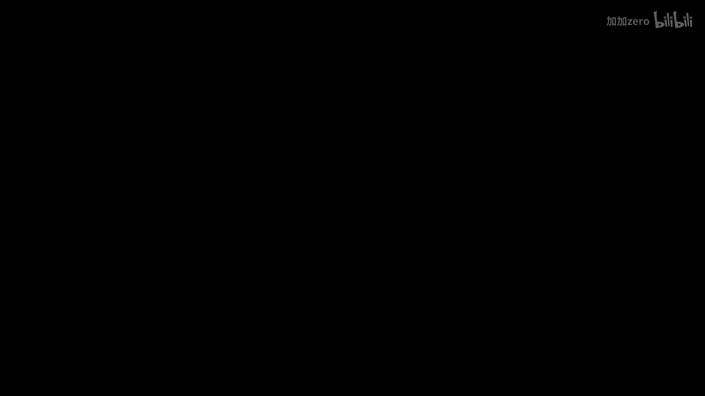
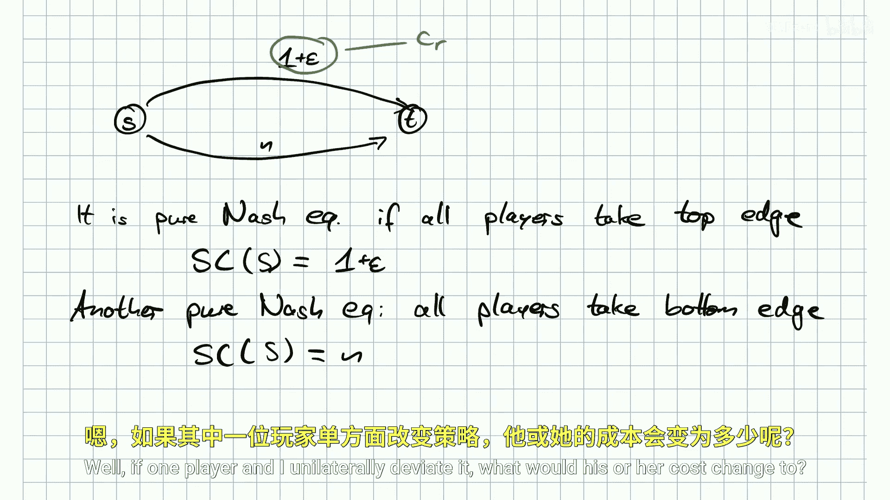

# 波恩大学【中英⚡算法博弈论｜2020-21 Algorithmic Game Theory】 p10 P10 Lecture 9 (Inefficiencies in Cost and Market Sharing Games) -BV1qX86zPEPG_p10-

Hello and welcome back to Agroth McCain's theory。Today we'll continue and complete our discussion of inefficiency due to strategic behavior。

I hope you remember that last time we introduced the price of anarchy。

 which was one way to bound the loss due to strategic behavior。

This is taking a somewhat pessimistic view as we say， well。

 how much worse is the worst equilibrium compared to the social optimum？Today。

 in the first part we'll take a more optimistic view by considering the so-called price of stability。

 which compares not the worst equilibrium but the best equilibrium to the social optimum。

 and then in the second part we'll again come back to the price of anarchy。

 but then we'll consider a payoff maximization game rather than a cost minimization game。

 and we'll see to what extent well techniques are similar or different thing。

But let's first start with the discussion of the prize of stability and we'll do this in the context of cost sharing games。

 which are a special case of congestion games， so let's formally define these。

So what is a cost sharing？A cost sharing game is nothing but a congestion game in which delays have a certain。

Have a certain forum。Namely。It cost sharing game。是。Is a congestion game？是。Wherere all。

Delay functions。At the form。D R of x is equal to C， R divided by x。For。Constance。CR。

What does this mean well？This means that there is this one cost CR for resource R。

 and the players that use this resource split up the costs of this resource evenly。嗯。So。

How do we then。Get to the social cost。Of a state in the setting， well。Just as usual。

Or as also last lecture， we'd say that the social cost is the sum of all players costs。Now。

 in this congestion game， we see。On that。Well， a player's cost。

 as in any congestion game is the sum of the delay values。But。If we now rearrange the sum。

Then we see， okay。Maybe let's first stay， but take a step in between and let's see， O。

 D R of N R of S。 This is certainly C R divided by N R of S。And how often do we get this term， Well。

 we get it exactly N our times。So。An alternative way of writing this is to say， O。

 take the sum over our resources that are used。By at least one player。And just sum up the CR values。

Good。So what we want to do is we want to bound the social cost of a pure natural equilibrium room in such a cost sharingringnge。

Well， unfortunately。The price of anarchy is really， really bad。 Let's see this in a simple example。

They knew the following。We have one source。One sink。And then， we now have。

One plus epsilon as the cost for the top edge。And will have a cost of N for the bottom edge。So。

These things that I'm drawing here。This is the CR value。Good。

What is a Ponna equilibrium in this setting， Well one pionna equilibrium。

Would be we'll have M players， so one pna equilibrium would be that all players take the top edge。

And this is also the social optimal。啊。What would be the social cost then？This would be1 plus epsilon。

Okay。But there is another Pionnaia equilibrium。Namely that old players take the bottom edge。

And what's the social cost done？Oh。Well， it is certainly just N。

Why is this also a Pation equilibrium well？If one player are unilaterally deviated。

 what would his or her cost change to So right now all n players are using this bottom edge。

 they're sharing the cost of n， which means each of them will have a cost of one。

We'll have a delay of one。Now， if I moved to the top edge。

 if I were the only player to move to the top edge and all other players are still on the bottom edge。

 Well， then I have a cost of one plus Eilon。 I have nobody to to share this with。

So my cost will be one plus epsilon， whereas down here， my cost was only one。So for me individually。

 this feels to be better to now stay year in this okay， admittedly really bad equilibrium。

 because for society， this is now cost of n whereas using if we were all using the top edge。

 this would even be an equilibrium， then we would society would only have cost of one plus epsilon。

 and for each of us individually， this would also be better。

 because only the cost of every individual would be one plus epsilon over n。Nonetheless。

 I think you may know many situations in which actually kind of society is playing this bad E room because。

 well， you don't want to be the only one who does something different because your individual cost which would be much higher。

 then if you just do whatever everybody else does。嗯。For example。

 the way you can think about this is those are two kinds of technology and now there is the much better technology and the worst technology。

But somehow， for some reason， maybe because theyre earlier in the market。

 Everybody uses the worst technology。 And then suddenly， well。

 you cannot just individually use the better technology because it might be incompatible。 Maybe you。

Wouldn't want to use other power plugs， although they they might be a lot better than what everybody else is using。

 And eventually， everybody would be happier if we all use different。

