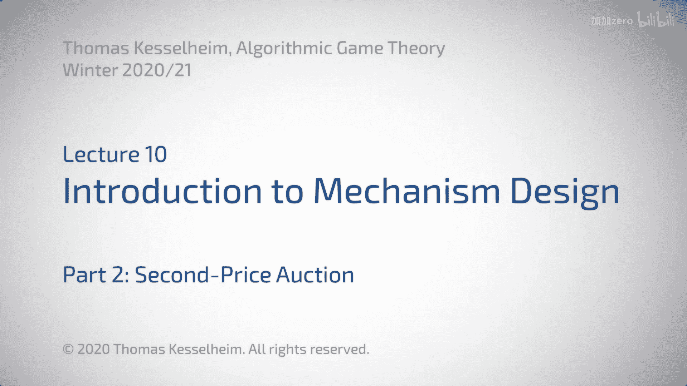

# 波恩大学【中英⚡算法博弈论｜2020-21 Algorithmic Game Theory】 p11 P11 Lecture 10 (Introduction to Mechanism Design) -BV1qX86zPEPG_p11-

Hello and welcome back to algorithmthmic Game theory I'm excited that we're starting a new topic today which is mechanism design。

 more precisely we are first starting with mechanism design with money before later the semester we also come to mechanism design without money。

So far， our goal was just to understand games and strategic behavior happening in games。

Today we're now asking the question， how should we set the rules of the game to achieve some desired outcome and not only today were doing we're asking this question but effectively for the remainder of the semester we are kind of asking this question。

And as an introductory example， I'd like to consider the question of selling a single item today。So。

We might not have one item。That we might want to sell。

Our goal is now to make just the world is as happy as possible。

 So our goal is not to make as much money as possible， but just to。

Make sure that the value that the world is getting out of this item， which is value less for us。

I the highest possible。What might this look like One thing you might want to do is you might want to run a first price auction。

What could that look like。Well， youre going to have a bunch of bids。

Each of them writes down their bid， how much they are willing to pay for this item。

And then you figure out who bid most？And in this case， the highest bid was 20。

 so we sell the item for 20 euros。嗯。If there's a good idea to sell an item like this or are better ways？

Well， to discuss this question， we first have to derive a Mathematica model。

And we first have to kind of capture the probably strategic behavior happening in here。

What we're seeing here was a socalled sealed bed。Me。First price auction。We have again。And players。

Or as we also call them in this context， often bitters。And。Eat of the bitters。Now。Reports one bed。

They all do this at the same time。And then， the bitter。With the highest bid。Winds。And pays。

His or her。Bit。Of course， we might want to define a tie breaking rule here because there might be identical bits。

 in which case we might want an essay okay at the bidder with the smallest index， for example。

 widths or。Whatever other tie breaking rule you prefer。How do we now capture the agents preferences。

 So what do these agents， bidders， players， who you want to call those are just。Identical。

 those things just mean all the same here， how do we express this？Well。

 what we do is we assume that each of the。Biditders has a value for winning。

And this is a non negative real number。So the bitter eye。Has vowed you。VI for winning。Yeah。V I。

Is some non negative real？And。What will then the utility be， of course， bitter I， if he or she wins。

 he or she has to pay。His or herbiid， So the utility。A bitter eye given beds B will be。VI minus B。

If bitter I。Winds。With bids， B。And it will be zero otherwise。

So this VI is just in terms of units of money expressing how much do I value the item？

And what we now say is O， my value and my utility is my value minus。

What I'm paying and what I'm paying in this case is just my own bed。If I win， if I lose。

 then my utility will be zero because I'm going home with as much as I came with。Now， if I'm bidding。

 for example， more than my value and I'm winning， then I'll have negative utility。

Because I'm paying more than my actual value for the I。But hopefully。

 I'm actually bidding no more than actual value。 and then Im have。Seeing some utility。Is。😮。

This a good game or not？Maybe。Well， it's at least for one advantage is that it's really easy to explain。

But what， what is a disadvantage。Well， we don't actually know。nobody knows these values in advance。

 so we don't know either， that's really important， Nobody knows these values in advance。bed。

You better actually know what the other bidders are bidding to now choose your best response。

And let's see this once again in our example， these are the bids in our example。And now let's ask。

 is this a pure na equilibrium proof？Is it a pure National equilibrium。For these players。

To bid this way。And even if we don't know their values， we see， well。

 this cannot be a naash equilibrium， this cannot be a pure na equilibrium。Because。

How should this bitter bidding 20， how should this ever be a best response？If this bidder bid。

 for example，7，02， then the play would definitely still win， but pay far less。

 And this way also have a higher utility。And the amazing thing is that。嗯。

There are better ways of designing such a mechanism for which there is a not only a na equilibrium。

 but for which bidding is super easy。And this is called a second price auction。

And this is what we will see next。

So now we are moving to the second price auction。 Once again， what was the first price auction。

 the seatdment， first price auction， each bidder reports a bid。

 and then the bidder with the highest bid wins and he or she。Just pays his or her bed。

And we what we were seeing was that usually。Truthful bidding， for example。

 isn't a purena equilibrium because if you're winning by a big margin。

 then you want to decrease your bit。Your true value， this is usually not a best response response。啊。

