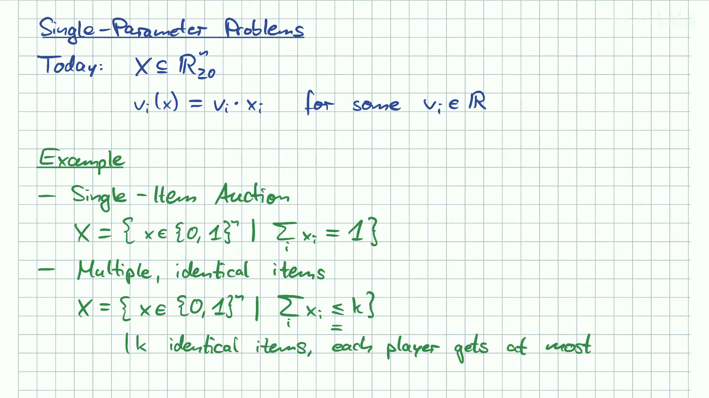

# 波恩大学【中英⚡算法博弈论｜2020-21 Algorithmic Game Theory】 p12 P12 Lecture 11 (Single-Parameter Mechanisms) -BV1qX86zPEPG_p12-

Welcome back to Athmic Game theory。Last time we introduced the topic of mechanism design with money and we also introduced the definition of a truthful mechanism。

Today， our goal is to better understand what necessary and sufficient properties mechanisms have to fulfill in order to be truthful。

But before we come to this。Let's quickly recap all the definitions。We'll have n players。

 or in this context we often call them bidders， and we number them by one through n。

And we have an outcome space X， this may be in general， an arbitrary set。

Although today we'll make a more restrictive assumption， what kind of an outcome space we have。

 but we'll come to this。😊，Now， each player has a private Val function which maps。

From the set of outcomes to real numbers， which means every player assigns a value to each possible outcome。

 this might also be a negative number， which means that the player associates some cost to this outcome。

Good， now we call capital VI， the set of all possible evaluation functions for player I。

 and capital V is the Cartesian product of these， so this is the set of all valuation profiles。

Now we defined this last time more generally， but for today it is enough to think about direct mechanisms。

 a direct mechanism now corresponds to an outcome rule and a payment rule in an outcome rule。😊。

The outcome rule determines an outcome and the payment rule determines the payments。

Both of them take as the input， a claimed valuation profile。Because each of the players。Bs。

Something and in a direct mechanism， the bids are what they claim their valuation is like。

And now the outcome rule takes all of these and maps it。2。One of the outcomes from the outcome space。

 and at the same time we have the payment rule， which maps on this to a payment for each of the players。

For example， we were considering these single item options。

Where possible outcomes were who wins the item and then usually we made the winner pay something。

And the losers didn't pay anything。But in general， we are not restricted to this kind of mechanism。

Now， what are the。Players， utilities。The player' utilities are quasiline utilities。

When we're now seeing the bits， so what the bidders or the players claim their evaluation is like。

 we now compute an outcome F。And then we evaluate the true valuation VI on that outcome。

And from that， we subtract the payment that the bidder is making。And the difference of this。

 this is a。Players utility once again we have the superscript M here which we often leave out which refers to which mechanism we're applying then we have this depends on B which are the strategies in this game。

 but then this also depends on VI， the private valuation function which we as the mechanism designer don't know。

And therefore， we were interested in what we call dominant strategy incentive。

 compatible or for short truthful mechanisms。A mechanism， a direct mechanism。

 is called dominant strategy incentive compatibleible if this following inequality holds。😊。

What's that？Any。Player。Gets the maximum utility when they bid their true value rather than any other bid。

Regardless of what the other players are doing。written down here。嗯。For any bid profile。

 it is it can only increase my utility if I unilaterally deviate to。VI， instead of bidding BI。

 whatever BI might be like。Okay。Today we'll get a deeper understanding of what this actually means。

And we'll do this for a special case of mechanism design problems， namely single parameter problems。

What are these？Our assumption today will be。That。Our outcome space X。Its a subset。Of。

Vectctors of non negative realels， and dimensional vectors。And。Each valuation function。

Is given as V times Xi。For some。VI， which is。A real number。So again， we're overloading notation here。

Like we did this for。Single item options where this VI。

 this would be the function associating a value to each outcome， and we're now say。

 okay this we can actually express by some real number times the Xi that I'm getting。

What might this look like？For example， we might have the single item auction。

Which we would simply represent as。X being all the vectors。In0，1 to the n。Where。

S of the Xi is equal to1。Now we're getting exactly what we want， namely， okay， first of all。

 this is a subset of r to the n greater than 0。😊，And。Here now we have X I。

Is equal to one if player I gets the item and it is zero otherwise。

But there are also other settings that we could capture to mention just。One simple example。

We might have multiple。Identical items。Which will also define this way。But then we'll have。At most k。

 so we might either have here equal to or at most K， and this means that we have K identical items。

And each player will still only get one。At most one。

So rather than having only a single item now we might not have two identical items。

 but the thing is each of the players will get only one of these at most one of these items。

 we could also easily define this and this would just mean that we would change this here to zero up to K so that a player can actually receive auto both items。

 but then we are restricted in what the valuation function is like namely that get。

