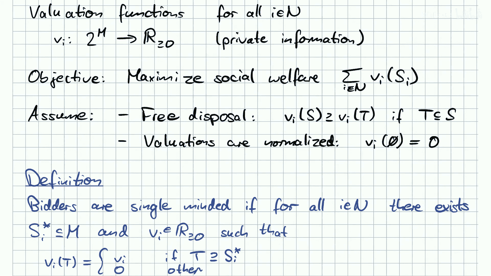

# 波恩大学【中英⚡算法博弈论｜2020-21 Algorithmic Game Theory】 p13 P13 Lecture 12 (Greedy Mechanisms for Combinatorial Auctions) -BV1qX86zPEPG_p13-

Welcome back Trigrorowth McA theory In the last lectures， we introduced mechanism design with money。

We got to know the notion of a truthful mechanism and then also by myosinlemma。

 we got a pretty great characterization of what it is that makes a mechanism truthful for single parameter settings。

Today， we'll use this characterization to build truthful mechanisms for combinatorial options。

This means that。We'll have to design an outcome rule。

 which is nothing but an algorithm that decides how to allocate items。And then from myslemma。

 we'll conclude what payment rule we would have to apply so that we get a truthful mechanism in total。

This will work for general combinatral a， but only for a subclass which we can again understand as a single parameter setting because for arbitrary settings。

 which are not single parameter， myos islemma does not hold。And by the way。

 things are much more complicated。Good， so let's first recap the definitions of communatorial auctions。

In come in a trial auction。We have。And bidders。Or players， however you want to call them。

And that will be the set。Capital N。And usually we call that it bidders1 through n。

And then we have M items。And we call that set M。Usually we might。Also call the items1 through M。

 although we might not always do this depending on what feels right at that time。

What are our feasible allocations？Feaible allocations。Are vectors of sets。So each of this。These sets。

Is an element？Of the power set of the set of items。And we also want that。

Each item is allocated at most ones。Which means。And if we consider it would。

Bitder is I and I prime gaant， those two sets have to be disjoined unless I is equal to I prime。

We'll have validation functions。Those。Define a non negative value。

For every set of the items for each player。And those are private information。

And what will our objective be？Objective。For today， well be to maximize social welfare。So。We might。

Addd up。The values that the players have for their respective sets of items that they're getting。

We'll assume furthermore。Free disposal。Which is a very fancy way。Of saying that。

If I get a set of items。S。My value is at least the value I would have for this side set T if T is a subset of S in other words。

More items never hurt me。If I get。More than if I get more items， so if T is a subset of s。

 then the value I have for the set S will be at least as much as my value for the set T。

You could also call this simply monotonicity。And then。We also assume that valuations are normalized。

Which means that the value。the empty set should be0。So if I don't get anything。

 my value is zero if I get more。Then my value will be non negative because we're saying that the value for such a set will always be non negative。

Good。Now， this is generally not a single parameter setting， why that。Because these functions。

 they cannot be expressed by just a single parameter。

Which is exactly the point of a single parameter setting。But？

The special cases of evaluation functions we're considering today。

 those we can indeed interpret as a single parameter setting， namely what will our assumption be。

 our assumption will be that I'm single minded。I'm only interested in one subset of the items。

If I get at least this subset， then Im happy。 if I don't get it， then。Im。

Just as happy as when I don't get any items。Let's write this down formally。We say that。

Ps are single minded。If。4。Every bitterder。There exists。Simet。As I star of items。And some。

Non negative real VI， such that。😔，bititter eyes value for a set of items will be。VI。

If T is a superet。F S I star and0 otherwise。

So。We are again overloading notation here by VI。We both denote the function as well as the value that it can take。

And this， I think， should be very familiar by now because in the case of， for example。

 a single item optionuction， we did exactly the same or also in the case of the。

Single parameter settings。 So VI。that is my value for the set S I star。If I get。

At least this had SI star， meaning I might also get more items than my value is always VI。

But if I get if I don't get all of S I star。And this might even mean that SI star contains 100 items I'm getting only 99 of them。

AllAlway then my value will be 0。Good， let's see。How we can。

