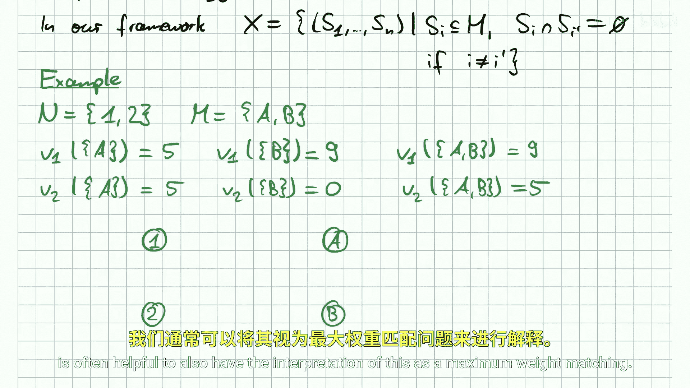

# 波恩大学【中英⚡算法博弈论｜2020-21 Algorithmic Game Theory】 p14 P14 Lecture 13 (VCG Mechanisms) -BV1qX86zPEPG_p14-

Yeah。Welcome back to Outrorow making theory。In the last lectures。

 we introduced the general problems and framework of mechanism designed with money。

 and then we also gained a pretty good understanding of single parameter problems。

 we could then figure out what it is that makes a mechanism truthful。

 namely the allocation rule had to be monotone and the payment rule had to follow。

The formula from Myerson dilemma。Today we will go beyond single parameter problems and consider just some arbitrary problems and for these we will again show a technique to build a truthful mechanism。

 although this is not quite as general as it would be for a single parameter problems for which we have an exact characterization of what makes mechanisms truthful。

 there is no such thing for more general settings。What are these more general settings。

 Maybe let's quickly recap our definitions。Still we have a set N of N players or bidders or agents。

 however we want to call these， we have an outcome space。Which is just someome set。

This had a particular structure in the context of。Single parameter problems today。

 we don't care what this has。And then each player has a private valuation function。

Which maps outcomes comes to real numbers？And then。

We say that capital V I is the set of possible valuations for player I。

 Capital V is the set of all valuation profiles， and then we say that a direct mechanism。

 M consists of the following things。 We have an outcome rule， F。Which maps。

A claimed valuation profile so each of the bidders claims somevalation function。

 and this is what the outcome rule takes as the input and it maps it to an output。And。

It also has a payment rule which takes the same input。Namely。

 what the bidders claim their values are。And it maps it to a vector of payments。

 which is just a real number for every bidder。嗯。We are still talking about quasiline utilities。

Which means that the utility。Of a bitterder under mechanism M， if his or her valuation is V I is。

The value of the outcome that is computed minus the payment that we are imposing on this bidder。

And we now call a direct mechanism， dominant strategies hand compatible or simply truthful。

 if for any bidder， any valuation and any bid。Utility of this bidder。

When bidding the true value is at least as much as the utility under any other bit。

 regardless of what the other bidders are bidding。One special case of this was。嗯。

The was every single parameter setting， but there are also settings which are not single parameter settings。

For example， general commatorial auctions。What would these look like？し。In a combinatator oxygen。

 what do we have？We have， of course。N， as is set。and bitterders。And M as the set。As a set of M items。

And what we can now do is we can assign。The items。To bitterders。And。Each bitter。

Has evaluation function？Okay。Yeah。V I， which maps subsets。Of items， to non negative real numbers。So。

In our framework。We would therefore set the outcome space X。To all partitions。

Of items among the andbitderters。Where each S I is a subset of M。And as I intersect， as I prime。

Is empty。Unless I is equal to。I prime。This is not precisely。

Or syntactically this is not the same problem because once again here these functions are something more restrictive because our more general framework also allows us to say okay。

 I now my value now depends on what items my neighbor is getting， this is fine。

 but the important thing is to realize this is something that fits into our framework。

 when we're not so super careful about the syntactical differences。

 whether we assign a value to such a vector or we assign a value just to any single of these sets。

This is actually the same thing that we've also seen in the context of single item options。

 so this is always a little annoying here。😊，That syntactically things do not always quite match up。

 but it is actually no bigger concern。What good now such a cominget hall auction look like。

We might have。Two bidders。And。Two items。And now we can define the function V arbitrarily。 So。

 for example， we might set。呃。Will you view you one。If bid  one gets item A。

 then they have a value of 5。 If they get only item B， then they have a value of 9。

 And if they get both items。Then they also have a value of 9。

This is an example of a unit demand function， because the only thing is。Do I get an item or。对。

The only thing I care about is。And what is the most valuable of my items。 So in this case。

 my most valuable item would be item B。 And I don't when I'm already getting item B。

 I don't care whether or not I'm getting item A。We could also as set a similar function for。Bitter。

 too。And。Let's， for example， take。This function。It is also a unity man function。

Bitder 2 now has a value of5 for item A， but no value for item B， and for both items together。

 he still has a value of 5。So。What you see here is that this cannot be described by just a single number。

We have one value for item A and one value for item B。And so this is not acing a parameter problem。

What would this be what could this look like visually？Is often helpful。To also have the。

Interpretation。

Of。This is a。