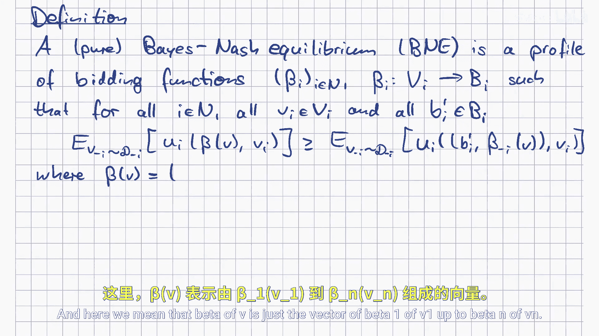

# 波恩大学【中英⚡算法博弈论｜2020-21 Algorithmic Game Theory】 p15 P15 Lecture 14 (Bayes-Nash Equilibria) -BV1qX86zPEPG_p15-

Welcome back to Adggri making theoryory。Over the past lectures。

 we've got to know truthful mechanisms， more precisely dominant strategy instead of compatible mechanisms。

These had the property that。Players or bidders always want to report their true values regardless of what the other players are doing。

 it is a dominant strategy for them to do so。But we've also seen that sometimes。This doesn't work。

Sometimes it's not possible to design a simple truthful mechanism。And。

Why is it that we're insisting on this truthfulness anyway， How can we。

Understand nontruthful mechanisms。This is exactly the kind of question that we want to start answering today。

But。How would we analyze such a non truthruthful mechanism。

 Because we still want to take into consideration that。Players will behave strategically。

If it is not in their best interest to report that true value。Then they might lie。

One thing that we might want to do is we might just consider pure or mixed naa equilibriumlibria of the resulting game。

However， there's one big weakness about this。For a pure or mixed national equilibrium。

What you will always be considering is the case that actually all players know each other's values。

Why that， Because to find this equilibrium， you would then。

all of the players have to know what the other players utilities are like。

 and the utilities depend on these private valuations。And this makes this a little weak。

So we might now argue， for example， for a first price auction that。If a purena mixes。

 it will always be great， but。嗯。How should the agents ever end up in such a pure natural equilibrium？

What they are choosing there as their strategies depends on what the other players have as their values and this is exactly private information。

So today we'll get to know。😊，An equilibrium concept which works with incomplete information。So also。

 the players don't know the。True values of the other players。But they do have a belief about this。

And this is called a basees Nsh equilibrium。Let's see how this is defined。We'll assume。That。

bititter eyes。Value V。Out of capital VI。Is drawn。Independently。From some。Distribution。Di。

These distributions。Are known to all bids。And now。Each player or each bidder。

 however you want to call this here。Each bidder will not choose。B BI。Of course。

This bidder knows his or her own value。But not。B minus I。

Only the distributions that B minus I is drawn from。How can we capture this？

We can now say in other words， that each bidder。Choose this a。Bdding function。Which we call beta I。

 which maps。From the set of all possible values。2 beds。And we now say that， whenever。The value。Is VI？

Btter I。Bits beta， I， FV， I。For example。Truth forbidding。Will be just the function that。

Beta I of V is equal to V。And now we say that。Such a。

Choice of a bidding function for each player is a base natural equilibrium if no player can benefit from unilaterally choosing a different bidding function。

So。In a way， we can understand this now as a game of choosing the bidding functions。

 The strategies are now the bidding functions。And we are kind of interested in a pure natural equilibrium of this game of bidding functions。

More formally， this looks as follows。eight。Pure。Base Nash。Equiilibrium。Or for short， B， and E。

Is a profile？As bidding functions。Beta I。For every player that we have。The beta eye。Is mapping。

From the possible valuation functions of bitter I to。These are her possible bes。

And now we'll have to define the equilibrium condition。4our。All players。All possible values。

And all possible deviation。Bids。The following holds。Take the expectation。Of。You， I。Beta of V。Come on。

😔，VI。And this will be at least。The expectation。F U I， F。Y prime，Bta minus I。A V。Com吗。

And here we mean。That beta of V is just the vector of beta 1。

F V1。