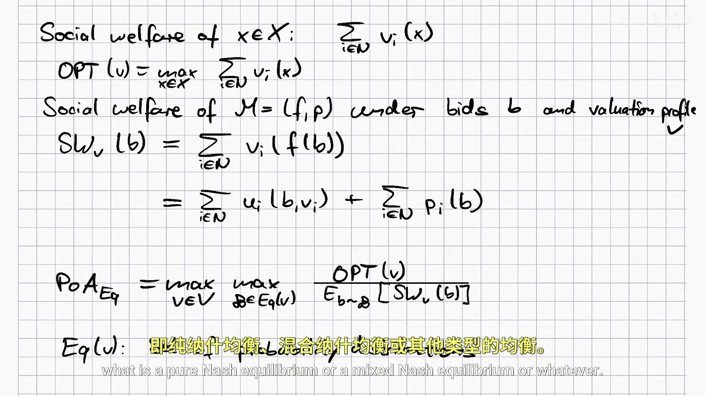

# 波恩大学【中英⚡算法博弈论｜2020-21 Algorithmic Game Theory】 p16 P16 Lecture 15 (Smooth Mechanisms) -BV1qX86zPEPG_p16-

Welcome back to algorithmgthic game theory。In the last lecture。

 we started discussing non truthruful mechanisms， like for example， the first price auction。

 we introduced the notion of a base Nsh equilibrium to。

Formerally specify how players might behave in such a setting where they don't know the other players valuations。

Today we'll generalize all of this a bit beyond first price auctions。

 but we'll also come again across the first price auction and kind of see again the entire argument of why the social welfare in a base natural equilibrium of a first price auction is still reasonably good。

Before we get started with this， let's quickly recap again the basic definitions of mechanism design。

 so we'll have again， and players， bidders or agents， we have an outcome space and each player。😊。

As a private valuation function， which maps outcomes to real numbers。嗯。And also。

We'll assume today that these real numbers are non negative， just like we were assuming this for。

 for example， the first price auction anyways。Now the。Baders report。Any sort of beds。

 we are not necessarily restricting ourselves to direct mechanisms now。

 so this might be just some arbitrary possible bits。W which are BI。

 this is the set of possible bits for player I and B is just the Cartesian product of these。

 so this is the set of all bait profiles。A mechanism takes as input a bid profile maps it to。

An outcome， this is the use so called outcome rule。

 and we also have a payment rule which maps a bid profile to a vector of payments。

Here it is again important that those are non negative today。What we were。

Talking about then alwaysway was dominant strategy incentive of compatibility。

 this is something we're not doing today， we'll still have the notion of quasiline utility。

 so the utility player I under bid profile B when his or her evaluation is VI。

Then the utility will be VI of F of B， F of B， this is the outcome computed under Bit profile B。

 and from that we subtract the payment that this bidder has to make。As I was saying。

We're not discussing truthfulness today， we're rather considering the games that are。

Induced by such mechanisms。And then， for example， we might consider a na cali bit。

So what would that look like？Although we've seen this a couple of times now。

Maybe it's good to once again understand what this what a。

Pion naturalural equilibrium means in this context。So we'll be given。A fixed。Valuation profile。V。

And then a profile。As bids。B。Is a pure natural equilibrium？If。For every player。

 we have that the utility。问。Bidding BI。Is at least the utility？When bidding BI prime。

For all possible BI prime。So in a similar way you could also generalize the notion of a mixednash or equilibrium of a correlated equilibrium。

 or it's not even a generalization， it's just an application to the setting。The point is this is。

A complete information setting in the sense that this valuation。Profile is fixed。

Each player has their fixed valuation profile and now what we're looking at is APion natural equilibrium and so this means the strategies may even depend on the exact same valuations of the other players。

Still what you could ask now is what is the price of anarchy。

 how good is such a pureionna equilibrium compared to the social optimum？And we can。

Define this also here。To make this more precise， we will talk about social welfare。Of some。

State sorry， not of some state， of some outcome。This will be。

Taking the sum of all valuations of the respective players。And then we can say opt of V。

 that would be the maximum social welfare。That we could see。And also。

We could write down the social welfare。Of a mechanism M。Under。Itsビ。This we would now write as。

Social welfare。For the Subscript V。So I should also say that this depends on the valuation profile。

And then we would now write this down as take the sum over all players and。

See what the mechanism computes underbit profile B。

 and then of course evaluate it regarding the actual valuations V。

You can also write this in a different way because we have the quasi linear utilities。

You can also write this down as the sum of the utilities。Plus。This sum of the payments。

And now we can also define the price of anarchy。We'll do this exactly as before。

 so the price of anarchy for an equilibrium concept EQ。Would be。

Take the worst of these valuation profiles。that take。The worst。😔，Of the Eria。

And compare the optimal welfare。That is possible with this valuation profile to the expected welfare at equilibrium。

And here again。EQ。A V， this is E。Set。Of。Probability distributions。Of course now it depends on V。

 what is a。

A pure national equilibrium or a mixed national equilibrium or whatever。

And this ratio will always be， of course， at least one because the optimal social welfare。

Is of course， at least as good as whatever the mechanism。

