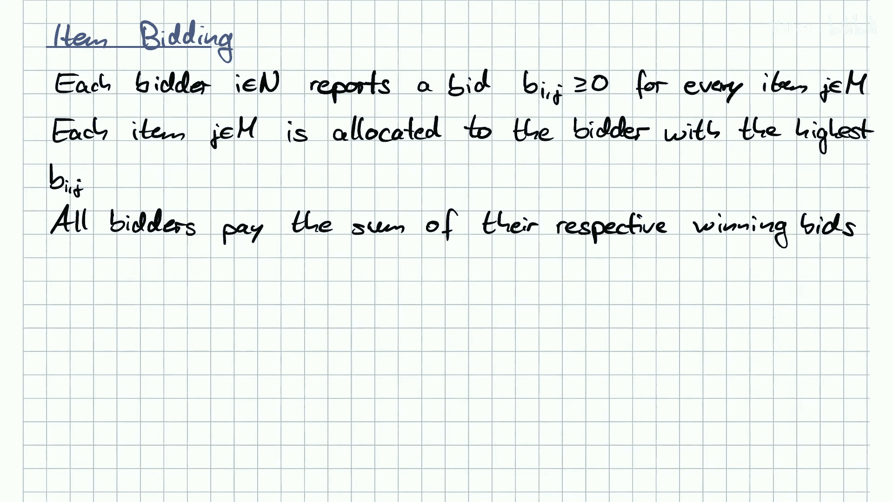

# 波恩大学【中英⚡算法博弈论｜2020-21 Algorithmic Game Theory】 p17 P17 Lecture 16 (Simple Combinatorial Auctions) -BV1qX86zPEPG_p17-

Welcome back to algorithmggothmic Game theory。In the last lectures we've introduced the notion of a base natural equilibrium and also the notion of a smooth mechanism。

 all this was to analyze non truthful mechanisms。Today， we are going。

Welcome back to Arithmic Game theoryory。In the last lectures we introduced some tools to understand non truthful mechanisms。

 namely we introduced base natural equilibrium。We introduced smoothness of mechanisms。

And always was about understanding what happens if a mechanism is not truthful。

 so it's not in the bidder's best interest to just report the true value。

Maybe it's even impossible to report your true value。

What can we then still say about the outcome of such a mechanism？

Today we will be a little more specific about the application namely will consider combinatorial auctions。

And for communal auctions， we see。Two different mechanisms for which we will then。

 in both cases be able to show that they are smooth and by the result from the last lecture。

 this immediately implies a price a bound on the price of anarchy for base natural equilibrium。

 but also for other equilibrium concepts。Before we get there。

 let's first recap all these definitions， so we are considering a commonat auctions。

 which means we have n bidders or players， which we'll call capital n。

 so this they will be numbered1 through n， and we have M items capital M1 through M。

Each of the bidders now has a private valuation function， which maps。

 subsets the items to non negative realels。I realized that I'm always dropping the。

Our convention that we're following all the time， namely that this is a monotone function。

 getting more items will never hurt you， and also that getting no items you'll have a zero value。

So this is all implicit in whatever were doing regarding income and auctions。

Now we are trying to find a mechanism， which is a pair of an outcome rule and a payment rule。

 both take as their input a bid profile。And then the outcome rule determines an outcome which means an assignment of the items to the bidders in the case of a comm auction。

 and the payment rule defines how much the bidders will have to pay。And also this time。

 we are still assuming that the bidders will always pay something non negative。But as you see here。

 these mechanisms are not necessarily direct mechanisms because these bid profiles。

 those or the respective bids， those are not necessarily valuation functions and as it turns out our first mechanism today will be an indirect mechanism。

 the second mechanism that we will be studying today will be a direct。

And then what was it that made a mechanism smooth？We call the mechanism Ladaum amuse smooth if the falling holds。

Take any vector of valuations， so valuation profile。And take now any player。

Then there has to be a safe deviation bit for this player。Which now fulfills the following。

For any bid profile， B。We have that this inequality is fulfilled， take the sum over all bidders。

 what is this bidders utility when this bidder is unilaterally now bidding B star whereas the others are bidding B minus I。

This should be at least Lambda times the optimal social welfare minus mu times the sum of the payments under B。

And this implies that the price of anarchy for base natural equilibrium。

 of course correlated equilibrium， for correlated equilibrium for mixed natural equilibrium forq natural equilibrium。

Is always bounded by the maximum of mu and one divided by lambda。

So all we are doing today is just proving smoothness of mechanisms。

And this is then as the immediate consequence that we are also bounding the price of anarchy。

Using the approves from last time。Good。😡，So the first mechanism I'd like to talk about is Iting。

Namely， what will we be doing， we will now be selling each item in a commun auction separately。

And we asked。How good is this， So the one way you can think about this is kind of a。

Parallel eBay auctions， maybe you just want to buy one phone。

 but you cannot actually tell eBay that you only want one phone if you buy all of theseuctions。

 if you win all of the auctions， then you're buying suddenly multiple phones。And。

This is why this is a non truthful mechanism because you cannot even reveal your true preferences。

 so this is an indirect mechanism。The， the bids that you're posting。

Those aren't actually your true valuation。Let's see how we could。Design this。

And how we could express this more。foly。So what is item bidding？

We're actually just selling each item in a separate。First， a second price a。

You we not doing this in a first price auction just because it's easier。So what will this look like？

Each bitter eye。Reports。The be。B Ij。For every。😔，Item。And then。Each item。Is allocated。2。The bitter。

With that。Highest。BIJ。And。All bids。Hey the sum。Of there。Respective。Winning bits。

So if it so happens that you know win 10 items， then you also pay for all these 1 items and you pay your bids。

Good， so this is not a truthful mechanism for many reasons， it is easy， but it is not truthful。

Why that， well， first of all， we have this weird payment rule。

 which even for a single item would be a first price auction， which we know is not truthful。

But other than that， also this way of bidding。This cannot be truthful because you cannot tell the mechanism what you really want。

 you cannot， you do not report your true validation functions。

 but all you can do is you can bid on a single item。Or not on a single item。

 but you can bid on all items， and then you might also win multiple items。And。

