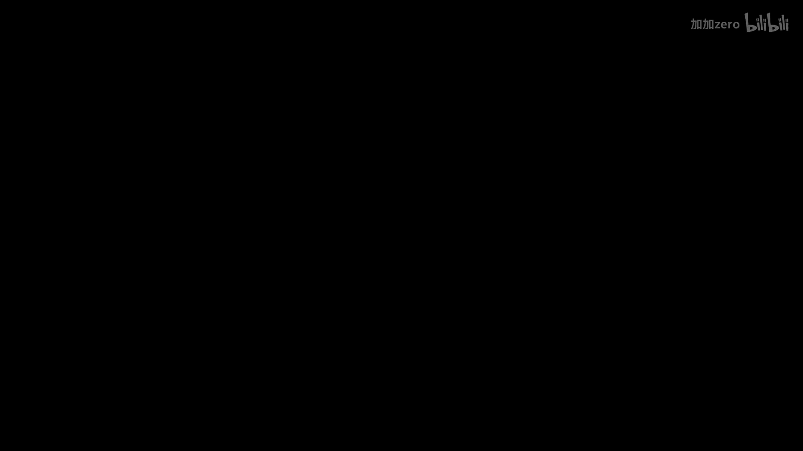
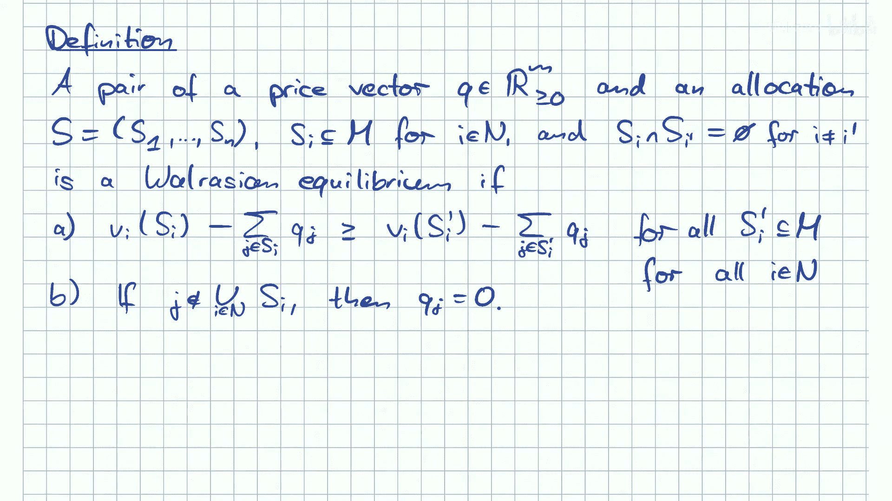

# 波恩大学【中英⚡算法博弈论｜2020-21 Algorithmic Game Theory】 p18 P18 Lecture 17 (Walrasian Equilibria) -BV1qX86zPEPG_p18-

Welcome back to algorithmthic Game theory。In the last lectures。

 we've learned a lot about mechanism design and particularly comb oil auctions。

And the kind of mechanisms that we were considering were always。Auctions of some sort。

 meaning that you and every other player as well submit a bid。And then based on what the bids are。

 the mechanism makes the allocation。But unless you're a professional art collector。

 this is not what your daily shopping experience is like。

Usually you just go to a store and then you see a posted price。

 so you see okay I can now buy this item for this much or I can buy two items for just then double the price。

And。How can one capture these kinds of settings mathematically？And also。而。Bs。

Efficient in the way that do we come to a good outcome？Do we come to good social welfare this way？

This is exactly the question that we will be considering today with some classical economic theory。

 and then also next time when we talk about。😊，A more algorithmic approach to this。

Which is more general， but then also loses something， you will see the differences between these。

But as I was mentioning today， we'll only consider classical economic theory。

 namely we'll get to know the concept of a war raised equilibrium。What is this？We have， again， and。

Players。Or agents， you can also call them bidders， although they are not actually bidding。

I often will call them just buyers。Because this is what they are actually doing。

And then we have M items。This is set we call one through small M and which we call capital M。

AndWe're now in this standard setting of combat auctions。Each player， I。Has a valuation function。

VI mapping from the power set。Of the items to the nonne reels。So again。

 each player has a non negative value for every subset of the items。

But what is different now is that we consider full information， so these are public knowledge。

 we know these VI。And also， everybody else knows them。

 So our question today is not at all about incentives。

 letting these players reveal their true values。 This is no。No question today。Rather。

 we are interested in the question。Do there exist good prices。

And whether or not there exist good prices， this is formalized in the concept of a wall raisingis equilibrium。

It's called a wall raising equilibrium after layon wall Ro a。嗯。

An economist who introduced this concept。Has this defined？A pair。As a price vector。Q。

And an allocation。S， which is a vector of S1 through S N。Each S， I being a subset of M。And。

Saets that are paras disjoined。So each item is allocated to at most one player。And this we are call。

A wall raised equilibrium。If two conditions are fulfill， the first one is that V I， F S I。

Minus the sum。Of all J and S I P， J， this is at least。V I of S I prime minus。The same。

Of all J and S prime。Q J。And this should hold for all Si prime， which are subsets of the items。

And then we also have the condition that。If an item。It's not。In the union of all S I。

Then its price has to be 0。Good。Let's have a closer look at this。

We see a wall raising equilibrium is nothing like the kind of a equilibrium that we've seen so far。

 for example， a natural equilibrium， a natural equilibrium was always about。

Each player choosing a strategy and no player wanted to unilaterally deviate from this。You now。

 players are actually not used in choosing any strategies。But still。It is。

Kind of formalizing the intuition that every player should be happy with their allocation and the prices。

 And this is。😊，As follows， so a well raising equilibrium now consists on of this price of vector and also the allocation of the items with the falling properties。

Let's say I'm player I， I'm not getting set SI。And then I'm paying the sum of the QJ for the items in SI。

Am I happy with this？Yes， I am happy with this unless there is another set SI prime for which my value mines what I would have to pay for that。

Is higher。 And this is written down here。 So this would be my quasi linear utility if I'm getting set S and I'm paying the sum of the prices in the set SI。

 And this is now for the set S I prime。 What would be my value， minus what would I have to pay。

And this condition now tells us that every player。Should be happy with what they are getting。

 So I forgot to write this down。 This should， of course。😊，Also， hold for all players。

So no player is unhappy with what they're getting， no player would rather get a different set of items than the one that they are currently being assigned。

 and then there's this other condition which is as follows if an item is not allocated。

 then it should certainly have a price of zero。This is maybe a more technical condition。

whichch will turn out to be useful later， but the point is that if nobody is getting an item。

 then it should have a price of zero so it could be and this then combines with this first constraint。

It should be easy to get。 So if there is an unallocated item， then I shouldn't be made。

Happier by giving me this item on top， because。I could， for example， include an SI Prime。

 everything that I'm getting so far and everything that is not allocated。😊。

Then I would still pay the same， and this shouldnt make me happier。So this kind of means that。

Items which are not allocated are。