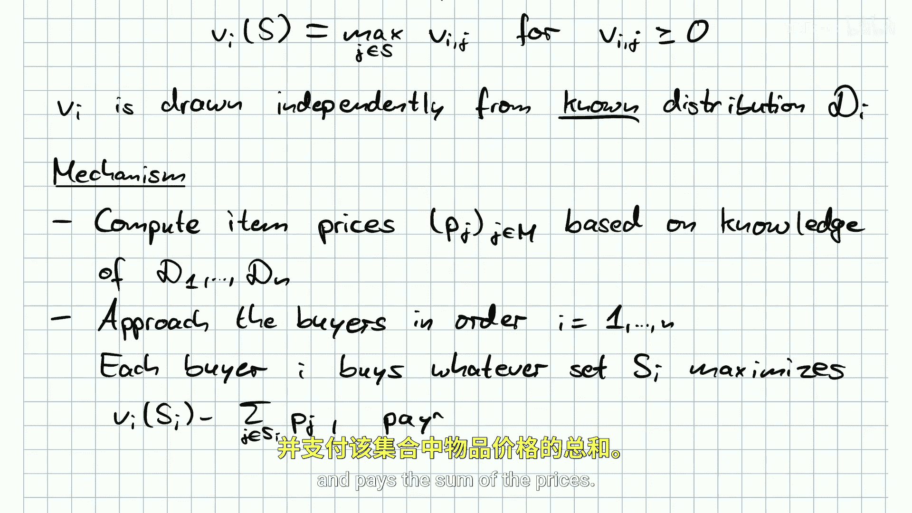

# 波恩大学【中英⚡算法博弈论｜2020-21 Algorithmic Game Theory】 p19 P19 Lecture 18 (Posted Prices with Incomplete Information) -BV1qX86zPEPG_p19-

Welcome back to algorithmic A theory。Last time we started talking about the question。

How well can prices coordinate markets？This means that rather than running an auction。We now。

 want to， for example， in a comminatorial auction， we would rather want to post prices to the different items。

So that。Buyers get their favorite bundles。And at the same time。

Social welfare is at least approximately maximized。

And what we got to know in this context last time was the concept of a world reason equilibrium。

Which was exactly this choice of prices and an allocation。

Such that every buyer is happy with what they' are getting。So no buyer would rather want to get。

A different set。Today we are complementing this with a more modern theoretical approach。

Which again posts prices but。Now the buyers just come one after the other and they take their preferred set。

 and as we see this does make a bit of a difference。Then our welfare guarantee。

well we will still prove a welfare guarantee， but we won't be able to show。That we get。

Optimal social welfare， but only approximately so。But at the same time。

 we work with less information。So I hope you see that there are many similarities。

 but also differences。What is the precise model that we're talking about？Like any commin auction。

We have n buyers that will be the set capital N。And we will usually call them just one through n。

And we have M items。And。Each buyer。I in N。喊水。Private valuation function。VI。Which。

Againgan assigns a non negative。Real number to every set of items。

And we assume that these are unity man functions。That is。V i。Of S will be the maximum。Of all J and S。

 V， I comma J。4。Non negative VOG。In other words。Every buyer。

Can in principle be assigned multiple items？But if they are assigned multiple items。

 then what they care about is only their most valuable one。Good， now， as you see。

 there's already something different here compared to what we were talking about last time， namely。

 these valuation functions are assumed to be private today。

 they are not public knowledge as in the theory of world Ra and Eria。But。

We again make the assumption that we also made in the context of base na equilibriumlib that in advance we know probability distributions。

 which these valuation functions are drawn from。This means。V I。Its drawn。Independently。

From a distribution， DI？And that will be。And known。Distribution。But other than that。

 we make no further assumption。So once again， these are known。

But the valuation functions are private。And now we'll study the following kind of a mechanism。

We first。Compute。Item prices。So a price Pj。For every item。And we do this based on。The knowledge。F d1。

Through the N。And then。We。Approach the buyers。In order。1，2， n。And。Each buyer。I。Buys， whatever。Set。

S I。Maxims。VI of SI。Minus the sum of the prices。In S I。And pays。

The sum of the prices。Good， so what's the mechanism， It's really simple。

Once you know how to do this first step。In this first step， we somehow。

And that's something we have to talk about。We somehow compute these prices， one price for every item。

 and then we put a price tag on every item， we do this based on knowing these distributions。

Of course， we don't know the valuation functions because those are private knowledge。

And then we approach the order， the buyers in order1 through n， and then each buyer。

Coses whatever said SI maximizes。This buy utility。 So V I of S I minus the sum of the prices in this set S I and。

Pace。The sum of the prices for the set that they chose。

This you could also express as an allocation function F。It's an allocation rule。Or outcome rule。

 as we call this for a mechanism。For every fixed D1 through DN。

 and then you also have a payment rule， the payment rule is also。Easily described。

 but that's maybe actually even a bit misleading because the way agents now。

Perform or the way agents behavior is not that they're telling us， okay。

 this is my valuation function， give me something， but they rather choose whatever they prefer among what is left。

The reason why I say it this way is that now it is completely obvious。

That this is a truthful mechanism。How so。Well。Why should I misreport or what are my alternatives。

 I could buy a different set。When it's now miter， and I could simply choose a different set。

But would this make me happier， of course not， because I'm just choosing the set whichever maximizes my utility？

So choosing a different set， lying about my valuation， saying that another set makes me happier。

 there's no point in this。At the same time， while truthfulness is easy， now， of course。

 this comes at the。Price that we now have to know these distributions in advance and that we have to fix the prices。

Which， for example， a mechanism like VCG could do without。But let's first write。

