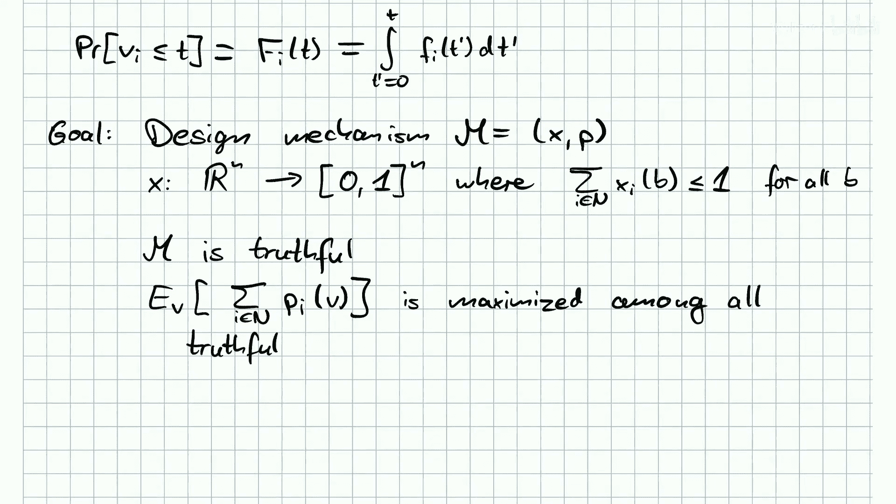

# 波恩大学【中英⚡算法博弈论｜2020-21 Algorithmic Game Theory】 p20 P20 Lecture 19 (Revenue Maximization) -BV1qX86zPEPG_p20-

Welcome back to our class on algorithmic game theory over the last lectures we've developed a pretty good understanding of mechanism design in particular for the goal of maximizing social welfare。

This means we might have one or multiple items。And we then want to assign the items to the buyers to maximize the sum of their allegations。

Today we are moving to a different objective， namely we want to maximize the revenue。

Which means that we want to maximize the sum of the payments。

And we will go back to just the case of a single item。

You remember maximizing social welfare in case of a single item was rather easy by， for example。

 running a second price auction。And then we even don't have to know anything about the virus in advance。

This is not quite true if we want to maximize revenue， because if， for example。

 we had only one buyer。How would we want to maximize revenue。

 This buyer could claim arbitrarily small values and。

We should probably give them the item and there's no way of enforcing anything。

This is why we assume like we did this also in other cases that in advance we know the。

ValuationThe probability distributions the valuations are drawn from。And based on this。

 prior knowledge， we then design a truthful mechanism with the objective of maximizing revenue。

So let's first。Write down our model。We'll have N bidders。

And the set of all bidders is again denoted by capital N。And。There is only one item。Each bidder。I。

Ass a private value。V I for the item。And we'll report a bit。B I。And we assume。baad。😔，VI is drawn。

From distribution DI。Independently。DI is known publicly。And the support。Will be something from 0 to。

V max。So there is an upper bound on the。And。On the values that buyers might have， namely it is Vmax。

Furthermore， we assume that these are continuous。So it's density function。Will be called F。And it's。

K。Cumulative。Distribution function。Will be capital F I。This means。That weekend now right。

The probability。That VI is ut most T。This we can alsoright as capital F of T or as the integral from。

0，2 T of small F I。Ft。第几。And what's not our goal， our goal is to design a mechanism。

Still a mechanism consists of an outcome rule and a payment rule now here。

 as we now have the density function called small F， we'll call the allocation rule。

The outcome rule now small x rather than small F word other than that。It is just the same， so。

A goal is to。Design。A mechanism。And。Which is a pair of an outcome rule and a payment rule。

And this outcome rule。Will be mapping。Vactctorors of bids2。

Vactctorors between vectors of numbers between0 and 1。Where。The sum of these entries。

Will be at most one。What does this mean， how can we interpret this？Well， there is the pretty。

Natural way of understanding this if one of these is indeed one and the others are zero。

 so this could be one option， then this buyer is getting the item。

 otherwise we can also interpret this as a probability distribution。So we could also say， okay。

 now this buyer is getting the item with probability half， this buyer with probability a third。

 and this probability was worth probability a sixth。

But these probabilities don't even have to sum up to one。

 this might also be less than one if we just decide to keep the item。

So one possible allocation is also just to say， okay， nobody's getting the item。We'll just stay。

 we'll just return the all zero vector， also that's something that is possible。And what's our goal？

Our goal should be that M is truth， should be truthful。And we want to maximize。一。

Some of the payments。When buyers are reporting truthfully。

So once again。We want to design a truthful mechanism。Each truthful mechanism。Now， comes with。

A payment rule？So we restrict ourselves to mechanisms， of course。

 which don't allocate the item more than once。And the ones that are truthful。

 and each of these comes now with a payment rule。And this。Among all now these truthful mechanisms。

 we want to now choose the one mechanism or。There might be even multiple one of the mechanisms which maximize the expected sum of the payments if bidders report truthfully。

You may not ask， why is it that we're insisting on truthful mechanisms， indeed。

 there's no real need for this。There's also some more general statement than this。

Let's not talk about this right now， so the point is because the mechanism is truthful。

 we can expect the buyers to actually report their true values and that's only why maximizing this thing makes sense if this was。

