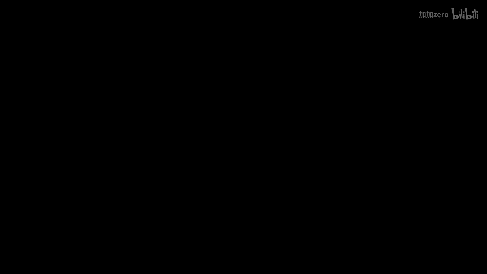
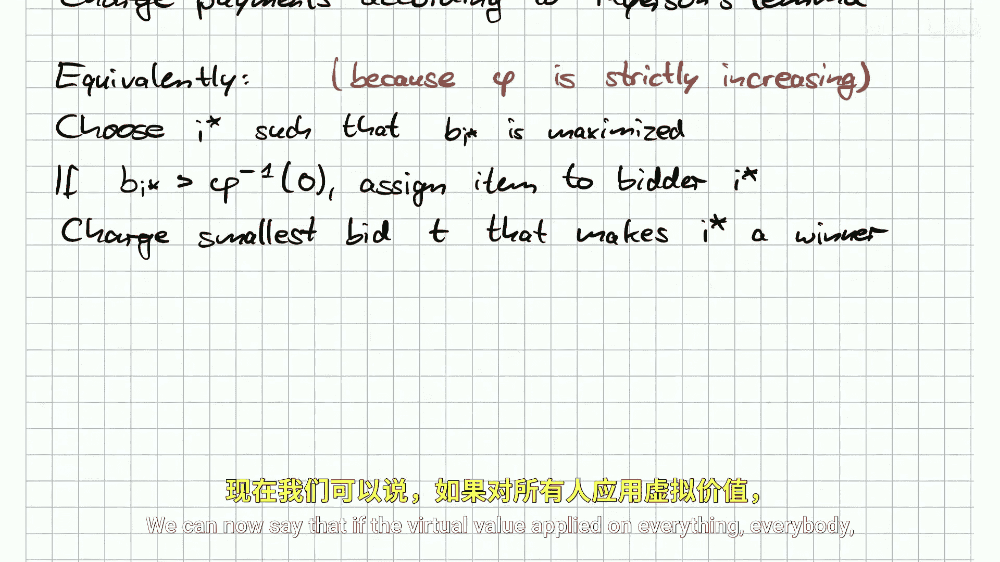

# 波恩大学【中英⚡算法博弈论｜2020-21 Algorithmic Game Theory】 p21 P21 Lecture 20 (Revenue Maximization with Identical Distributions) -BV1qX86zPEPG_p21-

Welcome back to Agrothmic Game，In the last lecture。

 we introduced the problem of revenue maximization and we already derived the equality of expected revenue and expected virtual welfare。

Today we are continuing our discussion of maximizing revenue。

 but for a special case namely we assume to have only a single item。

 and we furthermore assume that all distributions are identical。Let's first recap the setting。

We have n bidders， which we will again call capital n the set， and we will call them1 through n。

And so we're saying we have one item。And then we have these private Vals。

Which are we want through VN， those are the private valuations of the bidders。

Those are drawn from a known distribution。And today。The thing that we are assuming is that this is。

The same。For all bidders。Hi。And this is why I'm dropping here the subscript。

So the distribution will simply be called D and not DI because all DI would be the same anyways。

We assume that this has the aummulative distribution function， capital F and a density function。

 small F。What we showed last time was that。The virtual value function is very crucial， but was that？

The virtual value function。That was just something that came out of our。A weight of。

Solving for the or finding out what the welfare， what the revenue of a truthful mechanism was。

The virtual value associated to value T is the following。

 we take the value T and then we subtract something。

 so this is something I should have said also last time the virtual value is always smaller than the actual value because we are only subtracting something。

can even be negative， we've seen an example in which the virtual value was negative。

 and usually it will be negative for small values。Our assumption is。That。

This virtual value function is strictly increasing。

 this is just our assumption for today which means that the distribution that the values are drawn from is irreg。

 this is how it's called。Effectively， this just means that this function should be increasing。

And this is the equality that we showed last time， we showed that the expected welfare is equal to the expected virtual。

 the expected revenue is equal to the expected virtual welfare。What was this。

 the expected revenue of a truthful mechanism is？Take just the payment rule and see what happens if every bidder pays their true value。

 what is the sum of the payments that we're getting in expectation？

And we compare this to this quantity here。Here。This looks actually like。The social welfare。

 even instead of fear of VI， we would just be writing VI here。

 then this would be exactly equal to the social welfare。However now。

 the values are reduced to only the virtual values and we are then maximizing the sum of the virtual。

Values。For the。for the。For our allocation。And in particular， if we have only a single item。

Maximizing this expected virtual welfare by a truthful mechanism can be done by just maximizing this。

Inner thing here， always choosing the allocation that maximizes the virtual welfare and this means that we assign bid the item to the bidder whose virtual bid is highest。

 so just take see whatever they are bidding。To apply the virtual value function on those bids and see who had the highest virtual bid。

And。If this is positive， then we assign the item， otherwise we keep the item。But what does this mean？

What does this mean？In case we have a single item， so as you see I already drop the subscript I of the Phi function because the distributions are all identical。

Then there's a much easier way to understand this mechanism because we're applying the same function。

To all of the bits， this is the first thing that I'd like to observe today。So our mechanism will be。

Choose the I star。Such that。😔，C， F B， I star。Is maximized。And。I。Fee of B star。It's greater than 0。

Sign the item。2。😔，Witter， I started。And then we。Charge the payments。According to。Myerson's lemma。

But what does this mean？How would we， first of all， choose this I star？Well。

 if the function phi is monotone。and。It is even strictly increasing by our assumption。Then。

I star will be exactly the one who paid most。And then we also have to figure out what these things mean。

So we might。Equivalently， say。We choose I star。Such that。PI star is maximized。

And now what we can say is。If。Well。BI star is greater than phi。The inverse of phi applied to 0。Then。

 we would assign。The item。Too bitter。I star。So here we are using。That。Fe is strictly increasing。

And what would the payments be， Well， we know that the payments in this setting。

 How much would you have to pay if you are now bitterized star， you just should bid。

You have to pay the threshold。The smallest bid that makes you a winner。

And the only thing that we have to determine now what is the smallest bit that makes you a winner？

What does this mean？We cannot not say that。

If。