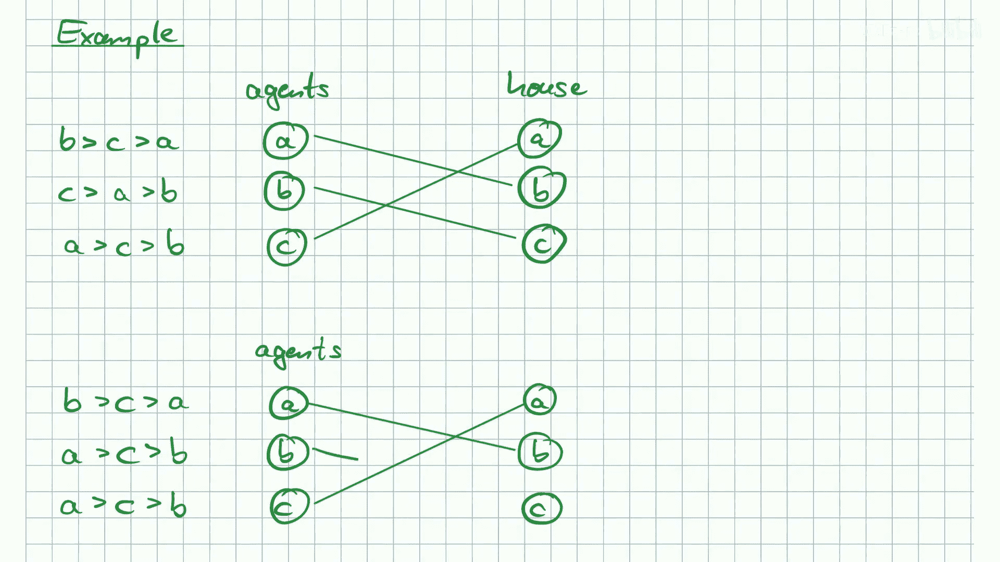

# 波恩大学【中英⚡算法博弈论｜2020-21 Algorithmic Game Theory】 p22 P22 Lecture 21 (Allocations without Money) -BV1qX86zPEPG_p22-

Welcome back to algorithmgthic game theoryory。For the last weeks。

 we've learned a lot about mechanism designed with money。But what if you don't want to use money to。

Push people into the right direction so that you actually get the desired outcome。

Why wouldn't you want to use money， maybe it's because it's infeasible to collect the money or maybe because it's unethical for certain reasons。

What can you do then in the next following lectures， we'll get to know。

Something about mechanism design without money。 Unfortunately。

 things are much less clear than the the settings are usually more complicated。For very good reason。

 because so far， everything that we were doing was in units of money。And by that。

 I don't just mean the payments。 I also mean how much do you value this item？

Also this we expressed in terms of monetary units， we said， okay。

 Ive now value this item5 and this item  three， and if you now have a higher value then you should get the item because this is what maximizes social welfare。

No。If we don't have money。How should we compare what is more valuable。For whom。And as you see。

 we'll have to think about this more carefully what we actually mean by getting a desirable outcome。

The first problem I'd like to consider now is a very simple problem in which that。

Every of our agents。Brings one item to the market， which we call a house。

 and what they want to do is they want to exchange these houses so that。

Everybody is as happy as possible after the exchange。You could， of course， also do this with money。

 so everybody just sell their house and then you buy again the houses。

And this is maybe even a possible mechanism for such a setting。B。

Here now we want to do this entirely without money。So what will this look like。

As usually we have N agents， I I call them for no really good reason。

 and those we would still call players。The set is called capital n and。Each of them。Initially。

Has one item。Would recall house just to say， okay， you don't you actually only need one house to live in。

 you don't need two houses， but you definitely should have one house to live in。

And what is now our goal？阿狗屋。Is to reassign。These houses。To make agents happier。Which means。

We want to find a。One to one correspondence。Pi， which will just be mapping from N to N。

Which means that。After reassignment。Agent I。不用喊。House。Pie eye。Okay。So as I was saying。

 we are not doing this with money。All this making agents happier。

 We won't be expressing in terms of monetary units。 So， of course， you could say， now， okay， I。

 I value this mansion by 2 million and this mansion by 3 million。 And so I prefer。

There three million mansion to it，2 million mansion。But。

Why does this make you or why is it more important that you now gain 1 million compared to somebody else。

 So in。In perceived validation than somebody else， who maybe just is getting a thousand more。And。

Therefore， we are not expressing actually all these preferences in terms of monetary units。

 we don't say I value this house by this much， but we rather say， okay。

 this is my preference list of houses， I prefer this house over that house over that other house。收。

一尺。Agent。Ha a full preference list。Overall， houses。With no ties。Let's see what this may look like。

We have agents。AB。And see。And they also bring a house， A， B， and C。And for example。

 the first agent might prefer house B over house C over house A。

The second agent might prefer house C overhouse A overhouse B。

And the third agent might re preferfer house A over house C over house B。Okay， in this case。

 things are really easy because the most preferred house。

 This is a different one for each of the agents。 So we could just give agent A， house B， agent B。

 We could give house C， agent C could we could give house A， and all of them would be happy。

 All of them would be。The happiest people in the world because they got their favorite house。

So our mapping pie。我等闭。This perfect matching in this。Bipartite graph。But， usually。

Things won't be this smooth。Of course。There might be this one mansion that everybody wants to have。

And。Ran。And we can make give everybody what they prefer most。For example， this might look as follows。

So again， we have agents。A， B and C。Each of them brings a house， A， B， and C。

And agent A now prefers house B over house C over house A as before。

 but agent B now prefers house A over house C。Overhouse B。And。The preferences of A and B。

 we don't modify either。What would happen if we now did the same？Exchange。

So how happy are people now。Agent A still gets the preferred house。

 Agent B does not get the preferred house。