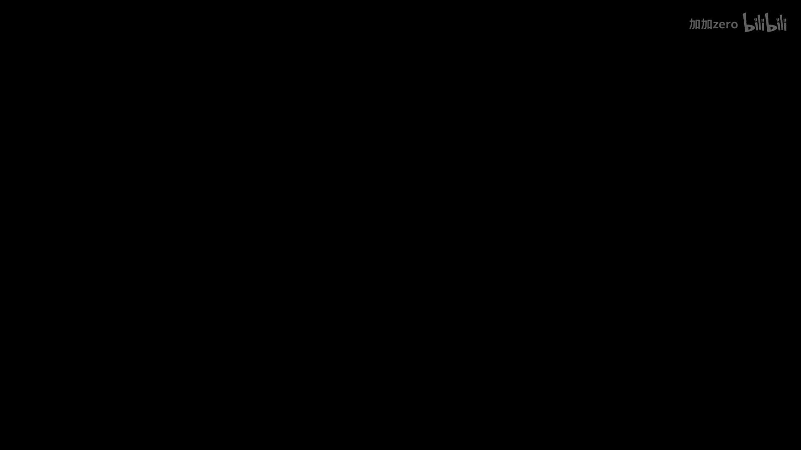
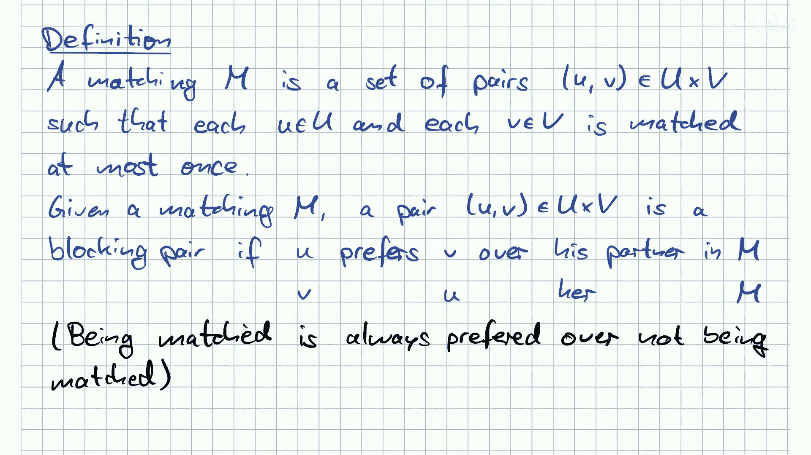

# 波恩大学【中英⚡算法博弈论｜2020-21 Algorithmic Game Theory】 p23 P23 Lecture 22 (Stable Matching) -BV1qX86zPEPG_p23-

嗯。Welcome back to algorithmrithmic game theory。In the last lecture。

 we introduced the field of mechanism design without money。And we saw two examples of。

How this might look like。What we saw is that things are more complicated than if we have money because it is much more complicated to express preferences。

Because we cannot just。Express them in terms of monitor units。

 but what we rather always do is just encode them as preference orders。

One example that we got to know was this house allocation problem。

In which we found a reallocation of the houses so that everybody's happy with this reallocation。

 meaning that there is no coalition of people who would rather do their own thing than joining our exchange。

Today we'll consider a very similar problem with one major difference， namely。

In this house allocation problem， the houses don't care who lives in them。

But today we're considering。And setting of matching with two side preferences。

And the traditional way of stating this is as a marriage problem where we have。Tradition。

Home heterosexual。And monogamous relationships。 and we just want to match men with women。

I personally find this the weakest of all possible motivations because。

Everything that we will discussing， this is not what。Marriages look like。And auto， I feel。

This finding a partner for your life shouldn't look like I think it is much more reasonable。

 for example， in the context of matching。Job applicants with employers。

 but as you will always find this in the words of these marriages。

 I'll also stick to this and I'll also speak about men and women。

So what's the setting that we have here？We have。Is that。Of men。

 which well call you and a set of women。Which we call V。Every man。

So that will be a small U in capital U。Has a preference order。Over the women。And every woman。

Has a preference order over the man。Which we will call。Which is to set you。

And what do I mean by this， I mean that this is a total order。So， everybody's ranked。

And there are no ties。So what could this look like we might have？The seteth。Man， which our call。X， Y。

 and Z。And I want to call the women A， B， and C。And now we'll have to write down the preference lists。

 so for example。X might say I prefer A over B over C。W might say I prefer A over C over B。

And Z might say， I prefer C over A over B。And then we have similar lists for。They womenomen。

 so they also， each of them has a list， so A might prefer x over y over Z。

 B might prefer Z over x over y。And C might preferred y over x over z。And what's not our goal？

Our goal is just to match men with women。And we want this to be then a stable matching。

Which means something like。What we also said in the context of the house allocation namely。That。

Everybody's happy with what we are assigning them。In the following way。

 namely that there's nobody else who you prefer more than your current match and that somebody else also prefers you。

Over their current match。So let's formally define this。A matching。Is a set of pes。Newuccomer V。

Such that。Yiiz。😔，U and U and each。Yanvii。Is matched。At most once。And we'll say that。

Give the matching M。A pair。You can move V。Is a。Blocking hair。Ifve。You prefers。Over。His。Partner。In。

In M and V prefers you over her partner。In M。And by that， I mean that。And there's this one important。

Convention。Being matched。Is always。Preferred。Over not being matched。So once again。好。

Take any matching， which just matches men and women in an arbitrary way。

Maybe also nobody gets matched just as one possible matching that you could keep in mind。

And then we say， okay， a pair you come a V is a blocking pair。

If U prefers V over his partner in M and V prefers U over her partner in M。

So both UNV would rather be together than with their respective partners。In M。And in particular。

 this might mean that both of them are unmatched， in which case they would definitely like this better。

 they would rather be matched than both being unmatched。

And now we say that。M is called。Sttable。If there。Is no。

