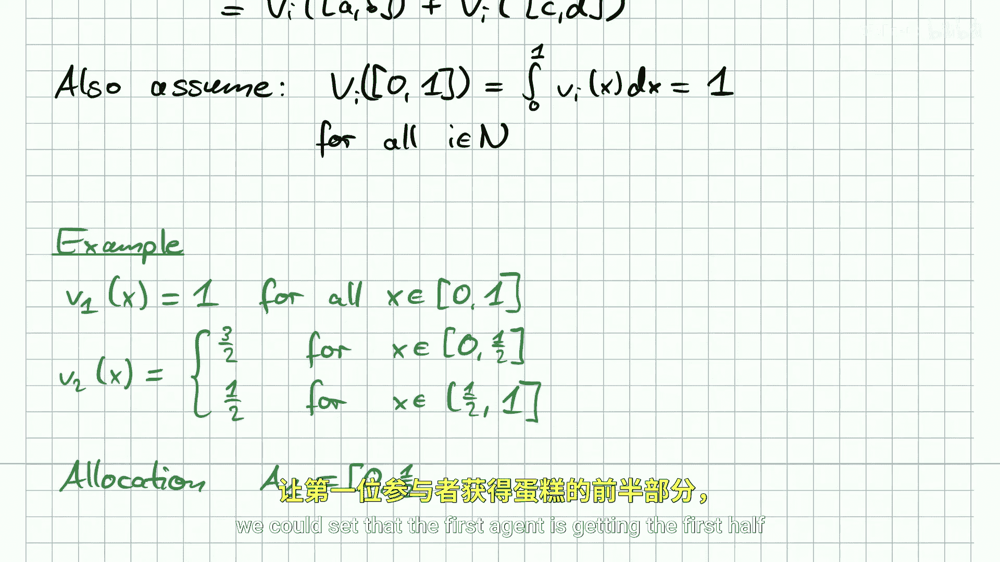

# 波恩大学【中英⚡算法博弈论｜2020-21 Algorithmic Game Theory】 p24 P24 Lecture 23 (Cake Cutting) -BV1qX86zPEPG_p24-

Welcome back to algorithmgothmic Game theory。Today we are talking about another problem of mechanism design without money。

Which is about fair division。What are these fair division problems without many。

 You'll see them very often in real life。 For example， you might consider a group of employees who。

Have to decide which work shifts two of them works in and some might say， okay。

 I rather work in the morning， some others may say， okay， I rather work in the afternoon。

 some might say， oh， I'd definitely want to keep my weekends。

 three others would say no I'd rather work on the weekend than during the night and。

Just everybody will have their personal preferences。

How do you get to an assignment that makes everybody as happy as possible overall？

We'll be considering this in a very simplified setting， so you could of course， consider this with。

 for example， indivisible items。You know， we've seen indivisible items a couple of times this semester。

But we'll now consider a fully divisible resource， but the thing is people prefer different parts of that resource。

And what does this resource usually look like？Well。

 what people usually are considering is the problem of cake cutting。

So this is the kind of cake you should have in mind。 It is just a linear cake。 and then you may。

Just cut it into pieces and people will prefer different parts of the cake。Some people might prefer。

 for example， this， why chocolate par。Some people may just prefer the plain black chocolate part。

 or somebody might prefer the sprinkles。Depending on what you personally prefer。

 depending on your personal taste。So how do we capture such a setting mathematically？

So this might be our cake。And how do we model this cake will model it just as an interval going from zero to1。

So this will be just the interval zero to one。And we can cut this into pieces。And what is a piece。

 a piece is just a union of subintervals。We'll have。And agents。And。Each agent， I。As again。

 a valuation function。Which now assigns a non negative value to each piece of the cake。We'll assume。

To， to capture this。So this valuation function， this is called capital VI and we'll assume。

That there is a density function。Small VI。Which maps。01 to the non negative reels。Such that。

Capital V of x。Is given as the integral overall。X and x， this small VI of x。So， in particular。If。

We're assigning you the interval from A to B。Then you value。

For that will be just the integral from A to B of this small function V。

So just integrating over this density。And。If x is a disjoint union of intervals。Then。The value。😔。

Will be just the sum of these。Two integrals。In other words。This valuation function is additive。

Across different intervals。Disjoint intervals， I mean by this。

One thing to notice at this point is that it doesn't actually matter whether we assign open or closed intervals。

 just because the integral from a to a， for example， is 0。 So getting this。

What does this even mean in the sense of a cake that you get？

That you have a cut at A and then you have another cut at A and you get everything in between， well。

 that's nothing。So this is why we are。Or we can safely assume something that。

That sometimes these intervals will be open， sometimes these will be closed。

 so that's actually not the point that matters。We'll also assume that everybody values the entire cake the same way。

 but what matters is what which part。They prefer of the cake。 They prefer most。

 So do they rather prefer the white chocolate part or this。Sprinkles partd or which one。

 which part do they prefer？So。We'll also assume that。Capel V。Of the integral from0 to 1， this is。

 of course， again， the integral。Of this small VR， this density function that this will be simply one。

So what might this now look like in concrete numbers？We might have。

Somebody who just doesn't care which part of the cake they're getting。

So then this densitysority function would just be one everywhere。Or we might have somebody。W says。

 okay， I definitely prefer the first half because there my density is maybe like three halves。

And in the second half， the density is only one half。So they， for example， again。

 value the entire cake as one。But the first half of the cake pipe。

 So what this guy now says is just half of the cake。 This guy here says， okay， that's actually。Well。

A quarter versus three quarters of the cake。So that's just the difference of personal perception。

 how much do you value which part of the cake？So what could we do here？For example， we could set。

And we could choose as an allocation。We could said that thee。First。

Agent is getting the first half and the second agent。

