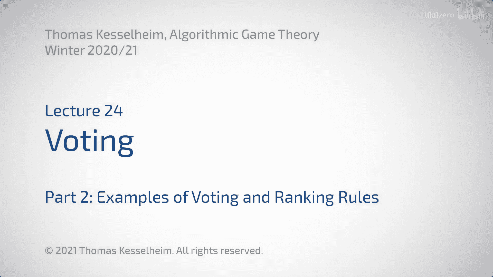

# 波恩大学【中英⚡算法博弈论｜2020-21 Algorithmic Game Theory】 p25 P25 Lecture 24 (Voting) -BV1qX86zPEPG_p25-

嗯。Welcome back to algorithmthic in theory。Today we'll be discussing a topic and mechanism design for which at least for most of us。

 it is clear that it should not involve any money， namely voting。

So what could this mean we might want to design， for example， a presidential election。

 we have multiple candidates， and then we have to determine who will win presidency。

And this might mean that each voter will just say who's their preferred candidate or they may tell us even more。

 that's up to our particular design。And if you have only two candidates。

 then there is a very standard format for this， namely。Who wins the election。

 the one who got more votes than the other， setting now the issue of tie breaking aside because this rarely happens that two candidates would get the exact same number of votes。

And this。Is。Used very widely， and it is also used for a good reason。Why that。

 because only a minority of the voters will not be happy with the outcome。

The majority of voters will say， okay， this is my preferred outcome。

 and in this way there is no better outcome than this one。

But things get much more tricky when you have three or more candidates。

And probably you've seen this also happening。In the elections， for example， for a mayor。

That then suddenly you think， okay， I could now vote for my favorite candidate。

 but he or she has really small chances， so I might want to support my second favorite candidate just because。

 well， he or she is likely to then get at least a plurality。

Of the votes and this way get more votes than the guy that I really don't want to have。

So there there is some strategic voting involved， and that's one of the questions we should ask。

Are there ways to avoid this that。The voters will behave strategically。

 will have to behave strategically。And also， before that， we should ask the question。

How do we even determine the winner， so even if everybody told us？Who they prefer most and。

Whos their second favorite candidate and so on， How would we then determine the winner because there are better and worse rules？

But before we start all this， let's first introduce a formal model。Because。

This is again the problem that we are in a setting without money。

 so there is no just there are no monetary units in which we can express， okay。

 I like this candidate this much but instead we'll again define a preference order。So formally。

 this will look as follows。We will have N agents。Capital N again， and we have M candidates。

And we call the set of candidates， gamma， capital gamma。Each agent。还是。Complete。Preference list。

Over gamma。Without our ties。And we will now use the following notation。We will write。

A is preferred over B is preferred over C。With a subscript I if。Agent I。Prefers。A in gamma。Over。

Be in gama。😔，And。Bi。😔，Oversea。This， of course， implies。That。A alsos I also prefers A over C。

 so we'll have transitivity。And what are now our problems？There is the voting problem。

Which is the following。Given all these preference orders。We'll have to。Determine one winner。

From Gamma。And we'll have the ranking problem。Which asks us not to only determine a winner。

But a full ranking of all candidates。So。Again， we're given all these。Preference orders。

And our goal will be to determine a society ranking。Of all candidates。

This means that besides only finding a winner， we'll also have to say who's in second place。

 who's in third place， and so on。So our goal will be now to design a ranking rule or a voting rule。

 depending on which problem we're in these two problems are very similar。

 the ranking problem of course asks us to do more， but generally you should think of them as very。

 very similar because also the fundamental things are the same。So what makes this difficult？😮，Well。

 we are now given these preference orders of the individual agents。And somehow。

 we'll have to find a compromise。 maybe however you want to call this。

 And we don't have any objective functions， so。This is actually up to our design of what we now think is a good outcome。

 for example， for this voting problem。One way you could approach this is to say， okay。

 I'd going take just a random。Winner from Gamma， or I take the one who gets the least number of votes。

In other words， you take these preference orders and then you say， okay。

 and there are now multiple versions of this， for example， who's。Voter who's。

At the worst position in the plurality of these preference orders or whose。嗯。

The first choice for the least number of agents。 All of this， of course， doesn't make real sense。

 but why。Why isn't this a good voting rule to choose。The， the candidate who。

The fewed voters actually like。This is something that we'll have to formalize。

We've all seen examples of voting and ranking rules。

And I'd like to now first discuss these and discuss how they fit into our framework and to what extent they turn out to be good or not a good ranking group。

Or voting room。And the first one I'd like to consider is plurality voting。How does this work？

In plurality voting， you just have one vote each。Voter has one vote， and they just。

