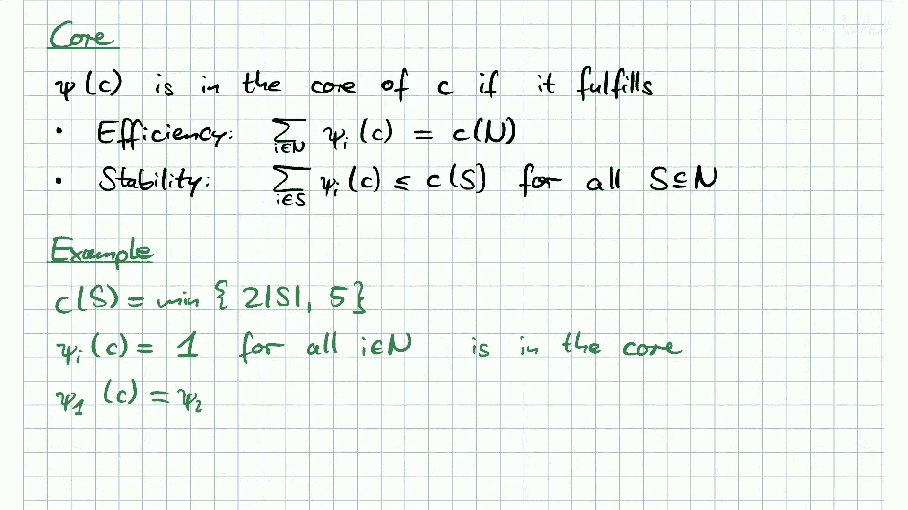

# 波恩大学【中英⚡算法博弈论｜2020-21 Algorithmic Game Theory】 p26 P26 Lecture 25 (Cost Sharing) -BV1qX86zPEPG_p26-

Welcome back to algorithmgothmic Game theory this will be our final lecture today。

 thank you very much for staying this long。Today we'll be discussing a topic which you could also call fair division。

 but usually it goes by the name cost sharing。What's the general problem？Well。

 suppose you and your friends want to buy a train ticket。

Now you can save money all of you together if you buy a group ticket then rather than buying all individual tickets。

However， the question will be， how do you split up the cost among all your friends？

So that everybody feels treated fairly。There are different ways of defining this。

Some of which have some advantages， other have other advantages。

 and today they will see two different approaches of how to split cost。

And what properties they fulfill？So let's first define a model。We have again， H N agents。

Which we again call capital n， and we have a cost function。That is just one cost function。Which maps？

From all subsets of the agents to a real number。So CFS， this is the。Cost。That。S would have。

On their own。And will assume that。For the empty set， this is zero， but for others。

 the cost can in principle also be negative。So what might that be？We might have a train ticket。

And we might have。5 agents。Then a single ticket。努比。5 euros。A single ticket will be 2s。

And a group ticket。Will be five euros。So what would that mean the cost of a set of agents？

Will be the minimum。诶。Two times the number of agents in that set。And5。

So if it is just two people who choose to buy a ticket。

 then they'll have a cost of four if there's only one person who wants to buy a ticket will be a cost of only two。

But three or more agents， they immediately have a cost of five because they together can buy a group ticket。

So what will now be our question， our question will be to split up the cost that we have for the entire group of people。

 so CFN we want to split up among all agents。In N。So that。The cost， of course， will be covered。

 the overall cost will be covered。And each of the agents is treated in a fair way。So more formally。

好狗哦。Will be to find。A cost sharing vector。si of C。Which， of course， depends on the cost function。

Which now splits up。The cost among all an agents。And when all agents together。

They exactly cover the cost。Well， clearly there are different ways of defining such a cost vector in our example here。

 how could this look like we could， for example， say the first two agents each pay two euros。

 the next agent pays1 euro。Or the first agent pays all five euros and the other agents pay nothing or。

Each of the agents pays1 euro。Some of these we might consider。More appropriate than others。

 And this is exactly the question that we're asking today。 What is it that makes such a cost sharing。

Backctor， fear or。Appropriate in any possible sense。The first way of choosing such a cost vector。

 a cost sharing vector I'd like to discuss now is the so called core。

For cost sharing vector to be in the core。Several properties， namely two， have to be fulfilled。

And these are the falling。We say that。Si of C is in the core。Of C。If。It fulfills。On the one hand。

 it should fulfill a property called efficiency。Which。We've already seen。

The sum of the individual cost shares should sum up to one。The sum of the individual cost shares。

Should sum to the cost of all agents together， So the sum of the individual costs。

Exactly recover the social cost。And then we also have stability。Which means。The followinging that。

Some of the costs。Is no more than the cost。Of a set。For any。Sets of agents。

So no coalition pays more by this cost sharing factor than they would if they just did their own thing and。

Just for example， bought triet， train ticket just for this group of people。Is there a。

Core outcome in our 2 example， Yes， there is。So， we had。C， if S to be the minimum。

Of two times the cardinality of s and5。Now， what might be a core outcome？We might， for example， said。

C I and Psi I F C equal to1。For all I。This will be in the core。Or。We might， for example。

 split up the cost。At the first two。

Agents pay two。