# 001：基础

## 概述

在本节课中，我们将要学习现代C++课程的组织结构、学习C++的动机、C++语言的历史与设计哲学，以及开始编程前必须掌握的Linux操作系统基础知识。我们将从最基础的“Hello World”程序开始，了解C++程序的编译和运行过程。

## 课程组织与期望

我们已经准备好开始今年的现代C++课程。由于新冠疫情的影响，我们无法在教室授课，但我认为这对大家和我来说都是一个好消息。在教室里教授编程颇具挑战性，就像试图在教室里教10个人如何骑自行车一样。当然，我们可以解释一些理论和概念，但最重要的是你需要亲手在键盘上开始编码。

课程每周三下午4点（中欧时间）进行一次线上讲座，每次讲座时长不超过一小时。我的期望是，你每周投入一小时，并从中学习到知识。

除了讲座，我们每周五还有辅导课。我不会在辅导课上进行直播，但我会在Discord频道上在线，随时解答问题。我还可以通过屏幕共享来演示如何解决问题。

请务必注册并加入Discord频道。这是最快的讨论渠道。如果你有问题，并且认为其他人也可能从中受益，请在相应的频道提问。例如，关于讲座的问题可以发在讲座频道，关于作业的问题可以发在作业频道。这样我可以一次性为大家解答。

根据学习计划，本学期你需要投入大约60小时。这意味着你每周至少需要花费一整天（约8小时）在C++课程的学习、作业和辅导上。因此，仅仅每月投入两小时是不可能完成这门课程的。

## 课程内容与目标

在本课程中，你将学习以下核心内容：
*   如何在Linux环境下工作。
*   如何使用现代C++编写软件。
*   一些核心的软件开发技术。

本课程不是纯粹的编程入门课或设计模式课程。我们还将使用OpenCV（一个开源的图像处理库），最终的课程项目是实现一个基于逆向图像搜索的地点识别管道。

今年的课程内容经过了精心梳理，分为四个部分，从易到难：
1.  **工具**：如何构建项目、使用Linux等。这部分内容将在辅导课中讲解，不会占用讲座时间。
2.  **C++核心语言**：为期四周。完成这部分后，你将能够用C++编写其他语言（如Python）中常见的程序。
3.  **现代C++**：这是课程的核心部分，包含了C++特有的一些高级和复杂特性。
4.  **期末项目**：你将有一节关于项目概念的讲座，然后需要独立完成项目。

此外，今年的九次作业中有一些与期末项目直接相关。如果你认真完成了这些作业，那么你就已经完成了期末项目的一部分工作。我不建议你只完成作业拿到分数后就搁置，直到期末项目才开始，因为作业中的任务正是项目的基础。

## 课程哲学与期望

本课程的哲学是“Talk is cheap. Show me the code.”（空谈无益，代码为证）。在编程中，人们有时会花数小时讨论一个概念，但代码本身可能非常简单。直接看代码并讨论通常更高效。

因此，我期望你在本课程中亲自动手实践，花大量时间在键盘上尝试，让代码运行起来。

这里有一个免责声明：如果你不理解任何内容，请随时打断我。但请不要惊讶于我有时操作得很快。这不是因为我聪明，而是因为我使用Linux超过10年，已经非常习惯。有时我很难放慢速度。如果你看到我做了你不理解的操作，请在聊天区告诉我：“等一下，我不知道你在做什么。”我会尝试放慢速度。

另外，我目前使用的是一台五年前的双核机器，无法运行过于复杂的桌面环境，所以我使用了一个叫i3的平铺式窗口管理器。它可能看起来有些“极客”，我不推荐初学者使用。你的电脑完全可以看起来比我的更美观。

## 为什么学习C++？

我知道你们中的一些人学习C++只是因为它是课程要求。但请相信，当你正确学习它时，C++是一门非常有趣的语言。

根据Stack Overflow 2018年的调查，近一半的专业开发人员将Linux作为主要工作系统。在2015年，C++是使用最广泛的系统编程语言，拥有近500万用户。C++至今仍然非常流行。

当然，如今Python等语言可能更流行，但这部分是因为Python的应用领域更广。在机器人等领域，你很难找到用Python编写的主流框架。因此，在比较语言时，请确保你了解比较的背景。在我们这个领域，所有公司都希望你掌握C++。

即使你计划从事研究而非工业界，掌握C++也非常重要。C++可能不是原型开发的最佳语言，但一旦你有了成熟的想法，用它实现的程序运行速度极快。

C++的一个核心理念是高效。十年前，当人们谈论节省几兆字节内存时，可能会被嘲笑，因为个人电脑的内存正变得越来越大。但游戏规则已经改变，计算机不再仅仅是桌面设备，还存在于智能手机、手表和机器人中。这些嵌入式设备上的处理器功耗和尺寸变得至关重要，内存效率等问题重新受到重视。这就是C和C++至今仍是最流行语言的原因之一。即使你不在乎成本，可以购买更强大的处理器，你也需要考虑能耗和电池续航。这就是编译型语言（如C/C++）至关重要的地方。

许多知名公司都在使用C++，例如Google、Microsoft。这并不意味着他们用C++做所有事情，但他们确实在使用，并且投入资源让C++变得更好。许多浏览器（如Firefox、Chrome）的源代码也是用C++编写的。此外，像Java虚拟机、部分Windows操作系统、Office、Photoshop等软件，以及游戏产业的大部分，都主要使用C++。

## C++简史

计算机发展初期，我们有一种美妙的语言——汇编语言。它的好处是指令简单，编写得当则运行极快，并且能完全控制硬件。既然如此，为什么我们不一直使用它呢？让我们看看用汇编语言编写“Hello World”程序是什么样子。这段代码难以阅读，并且需要大量代码来完成简单的任务。此外，汇编语言严重依赖于目标处理器，这是它最大的缺点之一。

于是人们提出了更高级语言的想法。计算机只理解二进制代码，但汇编语言很容易翻译成二进制。为什么不使用更直观的语言编写代码，然后通过一个叫做“编译器”的程序，将高级语言源代码转换成汇编语言呢？这就是C语言的诞生。

C语言由肯·汤普森和丹尼斯·里奇于1972年创建。它快速、简单且跨平台，你不再需要了解底层架构。C语言至今仍是最流行的编程语言之一，但它也有弱点：没有对象和类，难以编写通用代码，编写大型程序非常繁琐。

大约40年前，丹麦人比雅尼·斯特劳斯特鲁普发明了C++语言。他希望保留C语言快速、跨平台、易用的优点，同时加入更多高级语义特性，例如类、对象和泛型编程。这就是C++至今的发展历程。

## 现代C++与设计哲学

我们通常将C++11标准（2011年发布）之后的特性称为“现代C++”。在本课程中，我们将使用C++17标准（2017年发布）。C++20标准即将发布，但由于编译器支持尚不完全，我们不会使用它。

C++的设计哲学是多范式编程。它不仅是面向对象或面向过程的语言，而是支持多种范式，让你能够直接在代码中表达想法和意图。这一点对我来说非常重要。

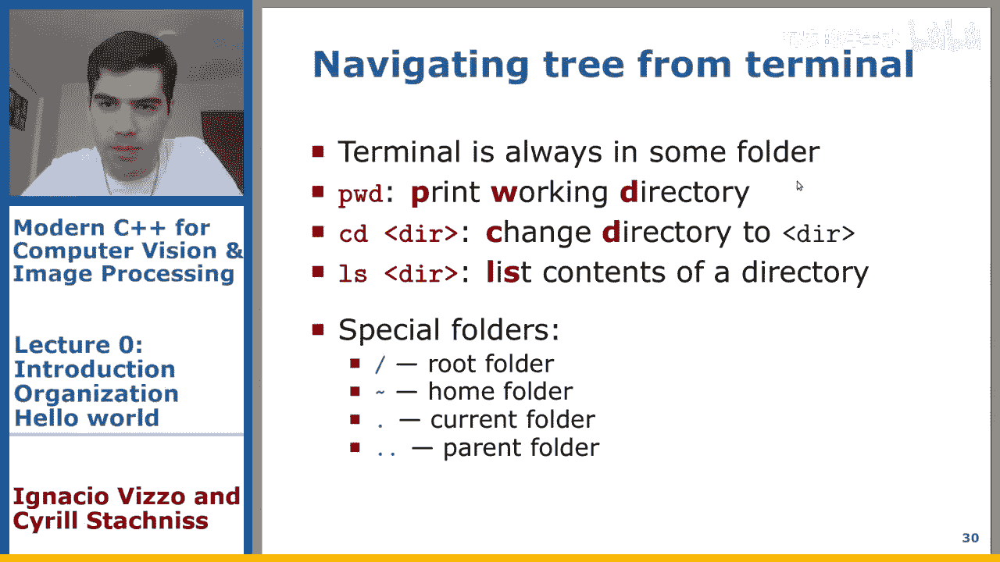

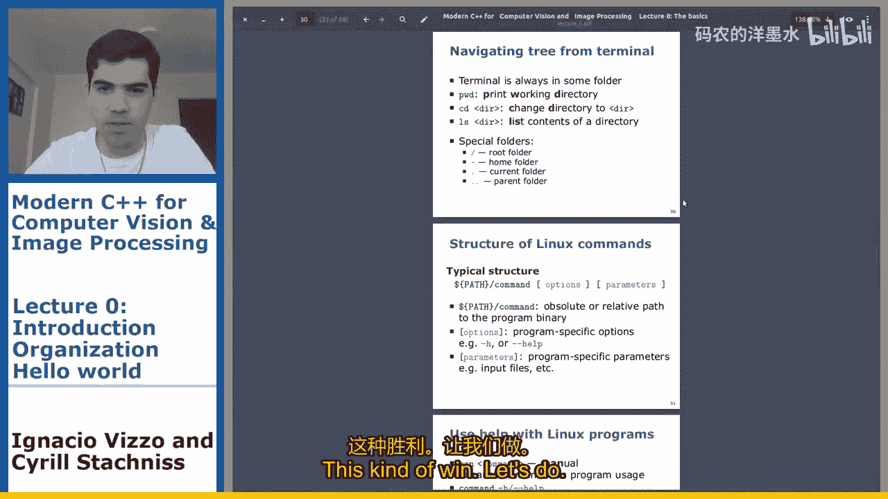

在C++11之前，人们习惯于到处添加注释。后来人们开始思考，如果代码本身易于阅读，就不需要那么多注释。如果你的某行代码晦涩难懂，需要在其上方添加50行注释来解释，那很可能是一个糟糕的设计或想法。

因此，在本课程中，尝试在代码中表达想法和意图，而不是在注释中，这一点非常重要。C++为你提供了实现这一目标的工具，这也是现代C++更优秀的原因之一。

C++在明智使用时非常安全，并且极其高效。它提供了“零开销抽象”层，这意味着你可以使用语言的高级特性，而无需在运行时付出性能或内存的代价。

关于效率，至今仍有很多人认为C语言比C++更快。这些人大多是因为不了解如何正确使用C++，或者没有使用合适的工具和编译器。当你明智地使用C++时，在效率上很难被击败。

## Linux操作系统简介

我们将在本课程中使用GNU/Linux发行版。我在这里做一个简要介绍，如果你有任何问题，现在是时候在聊天区提出了。当然，我建议你去YouTube或Google搜索“为什么应该使用Linux”。

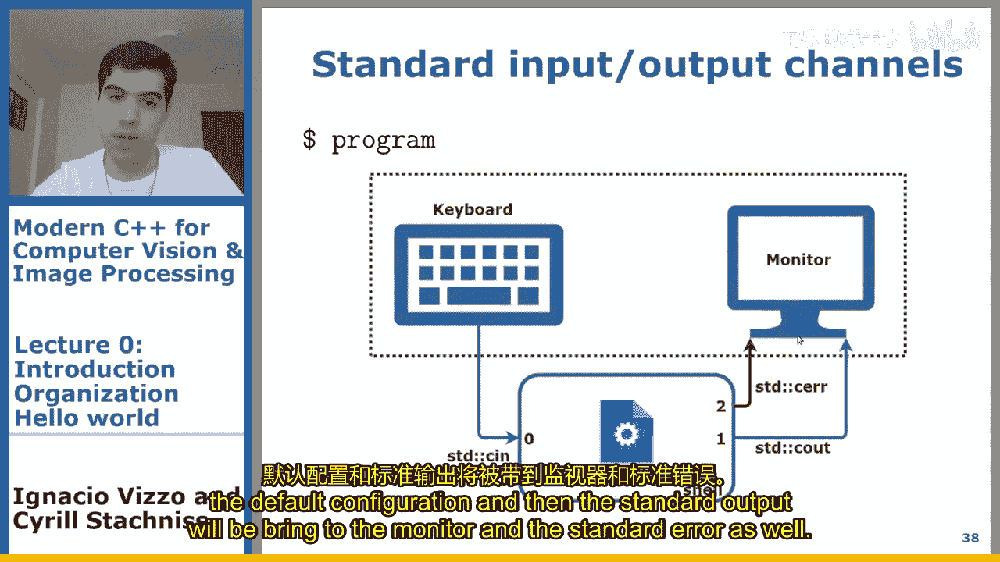

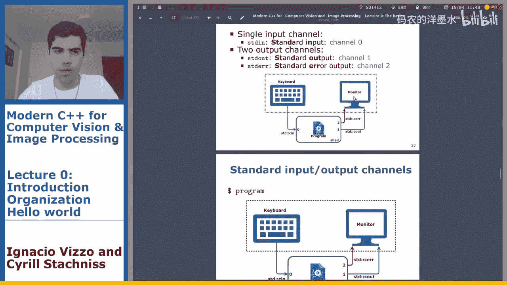

Linux是一个免费、自由、类Unix的操作系统。如果你使用macOS并习惯使用终端，你会发现一些相似之处。如今Linux极其流行，大多数服务器都在运行Linux。

这是Linux的目录树结构。它非常简单，没有隐藏的盘符（如C:， D:）。一切从根目录（`/`）开始，所有其他目录或文件夹都在根目录之下。

你需要知道的是，用户空间文件夹位于 `/home/` 下，然后是用户名。例如，我的主目录是 `/home/ibi/`。这基本上是你处理文件的地方。

在Linux中，文件夹路径通常以斜杠（`/`）结尾。任何以斜杠结尾的路径都是一个文件夹。绝对路径以斜杠开头，而相对路径则不是。路径是区分大小写的。文件扩展名是文件名的一部分，只是一个字符串。如果你想更改文件扩展名，只需重命名文件即可。

在Linux中，你的最佳朋友是终端。许多操作在终端中完成比在图形界面中更快。我强烈推荐使用终端。如果你是Linux新手，我的建议是：不要试图用你习惯的方式（图形界面）操作，而是去Google搜索如何在终端中完成，这是学习使用终端的最佳方式。

以下是一些基本的终端导航命令：
*   `pwd`：打印当前工作目录。
*   `cd`：更改目录。
*   `ls`：列出当前目录下的文件和文件夹。

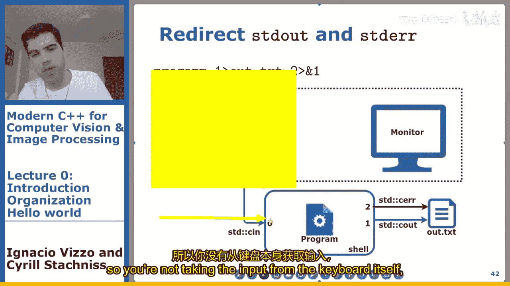

命令本质上就是一个程序。当你输入一个命令时，shell（终端）会在一系列目录中搜索这个程序，这些目录由 `PATH` 环境变量定义。命令通常带有选项和参数。如果你想了解一个命令的用法，可以使用 `man` 命令或 `--help` 选项。

我强烈推荐使用Tab键自动补全功能。这可以确保你输入的命令路径是正确的。

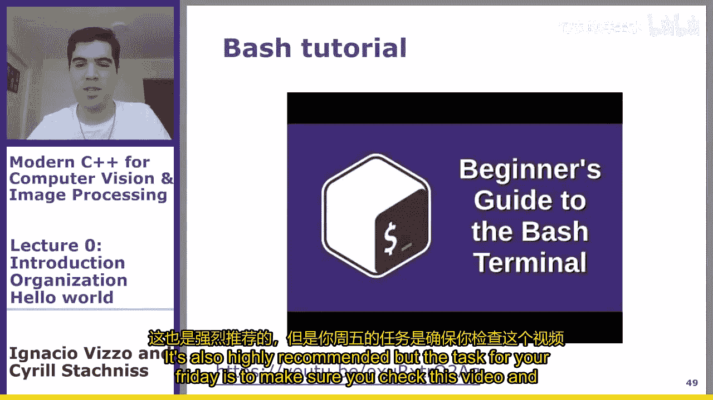

这里列出了一些处理文件和文件夹的基本命令，例如创建目录（`mkdir`）、删除目录（`rmdir`）、复制文件（`cp`）、移动文件（`mv`）。我建议你在课后查看幻灯片上的占位符练习，学习如何使用通配符（如 `*`）来轻松处理文件。

最后，我想快速解释一下标准输入/输出/错误，因为我知道很多人对此感到困惑，但其实非常简单。

当一个程序在Linux中运行时，内核会为其分配三个文件描述符：标准输入（`stdin`， 文件描述符0）、标准输出（`stdout`， 文件描述符1）和标准错误（`stderr`， 文件描述符2）。默认情况下，标准输入来自键盘，标准输出和标准错误都打印到显示器。

你可以重定向这些流。例如，`./program > output.txt` 将标准输出重定向到 `output.txt` 文件（屏幕上不再显示）。`./program 2> error.txt` 将标准错误重定向到 `error.txt` 文件。`./program > output.txt 2>&1` 将标准输出和标准错误都重定向到同一个文件。

管道（`|`）可以将一个命令的标准输出连接到另一个命令的标准输入。例如，`command1 | command2`。

我强烈推荐你观看幻灯片上链接的关于管道和重定向的10分钟视频，以及关于Bash终端的一小时教程视频。这是你本周五的任务：观看Bash教程视频，并跟着练习。

## 第一个C++程序

C++是一门庞大的语言，要真正学会一切可能需要两年。但学习基础知识和核心技术，我认为六个月是足够的。当然，我无法在一门课中教会你C++的一切，也没有人知道C++的一切。

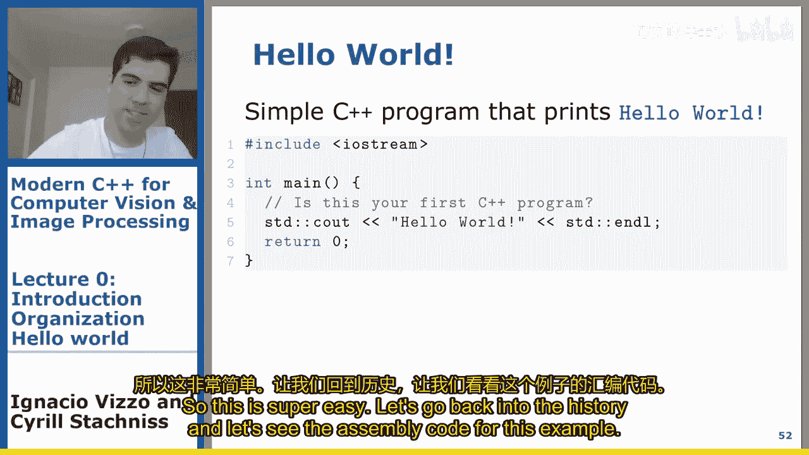

我们将编写C++代码。你有两个主要选择：使用集成开发环境（IDE）或文本编辑器。对于学习阶段，我完全不推荐使用IDE。虽然IDE更舒适，但你会错过了解背后原理的机会。学习时需要了解这些幕后机制。在本课程中，我们将探究这些并不算难的幕后原理，然后你将学会如何脱离IDE工作。

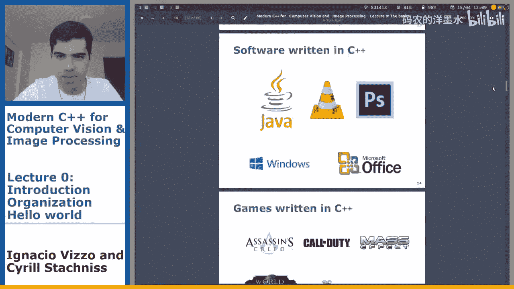

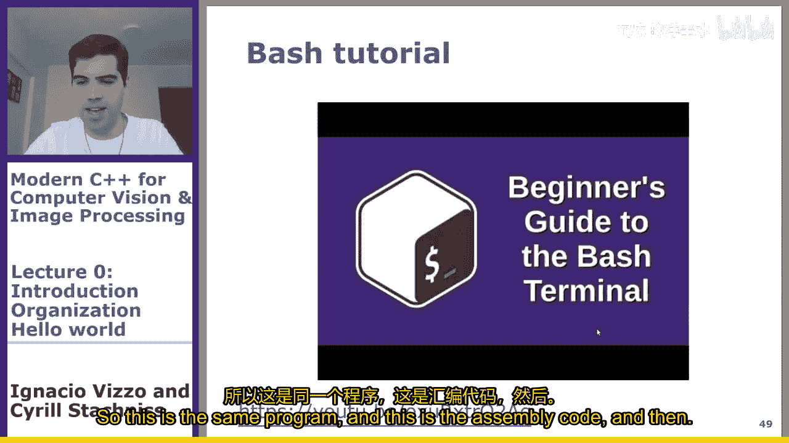

我们将使用Visual Studio Code作为文本编辑器。它是一个现代、开源、由微软支持的编辑器，具有许多强大功能。使用文本编辑器可以让你学到更多，更具灵活性。如果你去大公司工作，很可能不会使用Eclipse这类重型IDE。

另一个工具是Vim，它非常难用，但如果你计划在机器人领域建立职业生涯，我建议你有时间（比如现在疫情期间）开始学习它。Vim只是一个文本编辑器，但使用起来极快。当你需要远程连接服务器或机器人工作时，你会庆幸自己会使用Vim。

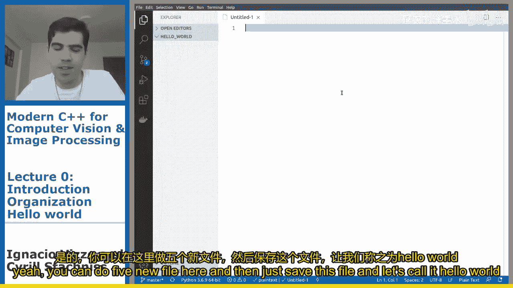

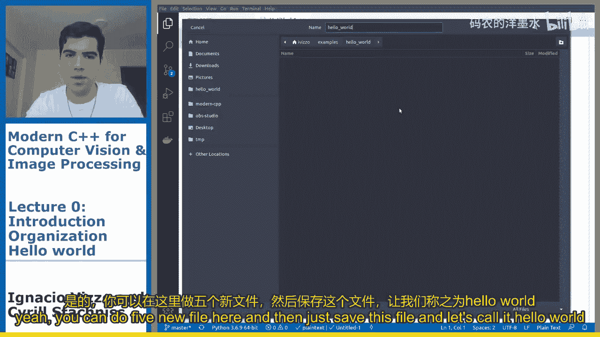

现在，让我们看看最简单的“Hello World”程序。与之前看到的汇编代码相比，这个程序简单明了。

让我们来构建这个例子。我将打开一个终端，创建一个新目录，然后进入该目录。我的建议是：从终端完成所有操作，设置好工作空间，然后再打开文本编辑器。

在Visual Studio Code中，你可以通过 `code .` 命令在当前目录打开编辑器。然后创建一个新文件，命名为 `hello.cpp`。

在文件中，我们写入以下代码：
```cpp
#include <iostream>

int main() {
    std::cout << "Hello Modern C++" << std::endl;
    return 0;
}
```
保存文件。这只是一个文本文件。要运行它，我们需要编译。在终端中，使用 `c++ hello.cpp -o hello` 命令进行编译。这将生成一个可执行文件 `hello`。运行 `./hello`，你将在屏幕上看到输出。

C++是一门编译型语言。这意味着我们编写高级语言代码，然后使用编译器（如Clang、GCC）将其转换为机器码。这与Python或MATLAB等解释型语言有重大区别。一个主要好处是，在运行程序之前，你就知道程序中是否有错误。

注释用于在源代码中添加说明。以 `//` 开头的行是单行注释。`/*` 和 `*/` 之间的内容是多行注释。现代哲学是编写能够自我说明的代码，而不是依赖注释。

代码格式非常重要。今年我将使用一个叫做 `clang-format` 的工具来自动格式化代码。遵循统一的代码风格可以使代码更易于阅读。如果你按照我的设置指南配置了开发环境，你已经拥有了这个工具。

每个C++程序都从 `main` 函数开始。这是语言定义的，你不能更改这个名字。`main` 函数返回一个整数，通常0表示成功，非0表示错误。

`#include <iostream>` 是一个预处理指令，它告诉编译器将 `iostream` 头文件的内容“复制粘贴”到当前文件中。这样我们就可以使用其中定义的输入输出功能。

如果你想尝试与标准输入输出交互，可以编写一个简单的程序来演示。我建议你亲手编写这个程序，并尝试幻灯片上的重定向例子。

## 编译过程

编译过程是将人类可读的文本（源代码）翻译成机器可执行的二进制代码（机器码）的过程。执行这个翻译工作的程序叫做编译器。在Linux中，你可以使用多种编译器，今年我转向使用Clang。

最后，我想感谢Igor，他是这门课程的创始人，也是一位出色的老师。本课程80%的幻灯片都基于他的工作。如果你对我的讲解有任何不理解的地方，可以去查看Igor往年的讲座视频。

## 总结

本节课中我们一起学习了现代C++课程的整体框架、学习C++的重要意义、C++语言的发展历史与核心设计理念，以及开始C++编程所必需的Linux基础操作。我们从最简单的“Hello World”程序入手，了解了C++代码从编写、编译到运行的完整流程，并强调了动手实践和代码可读性的重要性。

## 课后任务与资源

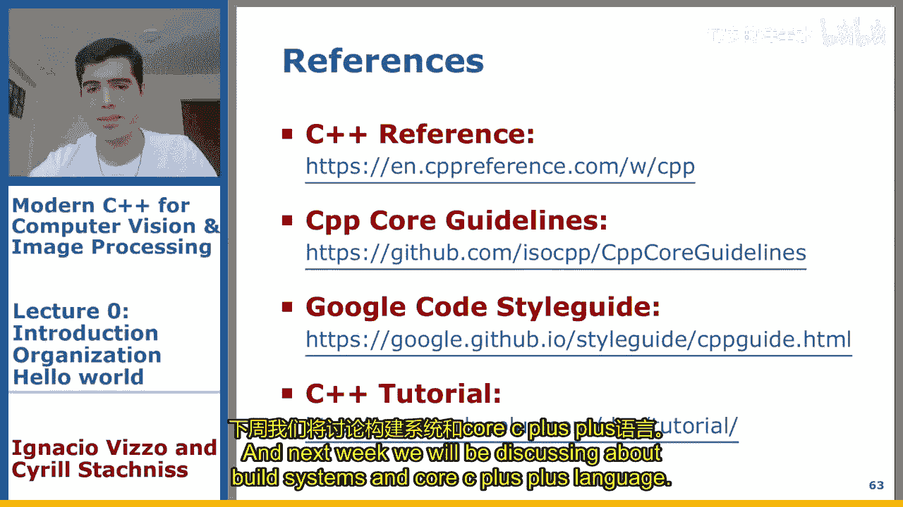

*   **任务**：安装Linux或配置WSL（Windows用户），完成幻灯片上的示例练习。
*   **周五任务**：观看提供的Bash终端教程视频（约1小时），并跟随练习。
*   **讨论**：任何问题请在Discord频道讨论。
*   **下节课预告**：下周我们将讨论构建系统和C++核心语言，并发布第一次作业。
*   **推荐资源**：
    *   **书籍**：《C++程序设计语言》（Bjarne Stroustrup著），《C程序设计语言》（K&R著）。
    *   **在线参考**：[cppreference.com](https://en.cppreference.com)
    *   **扩展观看**：一个关于“为什么应该学习编程”的TEDx演讲（可选）。