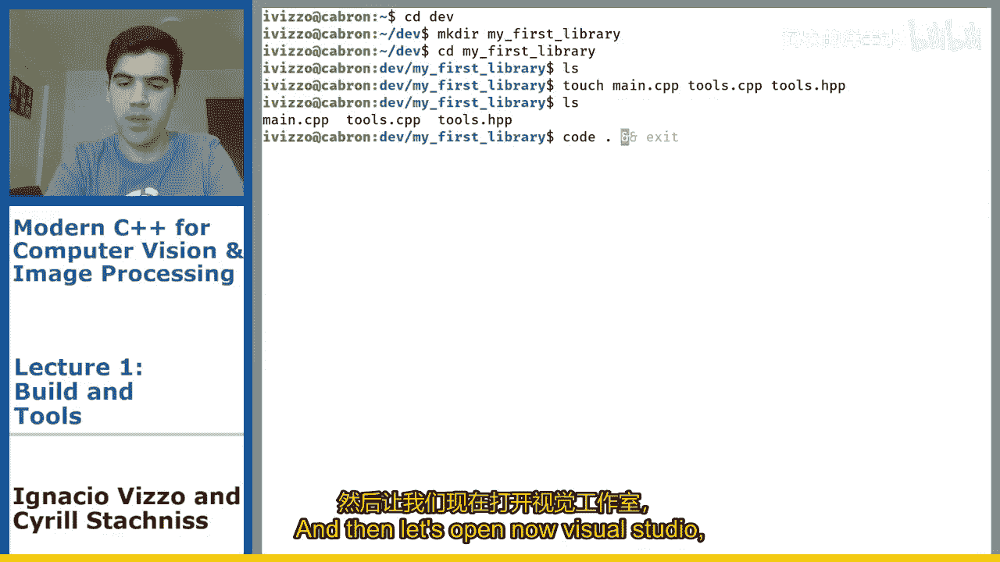
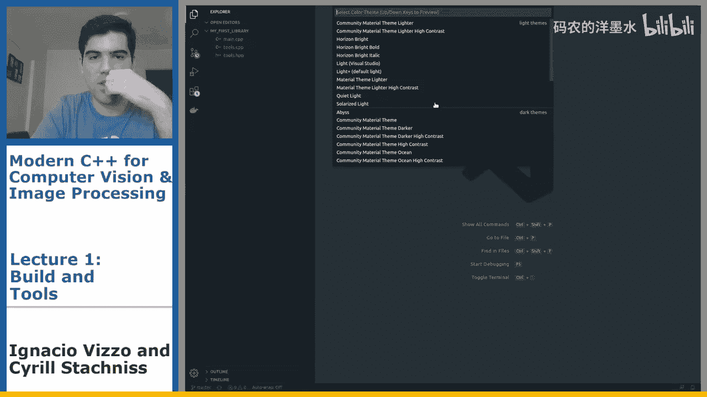
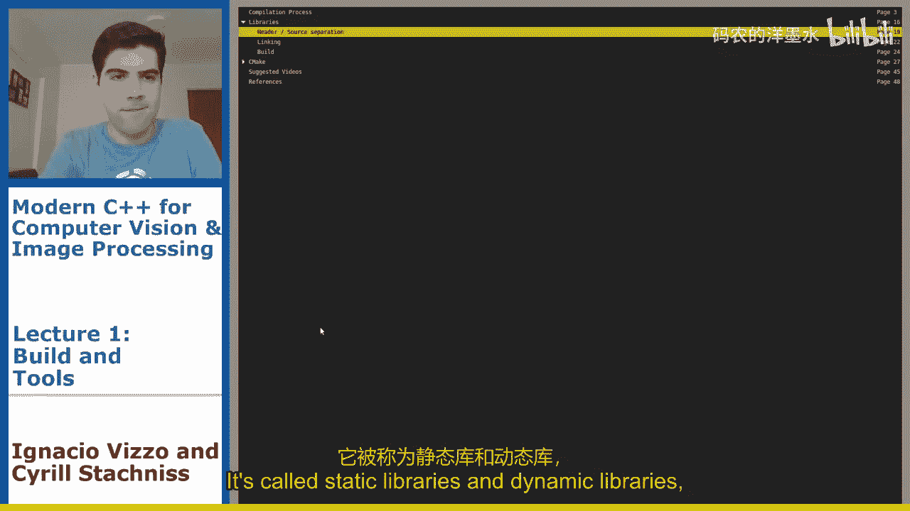
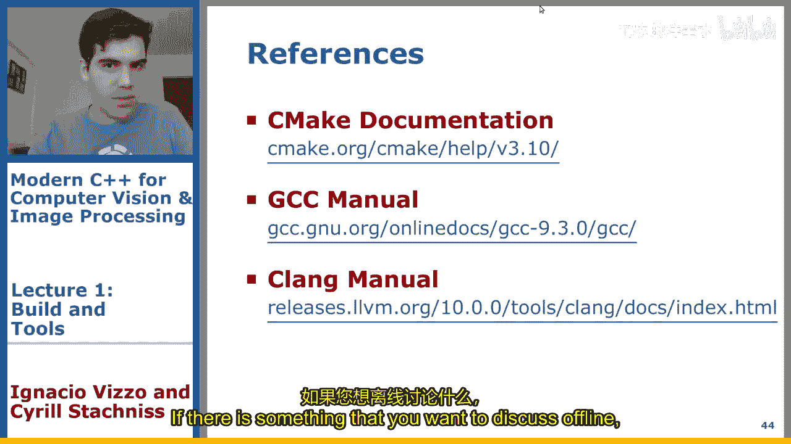

# 002：构建系统与工具 🛠️

在本节课中，我们将深入学习构建系统。这是关于工具主题的最后一讲。从下周开始，我们将讨论C++语言本身。理解如何构建程序以及如何处理构建系统，对于掌握C++至关重要。本节课我们不会看到任何C++代码，而是退一步，在开始编码之前先学习如何使用工具。

## 软件开发生态系统概览

当我们想到编程时，通常会专注于源代码。但实际上，软件开发涉及许多其他工具。学习如何使用这些工具，能让你在处理C++乃至其他语言时获得“超能力”。

在本课程中，我们将讨论其中一些工具。今天的重点是构建系统，它将教你如何构建C++项目并避免一些错误。我们还会在教程中简要涉及其他工具，如静态代码分析、测试、代码格式化以及持续集成/持续部署（CI/CD）。版本控制系统（如Git）和调试工具也是现代开发不可或缺的部分。

这里我想强调一个重要观点：在软件开发中，**概念**和**工具**是两件不同的事。概念（如算法、设计模式）不太可能随时间改变，而工具（如编译器、构建系统）则可能。因此，明智的做法是将更多时间投资于学习概念。然而，C++是一门复杂的语言，我们需要工具来高效地应用这些概念。如果你的工具不好用，你的工作效率也会大打折扣。

## 编译过程详解

现在，让我们深入探讨构建系统以及编译过程的工作原理。

### 什么是编译器？

编译器是一个特殊的程序，它的职责是将人类可读的源代码转换为计算机可以理解的二进制代码。

这个过程可以用一个简单的图示来理解：你编写源代码，编译器执行“魔法”，最终输出二进制代码。

### 最简单的编译方式

编译一个C++程序最简单的方式就是直接调用编译器。在本课程中，我们将使用 `clang++`。

```bash
clang++ main.cpp
```

这条命令会生成一个名为 `a.out` 的可执行文件。如果一切正常，就说明编译器安装正确且系统库齐全。我们在上一讲的“Hello World”示例中已经测试过这一点。

当然，现实中的项目不会总是这么简单。理解一个项目的最佳途径之一，就是通过它的构建系统。很多人在学术界和工业界遇到困难，往往是因为不熟悉构建工具。了解项目的构建系统，能让你洞察项目的结构和运作方式。

### 编译的四个步骤

当你调用 `clang++ main.cpp` 时，编译器在幕后执行了四个步骤：
1.  **预处理**
2.  **编译**
3.  **汇编**
4.  **链接**

下图展示了这个过程：

```
源代码 (.cpp) -> 预处理 -> 编译 -> 汇编 -> 链接 -> 可执行文件
```

了解这些步骤的细节非常有益，它能让你明白在构建程序时到底发生了什么。掌握构建程序的原理是一种“超能力”，它能让你有目的地操作，而不是盲目尝试。一旦你理解了如何构建，你就真正掌握了你的项目。

许多人因为不知道如何使用 `#include` 等语句，而将所有代码写在一个文件里。学会使用工具，会让你的开发工作轻松很多。

### 手动执行编译步骤

让我们通过一个小例子，手动执行这些步骤，以便更深入地理解。我建议你在自己的机器上尝试。

首先，创建一个干净的工作目录和一个简单的程序：

```cpp
// main.cpp
#include <iostream>
// 这是一个注释
int main() {
    std::cout << "Hello Build Systems\n";
    return 0;
}
```

**1. 预处理**
预处理步骤负责处理 `#include` 指令（将头文件内容复制到源文件中）、展开宏定义以及删除注释。

```bash
clang++ -E main.cpp -o main.i
```
现在你可以查看 `main.i` 文件。你会发现文件变得非常长（例如，可能超过28000行），因为 `#include <iostream>` 的内容被包含了进来。同时，你写的注释也消失了。

**2. 编译**
这是真正的“编译”步骤，编译器将预处理后的代码（`main.i`）转换为汇编代码。

```bash
clang++ -S main.i -o main.s
```
生成的 `main.s` 文件包含汇编指令，这对人类来说难以阅读，但机器可以理解。

**3. 汇编**
汇编器将汇编代码（`main.s`）转换为目标文件（二进制代码）。

```bash
clang++ -c main.s -o main.o
```
`main.o` 是目标文件，包含机器码。直接打开它看到的将是乱码。

**4. 链接**
链接器将一个或多个目标文件（以及库）组合起来，生成最终的可执行文件。

```bash
clang++ main.o -o main
```
现在，运行 `./main` 就可以执行程序了。

**总结一下**，直接运行 `clang++ main.cpp` 相当于自动执行了以上所有步骤。理解这个流程有助于你诊断构建问题。

### 编译标志

编译器支持许多标志来优化和控制编译过程。例如：
*   **指定标准**：`-std=c++17`
*   **显示警告**：`-Wall -Wextra`
*   **将警告视为错误**：`-Werror`
*   **优化级别**：`-O1`, `-O2`, `-O3`

优化器是编译器的核心组件之一，它负责将源代码转换为高效快速的机器码。例如，它可以在编译时计算 `2 + 2` 这样的常量表达式，而不是在运行时计算。我们将在课程最后讨论泛型编程和静态代码生成时再深入这个话题。

## 库的概念与创建

现在我们已经了解了如何编译一个简单程序。接下来，让我们利用这些知识来构建更复杂的项目，这就引入了**库**的概念。

### 什么是库？





库是一组预编译的符号（如函数、类）的集合。使用库的好处包括：易于维护、便于分发，并使项目结构更清晰、更易协作。

库主要分为两种类型：
1.  **静态库**：在链接时被完整地复制到最终的可执行文件中。优点是执行速度快，缺点是会增加可执行文件的大小。
2.  **动态库（共享库）**：在程序运行时才被加载。多个程序可以共享同一个动态库的实例，节省磁盘和内存空间。常见的扩展名是 `.so`（Linux）或 `.dll`（Windows）。

### 如何创建库？

在C++中创建库的关键在于**分离函数的声明和定义**。

*   **函数声明（接口/原型）**：这就像一个“承诺”，告诉编译器这个函数存在，其具体实现稍后提供。声明通常放在头文件（`.hpp` 或 `.h`）中。
    ```cpp
    // some_file.hpp
    void functionName(int param); // 注意分号
    ```
*   **函数定义（实现）**：这是函数的具体代码。定义放在源文件（`.cpp`）中。
    ```cpp
    // some_file.cpp
    #include "some_file.hpp"
    void functionName(int param) {
        // 实现细节...
    }
    ```

**为什么要把实现放在 `.cpp` 文件而不是 `.hpp` 文件？**
如果你把实现也放在头文件中，那么每次在其他 `.cpp` 文件中 `#include` 这个头文件时，都会复制一份完整的实现代码。这会导致编译时间急剧增加，尤其是在大型项目中，甚至可能导致编译机器内存不足。更重要的是，这完全绕过了链接器，没有利用到工具链的完整能力。

### 手动构建库示例

让我们通过一个例子手动构建一个库。假设我们有一个名为 `tools` 的库，它包含两个函数：`makeItSunny` 和 `makeItRain`。

**1. 创建文件**
*   `tools.hpp` (声明)
    ```cpp
    #pragma once
    void makeItSunny();
    void makeItRain();
    ```
*   `tools.cpp` (实现)
    ```cpp
    #include "tools.hpp"
    #include <iostream>
    void makeItSunny() {
        std::cout << "Making it sunny!\n";
    }
    void makeItRain() {
        std::cout << "Making it rain!\n";
    }
    ```
*   `main.cpp` (使用库)
    ```cpp
    #include "tools.hpp"
    int main() {
        makeItSunny();
        makeItRain();
        return 0;
    }
    ```

**2. 手动构建步骤**
如果直接编译 `main.cpp`，链接器会报错，因为它找不到函数的实现。
```bash
clang++ main.cpp # 链接错误：undefined reference to `makeItSunny()`...
```
我们需要分步构建：
```bash
# 1. 将库的实现编译成目标文件
clang++ -std=c++17 -c tools.cpp -o tools.o

# 2. 将目标文件打包成静态库（归档文件）
ar rcs libtools.a tools.o

# 3. 编译主程序，并链接我们创建的库
# -L. 告诉链接器在当前目录(.)搜索库
# -ltools 告诉链接器链接名为 `libtools.a` 的库（去掉`lib`前缀和`.a`后缀）
clang++ -std=c++17 main.cpp -L. -ltools -o main
```
现在运行 `./main` 即可。

可以看到，即使只有三个文件，手动构建也需要多条命令，非常繁琐。对于大型项目，这根本不可行。因此，我们需要自动化构建工具。

## 构建系统简介

构建系统的出现是为了自动化项目的构建过程。其发展历程大致如下：
1.  **Shell脚本**：将命令写在脚本里，但难以维护（例如，重命名文件需要修改多处）。
2.  **Makefile**：早期且至今仍广泛使用的构建系统，通过定义规则和依赖关系来构建。
3.  **CMake等元构建系统**：由于Makefile编写和维护仍然复杂，出现了像CMake这样的工具。**CMake本身不是一个构建系统，而是一个构建系统生成器**。它读取一个高级的、相对易读的脚本（`CMakeLists.txt`），然后为你生成对应平台（如Make或Ninja）的底层构建文件（如Makefile）。

### 使用CMake

CMake是跨平台的，功能强大。使用CMake的基本用户流程是：
1.  创建一个 `CMakeLists.txt` 文件，描述你的项目。
2.  创建一个构建目录（例如 `build/`）。
3.  在该目录中运行 `cmake ..` 来生成构建系统文件。
4.  运行 `make`（或其他生成器命令，如 `ninja`）来实际编译项目。

让我们用CMake重写上面的库示例。

**1. 创建 `CMakeLists.txt`**
```cmake
cmake_minimum_required(VERSION 3.10)
project(FirstProject)

set(CMAKE_CXX_STANDARD 17)
set(CMAKE_CXX_STANDARD_REQUIRED ON)

# 添加一个名为 `tools` 的库，其源文件是 tools.cpp
add_library(tools tools.cpp)

# 添加一个名为 `main` 的可执行文件，其源文件是 main.cpp
add_executable(main main.cpp)

# 将可执行文件 `main` 与库 `tools` 链接
target_link_libraries(main tools)
```
这个脚本非常清晰：添加库、添加可执行文件、链接它们。

**2. 构建项目**
```bash
mkdir build && cd build
cmake ..
make
```
CMake会检测编译器，生成Makefile，然后 `make` 命令会执行实际的编译和链接步骤。完成后，你会在 `build` 目录下找到 `main` 可执行文件。

CMake的一个优点是，如果你把构建目录弄乱了，可以直接删除它，然后从头开始 (`rm -rf build && mkdir build && cd build && cmake .. && make`)。




### CMake的其他功能

CMake还有很多强大功能，例如查找系统上已安装的软件包：
```cmake
find_package(OpenCV REQUIRED)
target_link_libraries(my_target ${OpenCV_LIBS})
```
这比手动指定头文件路径和库文件路径要方便得多。随着课程深入，当你使用像OpenCV这样的外部库时，就会用到这些功能。

学习CMake和其他工具的最佳方式就是实践。你将在第一次作业以及后续的项目中使用它。

## 总结

本节课我们一起学习了以下内容：

1.  **编译过程**：深入了解了从源代码到可执行文件的四个步骤（预处理、编译、汇编、链接），并手动执行了这些步骤。
2.  **库**：学习了库的概念、静态库与动态库的区别，以及如何通过分离函数声明（在头文件）和定义（在源文件）来创建库。
3.  **手动构建的挑战**：我们手动构建了一个简单的库，这个过程命令繁多且容易出错，凸显了自动化构建的必要性。
4.  **构建系统**：引入了CMake作为元构建系统生成器。我们看到了如何用一个简洁的 `CMakeLists.txt` 脚本来自动化整个构建流程，这比手动编写命令要高效、可维护得多。



记住，理解这些底层概念能赋予你强大的掌控力，而熟练使用像CMake这样的现代工具则能极大提升你的开发效率。请务必完成相关练习来巩固这些知识。