# 005：STL库

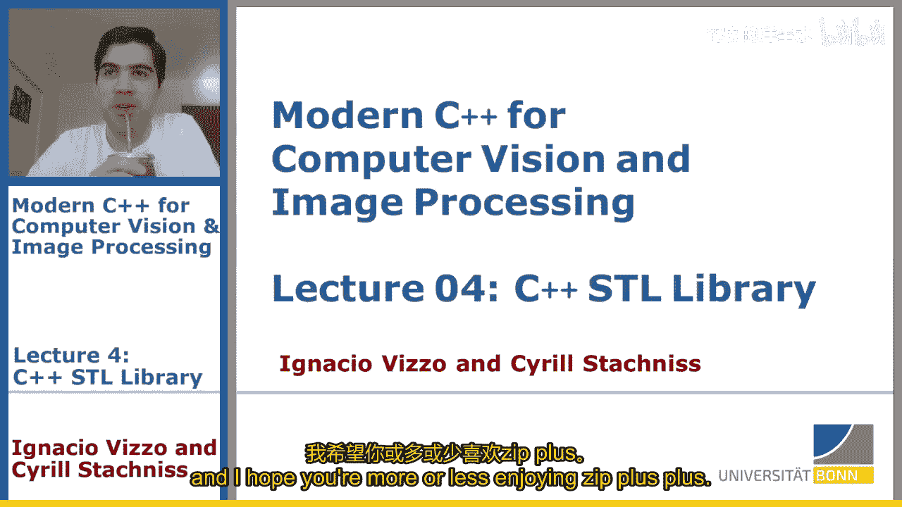

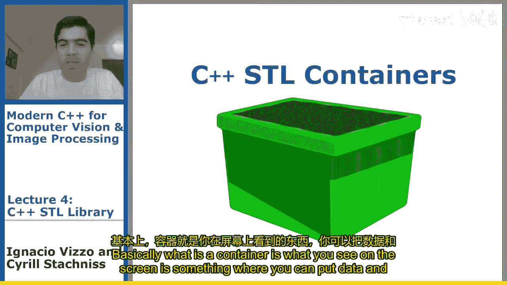

在本节课中，我们将深入学习C++标准模板库（STL）中的核心工具。我们将探讨容器、迭代器以及算法，了解如何利用这些强大的组件来编写更安全、更高效、更易读的代码。

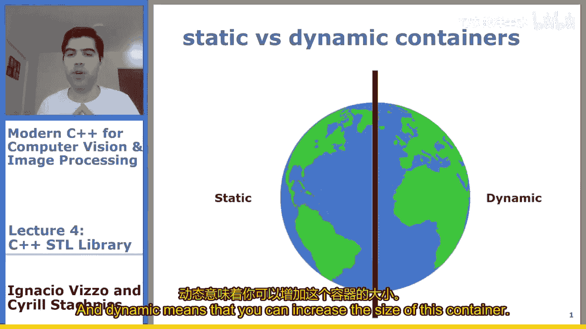

## 容器

在上一节中，我们学习了如何编写自己的函数。从本节开始，我们将学习如何使用STL库中预定义的函数和容器。

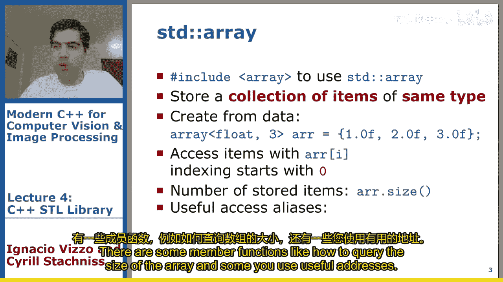

容器是用于存储数据的对象。在C++中，世界通常分为静态和动态两部分。静态意味着在编译时确定，动态意味着在运行时确定。容器也分为静态容器和动态容器。

### 静态容器：`std::array`

`std::array` 是一个静态容器，其大小在编译时定义，并且在程序执行期间不能改变。

**公式/代码：**
```cpp
#include <array>
std::array<int, 3> data = {10, 20, 1000};
```

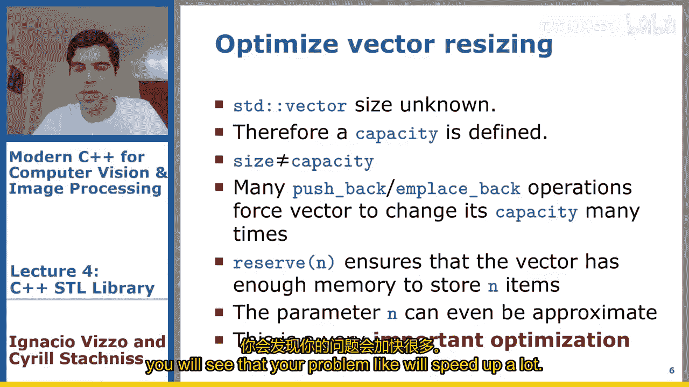

以下是使用 `std::array` 的关键点：
*   要使用 `std::array`，需要包含 `<array>` 头文件。
*   声明时需要两个模板参数：元素类型和数组大小。大小必须是编译时常量。
*   可以使用方括号运算符 `[]` 访问元素，索引从 `0` 开始。
*   可以使用成员函数，如 `empty()` 检查是否为空，`size()` 获取大小。

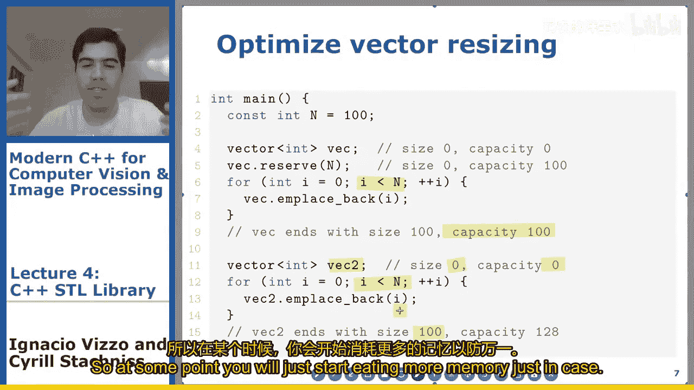

### 动态容器：`std::vector`

`std::vector` 是一个动态容器，其大小在运行时可以改变，是更常用的容器。

**公式/代码：**
```cpp
#include <vector>
std::vector<std::string> names = {"Alice", "Bob", "Charlie"};
names.emplace_back("Roberto"); // 动态添加元素
```

以下是使用 `std::vector` 的关键点：
*   要使用 `std::vector`，需要包含 `<vector>` 头文件。
*   声明时只需指定元素类型。
*   可以使用 `emplace_back`（推荐）或 `push_back` 添加新元素。
*   可以使用 `clear()` 函数清空所有元素。
*   `vector` 应该是存储同类型元素集合时的默认选择。

#### 优化：`reserve` 函数

`vector` 的一个潜在缺点是动态调整容量可能耗时。如果预先知道大致要存储的元素数量，可以使用 `reserve` 函数预先分配内存，以提高性能。

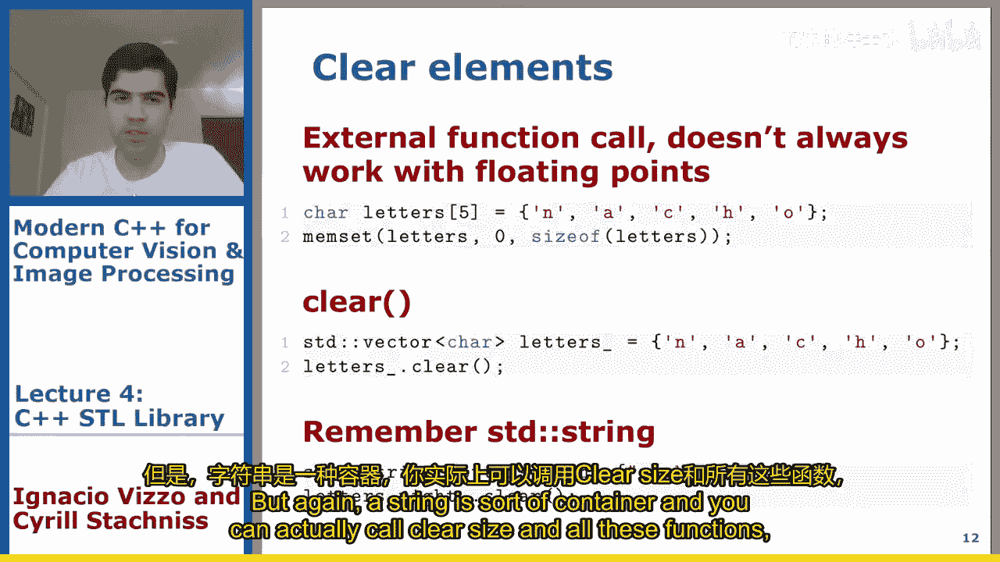

**公式/代码：**
```cpp
std::vector<int> optimized_vector;
optimized_vector.reserve(100); // 预先分配100个元素的内存
for (int i = 0; i < 100; ++i) {
    optimized_vector.emplace_back(i);
}
```

### 关联容器：`std::map` 与 `std::unordered_map`

关联容器用于存储键值对。`std::map` 中的键是排序且唯一的，而 `std::unordered_map` 中的键不排序但访问通常更快。

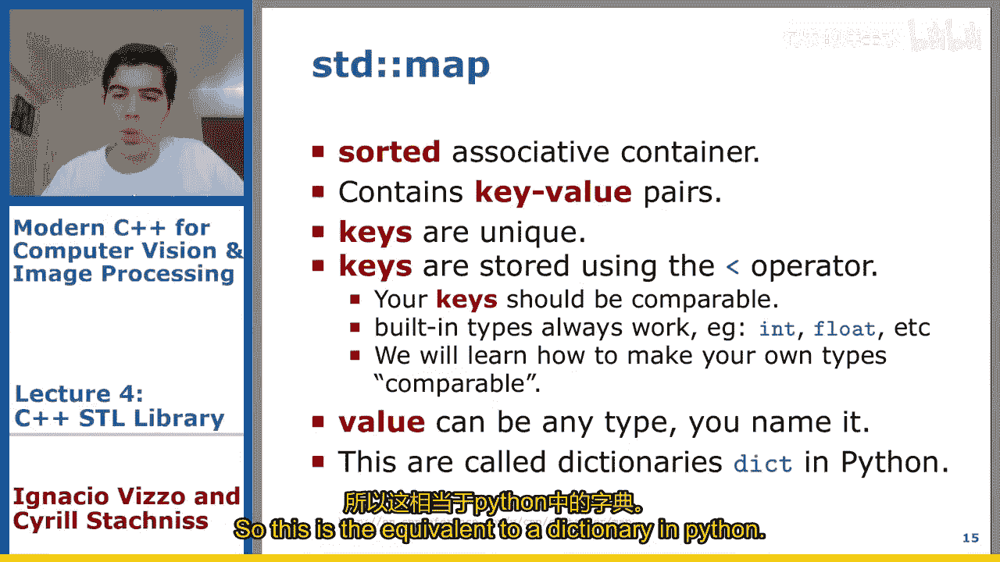

**公式/代码 (`std::map`)：**
```cpp
#include <map>
std::map<int, std::string> student_map;
student_map[101] = "Alice";
student_map[102] = "Bob";
```

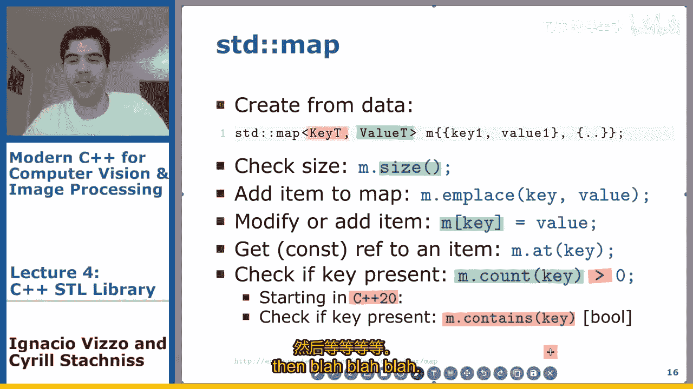

**公式/代码 (`std::unordered_map`)：**
```cpp
#include <unordered_map>
std::unordered_map<int, std::string> student_unordered_map;
student_unordered_map[102] = "Bob";
student_unordered_map[101] = "Alice";
```

以下是关联容器的关键点：
*   `map` 的键必须可比较（定义 `<` 运算符），`unordered_map` 的键必须可哈希。
*   可以使用 `count(key)` 或 C++20 的 `contains(key)` 检查键是否存在。
*   使用 `using` 语句为长类型名创建别名可以提高代码可读性。
*   遍历时，C++17 支持结构化绑定 `for (const auto& [key, value] : my_map)`，使代码更清晰。

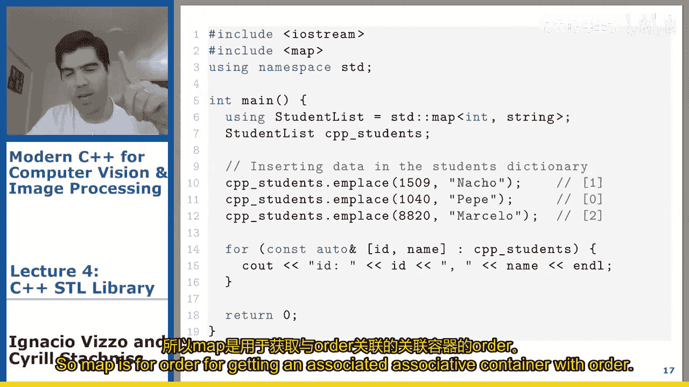

### 为什么使用STL容器？

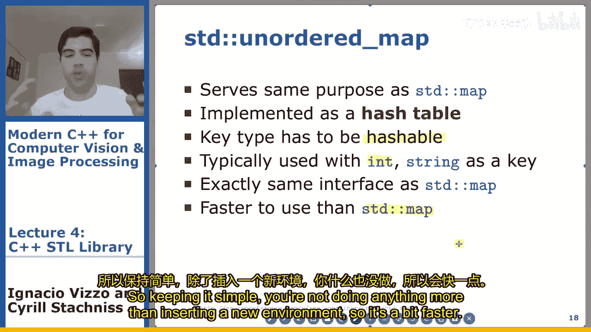

与C风格数组相比，STL容器具有显著优势：
*   **安全性更高**：边界检查更严格（尽管 `vector::operator[]` 不检查，但有 `at()` 函数）。
*   **可读性更好**：成员函数如 `size()`, `empty()`, `back()`, `clear()` 能清晰表达意图。
*   **功能更丰富**：内置了大量成员函数和支持STL算法。
*   **性能相当**：经过高度优化，通常与手写代码性能相当。

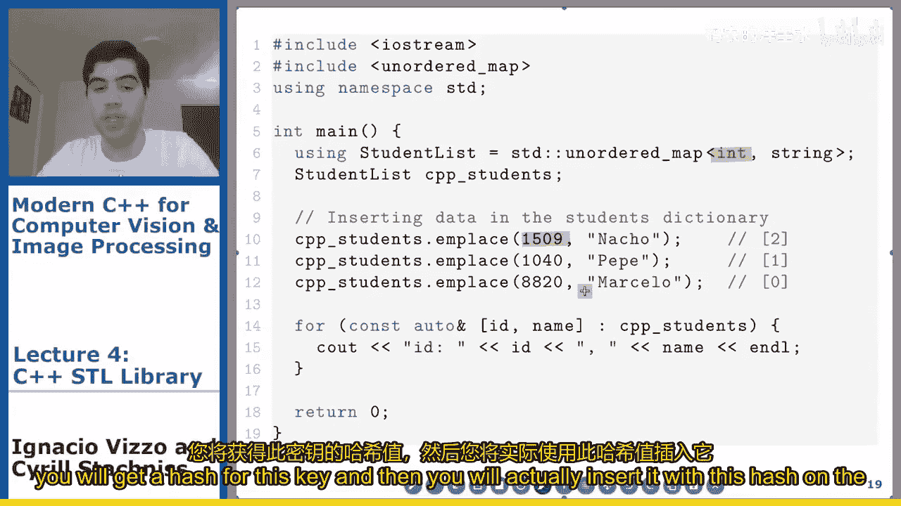

**核心建议**：避免使用C风格数组，在不确定时优先使用 `std::vector`。

## 迭代器

迭代器是连接STL算法与其操作数据的“胶水”。它是一种泛型编程机制，允许算法独立于底层数据结构。

**核心概念**：算法通过迭代器操作数据，而不是直接操作容器本身。这样，一个排序算法可以用于 `vector`、`list` 或任何提供了适当迭代器的容器。

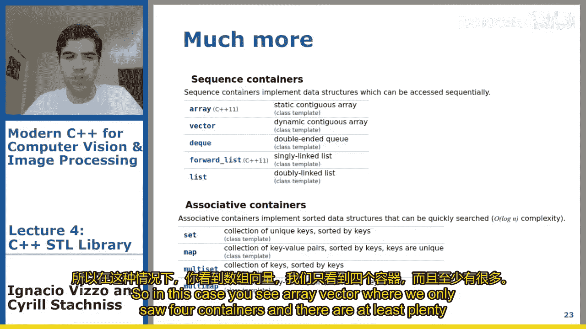

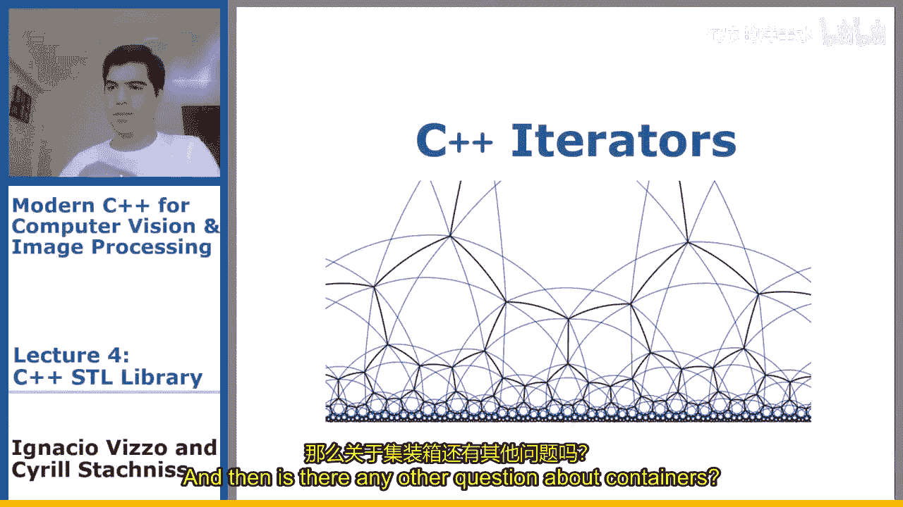

迭代器类似于指针，可以解引用（`*it`）来访问元素，并使用递增（`++it`）来移动到下一个元素。

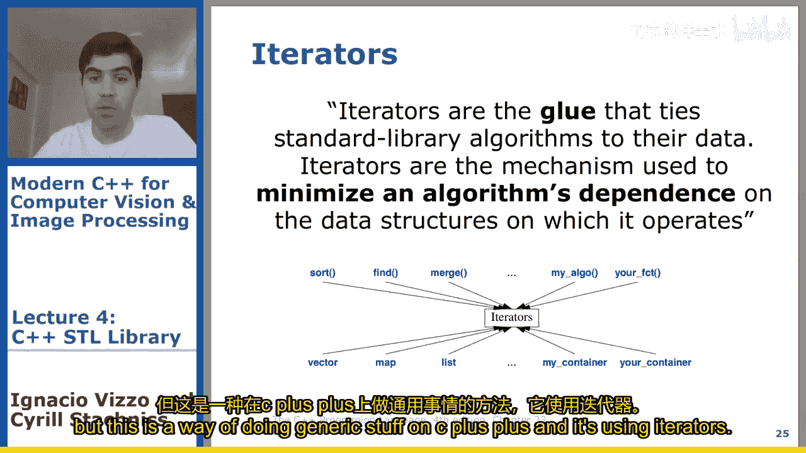

所有STL容器都提供了一系列范围访问迭代器：
*   `begin()`, `cbegin()`：指向容器首元素的（常量）迭代器。
*   `end()`, `cend()`：指向容器尾后位置的（常量）迭代器。
*   `rbegin()`, `crbegin()`：指向容器逆序首元素的（常量）迭代器。

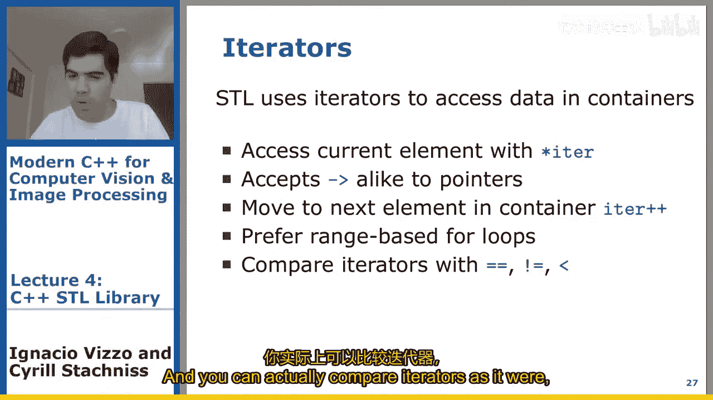

## STL算法

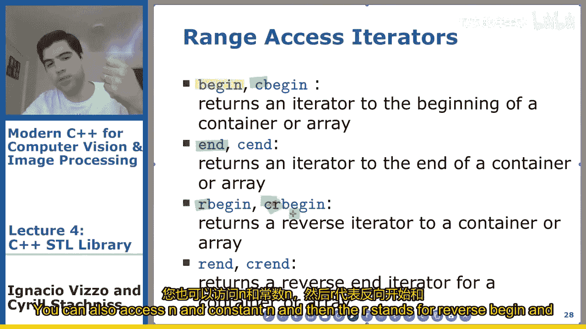

STL在 `<algorithm>` 头文件中提供了约80多种标准算法。它们操作由迭代器定义的序列。

**关键建议**：不要重复造轮子。在编写自己的算法（如排序、查找）前，先查看STL是否已提供。这些算法通常与手写代码一样快甚至更快。

以下是部分常用算法的示例：

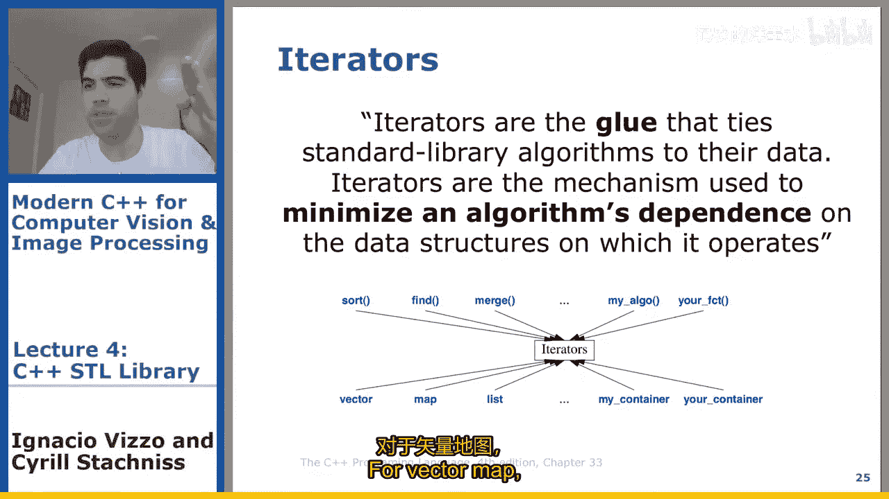

**排序 (`std::sort`)**
```cpp
#include <algorithm>
#include <vector>
std::vector<int> v = {5, 3, 1, 4, 2};
std::sort(v.begin(), v.end()); // 排序整个vector
std::sort(v.begin(), v.begin() + 3); // 只排序前三个元素
```

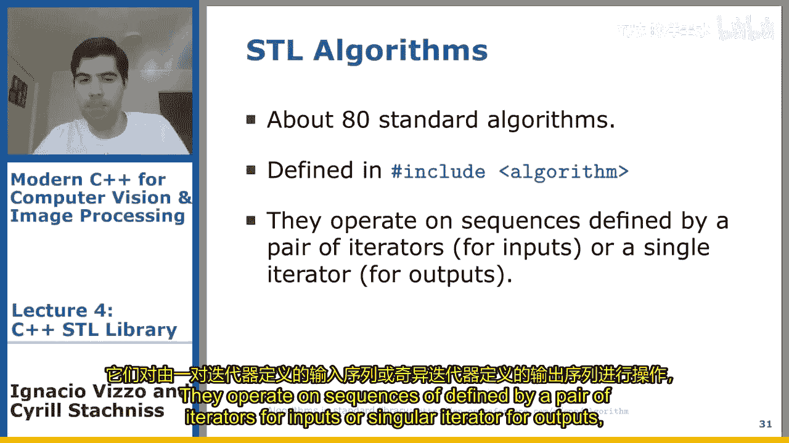

**查找 (`std::find`)**
```cpp
auto it = std::find(v.begin(), v.end(), 3);
if (it != v.end()) {
    // 找到了元素3
}
```

**填充 (`std::fill`)**
```cpp
std::fill(v.begin(), v.end(), -1); // 将所有元素填充为-1
```

**计数 (`std::count`, `std::count_if`)**
```cpp
int num_threes = std::count(v.begin(), v.end(), 3);
int num_even = std::count_if(v.begin(), v.end(), [](int i){ return i % 2 == 0; });
```

**遍历操作 (`std::for_each`, `std::transform`)**
```cpp
std::for_each(v.begin(), v.end(), [](int n){ std::cout << n << " "; });
std::string s = "hello";
std::transform(s.begin(), s.end(), s.begin(), ::toupper); // 转为大写
```

**数值算法 (`std::accumulate`)**
```cpp
#include <numeric>
int sum = std::accumulate(v.begin(), v.end(), 0); // 求和
int product = std::accumulate(v.begin(), v.end(), 1, std::multiplies<int>()); // 求积
```

**最值 (`std::min_element`, `std::max_element`)**
```cpp
auto min_it = std::min_element(v.begin(), v.end());
auto max_it = std::max_element(v.begin(), v.end());
```

**其他实用算法 (`std::clamp`, `std::sample`)**
```cpp
int clamped_value = std::clamp(5, 0, 10); // 将值限制在0到10之间，结果为5
std::string in = "C++ is cool";
std::string out;
std::sample(in.begin(), in.end(), std::back_inserter(out), 5, std::random_device{}); // 随机采样5个字符
```

使用STL算法可以消除许多手写的循环，使代码意图更清晰，并减少错误。

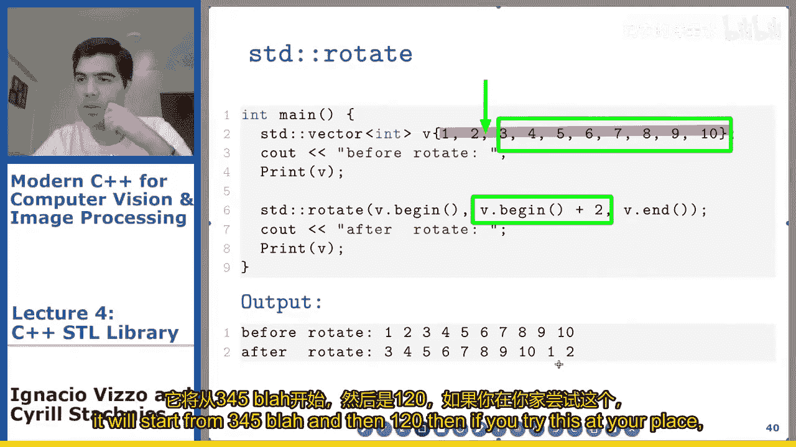

## 总结

本节课我们一起深入学习了C++标准模板库（STL）的核心部分。

我们首先介绍了**容器**，包括静态的 `std::array` 和动态的 `std::vector`，强调了 `vector` 的通用性和使用 `reserve` 进行优化的重要性。接着，我们探讨了关联容器 `std::map` 和 `std::unordered_map`，了解了键值对的存储和访问方式，并阐述了为何STL容器在安全性和可读性上优于C风格数组。

然后，我们学习了**迭代器**的概念，理解了它作为算法与数据之间“胶水”的关键作用，以及它如何实现泛型编程。

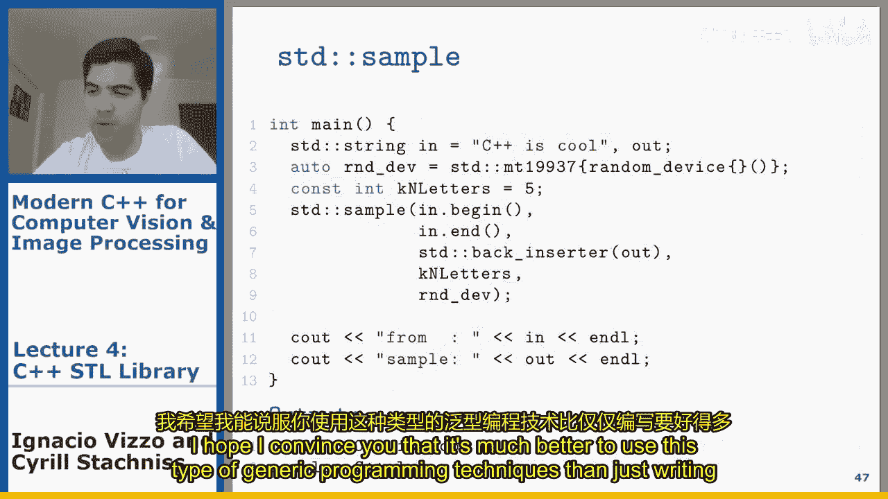

最后，我们快速浏览了大量强大的**STL算法**，如排序、查找、计数、变换等。这些算法与迭代器结合，能让我们以声明式、高效且安全的方式处理数据，避免重复编写底层循环逻辑。

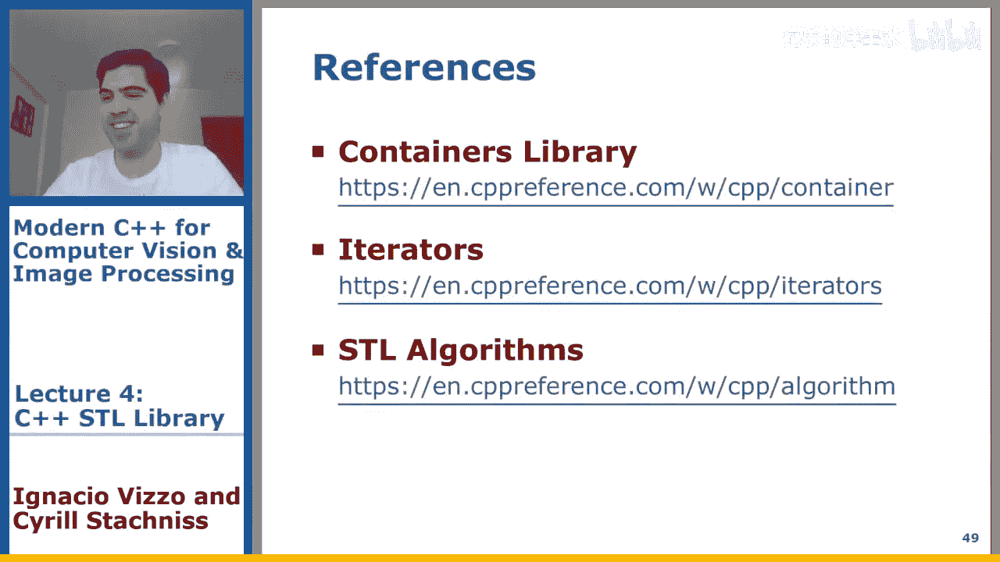

记住，熟练运用STL是编写现代、高效、易维护C++代码的关键。请务必多实践，并查阅 [cppreference.com](https://en.cppreference.com) 来探索更多容器和算法的细节。