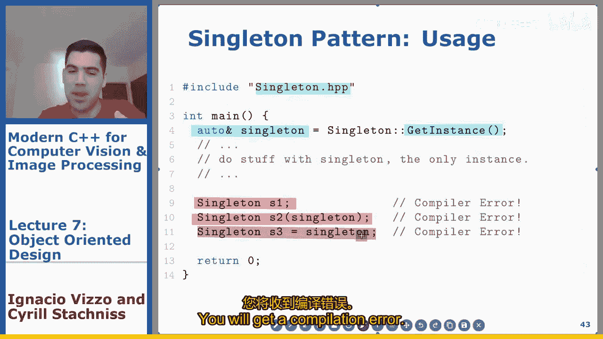
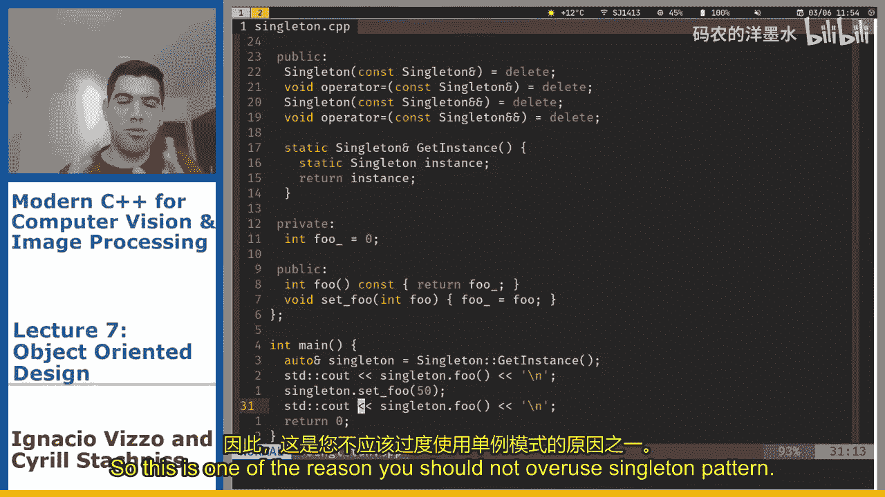
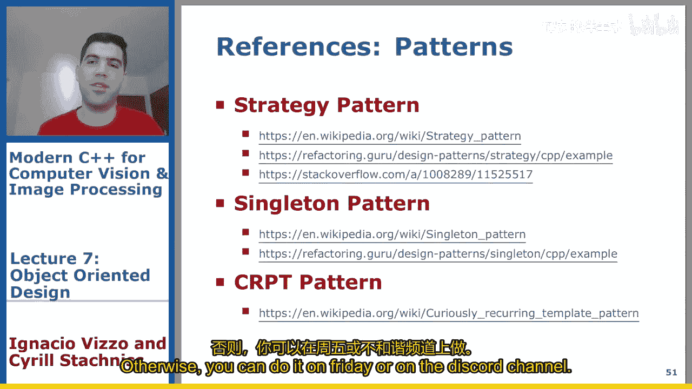

# 008：面向对象设计 🧩

在本节课中，我们将要学习面向对象设计（OOD）的核心概念。这是C++编程的基石，理解这些思想对于构建结构良好、可复用和可维护的代码至关重要。我们将从继承和多态等基本概念开始，然后探讨如何利用这些概念实现一些实用的设计模式。

面向对象设计的思想是通用的，适用于多种编程语言。其核心在于通过类层次结构来组织代码、复用功能，并表达对象之间的关系。虽然现代C++支持多种编程范式，但面向对象设计仍然是其重要组成部分。

---

## 继承：建立“是一个”的关系

上一节我们概述了面向对象设计的重要性，本节中我们来看看其核心机制之一：继承。继承允许一个类（派生类）从另一个类（基类）获取数据成员和成员函数，从而建立一种“是一个”（is-a）的关系，并促进代码复用。

在C语言中，我们无法在代码中明确表达类型之间的关系，只能通过结构体组合和函数来模拟，这会导致代码冗长且难以维护。而在C++中，我们可以使用继承语法清晰地表达这种关系。

**语法示例：**
```cpp
class Vehicle { // 基类
public:
    virtual int getFuelAmount() = 0; // 纯虚函数
    virtual int getCapacity() = 0;
    virtual void applyBrakes() = 0;
};

class Bus : public Vehicle { // 派生类，Bus “是一个” Vehicle
public:
    int getFuelAmount() override { /* 实现 */ }
    int getCapacity() override { /* 实现 */ }
    void applyBrakes() override { /* 实现 */ }
};
```
在上面的例子中，`Bus` 类公开继承自 `Vehicle` 类。这意味着 `Bus` 对象可以访问 `Vehicle` 的所有公有和保护成员。`public` 继承是最常用的类型，它会保持基类成员的访问权限不变。

以下是继承的三种主要访问控制类型：
*   **public继承**：基类的 `public` 成员在派生类中仍是 `public`，`protected` 成员仍是 `protected`。
*   **protected继承**：基类的 `public` 和 `protected` 成员在派生类中都变为 `protected`。
*   **private继承**：基类的 `public` 和 `protected` 成员在派生类中都变为 `private`。

对于初学者，我们主要使用 `public` 继承来建立清晰的“是一个”关系。

---

## 虚函数与重写：实现多态行为

理解了如何建立类之间的关系后，我们需要一种机制让派生类能够提供与基类不同但相关的行为。这就是虚函数和函数重写的作用。

任何类的成员函数都可以声明为 `virtual`（虚函数）。如果基类中的函数是虚函数，那么派生类可以**重写**它，即提供自己的实现。这是通过在派生类中使用 `override` 关键字来实现的。

**语法示例：**
```cpp
class Rectangle {
protected:
    int width, height;
public:
    Rectangle(int w, int h) : width(w), height(h) {}
    virtual void print() const { // 虚函数
        std::cout << "Rectangle: " << width << "x" << height << std::endl;
    }
};

class Square : public Rectangle {
public:
    Square(int side) : Rectangle(side, side) {} // 调用基类构造函数
    void print() const override { // 重写基类的虚函数
        std::cout << "Square: " << width << "x" << height << std::endl;
    }
};
```
基类可以通过将虚函数设置为**纯虚函数**来强制所有派生类都必须实现它。纯虚函数没有函数体，在声明后加上 `= 0`。

**语法示例：**
```cpp
virtual void mustImplement() = 0; // 纯虚函数
```
包含至少一个纯虚函数的类称为**抽象类**，不能直接创建该类的对象。如果一个抽象类只有纯虚函数而没有数据成员，它通常被称为**接口**。接口定义了一组必须实现的方法，是一种强大的设计工具，用于强制类遵循特定的契约。

---

## 多态性：同一接口，多种形态

我们已经学会了如何重写函数，现在来看看如何利用它实现多态。多态（Polymorphism）意为“多种形态”，它允许我们通过基类的接口来操作派生类的对象，并在运行时决定调用哪个具体的函数实现。

这是通过**虚函数表**机制实现的。带有虚函数的类在内部有一个虚函数表，其中存储了指向实际函数实现的指针。当通过基类指针或引用调用虚函数时，程序会在运行时查找该表，从而调用正确的派生类函数。

**示例：运行时多态**
```cpp
void printShape(const Rectangle& shape) {
    shape.print(); // 根据传入的是Rectangle还是Square对象，调用不同的print函数
}

int main() {
    Rectangle rect(10, 5);
    Square sq(7);
    printShape(rect); // 输出：Rectangle: 10x5
    printShape(sq);   // 输出：Square: 7x7
    return 0;
}
```
多态性非常有用，主要体现在以下几个方面：
*   **封装实现细节**：使用者只需了解接口，无需关心具体类的实现。
*   **统一处理不同对象**：可以用一致的方式处理基类及其所有派生类的对象，避免大量的条件判断语句。
*   **强制接口规范**：通过纯虚函数强制多个类实现特定功能。
*   **支持策略模式等设计模式**：可以将复杂功能外包到独立的类中，并以模块化方式传递给对象。

---

## 类型转换：在相关类型间转换

既然我们可以创建自己的类型并建立关系，那么自然需要在它们之间进行转换。C++提供了几种类型转换操作符，比C语言风格的类型转换更安全、更明确。

以下是C++中的五种类型转换：
*   **`static_cast`**：最常用的转换，用于在编译时进行良性转换，如数值类型转换、派生类指针向上转换为基类指针。
*   **`dynamic_cast`**：用于在具有多态性的类层次结构中进行安全的向下转换（基类指针转派生类指针）。它在运行时检查转换是否有效，失败则返回空指针。有一定性能开销。
*   **`const_cast`**：用于移除或添加变量的 `const` 或 `volatile` 属性。
*   **`reinterpret_cast`**：低级别的重新解释位模式的转换，非常不安全（例如，将整数指针转换为字符指针）。仅在需要直接操作底层内存时使用。
*   **C风格转换 `(type)value`**：**应避免使用**。因为它会尝试上述多种转换，行为不明确，容易引入错误。

**关键建议**：优先使用 `static_cast`，仅在需要多态安全向下转换时使用 `dynamic_cast`，避免使用C风格转换。

---

## 设计模式应用：策略模式

掌握了面向对象的基础后，我们可以利用这些机制来实现有用的设计模式。策略模式允许在运行时动态改变对象的行为或算法。

策略模式的核心思想是：定义一个策略接口，将各种具体算法封装成独立的策略类（都实现该接口）。在主要类中持有该接口的引用，从而可以在不修改主类代码的情况下切换算法。

**示例结构：**
```cpp
// 1. 策略接口
class PrintStrategy {
public:
    virtual void print(const std::string& data) = 0;
};

// 2. 具体策略A
class ConsolePrintStrategy : public PrintStrategy {
public:
    void print(const std::string& data) override {
        std::cout << "Console: " << data << std::endl;
    }
};

// 3. 具体策略B
class FilePrintStrategy : public PrintStrategy {
public:
    void print(const std::string& data) override {
        // 将data写入文件的代码
    }
};

// 4. 使用策略的上下文类
class ReportGenerator {
private:
    const PrintStrategy& strategy; // 持有策略接口的引用
public:
    ReportGenerator(const PrintStrategy& strat) : strategy(strat) {}
    void generateReport() {
        // ... 生成报告数据 ...
        strategy.print(reportData); // 委托给策略对象打印
    }
};

// 5. 使用方式
int main() {
    ConsolePrintStrategy consoleStrategy;
    FilePrintStrategy fileStrategy;

    ReportGenerator report1(consoleStrategy); // 使用控制台打印策略
    report1.generateReport();

    ReportGenerator report2(fileStrategy); // 使用文件打印策略
    report2.generateReport();
}
```
这种模式避免了在代码中使用大量的 `if-else` 或 `switch` 语句来选择算法，使得代码更清晰、更易于扩展新的策略。

---

## 设计模式应用：单例模式

单例模式确保一个类只有一个实例，并提供一个全局访问点。这在需要唯一管理器（如配置管理器、日志记录器）的场景中很有用。

实现单例模式的关键是：
1.  将构造函数和析构函数设为私有，防止外部直接创建或销毁实例。
2.  删除拷贝构造函数和拷贝赋值运算符，防止通过拷贝创建新实例。
3.  提供一个静态的公有方法来获取这个唯一实例。

**示例实现：**
```cpp
class Singleton {
private:
    Singleton() = default; // 私有构造函数
    ~Singleton() = default; // 私有析构函数
    Singleton(const Singleton&) = delete; // 禁止拷贝构造
    Singleton& operator=(const Singleton&) = delete; // 禁止拷贝赋值

    int data{0}; // 示例数据成员

public:
    // 静态方法，获取唯一实例的引用
    static Singleton& getInstance() {
        static Singleton instance; // C++11保证局部静态变量初始化是线程安全的
        return instance;
    }

    // 提供对数据的访问（示例）
    int getData() const { return data; }
    void setData(int value) { data = value; }
};

// 使用方式
int main() {
    Singleton& s1 = Singleton::getInstance();
    s1.setData(42);

    Singleton& s2 = Singleton::getInstance();
    std::cout << s2.getData(); // 输出 42，s1和s2是同一个实例
    // Singleton s3; // 错误：构造函数私有
    // Singleton s4 = s1; // 错误：拷贝构造函数被删除
}
```
**注意**：单例模式虽然容易实现，但过度使用可能导致代码耦合度高、难以测试（全局状态），在多线程环境中需要小心处理。应谨慎评估其必要性。

---

## 设计模式应用：奇异递归模板模式

奇异递归模板模式是一种利用C++模板和继承的编译时多态技术。它通过将派生类类型作为模板参数传递给基类，使得基类能够在编译时获知派生类的信息。

一个常见用途是实现“克隆”操作或像下面这样，在对象创建时自动打印类型名。

**示例：自动打印类型名**
```cpp
#include <iostream>
#include <typeinfo> // 用于typeid

// 基类模板，模板参数T是派生类类型
template <typename T>
class Printable {
public:
    Printable() {
        // 在构造函数中打印派生类的类型名
        std::cout << "Creating object of type: " << typeid(T).name() << std::endl;
    }
};

// 派生类，将自己作为模板参数传递给基类
class MyClass : public Printable<MyClass> {
    // ... MyClass 的成员 ...
};



class AnotherClass : public Printable<AnotherClass> {
    // ... AnotherClass 的成员 ...
};



int main() {
    MyClass obj1;       // 输出：Creating object of type: 7MyClass (名称可能被修饰)
    AnotherClass obj2;  // 输出：Creating object of type: 12AnotherClass
    return 0;
}
```
在这个模式中，基类 `Printable` 知道其派生类 `T` 的具体类型。这允许在编译时执行基于类型的操作，而无需虚函数和运行时开销。CRTP是高级C++技术，在需要静态多态时非常有用。

---

## 总结与建议

本节课中我们一起学习了面向对象设计的核心支柱：**继承**和**多态**。我们了解了如何通过继承建立类之间的关系，如何使用虚函数和重写来实现运行时多态，以及如何进行安全的类型转换。

我们还探讨了如何将这些概念应用于实际的设计模式：
*   **策略模式**：用于灵活地切换算法。
*   **单例模式**：用于确保全局唯一实例。
*   **奇异递归模板模式**：用于实现编译时多态。

最后，关于面向对象设计的一些建议：
*   **区分“是一个”和“有一个”**：`Square` **是一个** `Shape`（适合继承），`Car` **有一个** `Wheel`（适合组合，即作为成员变量）。
*   **优先使用组合而非继承**：除非确实存在清晰的“是一个”关系，否则使用组合（将类作为成员）通常更灵活、耦合度更低。
*   **避免过度设计**：不要创建过于深或复杂的类层次结构。在计算机视觉等领域，通常不需要极度抽象的建模。仅在能显著改善代码性能、可读性或可维护性时使用这些模式。



面向对象设计是构建大型、复杂系统的强大工具，但需要明智地使用。理解这些基本原则将帮助你编写出更优雅、更健壮的C++代码。