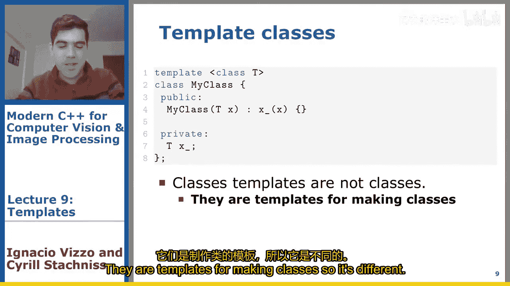
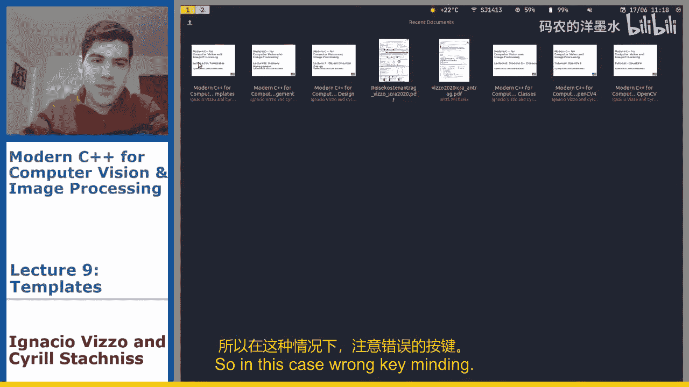
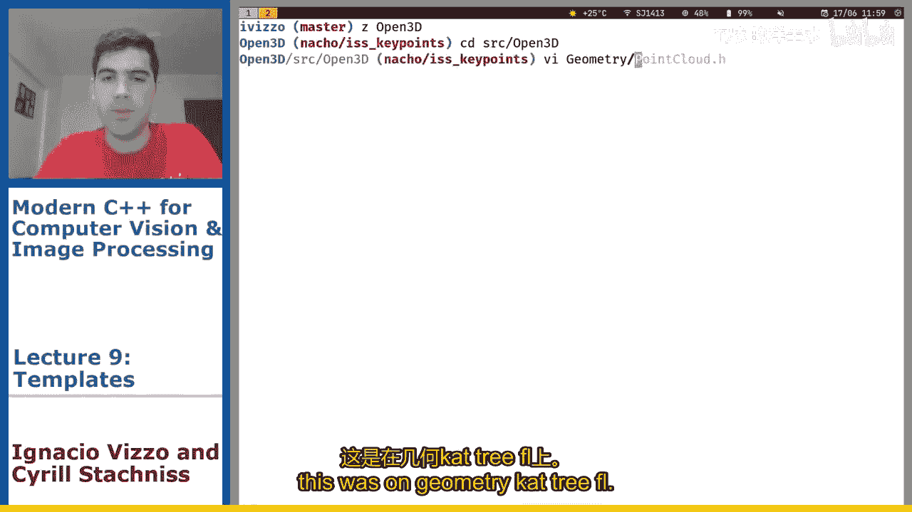
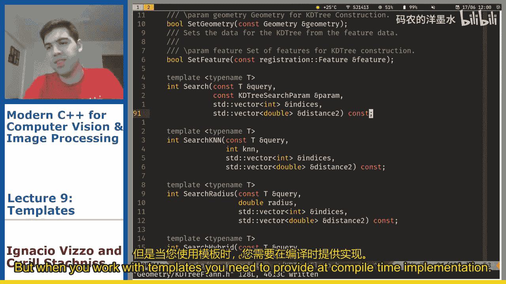

# 010：模板 🧩

在本节课中，我们将学习C++中一个强大但常被误解的特性：模板。模板是泛型编程的核心，它允许我们编写独立于特定数据类型的代码。我们将从基本概念开始，逐步理解模板的工作原理、语法以及在实际编程中的应用。

---

## 概述 📋

模板是C++中用于定义一族类或函数的实体。它允许我们编写通用的算法和数据结构，而无需为每种数据类型重复编写代码。本节课将介绍模板的基本概念、语法、类型推导、特化以及如何组织模板代码。

---

## 泛型编程与元编程

上一节我们概述了模板的重要性，本节中我们来看看其背后的核心思想：泛型编程和元编程。

泛型编程的目标是将算法与数据结构分离。就像一个杯子可以装茶、咖啡或水一样，泛型算法（如排序）可以操作各种类型的数据，而不必关心数据的具体类型。标准模板库（STL）中的迭代器就是泛型编程的一个例子，它使得STL算法可以操作任何提供了迭代器的容器。

元编程则是指编写能够操作其他程序或自身（视其为数据）的计算机程序。在C++中，模板在编译时生成代码，这本身就是一种元编程：我们编写的模板是“制造”类或函数的蓝图，而编译器则在编译时根据这个蓝图生成具体的代码。

---

## 什么是模板？

在字典中，模板是作为模型供他人复制的东西，或是用于生产其他类似事物的模式。在C++中，模板是一个C++实体，它定义了以下内容之一：
*   一族类（称为类模板）。
*   一族函数（称为函数模板）。

**关键点**：函数模板不是函数，而是**制造函数的模板**。类模板也不是类，而是**制造类的模板**。这是一个重要的区别。

---

## 动机：为何需要泛型函数？

让我们回顾一下函数重载。例如，为了实现计算绝对值的函数，我们需要为每种数据类型（`int`, `double`, `long`等）编写一个几乎相同的函数。这不仅繁琐，而且难以维护。





```cpp
int abs(int x) {
    return (x < 0) ? -x : x;
}
double abs(double x) {
    return (x < 0) ? -x : x;
}
// 还需要为 long, float, short... 编写
```

C语言通过使用不同的函数名（如 `abs`, `labs`, `fabs`）来解决，但这要求程序员记住每个名字。C++模板提供了更优雅的解决方案。

---

## 函数模板基础

我们可以使用模板编写一个通用的 `abs` 函数：

```cpp
template <typename T>
T abs(T x) {
    return (x < 0) ? -x : x;
}
```

这四行代码定义了一个函数模板。`template <typename T>` 声明了一个模板参数 `T`，它代表一个类型。在函数签名和实现中，我们使用 `T` 作为占位符。

**核心优势**：你无需为所有类型预先编写函数。只有当代码中实际用到了某个特定类型的 `abs`（例如 `abs(5)` 或 `abs(3.14)`）时，编译器才会在**编译时**为该类型生成（实例化）具体的函数。这就是“不为未使用的部分付出代价”。

---

## 编译时与运行时

理解模板的关键在于认识到**模板的一切都发生在编译时**。

这带来两个重要结论：
1.  **设计时的思考**：当你考虑使用模板时，应该问自己：“我需要在编译时就知道这个信息吗？” 如果你的算法依赖于运行时才能确定的传感器数据，那么模板可能不是合适的工具。
2.  **适用场景**：在机器人学等动态领域中，许多核心算法处理的是运行时数据，因此可能不需要大量使用模板。模板更常用于编写库、通用工具或需要编译时优化的部分。

**记住**：传递给模板参数（在尖括号 `<>` 中的内容）的值必须在编译时已知。

---

## 类模板

与函数模板类似，类模板用于定义一族类。

```cpp
template <typename T>
class MyContainer {
private:
    T data;
public:
    MyContainer(T d) : data(d) {}
    T getData() { return data; }
};
```

这里，`MyContainer` 是一个类模板。我们可以用它来创建存储不同数据类型的容器：

```cpp
MyContainer<int> intContainer(5);
MyContainer<double> doubleContainer(3.14);
```

标准库中的 `std::vector` 就是一个类模板：`std::vector<int>`、`std::vector<std::string>` 等。

---

## 模板参数与类型推导

函数模板有两种“传递参数”的方式：
1.  **编译时参数**：通过尖括号 `<>` 传递的模板参数（类型或值）。
2.  **运行时参数**：通过圆括号 `()` 传递的函数参数。

例如：
```cpp
template <typename T, int N>
T accumulateVector(T value) {
    std::vector<T> vec(N, value); // 创建包含N个value的vector
    return std::accumulate(vec.begin(), vec.end(), T{0});
}
```
调用方式：
```cpp
auto result1 = accumulateVector(2); // 编译器推导 T=int, 使用默认 N=10
auto result2 = accumulateVector<float>(2.0); // 指定 T=float, 使用默认 N=10
auto result3 = accumulateVector<float, 5>(2.0); // 指定 T=float, N=5
```

**类型推导**是编译器的一项便利功能。在大多数情况下，编译器可以根据函数调用时传递的实参自动推导出模板参数 `T` 的类型，因此我们常常可以省略尖括号：

```cpp
abs(5);   // 推导出 T = int
abs(3.14); // 推导出 T = double
```

从C++17开始，类模板也支持通过构造函数参数进行类型推导：
```cpp
std::vector vec = {1, 2, 3}; // 推导出 vec 是 std::vector<int>
```


---


## 模板特化

有时，对于模板族中的某些特定类型，我们可能需要不同的实现。这时可以使用**模板特化**。

例如，一个默认返回 `false` 的“是否是bool类型”检查器：

```cpp
// 主模板
template <typename T>
bool isBool() {
    return false;
}

// 对 bool 类型的完全特化
template <>
bool isBool<bool>() {
    return true;
}
```
调用 `isBool<int>()` 返回 `false`，而调用 `isBool<bool>()` 返回 `true`。

特化语法是在模板声明后使用 `template <>`，然后给出针对特定类型的完整定义。

---

## 组织模板代码：头文件与源文件

对于普通函数，我们通常将声明放在头文件（`.hpp`），定义放在源文件（`.cpp`）。但对于模板，这种做法需要格外小心，因为模板的实例化发生在编译时。





以下是三种常见的组织方式：

1.  **全部放在头文件中（最常见）**：将模板的声明和定义都放在 `.hpp` 文件里。当其他文件包含此头文件并实例化模板时，编译器能看到全部定义并生成代码。
2.  **头文件 + 实现文件（`.ipp`/`.tpp`）**：将模板声明放在主头文件（如 `myclass.hpp`），将模板定义放在一个额外的实现文件（如 `myclass.ipp`），然后在主头文件末尾 `#include “myclass.ipp”`。这保持了代码的整洁性。
3.  **显式实例化**：将模板声明放在头文件，定义放在 `.cpp` 文件，并在 `.cpp` 文件中**显式地**列出你希望支持的所有模板实例。这样，只有这些列出的类型会被编译到库中。

    *myclass.hpp*
    ```cpp
    template <typename T>
    void myFunc(const T& x);
    ```
    *myclass.cpp*
    ```cpp
    #include “myclass.hpp”
    template <typename T>
    void myFunc(const T& x) { /* 实现 */ }

    // 显式实例化
    template void myFunc<int>(const int&);
    template void myFunc<double>(const double&);
    ```
    这种方式限制了模板的泛用性，但可以隐藏实现细节并减少编译依赖。

---

## `constexpr`：编译时计算

`constexpr` 是C++11引入的关键字，用于指示表达式或函数可以在编译时求值。这与模板的编译时特性完美结合。

```cpp
constexpr int factorial(int n) {
    return (n <= 1) ? 1 : n * factorial(n - 1);
}
int main() {
    constexpr int result = factorial(5); // 值120在编译时计算
    int runtimeVal = 10;
    int runtimeResult = factorial(runtimeVal); // 在运行时计算
}
```
标记为 `constexpr` 的函数如果使用编译时常量调用，其结果将在编译时计算。这可以提升运行时性能。

---

## 总结 🎯

本节课我们一起学习了C++模板的核心知识。我们了解到：

*   模板是用于定义一族类或函数的蓝图，其核心是**泛型编程**和**元编程**。
*   模板的所有工作都在**编译时**进行，这是理解其行为和限制的关键。
*   我们学习了**函数模板**和**类模板**的基本语法和使用方法。
*   **类型推导**让模板代码更简洁，编译器能自动推导出许多模板参数。
*   **模板特化**允许我们为特定类型提供定制化的实现。
*   组织模板代码时，通常需要将定义放在头文件中，或者使用显式实例化等技术。
*   `constexpr` 可以与模板结合，实现强大的编译时计算。


模板是C++最强大的特性之一，也是STL的基石。虽然其语法有时显得复杂，错误信息可能令人困惑，但只要掌握了“编译时”这一核心概念，并理解模板是制造代码的蓝图而非代码本身，你就能有效地利用它来编写更通用、更高效的C++程序。