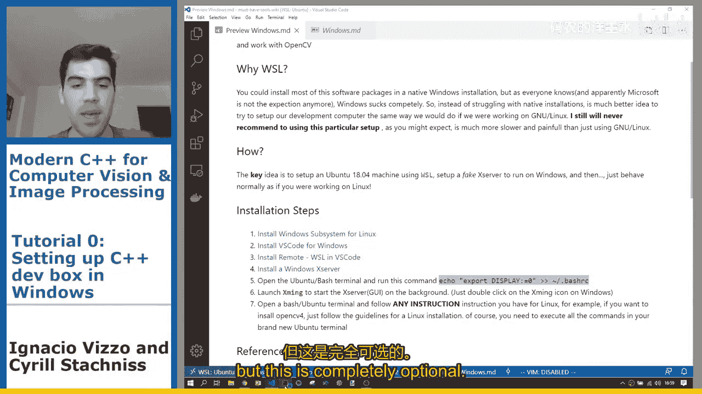
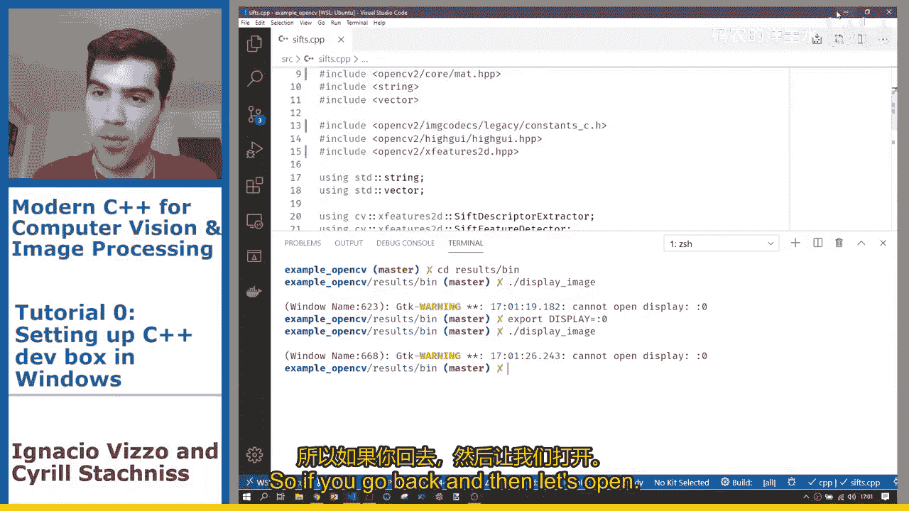
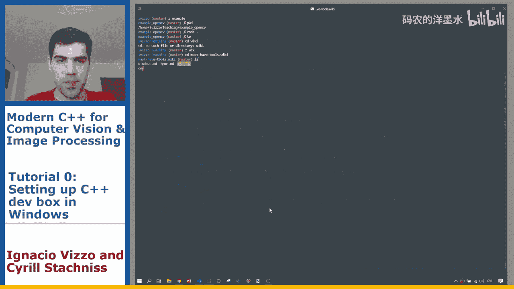
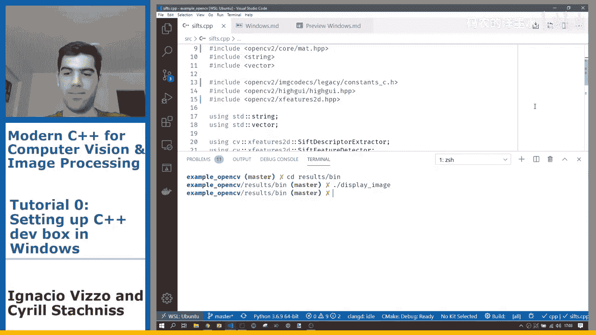

# 012：在Win10 WSL中设置OpenCV4 C++开发环境 🖥️➡️🐧

在本教程中，我们将学习如何在Windows 10系统上，通过Windows Subsystem for Linux（WSL）来搭建一个用于现代C++和OpenCV4开发的Linux环境。这种方法避免了在Windows上直接安装复杂库的麻烦。

## 概述

上一节我们介绍了课程的基本工具链。本节中，我们来看看如何在Windows系统上创建一个兼容的开发环境。核心思路是利用WSL在Windows内部运行一个Linux子系统，从而使用Linux的包管理工具来安装C++开发库和OpenCV。

## 环境搭建步骤

以下是配置WSL开发环境的主要步骤。整个过程分为安装WSL、配置开发工具和设置图形界面支持几个部分。

1.  **安装 Windows Subsystem for Linux (WSL)**
    首先，需要在Windows 10上启用并安装WSL。这相当于在Windows内部集成一个轻量级的Linux虚拟机。你可以按照官方文档或课程Wiki提供的链接完成此步骤。

2.  **安装 Visual Studio Code (VSCode) for Windows**
    在Windows上安装VSCode。这是我们主要的代码编辑器。

3.  **安装 VSCode 的 Remote - WSL 扩展**
    在VSCode中安装此扩展后，你可以在Windows的VSCode中直接打开和编辑WSL子系统里的文件。安装成功后，VSCode左下角会显示一个绿色的按钮，指示当前连接的是WSL环境。




4.  **安装 X 服务器 (用于图形界面支持)**
    由于WSL默认不支持图形界面(GUI)，我们需要安装一个X服务器（如VcXsrv或Xming）来运行OpenCV等需要显示图像的应用程序。课程Wiki中提供了具体的安装和配置教程。

5.  **在WSL中执行环境变量配置**
    安装好X服务器后，需要在WSL的终端里执行一个命令来设置显示环境变量，例如：
    ```bash
    export DISPLAY=:0
    ```
    这样，WSL中的GUI程序就知道将图形界面输出到我们安装的X服务器上。

## 工作流程演示





完成以上设置后，你的工作流程如下：

*   通过开始菜单搜索并打开“Ubuntu”（或其他你安装的WSL发行版），这将启动一个Linux终端。
*   在这个终端中，你可以使用`apt`等Linux包管理命令安装GCC、CMake、OpenCV4等所有必需的开发库。
*   在WSL终端中，使用`code .`命令可以在Windows的VSCode中打开当前WSL目录，进行代码编辑。
*   编译和运行程序在WSL终端中进行。如果需要显示图像，确保X服务器正在运行（通常会在Windows任务栏托盘区有一个图标）。

为了验证环境是否正常工作，你可以尝试编译并运行一个简单的OpenCV显示图像的程序。如果配置正确，图像窗口将通过X服务器在Windows桌面上显示出来。

## 总结



本节课我们一起学习了如何在Windows 10上利用WSL搭建Linux开发环境。这种方法的核心优势是**在Windows的便利性下，获得了Linux强大的开发工具链**。你无需处理Windows原生库安装的复杂性，所有依赖都通过WSL中的Linux包管理器解决。虽然性能可能略低于原生Linux，但它为必须在Windows下工作的开发者提供了一个极佳的解决方案。请务必按照课程Wiki的详细步骤操作，并确保X服务器在运行GUI程序前已启动。