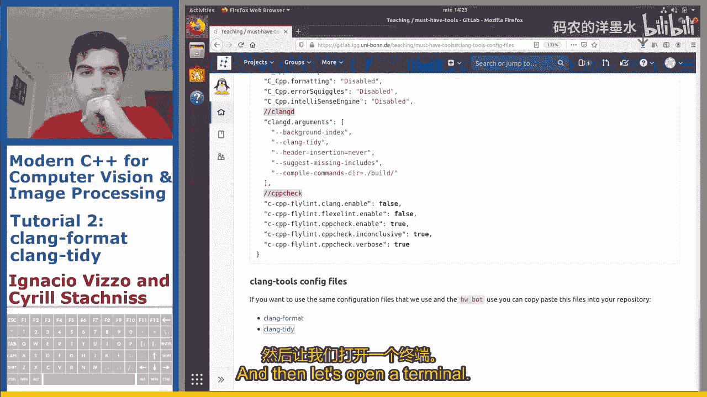
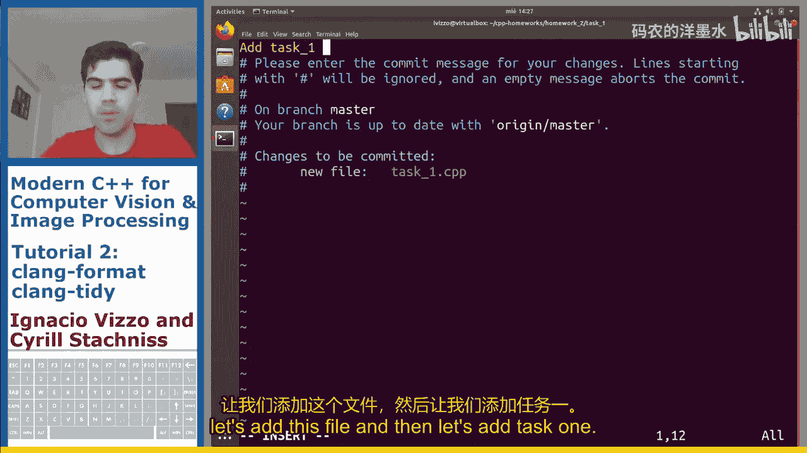
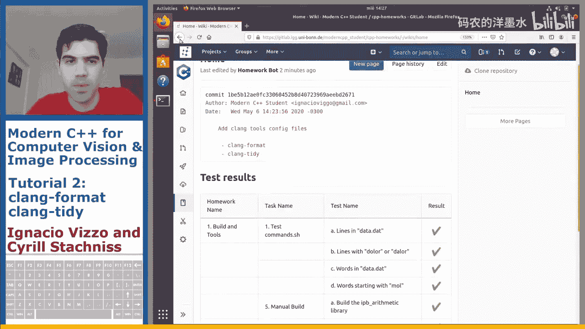
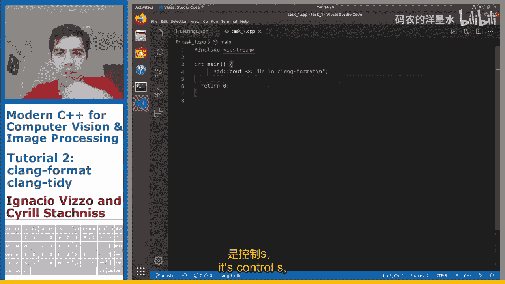
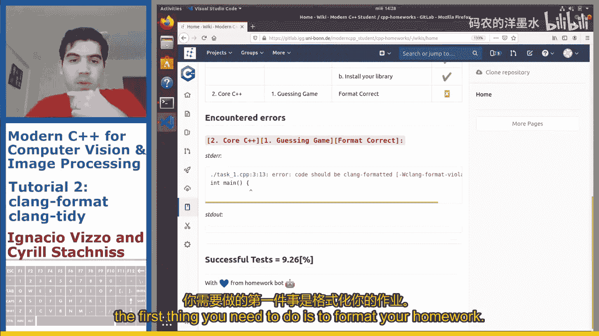
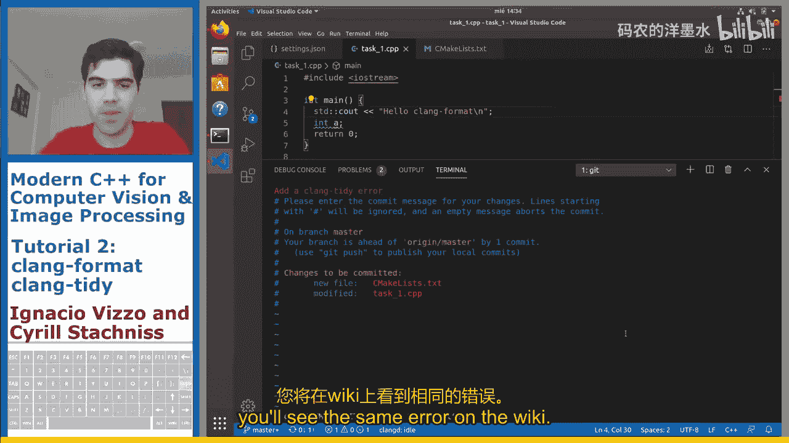
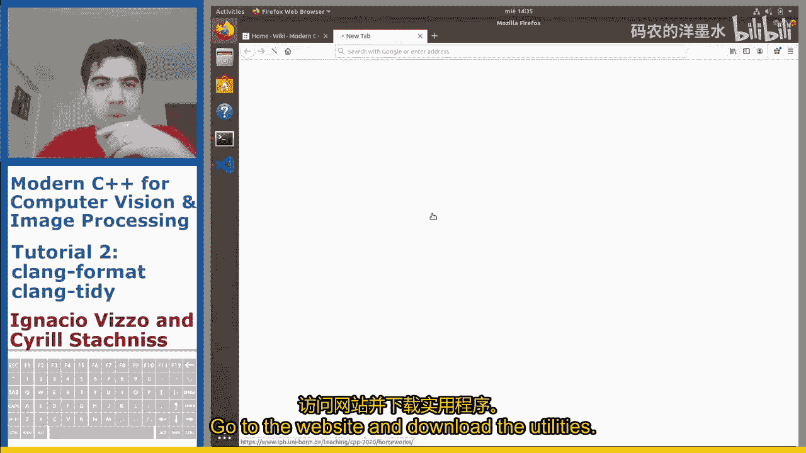
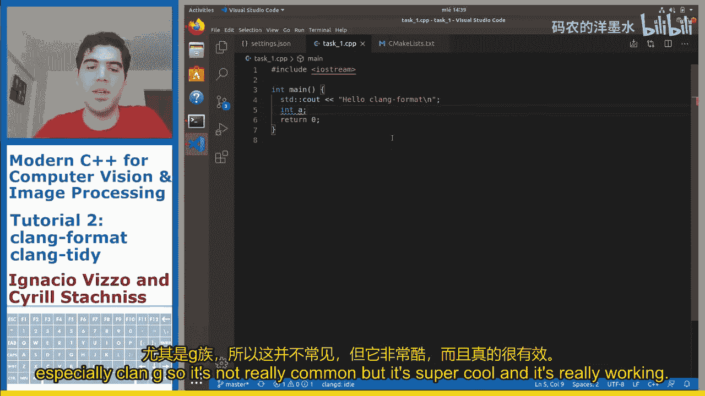

# 013：clang-tools

## 概述

在本教程中，我们将学习如何使用两个重要的开发工具：`clang-format` 和 `clang-tidy`。这些工具能帮助你自动格式化代码并进行静态分析，从而编写出更专业、更高质量的C++程序。我们将从配置开始，逐步介绍它们的使用方法。

## 配置工具



首先，你需要获取工具的配置文件。这些文件定义了代码格式化和静态分析的规则。

以下是配置步骤：

1.  从指定位置下载两个配置文件。
2.  将这两个文件保存到你的C++作业项目仓库的根目录下。
3.  这些文件应以点号开头（例如 `.clang-format`），使其成为隐藏文件。
4.  使用 `git add` 命令将配置文件添加到版本控制中，然后提交并推送到远程仓库。

将配置文件放入仓库的好处是，你可以在本地获得与作业评分系统完全一致的反馈。

## 使用 clang-format 格式化代码

上一节我们配置了工具，本节中我们来看看如何使用 `clang-format` 来自动整理代码格式。

`clang-format` 是一个代码格式化工具，它能根据预定义的规则自动调整代码的缩进、空格、换行等，使代码风格统一且易于阅读。



假设我们有一个格式混乱的 `task1.cpp` 文件：
```cpp
#include <iostream>
int main(){std::cout<<"Hello platform";
return 0;}
```
这段代码可以编译运行，但格式糟糕，难以阅读。



你有两种主要方式来使用 `clang-format`：



**1. 在终端中手动运行：**
*   查看格式化后的效果（输出到终端）：
    ```bash
    clang-format task1.cpp
    ```
*   直接格式化并覆盖原文件：
    ```bash
    clang-format -i task1.cpp
    ```



**2. 在编辑器（如VS Code）中集成：**
如果你按照初始教程配置了VS Code，可以启用“保存时格式化”功能。这样每次保存文件（Ctrl+S）时，代码会自动被格式化。你也可以在编辑器中手动触发“格式化文档”命令。

**重要提示：** 在提交作业前，必须确保代码格式正确。评分系统会首先运行 `clang-format --dry-run` 命令检查格式。如果格式有误，作业将不会被进一步评估。

### 自定义代码风格

如果你不喜欢默认的代码风格，可以自定义。`clang-format` 支持多种预定义风格（如Google、LLVM、WebKit）。

以下是自定义风格的步骤：

1.  选择一个你喜欢的风格，例如 `WebKit`。
2.  在项目根目录运行以下命令，将该风格的配置输出到你的 `.clang-format` 文件中：
    ```bash
    clang-format -style=WebKit --dump-config > .clang-format
    ```
3.  之后使用 `clang-format` 时，就会应用你自定义的风格。

## 使用 clang-tidy 进行静态分析

学会了代码格式化，我们接下来看看如何用 `clang-tidy` 提升代码质量。

`clang-tidy` 是一个静态代码分析工具，它能在不运行程序的情况下，检测出代码中潜在的错误、不良实践和可改进之处。



为了让 `clang-tidy` 正确工作，它需要知道项目是如何编译的。这通过一个名为 `compile_commands.json` 的文件来实现。

**生成编译数据库：**
在你的 `CMakeLists.txt` 中，添加以下行来生成该文件：
```cmake
set(CMAKE_EXPORT_COMPILE_COMMANDS ON)
```
然后运行CMake和make命令，就会在构建目录下生成 `compile_commands.json` 文件。



**使用 clang-tidy：**
假设我们在代码中定义了一个未使用的变量 `int a;`。


*   **在终端中运行：**
    ```bash
    clang-tidy -p build/ task1.cpp
    ```
    `-p` 参数指定了包含 `compile_commands.json` 的构建目录。运行后，`clang-tidy` 会报告变量 `a` 未被使用的警告。
*   **在编辑器中集成：** 配置好的VS Code插件会在你编码时实时显示这些警告。
*   **在构建过程中集成：** 通过提供的CMake工具脚本，你可以在每次执行 `make` 命令时自动运行 `clang-tidy`。如果代码有问题，构建会失败并显示相关警告。

**重要提示：** 与 `clang-format` 一样，评分系统也会运行 `clang-tidy`。任何它发现的错误都会导致你的作业提交失败。因此，在本地提前使用这些工具进行检查至关重要，可以避免在评分系统上反复修改。

## 工具集成与工作流

现代软件开发的关键在于将各种工具灵活地集成到你的工作流中，而不是依赖某个单一的“魔法”集成开发环境（IDE）。

`clang-format` 和 `clang-tidy` 的优势在于它们的独立性和可集成性：
*   它们可以在终端、编辑器、持续集成（CI）系统、版本控制钩子等任何地方运行。
*   配置文件（`.clang-format`, `.clang-tidy`）可以轻松地在团队间共享，确保代码风格和质量标准一致。
*   这种基于通用工具链（如LLVM）的生态正在成为现代C++开发的主流方向，提供了极大的灵活性。

例如，本课程配置的VS Code环境就禁用了传统的C++插件，转而使用 `clangd`（另一个LLVM工具）来提供代码补全和智能提示，它能更好地与你的项目构建信息结合。

## 总结



本节课中我们一起学习了两个强大的C++开发辅助工具：
1.  **`clang-format`**：用于自动格式化代码，确保风格统一、整洁。
2.  **`clang-tidy`**：用于静态代码分析，在编码阶段及早发现潜在错误和不良实践。

我们了解了如何配置它们、如何在命令行和编辑器中运行，以及如何将它们集成到CMake构建过程中。掌握这些工具不仅能帮助你顺利完成本课程的作业，更能培养符合现代工业标准的开发习惯，为你的职业生涯打下良好基础。如果在使用中遇到任何问题，请及时提出。