# 【全集】波恩大学 现代C++ CS414 中英字幕 p01 Lecture 0 - 基础 -BV1EYm1B5E2D_p1-

Okay， so we are all set with this YouTube thing and then let's start with the lesson。

 I'm pretty excited to be your guide through this Mon C++ course this year。

It's going to be a bit challenging， since。We never did this before， like doing these online lectures。

 but I think it it's going to work out for both for you and for me as well。So。This year。

 because of the coronavirus thing， we can teach you C++ on the classroom。

 but I feel like this is good news for everyone because I never felt like。

Teaching coding on a classroom so it's quite difficult its like for me it's like if I would be trying to teach like 10 people how to ride a bike in a classroom so it's quite challenging so of course we can explain some theory facts and some ideas but maybe the most important thing is that you need to get your hands on the keyboard and start coding。

Okay， so let's。Get started let's discuss a bit about the CA course organization so we will have like lectures every Wednesday at 4 pm on Central European time so this is in Germany so this is basically this lecture and this is going to be once a week so every Wednesday I will be trying to give you a lecture of not more than one hour that's my idea so you commit yourself you put effort for one hour and then you learn something。

So we have lecture videos that I would point you with the link。嗯ん。😊，But the thing is why I am。

 I'm sorry， I need to check the chat。オッケ。I'm sorry， yes， I'm not a Youber， okay。Great。And。

Why we don' I don't want to do this offline video thing It's because I want to give you guys the feel like you are going to the university so that's why also some of the colors of the layout of the video so that yes that you come in to go to lectures every Wednesday that 4 pm of course I need to put extra effort to do this and I expect that you also put extra effort during the homeworks so this is going to be like 10 lessons where I will try to explain you guide you through the topics and do some live coding examples and then we have a tutorials every Friday but this is not going to be like a lesson where I I will not be doing this live stream thing。

And。嗯。😊，But I will be basically online on the Discord channel in case anyone has any question。

 we can discuss it through there， also on Discord channel I can share you my screen so if there are like some question I can say okay。

 let me show you the screen and I will show you how to fix some issue or whatever。

And also you will so you should reserve this spot for yourself because I will be giving you videos that I will be recording myself and also videos from other people that you will you should like watch to these videos on this time slot。

And then if you haven't already， just please sign up to the Discord channel。

 so this is the fastest channel to discuss for many reasons。

Please if you have a question that you think that someone else might benefit from the answer。

 just ask on the channels so we have a lecture channel to discuss stuff about this for example。

 you say I hate this YouTube live stream it doesn't work for me then you go to the lecture channel on Discor and you say hey guys what do you think do you think we should use Zooms like this or guy is using Zoom it's much better than this YouTube live stream wherever if you have any issue with the Homes。

 you will go to the Homeworks channel and say Im starting with Home number two blah， blah， blah。

 blah blah， blah and then we can discuss everything there like AsA group and this will allow me to give you one answer for all of you guys。

And of course I am working from home， so I'm basically always online。

 so if you are struggling with something and I am online in that moment。

 I can help you to sort the issue。Just be aware that I'm currently in Argentina。

 my home and lovely country and there there is five hours difference with Germany。

 I have no idea where you guys at， but with Germany there is five hours difference So make sure you sign up to the Discor channel Okay this is for me important for you because this is some numbers that not everyone see if you look to the study plan of discourse you will have this numbers and I did the math for you and then let's try my new magic too Okay。

 apparently is working。嗯。So。In this particular year， this 60 hours per semester on lectures。

 this is more or less the time we spend doing lectures during a normal semester。

 so in this case you will have to spend these 60 hours in the whole semester with my YouTube videos and other recommendations I will give to you and then if you do the math。

It will have basically eight hours a week。 What is the meaning of this is that at least you need to spend one full day working on the C+ plus homeworks plus the lectures and the tutorials and whatever so if you want to make a schedule for yourself you can say okay every Thursday I will work from 8 am to 5 pm on the C++ homeworks depending on the background you have if you know if you new C++ before whatever you will turn to spend extra time but this is basically the minimum requirement。

 So it's very unlikely that you get through this course just spending two hours a month so it's one day per week for the C++ course。

😊，So one of the basics that you will be learning in this course is how to work on a Linux environment。

 this is super important， how to write software with modern C++。

And some core software development techniques， so this is not a programming course。

 it's not a pattern course， so it's not going to be sufficient if you want to learn this。

 but we will discuss some small points。And also we will be dealing with OpenCB that is an open source library to work with images and then the final project is basically doing this inverse image search that you can check that link that is basically to see a working example that we will adapt this idea and try it on our field that is the robotics field and we will build a place recognition pipeline sort of。

Using inverse image search。Okay， this year， I also spend some extra time trying to sort the contents of the course to make it easier for you。

This doesn't mean that it's extremely easy， but I spend a lot of time trying to make the put the topics from the easiest to the hardest so if you see this is scheduled so all this information is on the web page of the course so you can go and check it out but it's basically in four parts so the first part is basically the tools so this year I decided to completely remove wherever is related with tools from the lectures this means that I will not be discussing how to build a project during the lectures because that's not the key concepts of the class。

But then we will move these to tutorials So all the first part that is basically how to build projects how to use Linuxs and all this part will be part one of the course。

 that is basically the tools。 So this is the tools you need to know in order to work with the concept right but then the concepts also need like their own place in the course。

 So then we have two extra parts that is basically part two I call it the C+ plus core language and it's basically four weeks this means one month。

 then if you complete this part。 let's say there is no real examination between parts So it's just like a scheme to make it easier for you So if you complete part two that is the core language then you will probably know how to code in C stuff that you already know how to code in all language like let's say Python or mat So it's basically。

The the the simply the core language is what I call like what you can do with all languages as well in C++ and then the third part is going to be the modern C+ that this is the the meaty part of the course that is basically。

Don't mention have in my course。I'm watching the the chat。

The the modern C plus plus part is the meaty 1， I was saying that is the things that you will be able to code in C plus。

 but you cannot code in other languages， or is the most。😊，Fancy part of the course。

 I would say and also the most complex part in previous year。

 we used to explain some of these topics around the semester and but this year I tried to make it like from easy to higher level when I made a scale and then the final part is going to be the final project。

That is this basically you will have one lecture on the concepts behind the final project you need to implement。

 and then you will have no lectures because you need to do the project yourself。

And also one thing I we are doing this year so you you don't complain there is a lot of homework。

 some of the homeworks during these nine homeworks will be related to the final project what is the meaning of peace So if you complete let's say homework number  five and you do it properly then you have 10% of the final project already done So I will not recommend you to do some stuff that I know students do that is like I do the 50 points and then I quit until the final project because during the homeworks you will be all implemented implementing task from the final project So this will。

Give you the ability to complete this final project in less time。

The course content so this is basically the topics list you can also check on the web page。

I just put this on the web page for people who is。Curious and wants to know what we will be learning during this semester。

Then the philosophy of this course。 and for this。I will ask you to help me is that this famous quote that is a to chip show me the code so sometimes in coding not in C plus but in every language so people can spend hours talking about like one particular thing but then when you see the code is super simplistic and then it's faster to just see the code and discuss about the code without like too much。

So that's the philosophy。This is what I expect you to do in this course so you should get your hands dirty。

 you should be hours in the keyboard trying stuff in order to make it work。

So you will get your hands dirty and then I have a disclaimer here that is that。

I will ask you to stop me if you don't understand anything。

 but I also need to ask you that don't be surprised if I do something fast。

 it's not because I am smart or because blah， blah， it's because I have been using Linux for example。

 for more than 10 years so I am really used to this。

And sometimes for me it's really difficult to not do the stuff I'm used to do。

 So if you see that I did something funanky， you say， wait a moment。

 I have no idea what you're doing。 You just open this， but blah， blah， blah， just。Go to the chat。

 He said natural。 stop。 What are you doing， I would try to go slow。

 but I am really used to type on the keyboard， So I might be a bit fast。

 but this doesn't mean that you should be scared or say， oh， why not， this is like so complicated。

 He's doing really fast。 It's just because I have been doing this for 10 years。

 So make yourself to I want to make this clear。 And also。

I usually try to use like modern desktop environments to show you how to use Linux and whatever。

 but currently I only have a dual core machine from and it's five years old。

 So I cannot run like really heavy desktop environments like No or unity whatever。

 So I am running a ti window manager。 it's called I3。 And if you see it。

 it might be like hockey or whatever， I don't recommend you to use this。

 but I just want to mention that you can make your computer look much more beautiful than my computer。

 So don't be scared。诶。For的。Why， so I also made a frequent。

Questions and answers on the modern C++ website I would recommend you to go there and check it out。

 it's on the website you go to the fact tab and then there you have the answers but then here I will try to motivate you to why you should use in C++ I know that some of you only want to know C++ because it's part of your study program but believe it's a really fun topic to really fun language when you learn it properly。

So when I was designing this part of the class， I wanted to show you millions of things of why you should learn C++。

 but then I decided to make it more simple and then encourage you to go and look on Google， YouTube。

 whatever why you should be learning C++ so before you start learning。

 you should ask yourself this question and then do some research on the language itself。

So this is from 2018 but here are some of the numbers of the survey from Sta overflow。

 so most of you might I already know Sta overflow so it's basically a forum where people ask questions about coding。

And then every year they do this survey where they ask like most of the parameters in the world。

 let's say， which tools they use， which environment they use and wherever。

 and then the results from the some key results because it's a big survey。

 I would recommend you to go and check it out。Is that。

Nearly half of the people who are professional developers are using Linux as the primary system for working and then。

This was in 2015， C++ was the most use system language with almost 5 million users。

So C plus plus is still super popular。 Nowadays， we have all languages that are。

A bit more popular like Python， let's say， but this is also because Python can be used for more people。

 but then you you need to keep in mind that we are trying to target C plus plus or robots。

 and then if you go for robotics the robotics feel。

 then you will not find like many python or wherever other languages working there。

 So make sure that when you see these surveys and comparisons。

Make sure that you know what you're checking because of course you will see， I know JavaScript。

 like the most used language， but everyone is doing web development so it's not really fair if you trade it against JavaScript because it's a different monster。

So all of the companies in our field will want you to know C++ and also if you don't plan to go for for the industry and you plan to do research。

 it's really important that you know C++ in terms of it's really good if you can run experiments and don't need to wait like for three months in order to get the result of these experiments。

So with C++， it's not the best language for prototyping， but once you have the ideas。

 it's really fast。So one of the key ideas of C++ is that it's super fast and this is why we use it in our field。

Another reason is that。Nowadays， so maybe 10 years ago when people were talking about， okay。

 let's say。A few bitetes of memory， people start laughing because it was an age where people started getting like 12 gigabytes of memory around on the computers。

Then the game changing because then the computers stopped being only on your desktop and then started to be on your smartphone。

 on your watch and on your robots and everywhere， so then the power consumption and the footprint of the processors you put on these devices start so the weight of this start to matter and then people stop laughing about like memory efficiency and all this stuff and this is why still see and C++ are one of the most popular language out there。

 not because you want to。To save like time on your desktop machine or memory on your machine。

 But because you want to probably run these software in amba devices where you don't have like infinite amount of resources。

 And then every bit matters here。 And even when you say， I don't care I have money。

 can pay more like a bigger processor or whatever。 then you will need to pay energy consumption。

 And then you will need to put a bigger battery on your device。

 So this is where the trade of like say could stop。

 And then this is where like compile languages like C or C plus start to to have really importance。

These are some of the companies that I know they use C++。

 so it's not like a real language that no one use， so Google， Microsoft。

 all of them use C++ this doesn't mean that they use C++ for everything。

But we know for a fact that they use C++ and also they are part of the people。

 so they have people who invest time on making C++ a better language。

Some browsers that use C+5volox Chrome。 If you check the source for these browsers。

 they are all written in C++。Also， there is some software that is created primarily in C++ like the Java build machine。

 some part of the Windows operating system， office， Photoshop。Many of them。

And there's also a big part of the game industry that uses C++ as primary languages。

 so this is one of the some games that we know that are written in C++。Okay， so let's。嗯。

See a bit of history of C++。So basically when we start having computers on our life。

 we have this beautiful language I love that is called assembly and one of the benefits is like there are really simple instructions。

For this language to program computers and it's super fast when it's well written。

 and then you will have complete control not over just your program， but also the hardware。

And then if you check these benefits you would say okay this is language we should be using as humans to program computers why don't we use this always so let's check how the heller wall example looks so this is a program that you need to run or write in assembly in order to write heller wall to your screen so of course it's quite difficult to read and it's not straightforward like what it's doing when you see the program。

And then you will have a lot of code to do really simple tasks like this hello wall。

 it's really hard to understand。 and the thing about assembly is that is。

Trickly depends on the processor you are targeting。

 so the assembly language will be different from AMD processor and interprocesor。

 so this is one of the biggest drawbacks。And that's why people came up with the idea of getting a better language likexi。

And then they say， okay， so computers will only understand assembly。

this is actually not extremely true。 Computers only understand binary code。

 but as is really easy to translate to binary code and then why the idea is that why don't we write code in a more intuitive language and then we add an additional program that this program we will call the compiler that。

Transforms this source code on the high level language to assembly language。

And that's how they came up with C So these are Keny and Richie。

 the creators of C this happened in 1972， so a long time ago。

 and then they made this language that was super fast。

 simple and crosspltum so you don't need to know your architecture anymore。

And then C was super popular because it was easy to use。

 but also was part of the weakness of the language So we they didn't have object to classes。

 It's difficult to write called was that worked generically and was it's super tedious nowadays still to write all large programs。

 So C is still one of the most used programming languages out there。

But my expectation is that people start to move to C plus just because it's a better language。

So then this guy calledBeyond Sts troop， there is a Danish guy， super cool guy。40 years ago。

 he invented the C++ language where he wanted to take all the benefits from C like it was fast cross platforms。

 easy to use but add more high level semantics into the language。

So he wanted a language that was super fast， simple to use and cross platforms。But we have， sorry。

 with high level features like using classes， objects， generics programming， and so on。

And this is basically the full story of C++ up to today。😊。

So there is also a question on the fact on the website about what is modern C plus and what is not modern。

 but basically。We will say that。Whatever it is after。

C++ 11 that is basically the standard that came after 2011， this is what we call more in C++。

 I mean if you use language features from these standards and wherever it is before C++ 11。

 we will call just C++。Particularly in our course， we will be using this standard that is C+ plus 17。

 that is a standard that they released on 2017 and has a lot of modern features as a language。

Nowadays， they are still working on the C++ 20 standard。

 but this is not as far as I know they will release this in two weeks or so。

 but we will not use C++ 20 features because they are not fully supporting compilers。

So the design philosophy of C++ is basically to be multiparing and this is not only to be a object oriented language or a procedural oriented languages to support different paradigms and then express ideas and intent directly in。

 so this is super important for me。Because I probably some of you learn how to program using see all language where。

In these languages， when you want to express ideas in code is really difficult so how people sort this out this problem with comments。

So up to I know before。C plus 11， let's say people were like super fun on like putting comments everywhere。

 This was the default so comment your code because blah， blah。

 blah and then there the start people start to think about it and they sayPro' better that if your code is easy to read then you need the comments。

And then if you have like a really hack instruction that no one can read and then up this instruction。

 you need to pull like 50 lines of comments， then it's probably a bad idea or a bad design。So for us。

 it's really important in this course。That you try to express ideas and the intent of your code in the code and not in the comments。

And C++ will give you the tools to do this， and this is why C++ it's a better language， more C++。

Also Cpa will be super safe when used wisely and will be extremely efficient and then we'll give you the abstraction layer that we call this serialco abstraction。

That is basically use some high level features of the language without paying the price at runtime。

 This means your program will run slower or at memory footprint。

 This means your program needs more memory。And then about efficiency， so still nowadays。

 sadly a lot of people argue that C is faster than C++ and most of these people is because they don't know how to use C++ and they are not producing the right tools or the right compiler。

 so it's extremely difficult to beat C++ in terms of efficiency when you use wisely。

So make sure you keep these in mind see programmers。Okay， so。

This is part of the tools like we will be using new slash Linux distributions on this course。嗯。

I will give you a brief introduction here， so if you have any questions。

It's the moment to write it in the chat。But basically。

 this is not part of the core lectures I want to say。

 but because the first thing you need to do is to open a terminal and start doing stuff。

 then I need to give you kind of an introduction on Linux。Of course。

 my recommendation is like go check on YouTube videos， Google why should I be using Linux。

 why Linux is better， why Linux is not better than Windows or Mac， whatever。So usually。

 if you try to ask me why I use Linux， you will need。About two or three hours。

 if you want to really listen to my answer。 so but my recommendation is start using Linux。

 your life will be much better。The only drawback is that whenever you use any error breaking system。

 you will not believe how people is using this for me every time I use Windows。

I want to keep myself and cry because I cannot believe that most of the people in the world in 2020 is using Windows。

Using sorry， we have a question using C++ 17 mean that we need to do something else that we did from the reportport tutorial no。

 so actually。嗯。嗯哼。The standard is just a convention， let's say。

 So you installed a modern compiler when so if you follow the first tutorial。

A moderncomp that supports multiple。Nam。Standard， sorry， So with this compiler， you can say， okay。

 build this program with C plus plus 11。 and with the same compiler。

 you can do build this program with C plus plus 17。 So it's just the standard。 So it's。

Not all the compilers support all the standards， so if you're using for example。

 you wouldn' do 1804 they have all the compilers， they don't support C+ plus 17。

 so they have some features but not all of them like the five system library that is super important and that's why I ask you to install a modern compiler that supports this standard but the standard itself。

It's actually not visible to the program error always。

 So you just say whenever you compile something， you say use this standard and then that's it。So。

 Linux is a free。Like free and labor Uni like operating system。

 so it's inspired on UniX this style like also 30， 40 years ago。

 so if you use MacOS and you are used to use the terminal， then you will find some similarities。

So why we say goodnu slash Linuxux is because the Linuxux kernel is just a small part of the operating system and the rest was provided by the Goodnu project。

So make sure you go and check it out why we need to say this。

And then it nowadays is extremely popular。 So when I started using Linux。

 I was a gig and people were looking weird at me because I was using this weird thing。

 But then Android became super popular Chromeized。 And then nowadays。

 most of the servers are running Linux。 When I say several， I mean like big computers。

Out there I know that even Microsoft or this aszure platform。

 they are running servers that run Linux， so this is super fun for me and I'm glad that Microsoft accepted this fact there are many distributions available you can use the one you want of course but I will be providing such support for U to because it's the most easy to use distribution and it's the one we use on the course and it's the operating system I'm running right now。

😊，So this is how the Linux directory tree looks。 So it's super simplistic and there is no hidden stuff。

 So we now have this letter C， D， whatever。And everything starts from root。

 that is basically the root directory is like the， the very first directory of the。

Of the breaking system that is basically this guy here， and then。

I correctly all the other directories or folders call it as you want。Are inside this root directory。

Of course。What is the meaning of each of these folders？

It's complex to explain and will take a lot of time。

 usually the only thing you want to know is that there is the user space folder that is on slash that is root。

Home， and then this will be your username that in my case， is Ibiu。

So this is basically where you will be working with your files。

Then the folders in Linux will always end with this。Slash character。嗯。It's， is this guy。Oops。都。

Any folder so any path that ends with this character will be a folder。

 so here's one example and then everything else so if you don't append the slash。

 then it it's going to be a file。 So I know what is this， but I know for a fact that this is a file。

Then absolute paths will start with the slash， and then all other partss will be relative。

 So what is the meaning of this that I have all my files on my home directory that this is on。😊。

Slash home slash Ibia and then slash whatever folder。And then for example。

 I have a file there that is called ph dot CPP and this is a full absolute path。

 but then for example， I can be working on this。Diory called folder。嗯。

And then when I say folder slash file， then I mean like from here， go to folder and then the file。

 So this is why we call it relative path and then make sure that you know that partss are k sensitive so it's。

This file them from here。Is not the same as this guy。 So these are completely different names。

 And then the extension is always part of the name。 And this is something that is super simplistic。

 So here the extensions are not obscure like in Windows where you can like you need to go to the property。

 So I never got this in Windows how to do but here in Linux the extension of a file is part of the name So it's basically part of a string。

 So there is nothing weird。 if you want to change the extension of a file。

 then you just rename it you don't need to do anything else。

 So this is super simplistic and it's good。So this is your best friend friend when you use Linux is use the terminal。

 mosts can be done much faster from the terminal than Gui。

I am a terminal gig and this means that I really like to use the terminal to get my stuff done super fast and then if I need to use the goUI for some reason it's usually slower and I prefer to move fast so make sure you press control Lt on your Linux distribution and open a terminal and try to do stuff from here。

Proly， if you are starting to use Linux。My recommendation is that don't try to do the stuff you are used to do in other platforms。

But try to Google how to do it from the terminal and this is how you get up and run on the terminal and this is how you learn how to use it basically。

Here are some commands to navigate through the terminal。 So basically。

 if you do print working directory， Okay， let's see if I can bring up a terminal here。And then。嗯。

Do okay。Then。

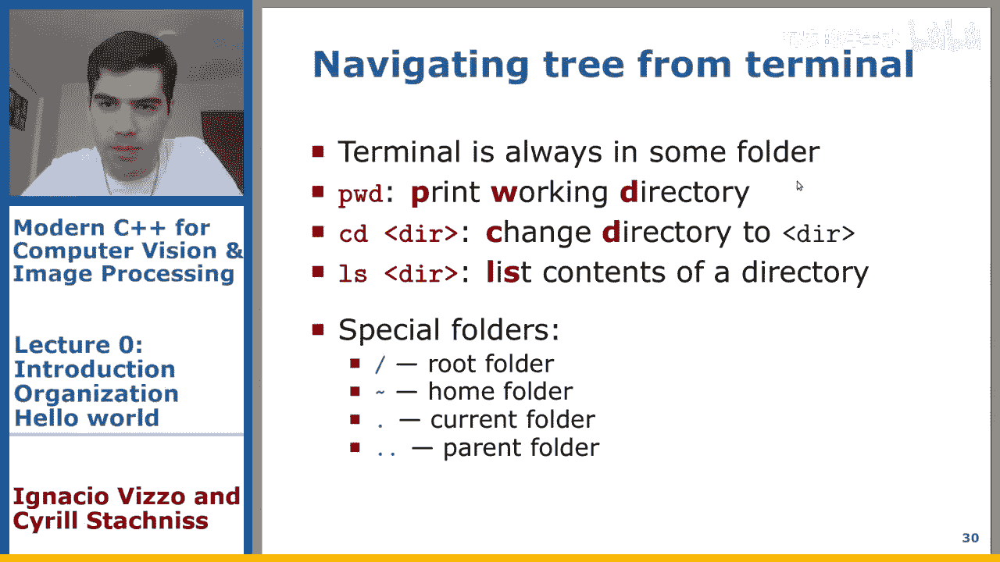

ですかな？When。Let's do。

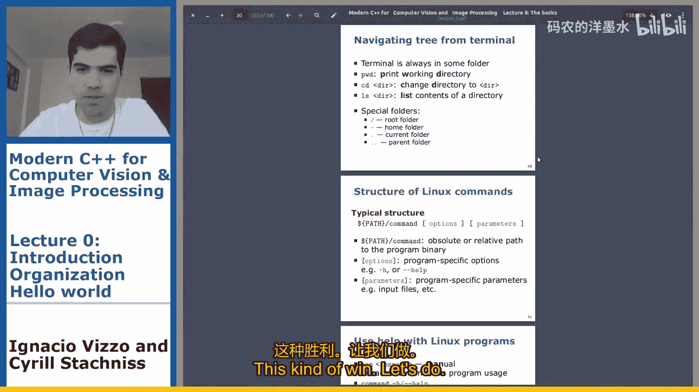

This thing， and then let's open a terminal to the right。能列吃。

I thing you can see from there so basically this is my terminal I made it look clear so it matches the rest of the colors so if I hit here print working directory you will say okay you are working on slashcom/ Fo and then if I want to go to any directory I I can do for example C and go to documents。

For example， and then this is how you change the path of your system and then。For example。

 if you want to list the files that it's on are on this particular part you should do LS。

So this is the most implicit command you can find out there。

Then this is how the commands are structured， so basically I don't really like this idea of command。

Or because there is no such thing， so a command is basically a program and that's it。

ButIt's not that。 there is a。Something else it's just a program that someone built for you。

 and you have it on your system。 So whereas this is basically on the path。

 So this path is it's a variable。So。This guy here。 So if you open the terminal， you will see that。

Actually， let's do it So if you do echo for example， this is to inspect a variable in you say path。

 This is all the directories where whenever you run in command。

 the shell that is the term line run will go to this directory and search for the program if it's not there it will go here or here or here So basically that's。

All the magic behind the。they have commands， there is no such finite command。

But because of this path variable， it gives you the ability to run the programs without having to specify the full path。

 so you don't need to slash user slash being rep that is a command， but you can just do rep。

Basically， these problems will always have or usually will have options and parameters。

If you want to know what a pro does， just use manual and or do the hell。By the way。

All these slides will be available on ecampus on the site。So some stuff。

 I will try to not be explaining like how to run a manual because it's not fun at all and you can do it by yourself。

 but it's on the slide because it belongs to this particular topic so I I wanted to put it here so you can download the slide after a director and try to run this on your computer。

Here is an example on how to do completion， so this is something I recommend everyone to use。

So especially when you start running Linux， when you press tab。

The shell that is a terminal will try to autocomp what you're doing for you。

 So so some people just try to to write like really long commands and they press enter and say oh this doesn't work。

 but then you I know you're trying to to execute a 50 characters command and then you don't know if you have a typo So the best way to do this is like when you are typing。

 just press the first just type the first letters you want to type and then just tap when you do tap you will get an auto completion and this is much easier for you because if the terminal is doing the auto completion for you。

 This means that wherever comes after the auto completion it's right。

 So you're sure that your command is working。Here I put you like a brief of the commands you need to work with files and folders。

 like how to create a directory， how to remove a directory。

 how to copy a file or move a file from one place to another。

And one thing I will recommend you to do is to after this video go to this placeholderer slide。

 and there is a small exercise here。 and that's basically in how to use these placeholderers that is basically special characters that will give you ability to work with files easily。

 So I will just mention one example。 And then this is Michel shell。 And then let's say that。😊，嗯。

I want to list all the PDF files that are in here because I want to see it and names。So basically。

 if you see here， this is my full path， so I am on home student examples stakeholdersholderers and then if I do a less I am watching all the files that are in here。

And then basically when I do LS star dot PDFdf， this star means like give me everything。

 whatever you want， but with the top PDF I'm saying just give me the ones that ends with dot PDF。

Of course you can do a lot of combination with this and then you can do regular expression。

 but we will not see this on the course， but I would recommend you to go and check it out this example。

And then lastly， about Linux， I decided to explain this maybe really fast。

Because I know a lot of people struggle with this and it's super simple and once you see you have this idea on your mind。

 it's really simple to follow。So， basically。Whenever a program is rainly nu。

The Linux kernel will assign。35 descriptors， you don't need to know what is that。

 but you need to know that you will have a standard input channel。That is this guy here。

That we usually call it S in， and then you have two output channels that will be standard output and the standard error。

Usually， when you print， I know hello well。To to the monitor。

 you're basically sending this string to the standard output channel。

And then the kernel reserves free find descriptor numbers that is this guy here。

 this guy here and this guy here for these three particular channels。

What is the meaning of this is that when you run this program basically。

 what is running behind the scenes that is this program is taking the standard input from the keyword unless you specify something different。

 this is the standard the default configuration。And then the standard output will be print to the monitor and the standard error as well。

 so let's check out an example of this。

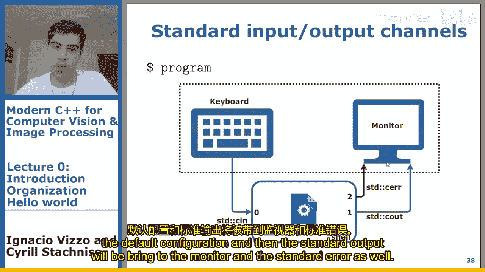

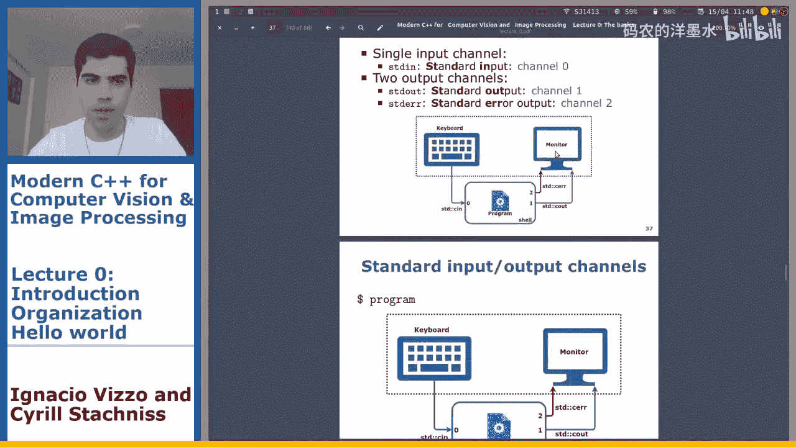

Then， for this。Let me open。Another terminal here。Andね。Okay， so。Let me change this size。 and then no。

 not you。OkayOkay， I think this looks good。Okay给不 done。

So basically I will show you how is the workflow of this standard input and channel using a shell So I have a directory here on my home directory so I'm basically right now I'm slash pump slash I so and then I know I have this examples directory and now I will press tab So if I press tab on my shell with autocomple hitting enter I will go into this directory。

And if I do LS， I will have one binary file here that is called program because it's the same as the example。

Then if you do clear， you will clear the screen of the terminal Now how to run this program and just do dot slash。

 this means that from this directory run this program。

 of course you can autocomple this min tab and then you just hit enter。

And then on the standard output， you will see this message that says， please enter a number。

 let's do8。And then on the standard error channel， you will have this error that the given number is 8。

 What is the meaning of this is that basically。The keyboard， by default default is going through the。

 I don't like this yellow。The giver is going directly through the standard input of this program。

And then the standard output will be print to the monitor and a standard error as well。

 So this is the really basics of。How a program works with the inputs and outputs of a program。

Now let's see how to start redirecting this and I will show you probably one example from this thing and then I will point you to a tutorial where they go deeper into this and I highly recommend you to watch this video that when I recommend you later on because it's just 10 minutes it's well explain you learn it fast and it's simple。

Then let's say that for some reason， I want to redirect the standard output of this program。

To a file that is called C out dot TX team。How I do this。 So this is a syntax。

 So this is not something we can change， but it's basically program。

 And then you say one and why I say one is because。

The file descriptor for the standard output is one and then you will say okay。

 please put one into this file called C TXT and then basically what is this going to do is like it will redirect the standard output to a file and this means that you will not see this anymore on the screen and you can check this you do program and you say one and then you do see out or the name of the file you want and then you just hit enter right？

Then， if you remember。Right now we should be seeing this standard output。

 please enter give me a number， but because the standard output is now being redirected to a file。

 you cannot see the output。So let's put 66。And you see here an error message because the standard error is still being redirected to the monitor。

If you list the files here， you will see that you have this C out file and then if you inspect this file。

 you will see that you have this standard output， please enter so that's all you need to know。

Basically， you have many other things you can do here， like for example。

 redirecting the standard error to a file or doing both my recommendation。Download the slide。

 check the examples， it really useful for you。And here I put you like some of the commands you need to know。

 so this is a mass， it's like three， four， five commands。

That you need to know in order to work with Linux。Otherwise you would struggle then when working with the shell you can also run multiple commands and then you can change this command so one option is to use the semicolon or the amperserson this basically this is super easy basically you have three commands you want to run and for example in this case this means run command one I don't know what's happening after this command one I don't care just run the command two after all and then command 3。

So that's。What this syntax is doing。 Then this or syntax that is actually super useful is like the double amperserson is basically run the command  one and then run the command2 if the first command succeeded。

 What is the meaning of this， If command one gives you an error。

 then you would abort the complete thing。And then about piping。

 So piping itself is a topic on when you work with Linux， but basically if you remember。

These examples， for example， so whenever you say okay， the keyword。

 it's fitting to the standard input of a program when you do piping， you're basically this case。

So the standard output of command1 is being set to the standard input of the command zonem and that's why it's like a pipe。

 so the output of command one instead of being print to the file or the monitor you are in check in this standard output to the standard input of or program So basically if you go to this guy。

This example， so that's。Say， if you remove this， then this is， this is where the。

The standard input will come when you do piping from another program。

 so you are not taking the input from the keyboard itself， but from the output of another program。

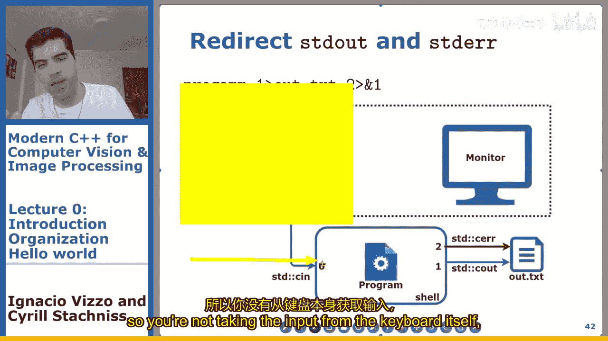

AndBa if I would recommend you， this is the video I was mentioning before。

 it's basically 10 minutes videos on how to work with pipes in Linux and redirection。

 make sure you go and check it out 10 minutes you learn it， that's it it's super easy。

 you should not struggle with its small details。Okay， and lastly， I am putting here a link。

To a bash tutorial， so bash is the terminal you will be using most likely。

But if you in sallountu and then you open a terminal， you are using bash for sure。

 and this this is a bit longer， so it's a one hour video。But。The thing is。

 if you spend one hour in this video， my guarantee is that you will learn all the stuff you need to know about bash。

So for this particular week on Friday， so this is your task you need to watch this video and you need to stop the so you need to watch the video on YouTube and then have a terminal at the site and then you stop the video whenever you say。

 okay， this is happening and then you run the commands and this is how you get used to the terminal and this is how you learn。

So that's your task for this Friday just check out this video， their video is optional。

 the one from pipepes， so this is optional， it's also highly recommended。

 but the task for your Friday is to make sure you check this video and go through A to B。

 it's one hour， it's all the things you need to know。

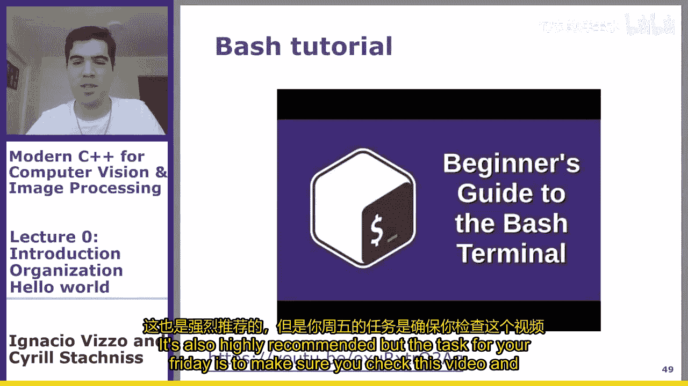

Any questions about Linux， so this was a super short interaction on how to work with the terminal。

Like really short， really fast。 The only way to learn how to do it is using the terminal。

 So there is no black ma， no fancyky stuff， nothing。 just go open the terminal， use it。

There is nothing really bad that it can happen from a command that is run on the terminal。Okay。So？

It's okay， what is the difference between standard error and output channel。Okay。

 so there is no real difference。Let's put the picture here。嗯。The thing is。Actually。

 on the 10 minutes video， I point you out。There is a good example of why you want to have separate things。

 but it's basically to split the water and say okay I will have a standard output where I would print like message that they are not really important but I also want to have control of this and print error message to another channel and for example if you write a program with this example where you have a file that is so this file will will have the content of the errors of your program so this is something that you might want to do and this is a mirror of flexibility if you you can have one channel if you want so the Linux channel could be built this way。

But then whenever you have you will have all mixed like outputs with errors all on the same channel。

 other thing you might want to do is this example， let's say you're running a program and this frame is printing a lot of information like deepbuing up。

 a lot of stuff。And then in the middle of the program， you know that there' is an  error。

But then you cannot see because it's like you have like 50，000 lines of messages and then you say。

 okay， I will really the standard output to a file。

Because I don't want to see this now I can see this later and I only want to see the errors and this product itself like having 50。

000 lines of dayback information， you will only see the errors like error like this is happening and this is a matter of flexibility。

So there is another question， so people who's using Windows sub system for Linux。

 so do all commands work the same way on the Windows sub system system for Linux。

 the answer is yes because。The thing that you run when you're using this trick that Microsoft is doing is you're basically running a Linux distribution inside Windows。

 sorry it's。Basically a brick machine， it's not， but it's basically that so the problem that you're running that is basically called bash。

That is the one that grants from the terminal。Cannot distinguish that key Windows or Linux is just so for the purpose of the shell。

 it's like you are tricking the problem and the problem thing it's Linux so basically you can safely copy paste any commands that you see for Linux on the Windows search system for Linux and it should work and if you notice because Microsoft is not doing something properly but it's basically the same。

So one thing you need to know is this is important that we want to you everything about C++。

C++ is a big language，'s amazing， but it's complex and it's big。

 so I would say that if you really want to learn everything about C++ for real， you burn it to years。

 but this is if you really plan to be like a C++ full time developer。

Learning the basics and the coordinate techniquess， I think with six months it's okay。But of course。

 you need to keep in mind that we can teach you everything about C++ And of course。

 if you have any ideas， feedback or like all your questions during this course will make this plus more fun for everyone else。

 So maybe you say nacho， when I was blah， blah， blah doing this project。

 we use this other feature of C++ and I think it's better。

 and this is really good because then we can discuss like this feature， if you think it's better。

 So it's really impossible for me to teach you everything about C+ plus one。

 because I don't know everything about C+ plus I think no one knows。😊。

And then because it's going to take forever， so keep this in mind。

Where we will be writing this beautiful Sus plus code， so basically you have two options。

One is to use an IDE， of course the people who knows how I think this is not recommended at all。

 this is the worst idea you can do， especially if you're learning so whenever use IDEs for learning this will。

 of course it's much more comfortable， everything is working。

But then you will miss all the maing of the what is going behind the scenes and when you learn you need to know this behind the scenes。

 So on this course we will go for the behind the scenes that are actually not that hard and then you will learn how to work besides an ID and then we will use in and text editor My recommendation is that you can use whatever you want。

😊，WeWe will probably using。Visual is studio your code。

 So this is a text editor that is modern and it's open source。

 It's supported by Microsoft and has a lot of cool features。

I also have a short explanation of why you should using in text editors and not IDs。On the website。

 so make sure you check that out， but it's basically this will give you the ability to learn more。

 to learn the behind the scenes also will give you the flexibility to work whenever and whatever you want。

So if you go for like big companies， it's really hard that you will find some of these companies using these Is because the Is are fine。

 but for a small project or for project that are like the scope of the project is not extremely big whenever you start like going bigger。

 this text， this Is like eclipse will just crash or we need to use like half of your computer。

And many other reasons， so again， make sure you go and check it out the website。

And if you have any concerns or if you have any opinion on this， we can discuss this on the chat。

 we can make a discussion and say no， let's use IDs are much better and'm quite sure I will have like a lot of arguments to beat your complaint。

 but I'm happy to discuss this if you need to。Another thing is like there's this guy called B。

That is super hard to use， but my recommendation， if you really plan to build a career in robotics。

 is that whenever you have time probably now because of the coronavirus， start learning。

It's just a text editor。 But the thing is it's super fast to use。The text a is fast。It's hockey。

 you will feel like you are working on the 70s， but people still use it nowadays in 2020。

 including My soul。And then whenever you work with remote servers or with robots。

 you will love the fact that you know how to use beam， otherwise you will be suffering。

 so you can use text editors on remote machines but when these machines are not super powerful all the net or the net connectionor is a bit slow。

 then you will suffer a lot so。Make sure you spend some time learning beamm or any similar tool if you want。

So this is the simplest program that will bring hello wall。So this is super easy。

 Let's go back into the history and let's see the assembly code for this example。

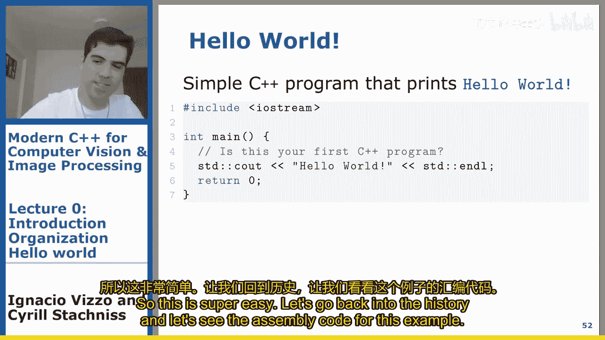

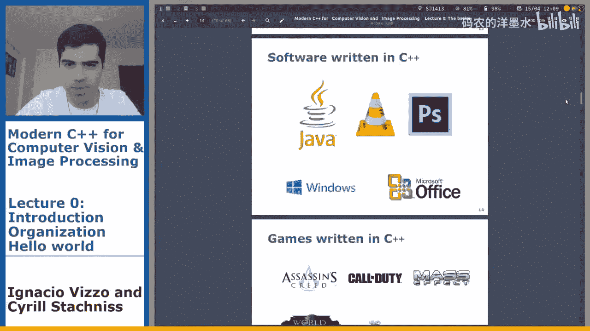

🎼嗯， here。So this is the same program。 and this is the assembly code。 and then。

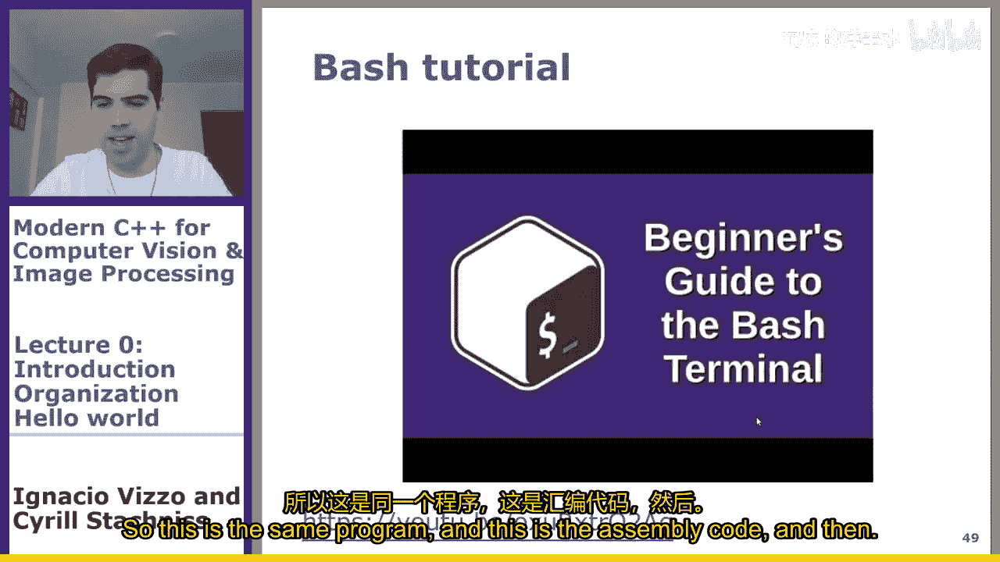

嗯。And Miss Edmund， this is the hello world for the Crus plus。So， basically， here。Oops。

So here you have the line that does all the magic that is basically put this string that we put it inside Her wall to the standard output and you know that if this parameter is running without any redirection。

 it's going to print this to the monitor and then this STD end line， it's basically saying okay。

 print a new line when you end this string， we go。We will discuss this syntax and these double dots starting next week for now this is the very first program you will see。

And believe me， this is a lot so actually when you start for let's say that you're working with a new robot and then you have a I know a new belin explore。

 whatever， so making these hell word example has to run sometimes takes months so heller word example it's super simple doesn't do anything really fancy but it's a lot actually。

So let's， okay， let's build this， let's build this example。So。For that， I will open a terminal。

 and then I will go to the examples， for example。And then I would create a new directory。

And they will call it hello wall example。And then here my recommendation is that so I have seen people using text editors。

Like an IDE So the tendencies that people will now want to open the text editor and then start coding my recommendation is try to do everything from the terminal and then create a separate directory。

 you know where this directory are and then once you have your workspace setup up。

 then you open the text editor。 So we have this new。And the directory。

 we will go into this directory for that video C。And then here we don't have anything and this is fine。

 and then we will do code and then dot。Right， and then this will open a text editor on the screen on this particular directory。

 And this is my recommendation is that you always do like this。 Let's close this terminal。

And then if you see open editors， there's nothing here， so this is this through your code。😊。

With the setup and the recommendations I gave to you on the Wiiki。Basically， I think if yeah。

 you can do five new file here and then just save this file and let's call it hello wall。

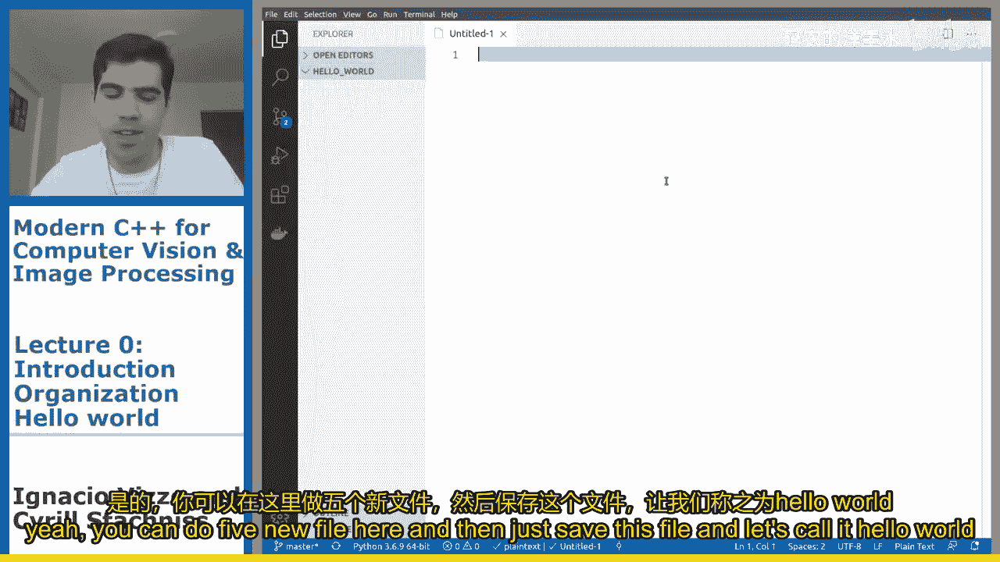

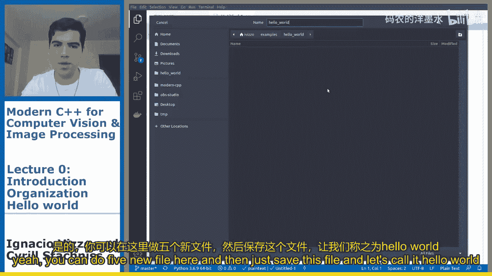

Dot c。One thing I really like about text editors that I。Extremely dislike about ID is that here。

Basically， you will have。The Pt are on this particular directory。

I remember that whenever I work with elips， you have folders and these folders are projects and you also have header files that are from the system and then you don't know where is what so here you only see one file that is this fill world。

And then if we want to reproduce this fill word example。

This is fun because when you do these like coding examples， nothing works。 So let's see。

 And then you just type include we will discuss this in a minute， I your stream。

And then we will write this function， we call it main。And then it will say， okay， print hello。Modern。

Here不。People who already knows C++ I'm sorry if it this is really worrying for you。

 but we need to go through these small details Okay， let's save this file。Actually， it's up。

Comment here and say。These prints。え。The output to。も一ゃ。Right， so this is your first program。

This is a text file， so if you go and print this you will see on the paper just text。

 so there's nothing there still or this you need to compile this。And then in order to do that。

 you will open a terminal。In this studio code， you can open a terminal within， the text editor。

Of course， you can open a separate terminal if it's up to you。 this is the same terminal， sorry。

That we were using before。If I do Ls， I only see one file and how I build this on Linux with our configuration。

 you should do C class plus， and then you will type hello and then you can do tap， for example。

 to autocompte and then you just hit。This will compile your program and then if you list the files that are in here now you will see this new file that is called a dot L that is basically the program that is the executable So if I execute this program。

You will see hello more C+。RightAnd of course， I can redirect this output instead of of in the screen and say okay。

The standard output I want to put it here to standard SDD output and then you don't see the output。

 but actually you have a new file here It's called SDD output that has a lot more and C+ plus and this second line is basically this guy here that is the end line right super simple it's a lot because this means that Euro setup is working。

 So this is the hell wall of the C+ plus examples。Something that is important it's comments whenever you write source code。

 you can add comments again the philosophy nowadays is to write code that speaks for itself and not the comments。

So。Basically， this， whatever follows this double slash will be a comment。

 So this is completely ignore and whatever is between these two guys that is basically a C style comment will be also ignored。

 So I will highlight you here。The parts of the program that you can actually write whatever you want here and will be completely ignored。

One thing I probably forgot to mention is that C++ is a compile language。

And what is the meaning of this？Is the same as C instead of writing assembly code。

 we will write a high level language and then we will use another program that we call the compiler but in our course it's the Kan compiler but can be GDC can be the intercompr。

 the Microsoft compiler， whatever compiler for C++ and then this compiler。

Will turn this C++ code into assembly code， and this is really important because。

This is there is a big difference between interpreted language like Python or Matlab and C++ we will discuss some benefits later on the course。

 but one of the big benefits is that you know before you run the program if there is some error on the program。

😊，People who already work with Python， they know it's an interpreted language so they will be executing instructions by instructions and then if you hit an error。

 then you realize that you have an error when you hit that line。

C++ will compile the program first and if there is nowhere error will give you an executable that is the program itself and then when you run this it will run binary code so you don't know like what is running it's just assembly called so if you inspect this program it's really hard to make a sense out of it and this is one of the reasons why it's super fast。

So this the comments are simply ignore and then about sellinging， it's super important。

And this year I decide to not be that tolerant like in previous years， so we will be using a tool。

 we will have a tutorial on these tools coming soon that is called plan format that will format your code and the idea behind this is that programs are meant to be read by humans and only incidentally for computers to execute。

So nowadays in 2020， there is no reason why you should not follow a particular coding style or a formatting style because it's really easy。

 you don't really need to do anything。And it's going to make your code look better。

 and it's going to be easy for ours to read so。Don't worry about this。

 So if you follow my setup on how to set up your dev machine， you already have these tools。

 and for example， if you see this example。If I tried to write like really ugly code。Like this。

 whenever I save this program， it will auto to format the program。

 And this is also happening on your machine。 So if I do control S for sale。

Tom this is now it's reformat in a better way so this is important for me and it will be important for you because if your programs。

 when you submit the homeworks are not in formatting style your homework will not pass the checks we will discuss this later on。

And then the last thing we'll discuss about this in world is that every C+ plus prime will start with the main。

 So this is。This is not something optional， This is not something that depends on Linux or Windows。

 wherever this is a fact every Cper starts with main。You're checking a project。 It has 50，000 files。

You want to know where the project starts， Go and check the main function。

 This is not a function you define。 It's defining the language， so you cannot change the name。

 you cannot say you know what I want the main that my problem starts with the function called Oitto。

 You can do this。 You just need to use man So main is a function。

Like that will return an error call basically on Linux are 255 error codes。

 but basically error0 means that everything is' okay and wherever it not is't error So if you remember when we were changing commands with the double amperserson and I say okay if command one doesn't give you an error then follow command2。

 this error is' basically the the return call of the program。And then whenever you hit include。

 so we will have probably next week a tool lecture on build systems。

You're basically saying please give me whatever is inside this file， just put it here。

 so I will show you how this works， don't be scareds so because of the content of this file it might be scary。

But this include Ios stream is doing something really easy。

 It's basically going to this file that if you go to this file， it's。This guy， just forget this。

It's copy pasting。 So I am selecting everything here， and then。

This include will you replace with the pace of this guy。

So basically doing include and copy pastee code from all files into your program is the same。

 there is no difference。But why we do this， because now this is like not too much source code。

 But let's say that you have multiple includes。 Then you have like all filess of 50000 lines of。

 of course， this is not。The best way to do it， but actually if you run this。

 try to compile this program again。Okay， we have a warning。

 but actually let's remove the standard output text and the program。Nothing is here。

 let's compile this and actually you have an execut level， so it's the same you run these。

 you have hello more C plus， nothing really changed。So basically， make sure that。

Just remember that whenever you do include and then do Ios stream。

You're only copy pasting wherever it is on the Ios stream file inside this particular。发呀。

And then last but not least， if you so if you're really anxious and you want to try out stuff。

 heres an example on how to work with the channels， the input channel。

 the standard output channel and the standard error。

AndActually let let's write this program down and my recommendation is that you write this program on your own and then you play with the examples of the redirection that is on the slide so I gave you four examples of course there are more combinations you can do but make sure you run this program this afternoon this tonight if you have time and make sure you run these guys and to see an example。

So basically another thing， all the parameters you will see on the slides。

They are basically so I built these programs before putting on the slide。

 so they're always working so you can like safely copy paste the the code from the slides。

So let's do the following， let's create a variable here。Let's call myva。And then let's put a zero。

 It's a good idea to initialize， and then let's say， okay。嗯。Keepive me your best number， right。

 This will print， give me your best number to the standard output。 And then if you check the slide。

 you will see that the syn syntax to get。Input from the standard input is this one。

 It's the same as the。The sea out， but with the stream operator， their way around basically。You do。

Whatever it's coming to the standard input， this means STDC in， just put it into my bar。And then。

Let's print to the error to the standard error。E。This is not your best number。

And then if we compile this again， so C+ plus hit wall。And then whenever we run this program。

 we get give me your best number and I say okay， my best number is 900 and said error。

 this is not your best number and this you see both outputs standard output standard to the monitor because that's the default。

But let's say I don't want to see the errors right now。 Okay， let's re。

The standard error channel to error T X T。And then let's run this， give me your best number 500。

 no error message Why， because myself being redirected to the monitor。

 it's only this new file that is error， this is not your best number。

 so make sure you check out this example。And that's it。

So this is basically the process of compilation so we humans understand text and that's why we write in these highlevel languages my computers only can get machine code that is basically binary code so the compilation this process is a translation from the text that is basically your hello wall docP program into machine code and who is doing this the compiler that is another program compilers that you can use in Linux are many of them this year I switch to Kline my heart still belongs to Gcc that is the compiler from the GoodNew project。

But the LBM project that is maintained by Apple is doing a great job on tools。 So。

 and I think we we need to have better tools。In order to work there with C++。

I also want to give credits to Igre the Great， so Igor is the person who started this course and it's an awesome guy an awesome teacher。

 so my recommendation that given the fact that we already have lectures for previous year courses so if theres anything that you didn't understand from my site。

 just go and check it out YouTube videos used from Igor maybe you can get the ideas from there。

And also I would say that 80% of the slides were made by Ior。

 so basically we are reusing the slides from Ior so Ior。

 thank you very much and I wanted to give credits to him。This is some people already saw this video。

But this is something I tend to do on my lecture。 So every time I'm finishing a lecture。

 and this case， it's half an hour late。 So I'm sorry， we have two hours。

 but I wanted to make it one hour。 I couldn't make it。So that is that whenever I finish a lecture。

 I want to give you a video that I think it's related to the lecture。

That that is not mandatory for the course。 So in this case。

 it's a Tedx talk on why you should learn how to prime so you can watch this video you can。

 It's up to you。 So again， I put this here it's on the slide you will have it on ecampus the book you might want to use as reference it' the simpleus plus programming in language So it's a really small book。

 it's like this size。 It's like 13000 pages's because it's basically like a manual It's not like a book to read in in the bed So beyond Startro。

The creator of C++ is the one who wrote this book， so always dress。

 this is usually the best source you can get。If you want to learn C。

 I would recommend you to use the Canyon and richy C book language that is again from the creators of C in now of course we will use this book。

 we will I mean I don't ask you to go and buy it or get it online but if you don't understand some concepts it's probably a good idea to go and check it out there。

Probably the best reference for any other small question you have is CBP reference。

 so I put you the link here， so as click it， go there and you will see probably most of the things you need to know are here。

 the examples are here， so it's a really good reference。And then that's basically it， so。

I will give you。Five more minutes if you have any questions。

If you have any questions on probably on the organization after the course or whatever。

 we can also discuss this offline。Next lecture will be next Wednesday same our same channel if you have any recommendation or any positive feedback I would love to know this is the first time I'm doing YouTube live stream so just hit me and say I really like the live stream I think Zoom is better this is better you can just write to the Discord channel and then we can try to make the best usage of the tools for us。

In terms of task for you， so you have some tutorials that I gave you reference on this slide。

 the slide will be online。And then also you need to install the Linux in your machine or use WSL and Windows。

 most of you should know this information so you already should have everything installed so actually you can after this lecture。

 you can go and and check the examples by your own like the examples we saw on this slide when I upload this slide。

And then for Friday you can check this bash tutorial if you have any questions we can discuss it on the Discord channel and next week we will be discussing about build systems and core C++ language and I will give you the first homework you need to do。

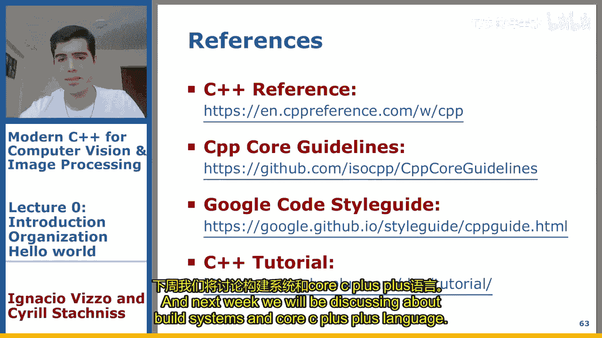