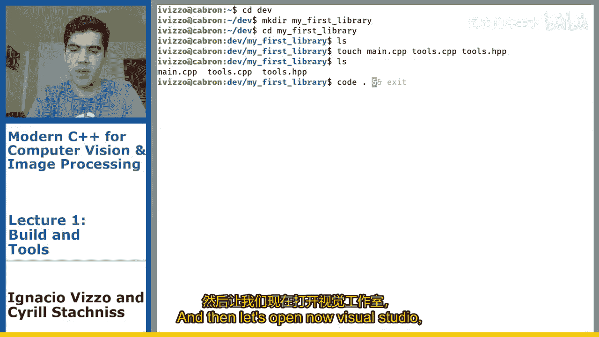
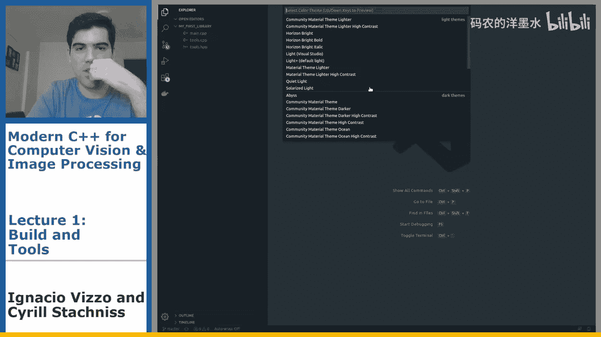
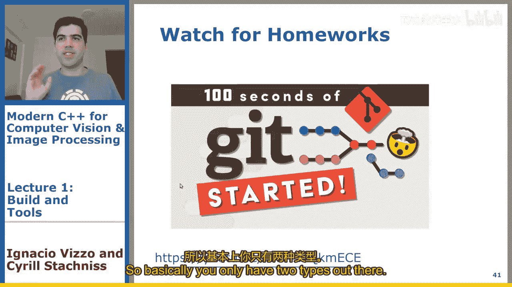
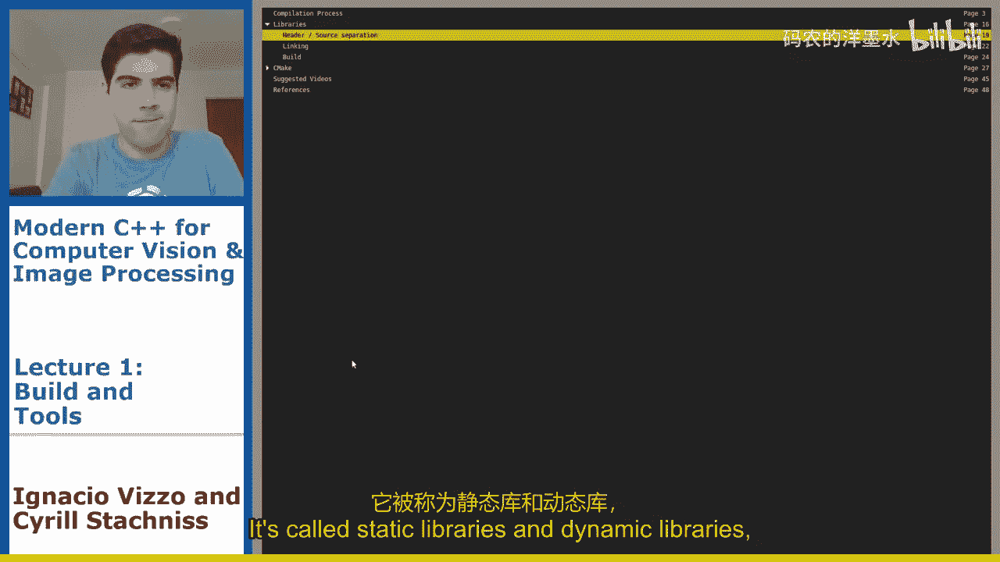
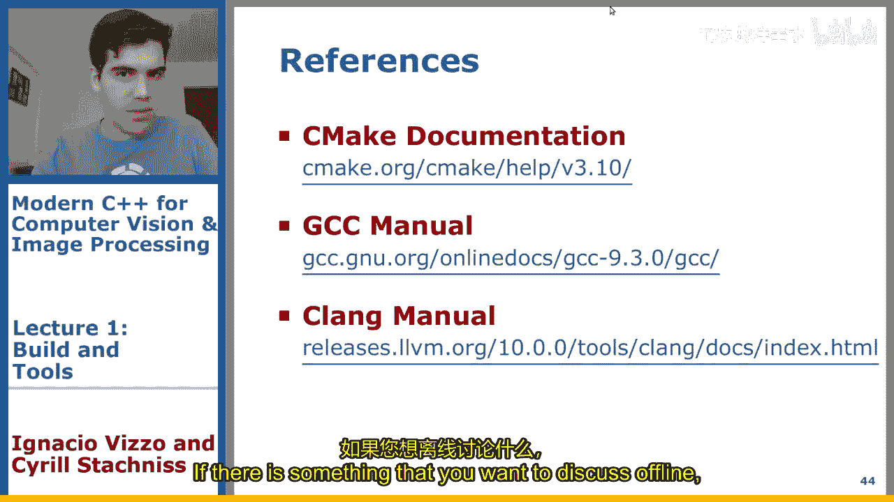

# 【全集】波恩大学 现代C++ CS414 中英字幕 p02 Lecture 1 - 构建与工具 -BV1EYm1B5E2D_p2-

So today， we're going to dive deep into。Bill systems。 So this is basically。The last lecture on tools。

 so this spot is reserved for C++ topics like these Wednesday lectures。

But the first two lectures were was about were about tools like Linux。

Today is going to be about build systems so sorry because last lecture was like a bit longer this this time I would try to make it into one hour。

So we all like can pay attention within this hour。 and basically， starting from next week， we will。

We will be discussing C++ topics and all the tools。

Topics will be discussed tutorials and in offline videos。

Okay so this is like an important deal for me so because most of the people I' met that they struggle with C++ C in general。

 this struggle is usually related to build systems so for me it's really important to understand the concepts behind building programs and actually how to deal with build systems so。

We are not going to see any C plus plus code in this lecture。

 so I'm sorry for the ones that really want to start doing C plus plus coding， but in this case。

 we will basically。呃。Take a step back and then learn how to use the tools before we start coding。

Okay， so this is basically a really， really brief of how it looks like a software development ecosystem。

So in the middle， we have the source code。 So usually when people think about coding in general。

 they will think about these particular thing。 So you only focus on source code。But actually， if you。

 if you pay attention to the picture， you will see that there's a lot of other tools involved in the development。

 development。 sorry of this software。 So it's not just the source code you write。And basically。

 learning how to deal with these tools， learning how to use these tools will give you superpowers in terms of like how to work with C++ and any other language in general。

So in this particular course， we will discuss some of these tools， but not all of them。

 so today's lecture is about build systems， so this will give you the idea of how to build C++ projects。

And then how to avoid some errors。Also during tutorial times we will discuss a bit but we will not dive really deep into how to use filters。

 how to use static code analysis to improve your code of course this is a big topic nowadays and we will have a separate tutorial for testing Also there are like some formatting tools that will format your code like automatically nowadays CI and CV that is basically continuous integration and continuous development deploymentary is a big topic that in all software industries including robotics so this wasn't true probably five years ago but now it's。

It became the standard also in robotics industries。

We will not see any tutorial unless some of you guys say， okay， no naturalcho。

 I would really like you to to make a tutorial on this then probably like。

Reaching the end of the course， we can make a small tutorial along CI and CDDM。

Something that you will be struggling with a lot probably， it's going to be good。

So this is the version control system that nowadays everyone use。嗯。So basically， again。

 we will not probably do like a full lecturing Gi。Proably a tutorial， so I have some recommendations。

 but you will need to use it。Also， we will have a small tutorial on how to debu projects C++ project。

And there are all， all sort of things。The important thing I want to mention here is that all the stuff you see here they are tools。

 so for me when you are working on C++ projects or software projects in general。

 they are like two different distinct things so one is the tools you use and there one is the concepts so usually for me it's better that if you invest time focusing on concepts and not tools because the tools will change in five years but thes the concepts are very unlikely to change。

So whenever you need to make a decision on where to spend time。

 Pro's a better idea to go for the concepts。 But anyway。

 C plus plus in general is a complex language and we need tools to work with this language。

 So if you only focus in in the in the。Concepts， then you will struggle a lot trying to apply these concepts to reas source code so basically the tools will give you superpowers in terms of what you can do with these concepts。

And as I always say， if your tool sucks， you most likely will suck。

 so it's never a bad idea to spend some time trying to improve your tools or to make a better usage of it。

So today we're going to be diving deep into build systems and how the compilation process works at all。

So the compilation process。What is a compiler anyway so a compiler is basically a program but it's not any program and it's basically the guy who will transform your horrible and unreadable source code into binary code binary code it's the language that the computer can understand here's a picture like showing how this process works in a really high level way So basically you will write a source code saying I want the computer to do this and there's this guy called the compiler will do real black ma and then you will turn this source code that is readable by humans into binary code and this binary code is basically the one that that the CPU is happy to it let's put it this way。

So the easiest way you can compile a C++ program。It's basically just calling the compiler。

 in our course， we will be using plan。And this will basically build a program。 They will put。

 they will。The compiler will use the a dot out name that this is the standard and then this program。

 if everything is working， this means that the compiler is properly installed and all the system libraries are there。

Then you're ready to go。 that's the whole thing you need to know about compilation。

This is something that we tested on previous lecture on the hell War example。

 and I guess that all of you already did a small example on this and then the question is will we always this easy of course not and this is a big thing。

😊，And something I forgot to mention is that I also have another say that is that if you want to understand a project。

 then the best way to understand it is through the build system。Basically I met also a lot of people。

 both in academia and industry that they struggle a lot just because they don't know how to deal with build system and it's not because they are stupid or they are not smart。

 it's because probably they didn't spend the time trying to understand the build tools and this also gives gives you some insights on how the project is structure and how it really works。

So basically knowing a build system of a project is a really good idea if you want to get into the project。

The compiler， so whenever you call this Kan plus plusva dot TppP will basically execute four steps behind the scenes。

 one is called the preprocessing step， then it's the compilation。

 then the assembly and then the linker。So if we tried to make a diagram out of this。

This is basically what is happening whenever you try to compile a C++ program。

All these steps are like really so we can dive really， really deep into those steps。

 but I think it makes no sense， but it's really good for you if you really know what's going on behind the scenes whenever you try to compile something。

By the way。When you learn how to build programs， this is also a superpower because it will give you the ability to understand how to do things without having to like do random steps without knowing anything that you're doing and once you understand how to build the things。

 then you know your program， you know your project。

 then you can deal with it and you own this project， you can change it the way you want。

So a lot of people usually write everything in one file， let's say， okay， my hope project。

 its called big project dog TppP， and I have all my pipeline there because I don't know how to use this include statements and whatsoever。

 So that is that if you know how to work with the tools， then your light would be easier。Okay。

 let me back to the lesson。Basically whenever you call the compiler， you unbed the compiler。

 you will give a source file in this case it's called mainotCP。

 and then the four steps which we mentioned will happen behind the scenes。Let's see。

 like step by step。 So this is。A small example we will do。This is something that you can do it。

 I will actually recommend you to try it your on your machines so you can get some insights of the compilation process。

 but this is not something you do on a daily basis。Okay， let's try the trick。It's working， amazing。

 Okay， we have a terminal here。And then let's try to do these compilation step by step but manually。

For that， I will go to my web directory and I will create a directory called compilation。

I will see the into this directory， So this is where I'm actually standing right now。

 and then let's remove everything from here。So we have a clean working directory。

So the first thing thing we will do is we will create a really small program because we don't want to focus on C++ on this lecture。

 but on how to build C++ project。 So I will not use the Vi Studio code editor because it's way too much for doing this。

 So let's call this main CP and then let's do。What we already know how to do。

 let's create the main function。And then， let's to see how。Iello。Deal system。なですが。Return zero。

 and then that's basically it。So of course， if you do clang plus plus and then you invoke this compiler with mainCDP。

 now when you do unless you will have this8 do out。

 that this is basically all you need if this program is super simple to compile so let's remove this for now and then let's start with again with a clean working director。

 So the first step is preprocessing。This is basically so we discussed this on previous lecture。

 so whenever you have an include so in this case。Will be this guy。 So whenever you do。

Whenever you include a file in on the source files you're talking about， basically。

Who is in charge of like Co going to this file and copy pasting the content of this file on the main dot CBP file。

 This is a preprocessor and also well expand macros， will remove all the comments。

 So let's actually let's do main CP and then let's put here。This is a comment where it is， right。

And then the preprocesor will delete all the comments， will include all the her files。

 and willll expand macros。You don't really need to know how to use the preprocesor nowadays because actually the only thing you carry is like how to include directories。

This would be a C class then we would be use in macros that is something really ugly to use。

And if I find macros in your code， you will struggle， my friend。

 So I don't want to see this define macros。But basically。

 the preprocesor is the one in charge of doing this。And then if we do， if we emvok the compiler。

 we can say， okay， I want to do the steps manually。

 perhaps because I want to check what's going in in between or because I want to change something else。

The flag you need to pass through the compiler is this big E and then you do main CP and this will open the file。

 reprocess this file and then output the results to the standard output right so if I do this you will get broom a lot of stuff。

But basically， let's。Really break the standard output as we did on the first lecture and then let's call this file Men dot I。

 it is like standard community and now we can actually open this file and inspect the content。

So if you try to see this youll see a lot of stuff that this actually comes from the IioStream heater file。

 so all this stuff we didn't write this code but basically was part of the standard library so there are a lot of lines actually so let's go to the last line and if you see here so this small example after preprocessing we have 28。

000 lines and our original code was basically nothing but all these lines actually came from the include IosStre heater file。

And if you see the source code， you see that， for example， our comments is not there anymore。

 If you remember like this is a comment where it is。

 it's not here because the preprocessor like clean up all this stuff。 and whatever is up。

 basically also the include is not here。 So they include Ios stream is not here anymore。😊。

Let's check again our CPP example basically was' an include， then a comment is not there anymore。

Okay， so now it's time for。Compilation so this is a term that we all use wrong including myself but it's fine like everyone knows that it is like this but whenever you say I will compile this program you're basically doing I will preproces this program compile it。

 asble it and then link it to create anexecutable but basically the whole compilation process there is one step that is the real one that we call compilation。

And this is basically where the compiler start to works for real。

 I mean like this is if you want to write a compiler for any language， this is the this is your task。

Basically， once you have the preprocess file with all the。Cours code。

 then you need to somehow figure out how to translate this into assembly code as you remember in the first lecture we saw like some really ugly assembly example。

 it's not something that we will discuss in the lecture but。Basically。

 you need to know roughly what it is。Okay， so you have the pre processces file and then you need to compile this to generate assembly。

So basically how you do this you in bulk plan plus plus。And then you say， okay。

 this is my source file， right？There is a warning， but basically if you list your directory right now。

 you have a new file that' is called main dot S。Again， if you open this file。

 then you will see assembly code that this is not something you can actually understand right now unless you have a electronics engineer background。

But basically， this is what it's really easy for a machine to understand。

Then the third step will be to okay now that we have the assembly instructions for this particular target there is an internal CPU now it tend to generate like an object file。

 basically an object file will be no more than binary code that a computer can understand。

And I will stop there because this can take a lot of time。

How will do this then we again frame point plus plus and then dash C and then the assembly file Now if you list your directory now you have like four files。

 the original file， the main dot I file there is a prepo file the assembly file and the object Of course if you pretend to open this object you won't see anything because this is binary code and actually it's an L format so you can actually see some strings between the thing。

But there is basically it's not understandable by a human， but for a computer。Of course。

 if you want to try to run this， it's okay， this is my program， it's not enough。

So the last step is to link。So how we link this program。

 it's super easy just to plan plus plus and then you say okay。

 this is the object they want to link and then let's call the executable so the output of this linkIn process here you can involve multiple object files in our case we only have one。

 let's call it main。And then if you list your directory。

 you have your main execute level and finally you have the execute level。So doing a recap。Basically。

 whenever you you want to。To compiler program。You should be using like four doing four commands。

 hopefully it's much more easy， but this is basically what's going on behind the scenes。

And if you want to do clamp plus+ and then may CP， that is the simplest one。

 basically all these steps are happening， but just behind the scenes， right？😊，Also。

 something that is super important is compilation fluxs。

 so probably I will do a tutorial on this because I really want you to to know how to use in particular。

呃This guy。How to optimize your code？Basically whenever you compile programs。

 you can actually specify different flags for the compilation process and one of the options is like okay the standard So as we already mentioned in the previous lecture when whenever you call client++ you have a default standard。

 but you can use like C++ 11 C+ plus 14 C+ plus 172023 depending on which standard is supported by the compiler in our case。

 C+ 17。And also， for example， you can have additional options like。Okay， if you have any warning。

 just show it to me， this is basically。I you all， this is basically if you find a warning。

 just let me know extracts like if you think that there is another warning just also let me know and this error。

 it's warning as error basically you say okay， if you find a warning just stop the compilation process。

 something is strong for me， but this is something that you pick actually。

The mice are is implemented basically。It's one of the most important things in the compiler。

And a good compiler basically he has a good optimizer。

 and this is basically the steps involved that will turn some source code into really。

 really optimal and fast code。This is basically， let's pretend that you have to do some operation like two plus two。

 let's keep it simple， you can do it at runtime and this means okay you can generate these two numbers in memory。

 then go and add these two numbers in memory and then get the result or you can realize that two plus two is a really simple computation to do and you can do it before you run the program。

We will discuss how to do generic experiment and started code generation on the last lecture。

 so this will happen in two months。Or Im in eight weeks。 So just wait for it。 The anything I。

 I don't want you to， to forget it that that there is a way to compile your。

 your program and add optimization to it just with flags。Okay。

 so now that we dive deep into how to compile a really simple program。Now， we need to。

Use this in our advantage and then let's talk about libraries Su， before I dive deep into this。

 I will give you one minute for questions or once we continue with the lesson okay。No questions。

 so let's continue。What is a library basically， so now we know how to more or less build programs。

The idea is that we want to make usage of the compiler and the linker and all the tools in the tool chain and build really nice projects。

 so basically that's where the concept of library comes。

Instead of having everything in one source file， we want to say， okay。

 I want to put all these symbols。Let's say like there are arimetic operations in one library and basically a library just a。

 a bag full of symbols and implementation details。😊。

So why we use libraries is because it's much easier to maintain。

 it's much easier to distribute and makes your project easy to read and to work with。

So a library can it's basically in multiple object files。

 these are like the symbols that are logically connected。And there are two types of libraries。

Most likely， we will be only dealing with static libraries that they are faster， but， of course。

 they will take more space because they become part of the binary。

 So whenever you static link a library into your program， you basically have your program and。

All the symbols from the library all in the same executable of course if you have like a some restrictions like an em embedded platform。

 this is not the best idea because where you have like a two gigabytes binary and probably you don't need this of course it's a bit faster than doing dynamic libraries that basically the dynamic library is what you have on your system so if you go to the slash user leave directory on your Linux computer you will see a lot of dot libraries that basically these libraries are sleeping there and runtime when you need a symbol you go and search for it there。

Basically static libraries are just like an archive。

 so basically you have bunch of symbols and then you put it all together in a dot a file。

How to create libraries in C+， basically the mechanism to do this is splitting the decoration of a function and the definition。

 So for now we will stick with functions。We will discuss a bit more about the syntax of this next lecture but believe me for building C+。

 you don't really need to know C+ it's just for building。

So all these concepts are related to build systems。

 so don't worry if you don't understand something from the code because the idea is that you you shouldn't be paying attention to the source code right now to the build process。

So basically， a function declaration set ups an interface and this is basically。

 let's call it a promise。And the one in charge to search for this equation is the preprocessor。

So whenever you okay we will discuss this in two minutes and the function definition it's basically the implementation of this function so whenever you work with you want to create libraries then you will declare your functions in some header file most likely and this is basically you are telling the preprocessor okay I promise I will give you the implementation for this function so don't worry you will get it soon but then you just just put the interface as a function this case is a function that's called function name it takes an integer as input parameter and it returns by this means nothing and then in a different file that is that you get you write implementation with all the details of this particular function。

How we split this between files， so usually you will have some her file where you only put the interface。

And how you specifyifies function definition， this means interface is basically。

This guy and how you specify this is。This is way too big， still big。With these semicolon。

 so this basically says， okay， there will be a function。

There will be an implementation for this function， believe me it will happen at link time。

And then of course， you need to write implementation of this function in some other file。And so。

 actually。Yeah， now this is fine。This is the hair file。 It's called some file H PB change the color。

 and this is the implementation for this function。 and then you will。

You need to ret the prototype so you tell the compiler okay。

 here's the implementation and then you basically say， okay， blah， blah， blah。

 and then you put the details and then for example， in your main program。

The only thing you need to know for now is you need to include the hair file。The hairf holes。

This promise I'm talking about that is basically the function definition， but not implementation。

 And then you can use this function。Without any problems。

If you want to build this and you should do it in your home， just write these three files。

You can pick the names you want， and then you try to compile it just saying okay。

 clam plus plus and then program blah， blah， blah， but then you will get an error。

And it's important to know that this error will happen。

What happen if we put implementation also an HB file？

We need probably one lecture for discussing this and where to put stuff。But basically。

 if you put implementation on header files。え。The simplest thing that you will do is you will pay the price at compile time because you will basically whenever you include this file in other CPP file。

 So the question is like what happened if instead of。呃。sSt rat。This is not red color line。

So let's say， okay， I want to put all my implementation on the HPP file。Of course you can do it。

 but you need to really know what you're doing because whenever you include this file。

 you will basically copy the whole implementation and then you are basically not using the linker。嗯。

是。This way your build will be super slow of course if you're working with one file。

 then it will be fine， but whenever you work with like billions of file you can actually run out of memory on your build machine on how when you try to build this so whenever you do this you're basically not using the linker。

And then you're basically throwing away one of the tools you have on your tool chain。

 So knowing how to split this implementation， basically。It makes you friends with the linker。So okay。

If you want to build this small example， then we will have an error and the error is super important to know。

That the error is by the linker。So what is the meaning of this when you try to so if you want to go for the four steps and then you do this but instead of doing the whole thing at once。

 you do just a preprocessing part， then this will work right because whenever you include the file。

Let's go back， so。嗯。When you include this here。The preprocessor will be happy enough because he trusts you and say。

 okay， there is some function that the linker will give me implementation in a future time this is a linknkIn time。

So basically， you can go up to step number three on the compilation pipeline without any issues。

 right？The Ven when the linker gets in bulk and then it will try to search for the symbols for from this function。

 you will not see the function。 Why is this because the implementation are not there So if you see the compile line。

Basically， you're just using the program dotcP and you're not including any information about the other dotcP file。

So that's the view of the linker， so basically if you see the original picture。

So last step on the compilation Python， its the linker， and it will basically。

With the promises of that， the functions you have made here at this part。

 that is basically the just the function prototype。The interface here。

 it will go and search through all the object files that can be object files。

 libraries could be external libraries， for example。

And then it would say okay here is the implementation for this promise sum function and then you will put it into the executecutable and basically that's how you link an implementation of a function with the definition right so that's when you don't use the when you put all implementation on the H file you're basically skipping this step and then you're basically not using the linker of course this can hurt you in many ways but the easiest way to put it is like okay compile time would be super big and probably would fail because if you will run out of resources。

Right。So the library it's a binary object that contains the compiled implementation of some methods in our case with some。

 the function， and the linking process will map a function declaration that is basically the prototype with the semicolon to its compiled implementation。

Basically， to use a library you need。Two files， the H files we have where you have all the function prototypes and the interfaces that is this promises and the compiled library object。

If let's say if I am， I want to give you a library and I don't want to share with you the implementation of the library because I know I want to sell this library to you that it。

The only thing I need to give you is like the Her file where all the functions prototypes are specified and the library object that is all the binary code。

Of course， you can do previous engineering engineering on the object files。

The library files and then try to figure out like what's going on。

 but basically if I don't give you the source code then you you don't know what's going on it's just like binary objects so whenever you sell for example。

 in video drivers or any other proprietarypar software on your machine。

 this is basically what is happening is this you're getting a hair file or actually multiple hair files and library objects。

Okay， so。How to build these libraries。Okay。We have I think we have time to do a smart example。

 so basically let's pretend that you want to be the library。

 it's called tools the library in this case will have two functions。It's called make it Sun。

 make it drain， but basically for now we don't know the implementation so this is just the prototype and then for that we will create this tools HPB file and then we will specify the implementation on the CPB file。

So let's do this example right away。So let's go to De and then。My first。Library。给。

Being working environment。 And then for now， let's do。This touch command will create。These files。

 but empty。And tools do HPP， right？So this is all we have， and then let's open now。

Miters to your code。So we work more comfortable。Let's change。です。

Make it bigger。And then let's start with the library。

So this is will be the header file for our library。😊，嗯 then。Well call prama once here。

This is basically to avoid including this her five multiple times， and here we'll do okay。

 make it sunny。And then the function is to make。Eat rain。So what's that the name， make it drain。

 make it sunny？Okay， so basically this is the her file， the this is the prototype of a function。

 but the implementation is not here。😊，For that， we will open。Then let's do this on the side。

And then here on the CBB file。We will do include， and then tools。对。HPP。And then。Stol。

Let's copy this here basically， and then how we implement this function。

 basically opening the Sc operator。And then。Let's include ion stream。And then here。It's now。3年。

And this is implementation。嗯，哼。Let's。There are way to resist， so the formatter is doing its shop。

And then let's do see error and then oops。Not yet implemented， I don't know where implemented， right？

Then don't forget the semi color。嗯么。7。What this he。And this is basically the implementation。

 So if you go to the slide。This is basically example， there the implementations are here and then。

Whenever you want to use these functions， then you will need to include just the her file。

 So let's put this here。And then。嗯。So let's include。 and then it's called tools dot H P P。

And this basically you are now copy pasting this on the hair on this in。Sorry。

 these interfaces on the dotsbB file， and then let's create a main function。And then。

no C and now we can actually make it rain， we can call these functions and make it sunnyia， right？嗯。

Then， but now， if you want to build this。So。Okay， let's close this guy here。Oops。Actually。

 let's close this。If you want to build this， so these are your files。

 then you will do clamp plus plus and you do main do CBP， and then you get this linking error， right？

Linker command fail Bara， why is this because you have the promise？I do't have the implementation。

So how to build this。Let's do it by hand really easily because now we gain this superpower that is to build libraries。

But now we have another problem that is that we don't know how to。

Not to write libraries to make our life easier， but we know how to build it。

 so basically you will need at least three steps。The first steps will be you need to compile。

An implementation of the library that is on tools。cdp into an object file。And for that， you will use。

This guy， that if you remember it's part of the four steps of the compilation and that's why we saw it before。

 and then you will need to create this library object that this is basically with the archive command。

And you can use as many object files here as you want。

 in this case well have only one and then whenever we compile the maint CPP file。We will say， okay。

 also， please link to this library。 This is where the symbols are defined。 So let's do it This。

 Let's try to make it work。And then。Let's open tools H， P P。Let's keep it， it's fine。

So we say C plus plus。 and then you say， okay， standard。Not this standard。 this standard。

 it's C plus 17。And then we will do tools dot CBP。 and then the output file， let me check。

 It's tools dot O。嗯。Because I'm missing the the dash seat。 So if you see here。

Don't forget this because now you're basically trying to make an executable。So， C plus plus。

 then that should see。And now you have an object file right again。

 if you want to open this object file， there is nothing here。But there's a command called the。

And then that you can demananglegle the symbols in here， you don't need to know this。

 so I'm just showing you to to show that I know it now you can see what is inside here and these are all the symbols。

But basically now we have the implementation that is the toolsol。

0 with all the binary code for this library and the her file with the declaration。

Now you need to create an archive actually， in this case， it's basically our。

And then let's call it lip tools。Lve tools dot A， and then we will put this into the archive。

If you list the files here， you have now this library， that is nothing more than the object。

 the definitions on the tool library and the last step will be。To compile this guy。

 that is basically the main file， but saying okay， now you're taking the linker search libraries on this path。

 this is the big L and the dot。And the layer you want to link is tools， right。

 and then let's call this main and indeed it worked。I'm going fast because I'm ready slow。

 so let's try to fit this in one hour now if you run this program。

 you have all the implementations details there。Anyway。Basically， this was really painful to do。

 so we have only three files。4our commands， a lot of stuff。 And that's why we should as humans， we。

 we should pursue better。Tools right， it's impossible that you can actually build real libraries with much much more source code and make it rain and sunny without any real tool behind you。

So building by hand was her， we had four commands to build really simple color work example with just two symbols and actually this is the first exercise of task number B on your homeworkware assignment。

 you need to do this by hand。And then how does this scale on big projects？

It's basically impossible to maintain because you cannot like run 50。

000 commands for all your libraries， and that's why humans embedded deal systems。V I build systems。

 just more tools， right？There are many of them， like way too many probably， especially for Cus+。

 and the idea behind this is that they will automate the build process of your projects。

The brief history is that they begin a shell script so okay you can say you just run four commands。

 you can write a shell script and then you just copy paste your command there that's your task for first assignment but then of course if you change the name of the file then you need to go to the shell script and change all the naming it's a mess and then they turn this shell scripts into make files that is basically one of the first。

Bill systems that is still nowadays one of the most used。And then they say， okay。

 but make files are really hard to write and maintain。 So let's create meta systems like CMake。

That basically will generate make files for us， right？And the fact is that SiA is notable system。

At all， it's basically a build system generator。 So it's called meta bill system。

 and it will basically generate a build system for you。

After you use CMake that is super popular nowadays。

 you need to use an actual V system like make or Ninja， for example。So what is idea。

 what I wish I could write so we have these three commands that we just run in the example a bit faster probably but you can go into the video and do it slowly of course you should try all these examples on your computer and then I would like to write a script in the form okay。

D个 man。That is long and boring， The only thing I actually these two commands。

I actually want a library， so okay， just put add library。

And then let's call it tools because that's the name we pick and then the just build objects for tools dot CBB。

 if you have moreph， you will put it here。And then I want an executable that is basically let's put it with our color。

 this is too fancy I like it。😊，This guy and it main dot CppB。

 So actually this is the the first part of this line is this， this one。

And then the thing you you need to do is like us is saying， okay， link this binary。

To the tools library right so all these three commands are full of information that we don't want we actually the only thing we need is like add library。

 add executable target and libraries that's what I wish I could write。

And then that's where CMA comes into the game。 So one of the most popular build tools out there does not build the code we already say this。

 but generate files to fill it into the build system it's cross platform and it's very powerful if you know how to use it and still the build receipt that is basically this bid script is readable So if you see this the a library blah。

 blah， blah， then this is still readable So if you read the script it's I mean you can make a sense out of what's going on but if you compare these three lines with the three lines at above。

 then if you don't know a lot of compilation commands。

 then actually when you read these three lines you have no idea what's going on。So that's the idea。

 that's why it's powerful。So from a user perspective， once you build these links， build script。

The only thing you need to know is like you will the user process is to create a big directory and then you will execute CMake and lastly you will do Mac。

So， basically。This step here is because CMake is not double system。

 So it's basically a build system generator。 So the first step is in grade double system。 make。

 for example， and then make。All the process is completely defined on the CA list file。

 so this is how it works and all children's files， like if you have like multiple CMake lists on your project。

Let's do the really basic first image project here， and for now we will reuse the example。

They on the make it rain and make it sunny， so let's go for it。I think we still have time， so yeah。

So first we will let's remove dot O and thought a。 So we have a clean directory。

 let's create this let see， make list TXT。And now， let's open。The file here。

So the first thing you need to know is you need to， so theres some border plate code。

But it's basically two lines that is Seemic minimum required and you say version 3。

1 that is the one on my system。 So in my case， if I do this it's 3。10。Let's do that with this。

 And then you will need to specify the project name。 So project， and then you say。First project。

 it's on the slides。And then that's basically， that's all the very basics you need to know。

 And then there are other stuff you can do。 For example， you can do set and then see make。Standard。

And then you say， okay， 17， this basically replace this on the build flag。S plus 17。

So but this will do it for all the files， so if you have like 50，000 files。

 it will add this flag to all the compilation lines on for all these files if you want to do it manually then you need to write it on all your lines。

And then let's do add library。And then we call this library tools。

 And then this is the implementation。And then add executable main。

 and it's called main CP and targetrget。Link libraries， let's link main with tools， right？And lastly。

 but not， but not least let's do this。 So see make。So this is important for all the tunings。

We will be using on this particular vector， so this will generate a compile commands file that is adjacent Jason file with all the build script and I will show you why it's important in the tutorials。

 but now we will inspect this file。So okay， this is my first library。

 the first step is to create a directory called Bill。And then we will see the into this directory。

 is now clean and then we will inbox CMake。Then you need to specify dot dot because you're actually saying okay my C list fight it's on one level app and if you see the output of this you will see a lot of information like okay。

We found a compiler is Kang10。 that is the one we are using and some stuff。

 So this is basically now ready to build。 So if you do make。

It will basically build the project and now that you know all the steps involving compilation。

 you can actually make a sense out of this output。Now it's building a C+ object。

 you know a dot O file and then link in a static library， leave tools。

 this is basically the second command we ran before。

 and then it stop there and then we will start working with the main， we will build the object main。

0 and then we will link this object with the other library， right？And then build target main。

 it's ready。 So if you list now you have this file main that is basically the same object。

 the same implementation， the same。Sorry， the sameeable executable as we did before， but much easier。

 right？😊，And see make。It's portable。And this is the thing I wanted to show you， if you。

Inspect this compile commands。chason， you will basically see the commands。

 so in this case it's roughly equivalent to doing a shell script。

But it's good to inspect these files to realize that they are actually doing the same thing as we did before。

 So there is no real magic involving build systems。

 but there are like just script and steps that will generate the build lines for you。

 In this case it's calling C+ with the standard this is 17 is's the same。

 and then you will this is the file and this is the object file。

 So if you compare this with the information on the slide you will see that there is basically the same。

😊，And some other stuff you can do， for example， is like a set Cmic。よし。Fax。2。嗯。しめ。I forgot that。Sorry。

 let me okay， C X X flux， C X X flux。And then you can look， for example。光。

And just by doing this on the build script。When you， we， we will not even compile this。 So when you。

When you inspect the compiles command do Shason， you will see that this WL is added to all the lines。

So that's why for me， it's important that you roughly know what's going on behind the scenes and that's why you should run the four steps on the compilation process and build the libraries by hand the very first time。

Going back and almost finishing。 so now we have the libraries， we know how to write libraries。

 we learn how to basically。Split implementation and the definition of functions to in order to build libraries we are using CMake to simplify the build process。

And basically， there are similar examples here on what you can do with CM。

 The idea is that it's not nothing that I can teach you in a lecture， but you should actually。

 of course， start working with it。 And that's why。Homework assignment has an exercise on C list。

 So you should go there and and check it out。 I put you some useful commands here。

 The only thing I want to mention is that， basically。If you really mess up the things。

 the good thing about CM is that with this framework。

 you have a build directory where all your files are there and let's say you there is something that is not working。

 you can just remove this directory and then start from scratch So in my case So let's say that。

I know something is wrong。One thing I can do just remove。The complete directory。

 and then I do it everything from scratch so。Take directory， and then。

Dictory C into Bill and then see dot dot and this will basically do everything from scratch and then just you can make the project again right。

 So make sure that if you're really struggling just remove the bill directory and then that should be it。

So。Let's do one thing because I want to really stick to the hour thing and we're basically done slides will be on campusus。

 Here are some information on how to use seeMake in your benefit， So how to find other packages。

On the system。 So just make sure you go through it。

 you don't need to know how to use this now on CM because you are not using external libraries。

 but you will So for example， when you do your final project that you will be using OpenC。

 for example， then you need how to know this。 That is basically one command that is called find package。

 So that's a idea of CM。 If you want to actually use libraries on your build commands。

 then you will need to specify all the paths manually and this is mess and basically CM will give you the the tool。

To just run find package。That is this guy here。And we'll do all the dirty work for you。

So there's no need to discuss this in the lectures， so I will just stop here。And okay。

 time for questions， we have some more minutes as you re up。So compilation process。

 there are four steps involved， then we saw libraries。

How to manually build libraries doing compile lines by hand was painful and it took a lot of time that's one of the reasons we are reaching the hour right now it's because it takes time and then we say。

 okay， instead of doing everything by hand let's work with build system and we introduce it CM and then we saw that with really simple script with a really simple scripted language like CMac you can generate your build systems。

And work it work much more easily。So any questions so far。By the way。

 the only way of learning SeeMake and all this stuff is just using it。 so it's not。

That's why it's for me it's not really on the concept side。 it's just a tool。

 and you will be using this for your homework， the first homework and。Proly。

The rest of your homeworks and your final project。Okay so there is a question that is types of linking libraries。

 what do you mean with types， so basically you only have two types out there it's called static libraries and dynamic libraries。

So。

Where is this。Yes。So here on slide 15。We have like basically the definitions。

 You don't really need to know a lot about this because。

It's not necessary but the only thing you need to know that there are two types。

 the static ones will have everything packed so it's like basically it's just a bug so there is no real thing in there and then you will put this layer into your binary and make a big thing and that's your hopeper and then the dynamic layer its there called dynamic。

Actually， this is important， so whenever I say static。😊。

The thing that it should came up into your mind。Is basically something that will happen at compile time So before it's something that is happening before you even get to run your program。

 that's static in S plus let's say so static linking basically say okay this is happening before I run the program okay so this guy is telling me that I will put all the library objects into my binary and dynamic whenever I say dynamic and this will so we will reuse this concepts a lot during lectures。

 it's something that is happening at run time this means I am already running my program So for example。

 you're doing dot slash main and then the execution start and then where happens here it's called dynamic and this means if I have a shared object a dynamic library。

😊，I will go and search for the symbols， the implementation of this library at runtime This means okay see out whatever and then make it sunny and then in this moment I need to go to the file so okay let's search for this dot soO files and then give me the implementation that's why you can also have linking errors at runtime So if you do this and if you have time you can actually do the exercise just you see make it easier。

 make it share object and then remove one of the implementations and then it would build this time So whenever you forget to do it at static with static libraries then you get compilation errors but with dynamics you will see the same error but at runtime so that's basically the difference。

So。And you probably that， we can discuss it offline。So there is spa tool for this road way of fling。

Yeah， that's probably bit deeper， but I mean it's a good question。So。

We were at here if you want to if you， if you want to use external library。

 do you have to compile it， it depends so depends on。The environment you're using。

 so if you're using precompiled libraries。So it really depends so you can be using a package manager。

 for example， like Conan， and then this will download precomped libraries for you and the only thing you need to do is to specify where the library and the head files。

But probably the other thing you can do is like okay you compile it before So this is how we will do it for OpenC。

 we will download the source code， we will build it。

 we will install it in your in our systems and then you basically specify okay just go and search for Open C and you can actually include libraries as part of your build system and this is actually really common and then you build it with your program So let's say you have a project and instead of searching the。

The system wide open CV you just clone open CV and build it before you even get to build your project。

 but this is actually quite common nowadays。Okay in the meantime。

 so Git is something that we will probably not cover during lectures so it's really important for me that you get started with Git Git is a tool everyone needs some time to get used to the tool but there is no real black ma behind the only thing it's impossible for me to understand how to use the tool if you don't use it so the concepts behind are like super abstract whatever and then when you when you get to run the commands and use the tool it's super easy。

So my recommendation is just go， there's a0 seconds get started video with some of the details and just start using the tool。

Also， under you one of your。Colleagues recommended this introduction。

 So it's a 15 minutes introduction。 I watched the video。 It's fine。 Okay， guys。

 thank you for your attention。😊，Thank you for asking question in the channel if there's something that you want to discuss offline。

 Discor channel， email I'm always available。

