# 【全集】波恩大学 现代C++ CS414 中英字幕 p03 Lecture 2 - 核心C++ -BV1EYm1B5E2D_p3-

So let's start with the lecture now。 So this lecture will be， I guess， probably the last one。

Where about like introduction to C+ plus in terms of starting from next week on。

I expect that we start seeing like more heavy and dense C plus plus code。

But I really want to take the proper time to allow you guys to start up your coding expertise C++。

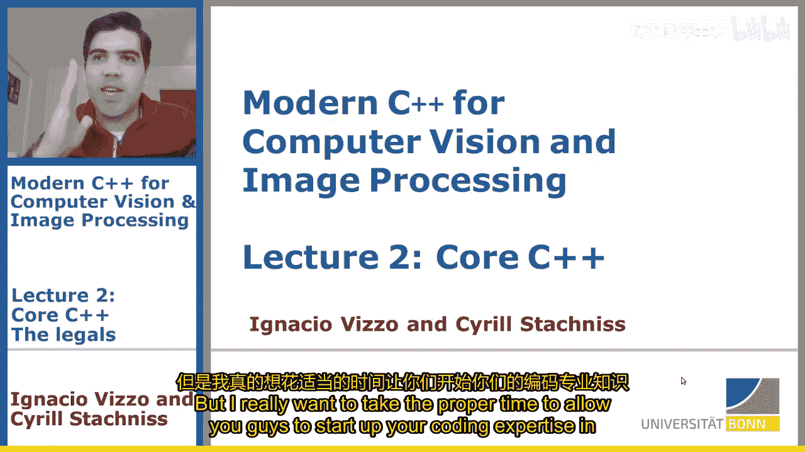

So basically， what we're going to see today it what I call the es。So it's basically。

Nothing more like nothing less than just what you can do and what you can do in C++ in terms of writing the program。

Is it possible to provide lecture PDF before the video？Yes， it is。嗯。No， now。 sorry。

 Next time I will do it。嗯。嗯。Sorry， there was a question if there is a chance to get the lecture PDFf before the video。

Okay， thank you。The idea of this lecture is that you will have a brief understanding of what you can do。

 what you can't do， and also I would like you to point where you should be looking for references in order to get the proper ideas。

So not much coding in this lecture， there will be a lot of fruits， so people who like math。

 will probably enjoy this lecture。Again， if I need to explain you probably all the rules of the language it would take me some time and actually I guess that the only ones who really knows all the rules are the people who work in the standard committee like people who believe about C++ not everyone know exactly all the rules but I just wrap the rules you probably need to know okay let's start so here's a definition of what we think that these are C++ program so its basically a sequence of text files that are the dotcP and dot or HppP files that contain declarations right and they undergo a translation to become an executable program which is executed when the C++ implementation calls its main function。

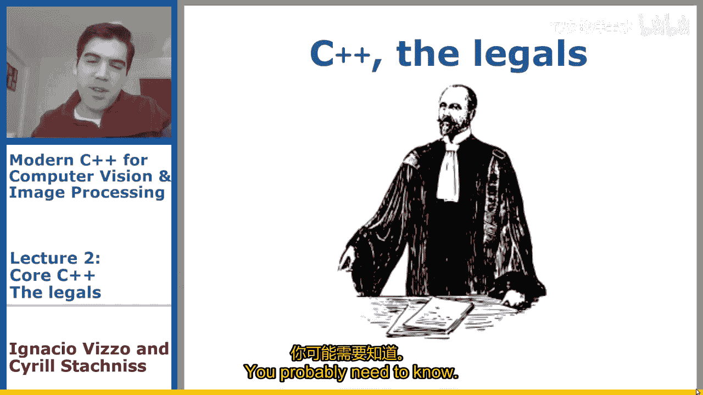

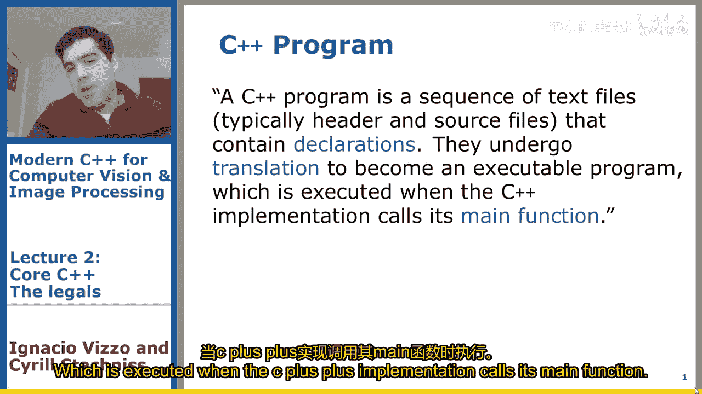

So let's see some of these definitions。Again， you will not gain any coding expertise during if you learn these definitions。

 but it's really good to know so。First of all， I will show you a table， but what is a C++ keyword。

 so it's really good that if also when we speak we try to use this terminology so the first lights is basically a glossary on what are the terms in C++ programs。

So some worse in a sto stress program。We always have a special meaning and the name of this course are keywords that this is true for all languages out there。

Or can can be used as identifiers， comments are always ignored during translation。

 so certain characters in the program have to be represented with escape sequence。So basically。

 I put there are some examples， but。Words like con， autoto friend， false， et cetera， et cetera。

 et cetera， are C plus plus reserve keywords。 And this means that you shall not be use these words or anything else that is not the the purpose of this particular word。

 Again， we saw some comments。But basically， are three types of comments。 So it's。

 I put there the comments you can do on your call。 Again， I， I high。

 I highly recommend you that you don base your。Programming expertise on comments， but in code。

 so the idea of C++ is that we can write the intent of our programs in the code itself and then we can avoid some comments。

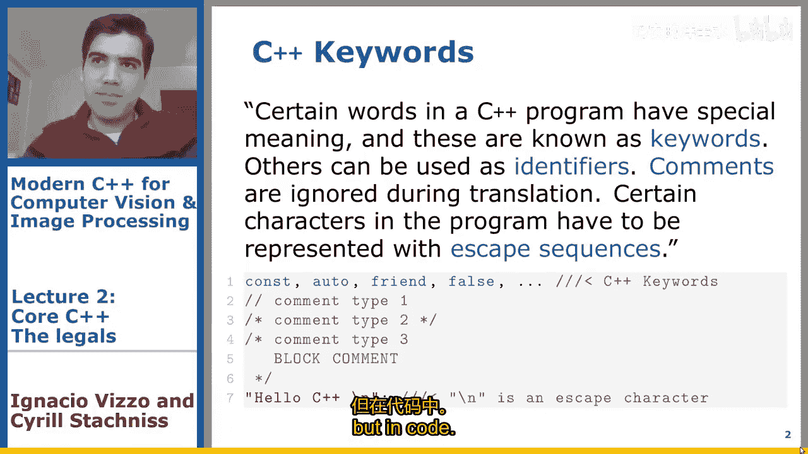

And then the sentence that says something I would escape sequence。 So basically。嗯。

This guy right here。So the slash n is basically what is called an escape character and there are many of them there are like specific characters that we call it escape sequences so these are like basically C++ keywords so these are words that you cannot use for your own reasons or reserved title the language。

Then there is this concept of entities， so the entities of a S pass programs are basically values。

 objects， references， functions， you name it。Preprocessor macros are not C++ entities。

So this is just， again， it's just a dictionary of like what are the meaning of these words。

The view of these slide is that you have a small reference on the topics I think you should be paying attention。

 but of course you can go to the books and the C+ reference standard and then you get much more definitions。

So for example， the first line like 3。5 so this is a value entity so this corresponds to this guy and then this is an object entity because we will see later on but basically S string is a class so this is an instantiation of this class and then for example you can have namespace entities etc cetera。

 etc cetera etc ce the only thing that is not considered an entities on a C plus plus program is preprocess or macros that this is basically inherited from from C so this is not considered a C plus plus entity and there will be some consequences of this of course So this is basically the definition nothing。

To worry about。And then we have the idea of declarations。

 so declarations may introduce entities and now you know what is an entity， a value， an object。

 reference， etca， etc。AsAsociate them with names and define their properties。

 the declarations that define all the properties required to use an entity are called definitions so basically。

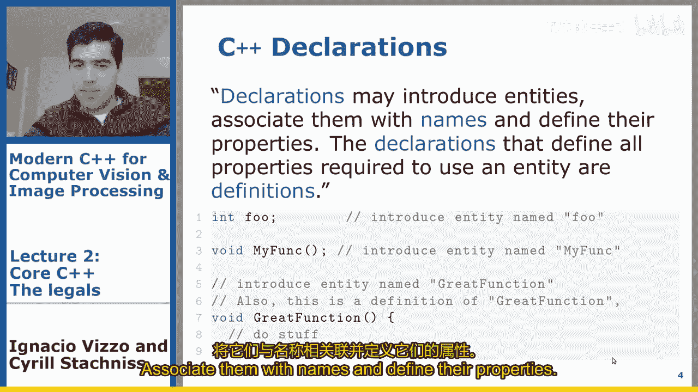

In this case。You have this statement here is basically introducing a new entity that is named full。

 right？And then this or。Statement will introduce a new entity that is a function entity that is called my function。

 and in this particular case。Because we have all the。Details of the implementation。

 So basically we are defining all the properties required to use the entity that in case the entity is called rate function。

 then we will call this a definition。 So if you remember。

So so far we have been dealing with build systems and one of the exercises。

 we have header files where we have declarations and we have source files where we have the implementation of these function entities and then that's why we call this the definition right so these are like just words。

And it's good to， to have an idea of， like。Okay， this is a decoration， this is the definition。

 so when you talk with other people or actually when you also ask questions through the channels。

 you know like which are the words you should be using。

So definitions of functions usually include sequences of statements。

 some of which include expressions and this is another keyword。

 that sorry it's not a C++ keyword but it's a concept itself which specify the computations to be performed by the program again。

 this looks like the Bible of C+ class just definitions。But basically。

 this is idea of what is a definition， so basically it's a bunch of statementsip and expressions。

So something that is really important is that。Every C plus plus statement will end with a semi columnlon and people who use to Python or no matter what I think you also need it。

And all languages just don't forget this or otherwise your program will not comply， but most likely。

And then this is a statement again， so we are reusing the same examples。

 but there are a lot of information behind each line of code in terms of what is each line。And then。

 for example， in this case， a plus B is what is called an expression， right？

So basically this is the definition of an entity of an function entity called my function and includes sequence of statements there are basically these three statements。

 some of which。Would include expression and the third statement will include this expression that is the sum of A and B right。

 so this is how you this is the definition of a definition in C++。Really fun now。

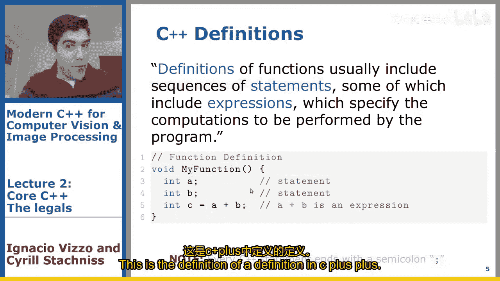

And then well have names right， so names encountered encountered in a program are associated with the declarations that introduce them。

 each name is only valid within a part of the program called its scope。

So this is a concept that I will be trying to highlight。

During all the lectures there is the scope of a program， the scope of function。

 the scope of a name space， so something that is really。

 really important is that you know that these caly braces or brackets。

This will open a new scope no matter what you have on top of your head。

 so for example here you have a namespace declaration， function declaration。

 you name it or probably nothing like in this case， so this is。Let in C+ plus code。

 so this will compile。嗯。😊，This will create a new scope。

 And basically that's the holiday of lifetime of variables and objects in Crus plus is that the objects will only be valid within scope。

 So in this case。😊，So my variable is the name of this entity。 And then in these three lines。

 I'm opening a new scope， and then I will create a variable， right， so this defines a new scope。

 and then the variable is added only within Hdi scope。 This means that if I for some reason。

Try to access this variable outside this scope， this will fail。 So actually， if you try to do this。

 you will get a compilation error。And this is do， this variable is not visible in this scope， right？

And then， for example， if you want， you can。Rename。

 I mean you can create a new variable with the same name and probably with another type and this is valid because in this scope there is a global scope。

 this variable bar FL is not declared， so this is valid。So， the。

So even perhaps I might forget at some point， but I will be trying to really pay attention to the scopes of the entities in C++ Pro。

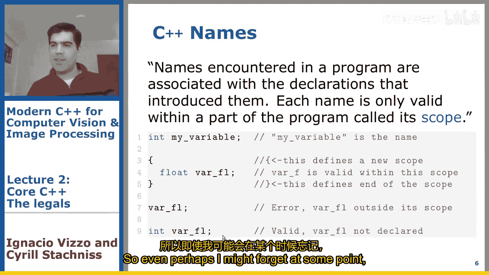

And then we have types， so this is probably the most important concept in the C+ plus glossary that is types。

 so big part of our course will be dedicated to this。

Basically each object reference function expression in Crus+ must be associated with a type。

 so Crus+ is a strong type language if you don't know the minute just don't worry。

Which may be fundamental compound or user defined， and also these types would be complete or incomplete。

So。Which are the fundamental types， basically the built in types of the language like floating point。

 Boolean， In， all the types you expect。And also user defined types。It's basically my type。

 it's a type that I define it， for example， or you define it。So the idea of this is。嗯。

Behind the scenes this is a class， so we will reach this point probably in three or four weeks。

But basically the idea of S+ is that you can create your own types and then you can express the intent of your program much better using your own type system and I will show you some examples when we reach this point of why this is a great idea for everything。

And in this case， this is what we call incomplete type because here is just the type declaration。

But there is no definition， so if you don't know what a definition is。

 you go back to the slides and then you read the definition of definition and in this case because I have all the details of implementation。

 we will call this that is a complete type。

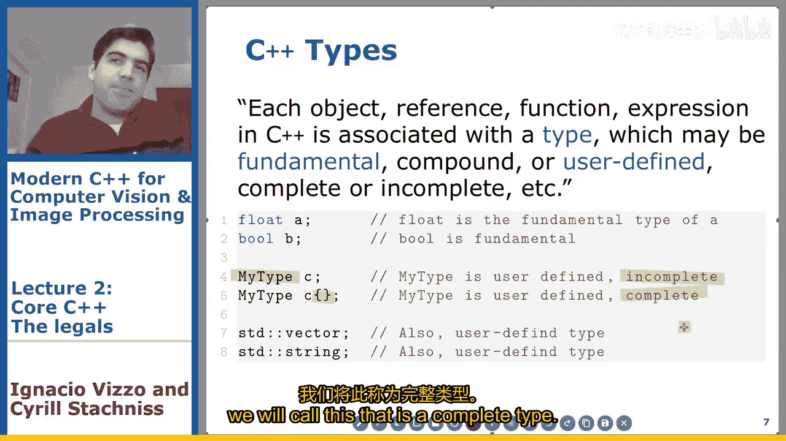

It's not really relevant that you know this。But it's good to have an overview of the key concept and then。

Lastly， we will have C++ variables that what is a variable is basically all declare objects and declare references that are variables except for non static data members。

So you would probably really get the idea of this sentence in three or four weeks。

 but for now you need to know that basically this is a variable。

 this is also valuable in this case I am creating a variable of my type or a custom defined type and it's also variable but it's also called an object instantiation of the class and then for example let's say that this class has an static data member don't worry we will see this in。

Three or four weeks， this is also a variable。But if you want to access a non static data member of this particular type。

 then this is not specifically a C class variable， Yes， we will recap this in a few weeks。

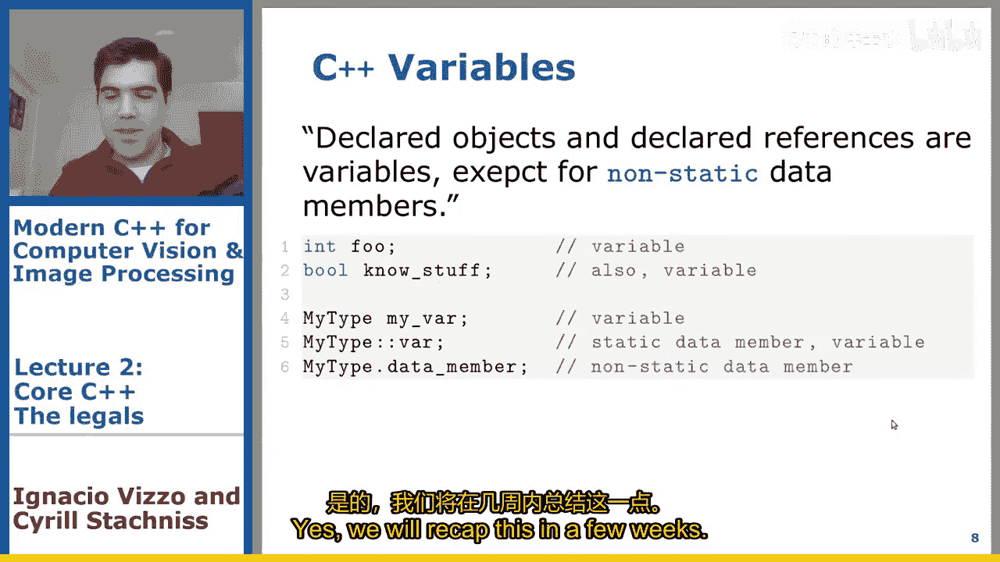

Also， keep in mind。When you create variables or types or functions， you will need to give names。

I do do this using identifiers so an identifier is an arbitrarily long sequence of dits underscores lowercase and uppercase Latin letters and most but not all of them uncode characters A valid identifier must begin with a non dit character Ientifiers are case sensitive so basically。

I is the names you would pick for your program and the entities on your programs。

 wherever these entities are， namespaces， functions， classes， variables， etc， etctera， etc。

So in this case， these are all examples of valid identifiers。嗯。

exceptcept for one so I will highlight you the one that you can use and this is not because I don't like it。

 this is completely this is illegal in  C+ for many reasons this size it looks ugly so the only thing you cannot do is start the identifier so the name with a digit like a number right but you can also use Uniiccode characters like this guy。

Of course， if you do this， you will most likely struggle。

 especially if you use like we are characters because。Depending on your system。

 you will be able to see these or not， so of course no one really do this。

 but in case you really want you can actually do it so if you go to the reference。C++。

 you will find like a list of all the Uni code characters you could use。Where。

 but it's much easier to just use letters。 And also these are case sensitive。

 So this idifier is not the same as this one because we have a capital list and we have a small list。

 So these are not the same idifier。 Thus there are different entities。And then lastly。

 you can do whatever you like。Of course， this is considered valuable。

 but it's probably way too long for one identifier so just behave properly when creating names。

And here basically。The table with a list of keywords and C+ plus。

 what is the meaning of this is that you cannot use these keywords in your identifiers。

 right you cannot call a function or read a variable。And call it， I know。Where is frame。

 you cannot do this。 You will have a compilation error because this is a reserve E for the language。

 You don't own this word you cannot really use it。 So， of course， whenever you program。

 you never have this。At the top of your face， like trying to see。

 but keep in mind you cannot speak any work in English to to for your identifiers， right？

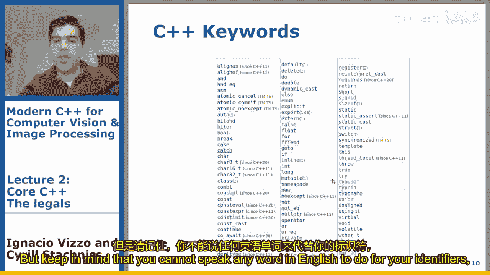

Then when we saw actually， So if we go back to。

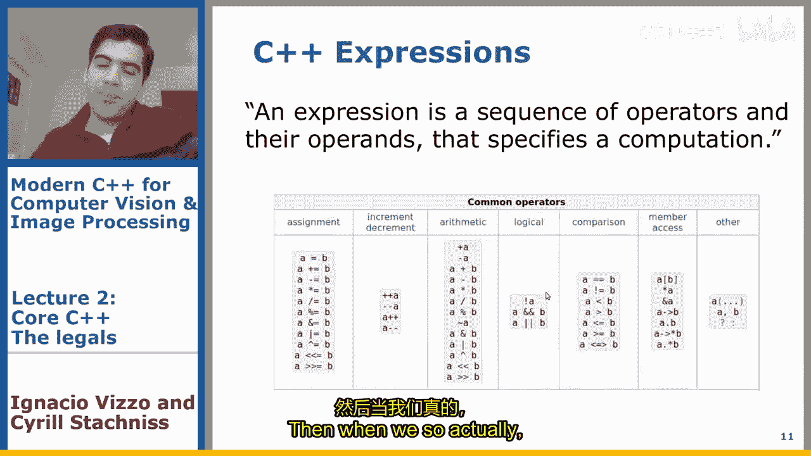

The threes。We say that definitions of functions usually include sequence of statements。

 some of which can include expressions。

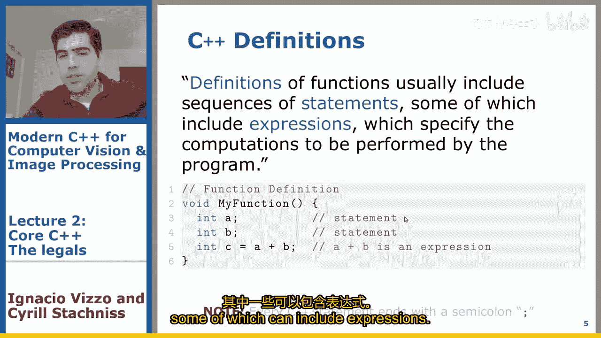

So basically， an expression is a sequence of operators and their opera that specifies the computation。

I put here basically a list of all the operators you can use in C++。

 some of them are like really so we we already know this and we expect this for the language like。

Some operator。 but as well， we have like。Super good stuff like the increment operator that of course will be different if you do this。

 if you go and check the documentation， you will find out why。

 but basically this adds one element to the variable a。

And this is the idea behind actually the name of C plus plus。 So basically C plus plus is C plus one。

 So it's a bit more than C。 And that's what why the name came into place。 And nowadays。

 people got really excited about this plus plus thing。😊。

And you will find people putting plus plus everywhere。 I'm a bit tired of this， plus plus。

Movement that I don't know。 So Cus plus was like smart choice to do 40 years ago。

 but if if you plan to do something or you plan to。Rate something。

 just don't overuse it C+ plus it's annoying for me， right。

 So these are basically just a list of common operators you can use。

 and this these are the ones you could use。In order to make computations in your program。

 so you have input data and then you want to do something with this data and these are the operators that the language will provide you to work with that data。

Probably next lecture or two lectures more。We will see how to work with these operators in a C++ way that this basically is how to overload these operators and make usage of the C++ language really with this。

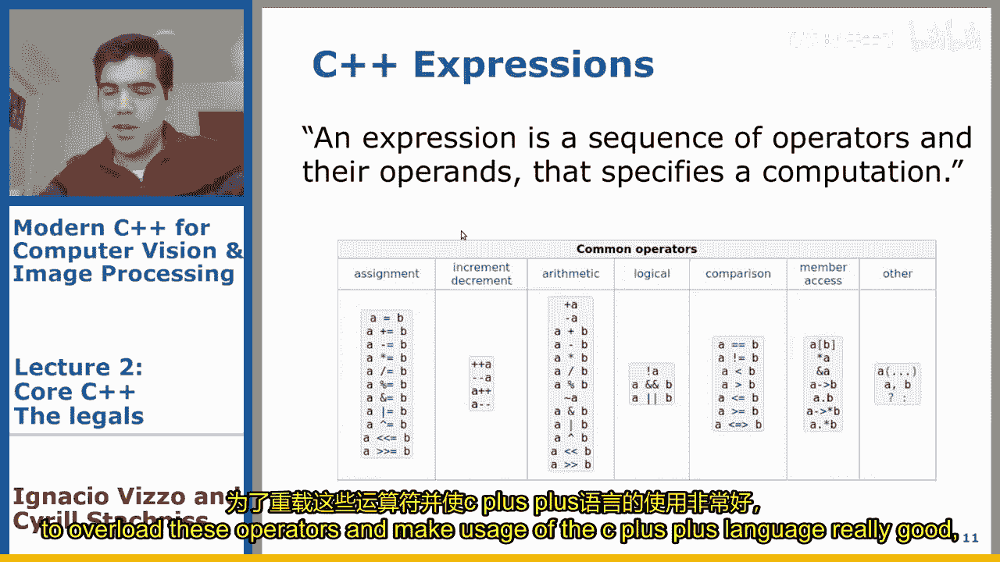

Okay， so that was basically the glossary that means that。

Whenever you struggle with probably something that you don't know how to write or something like this。

 it's probably good idea to check the slides and see the。

W are the legal things you can do or you can't do right if the information you're looking is not in the slides。

 then you will go to CPP reference and then you would search there and then you will probably find the answer。

So we will go super quickly now on contrasttractors and why。

 because I sort of expect that you know this， so these are like basic techniques and ideas on programming。

 so this has nothing to do with C++ itself。This means that there are no new ideas introduced by the C++ language for Con structures。

Yeah。So basically， this idea of of this will not change if you're using Java， Python， C plus C。

Julia are whatever， so these are basically core techniques of empowerium。

And if you really have no idea about these structuress。

 then it's probably a good idea to go and search for an interaction to programming course right so this is not something that we will spend a lot of time explaining because it's basically this stuff The only thing I want to show here is the syntax of this structuress So we have the famous if statement So basically you can have a volumeolean variable and ask if this variable is true or false and depending on the content of this variable。

 you can execute some actions or not So basically if today is rainy。

 then I will do this else if it's sunny， I will do all thing and else if neither both of the one we say before are true then we will do this So that's basically an if statement it's the same as。

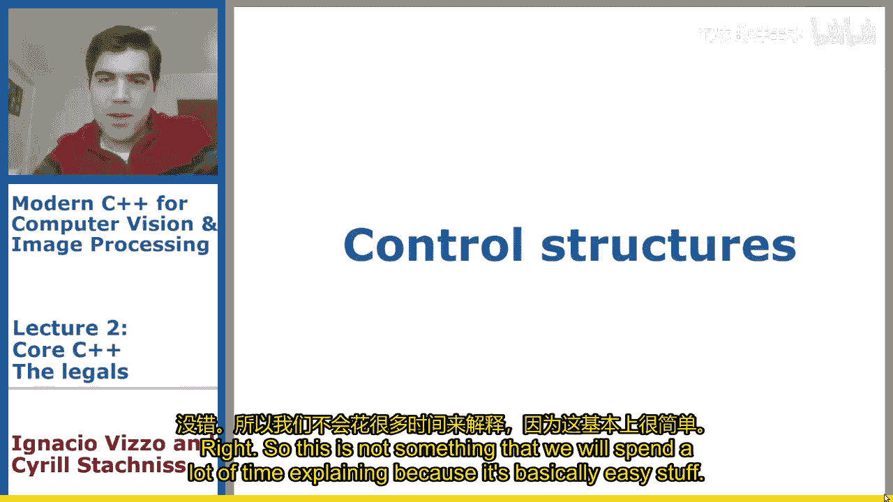

And in other language， the only difference probably is that syntax。So if you compare with Python。

 for example。In this case， we don't have like the horse indentation system， so。

Whenever you open a new Construct。These if statements will apply to the new scope that is generated when you open curly braces。

 right， So basically， this is what is inside this if statement。 So this is what will be executed。

If the statement is true， right？In Python you do the same， but with indentations。

 so in this case you can write everything in one line， of course it will look ugly。But yeah。

 the only difference between。 so how to put stuff in different parts of the structure is with color braces。

 So with this。Clling races， right？So this is simple， it's just this syntax of the language。

Then we will have switch statements as most of the language have。

 so basically this is used to conditionally execute some code。

And then we can have many case statements and then just keep in mind to use the brake。So， usually。

 this is。Something easy to forget， so if whenever you hit this case after you execute whatever it's part of this con two case。

Then you will need to break the execution of the structure Otherwise you will run into default fold and whatever you have here。

 so just don't forget to use brake whenever you use。嗯。Switch statements。

 and then usually this statement could be an int or an enumerated value， right？

So let's see a really small example and。Now in this particular example。

 Im kind of lying to you because C also has enum types。

 but I just wanted to show you how a C parameter will probably handle this task。

Even if they know that there is a anum types， this is how they will do it。

 this is typical C code and besides it's a bit ugly there is nothing wrong with them but basically in this case you have a color variable。

Let's highlight this。There is this guy that is an integralte， right？

And there are two main problems with this again， you can you can actually improve this in C。

 but it's very likely that if you know someone who knows C will do it like this。

 So the first problem is comments， right？I have been telling you that our idea is try to avoid unnecessary comments。

And then color is not really an integral variable， right， it's a color。But besides that。

 now you need to keep an explanation or on what is the intent of your program， you need to say okay。

 red will be one， ring will be two and blue should be three， right？

This is a really small example that what happen if you change this definition。

 Probably you forgot to change it in the code in the comments。Then your hover brain will be a mess。

 and these are really hard。Bugags to the bag， because it's， it's part of it's not really wrong。

 but the intention is wrong。 So this is the first thing we would like to remove。

The other thing is that color is an integral value， so it can be0，1，2，3，4，5。

 wherever so it's not really safe。And then we will see with the type system of C++ in future lectures how to fix these kind of issues。

 but can the idea is that you start to develop an intuition and what is like C style code or all style code and C++ right In this case。

 the intent of the program is not really specific is not really visible on the source code Of course you compile it you write it works I'm not saying that it doesn't work but the intent of the program could be much better expressed using C++。

In this case， we will be using。Something that is in your class。

 we will give more details on this future lectures。

But its basically we will create this new type and then we will say。

 okay this type can assume three values， red， green and blue right。

 and then we will create a color that is of type RGB。

 It's not an integralte anymore so now we cannot put a4 into this color and then we are already avoiding mistakes。

And also here the intent of the code is visible because RGB could be red， green or blue。

 and that's all I don't need to add any extra comment saying whatever youre reading is what it is meant to be because the code itself speaks by its own。

And then this is basically the same switch statement。But instead of using an integralteger。

 were using an enummerative type right， and then if the case is red， then we will print red and blah。

 blah blah if you compare it with the example， the C example。

You will see that actually the case here， we were forced to use numbers and then here。

 so if I change this definition， they I need to remember that I also need to change this part of the code。

 so this will be probably a mess， right？So it's really good for me， I will be really。Pro。

 if you start developing this intuition on what is C++ and how to write good programs。Okay。

 continuing with Cont structuress， we also have loops。So we have the famous while loop。

So we have a question that is is do the object of version， I don't get the question。

 but we can discuss it offline。嗯。

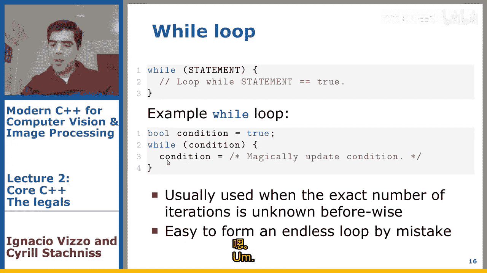

Yeah， don't worry about the syntax of enumerative classes。I know you can use a new with C。

 but this doesn't mean that people who problems in knows that they can use it because I。

I I've struggled with a lot of seapro and most of them that's in useive because it's better to because it's too high level and then they keep track of what's going on and then they just don't use it。

 they prefer integraltes or chas or whatever。And not all of them， but most of them。

So don't worry about this syntax right now， because this is part of the Num class types that we will discuss it later on。

你啲实要。You see that if you read this code， even if you don't know C+。

 you kind of get the idea of what's going on so but don't worry about this particular example because we will discuss this later on。

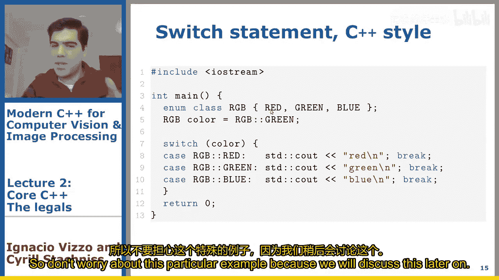

Okay，歪 loops。Basically， wherever you want to loop， you can use the white loop。

 and then this will be the statement is usually Boium variable。And then while this is true。

 the loop will be executedag， so map。So make sure that you use this wisely because it's really easy to end up in infinite loops with while。

And then this is another example。

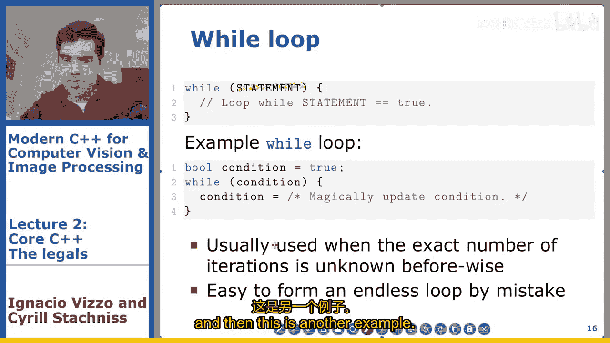

Again， I'm not planning to do examples like likeCOV examples on this because it's something that I expect you to know。

And if for some reason you really struggle， just send me an email and then I will try to help you to find a solution for that。

Then the follows。This is usually the loops。The most used loops in Crus class。

 but basically you will have an initial condition and end condition for the loop。

 and then you have an increment part of the loop。So basically let's say that you want to do something and then you have a variable or a constant variable that is count and then you will iterate this many times and in each iteration you will increment the I variable that is nothing more than an integral that is initialized in zero now this is nothing more than a follow loop right？

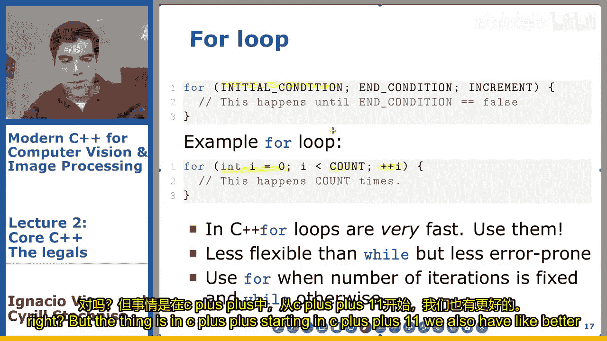

But the thing is in Cus+ starting in Ctrus plus 11。

 we also have like better loops that is basically range loops， it's called。

So we will discuss containers next lecture or two lectures。But basically， if you have a container。

 don't worry if you don't really know what is a container a Cus plus。

 but it's a collection of items of elements like an array of know floating point values。

And then you want to it through these values。 You don't really need this auxiliary variable that is called。

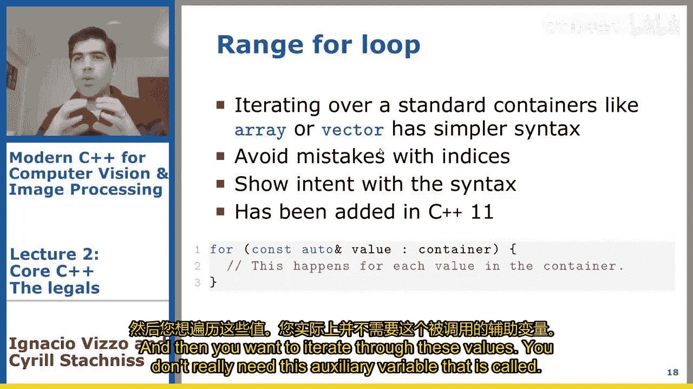

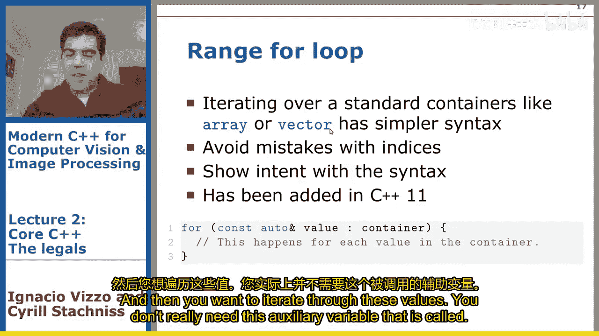

This I variable。So if you want to iterate through a container and I know print the values。

The eye variable。It's not really needed。 you don't you don't want it。 It's redundant。

 but before C+ plus 11 you had to do it because the language didn't support range loop。

 So the E of range loop loop is that whenever you have a container you can eat it through this container with a force syntax。

 but without specifying this auxiliary variable。 So basically in this case， so you have a container。

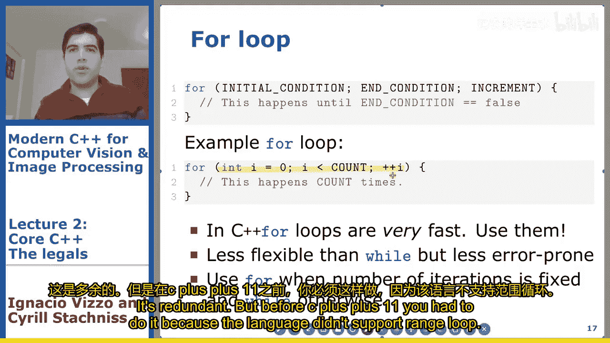

And then you will have one value for each for each iteration will be part of the container。

 Whenever we see S steelL containers， we will see a lot of examples on these four loops。

So is this for each loop， Yes， this is for each loop。

 So this is also range loop is also called for each loop。

And thanks for the question iss actually good because actually you read it like for each value in container。

 blah， blah， blah， that's why the the name for each。 So in this case。

 let's pretend that container is， I know a list of names。😊，Like bunch of names that are strings。

And then youll say for each name in contain in in names， and then you will I know see out name。

 So this is actually releases syntax to read and express the intent of the program much better than a full loop with an eye variable you say okay。

 I have an eye variable and blah， bhlah， I don't need it， right？

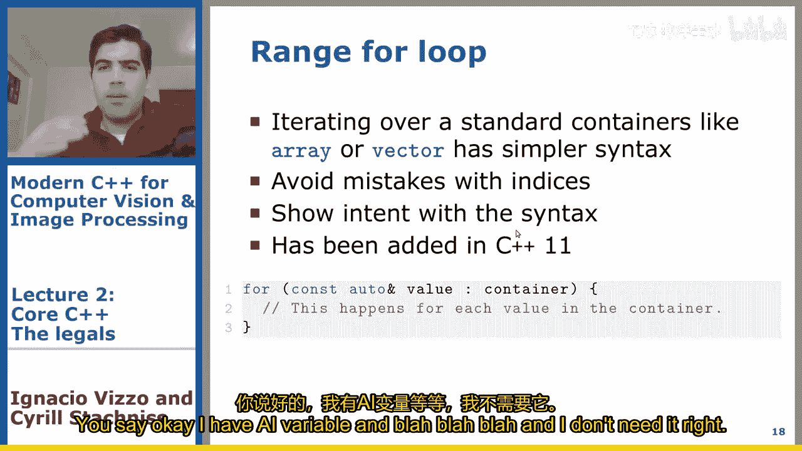

And also spoiler alert， don't worry if this looks misleading to you in something we will cover in future election。

But there are some stuff in C plus plus 17。That is actually new and that this is one of the reasons we are using this particular standard。

Is that you can use。diicctionaries， and you can iterate through dictionaries in a pythonic way。

 right， So small example。Basically， forget about this type。

But we are creating a variable called my dictionary that has like these two members right and then we can iterate through this dictionary with really a simple syntax that is a for each sentence。

So for each key and value in this dictionary， then print the key and the value。 So this are。

 this is basically in the key。 Its will be in this case， A， and this will be the value。

 So on that first iteration， you will have like。K a has value 27 and the second it you will have this guy。

Before C+ 17， you had to do much more steps in order to print the same results you can actually。

 I mean you could do it， it's not that this is new but it's a matter of syntax。

And this is basically the equivalent in Python， so this is how you will do it in Python。

And why I'm showing you this is because， most of the people are really scared about C++ of because the syntax is a bit more complex than Python or other languages。

That's why usually most of the people end up using more simple language。

 But the idea that with the years， the C plus plus standard is trying to improve its readability and its usage of the language。

So with this， I want to show you that you can do the same in Python， but in C++。

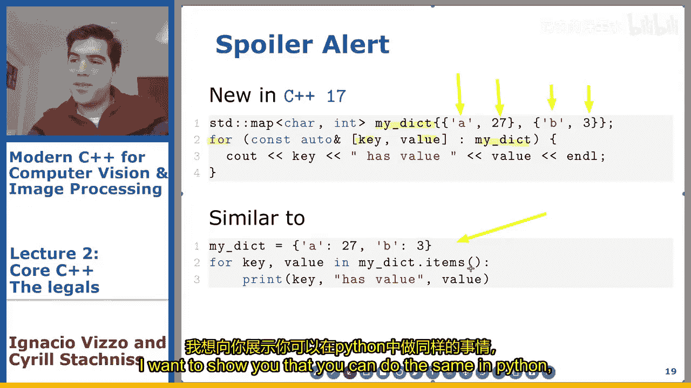

And spoiler alert number two， if you run these programs on your machine with the right optimizations。

 you will find out that the Cus+ implementation it's about 15 times faster without doing anything so the price you pay is nothing there is two more characters involved in the program but it's like one more line compared to three9 So it's almost the same syntax So the ideas are expressed in the same way。

 but you gain 15 times performance at randomtime So this is one of the reasons C+ is still。😊。

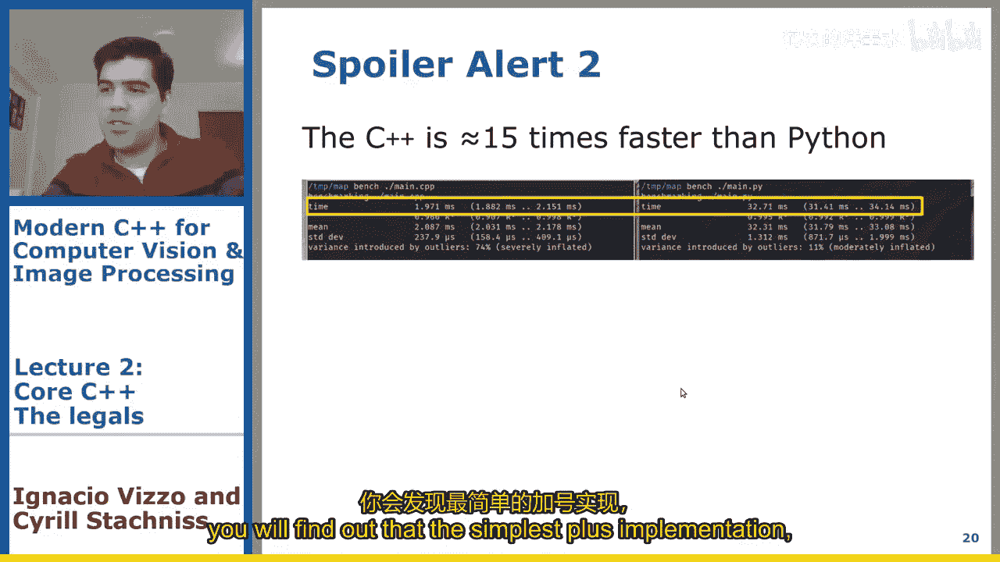

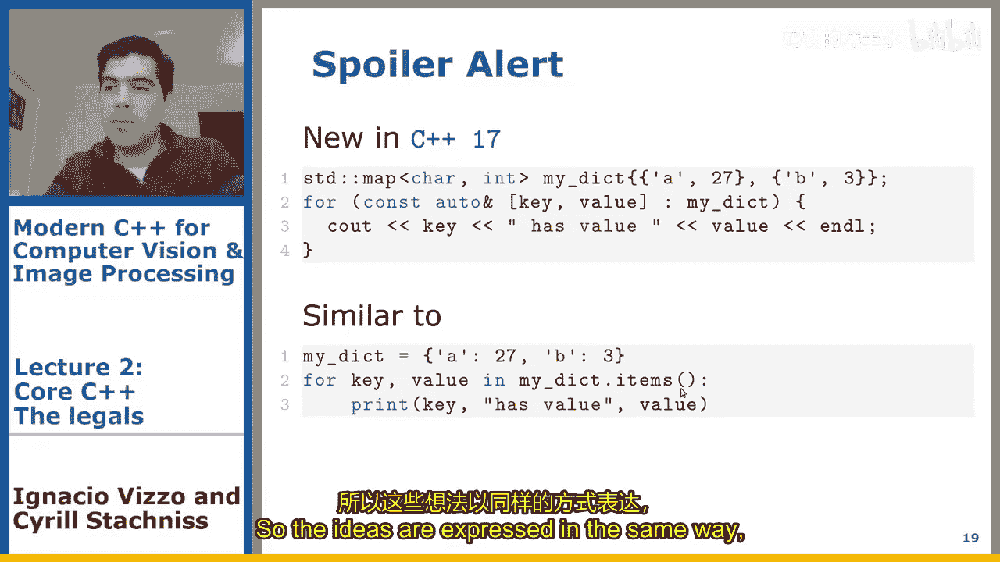

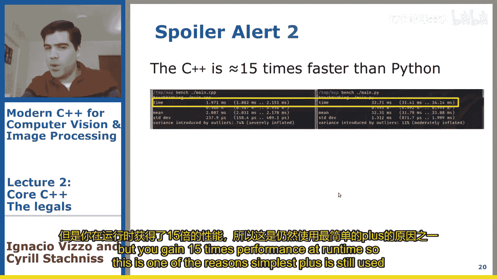

New nowadays。And then this is not something that you should be using unless it's necessary。

 but with a break。St you can break the execution of each each of these construct structure that we saw before。

 So let's say you are doing a infinite loop and purpose， like while true and then。

You will compare some conditions and depending on these conditions you can break。

 and this means that you will stop the execution of this particular loop that is defined within this scope。

 right？Of course， this is not considered structure programming。

So it's not highly recommended that you use this unless it's necessary。Not saying that is wrong。

There is usually a way to avoid these kind of techniques that will give you headaches and bugs in the future。

Okay， so reaching the end of the legal parts of C+ class， we went through the grocery。

 we saw some constructs and now I will show you some of the built types。

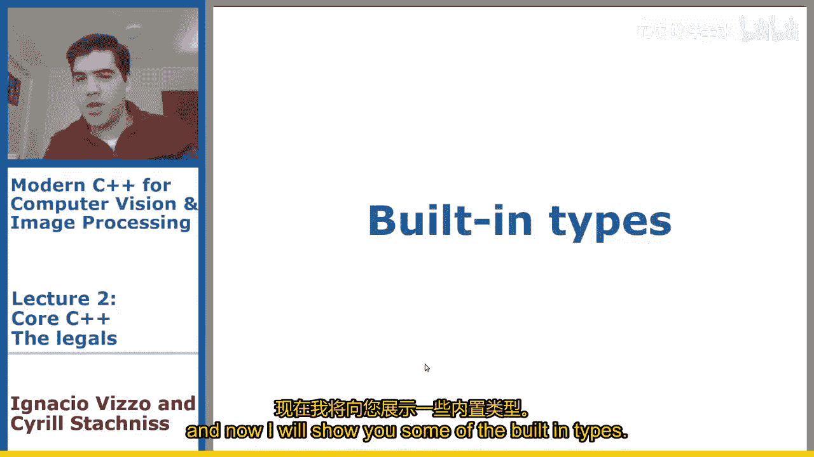

So these are what we call out of the box types in C+us class。

But are basically types that are already there for you。

 You don't really need to do anything to use it。 So basically， these are。Examples。To this point。

So these are all Liin types， make sure you go and check the reference you will see a lot of types。

But the idea that these are types that you can actually use。

And then also we will start using a lot what is called automatic automatic type deduction in this case。

But we will expand this in more detail in the future。But basically。

 it's like you have a variable that you know that is a floating point variable because you are specifying。

This with this F and yout really need to repeat the name here so the compiler can deduce this type for you and then in the in the future in the long term。

 it will make your code more readable and you will see why in future lessons。

So there are a lot of operations that you can do on ametic types。

 remember if you want to see what is the operation or which are which one other operators you can use。

Go back in the slides and go to the operations and you will see the table with all the operations。

 but you can do arimetic operations， comparisons， you can incr increment operations。

 you can do a lot of stuff with these aritic types。

Basically which one are the emtic types go check the reference before。

 but is characters integraltegers and floatingt point values。

 this could be short long double plott point onign in a lot of like all these types that are part of the core language。

Are concealed aromarimetic types， and then you can use all the arimetics operations within with these types。

Right， and one big advice。Because it's very likely that you will feel a temptation to do this during the lectures。

Is avoid using the equal operator for floating points。If you really want a huge explanation on this。

I can do a five minutes video， but。It's it's a matter of like the implementation details of floating points。

 people who have a strong background on computer science will know how to represent floating point values。

And then you will probably have a sort of intuition why it's not a good idea to compare floating points。

 because no matter what you see in the source code， the implementation， the bits that they represent。

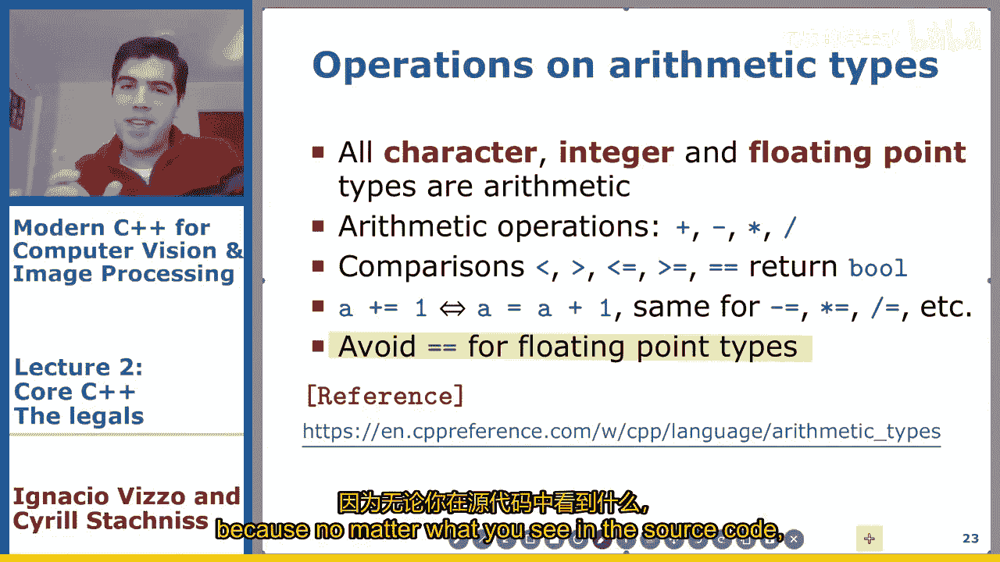

These floating point values might be different， right， so keep in mind that it's never a good idea。嗯。

Okay， so this is an example why is's a good idea。So。If you try to run this program。

And then you compare the assets。Okay， spoiler alert。

 of course this is false otherwise it wouldn't be here on the slides。

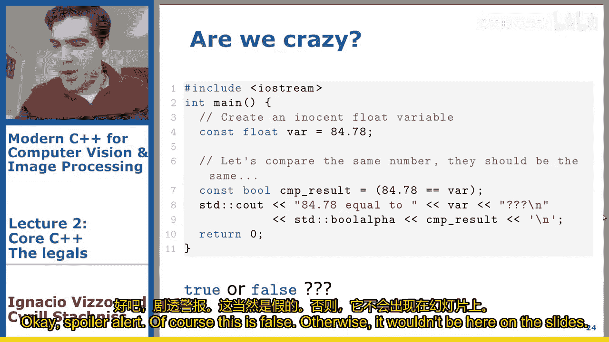

Anyway， you can also do some additional operations。Like with boion variables。

 you can do the or operator。 You can use the an operator and not。The syntax is inherited from C。

 so it's if you know C or Java， I think the syntax is the same。And basically。

 you can do some operation like for example， if it's not hungry and it is warm or if it's rich。

Then the Boolean variable is happy will be。

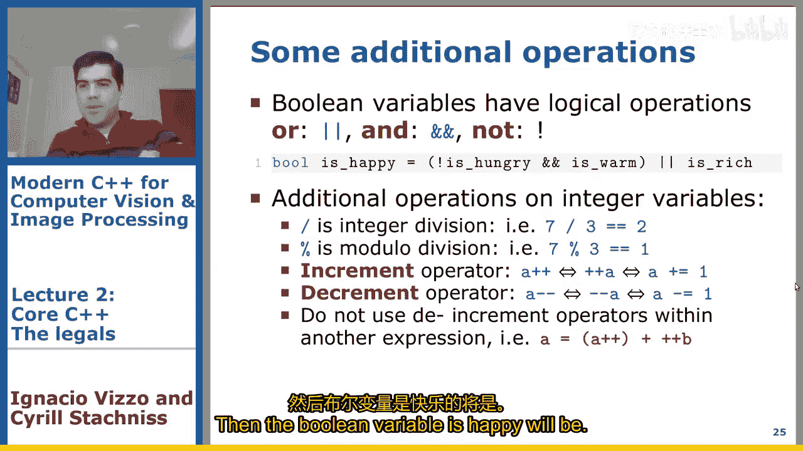

True， so this is some examples on what you can do with operations。 And just。

 the only thing I would never recommend you to do is doing stuff like this that basically。

This is legal S pass， you can do this， but of course if I give you two numbers for A and B。

 two integral numbers。You will most likely give me the wrong answer for this。

So just keep in mind that whenever you use these increment operators or just make sure that you don't do this crazy stuff because it's impossible to know what you're trying to do。

Okay， so variables， we already talk a bit about variables。😊，So always。

 there is always a pattern like you need to specify the type。Because C++ is a strong type language。

You will pick a name for this that is also called the name of the entity。

 you will use an identifier for this and then optionally you can initialize this variable。

 so it's always a good idea to initialize your variables to have a consistent startup state of your program。

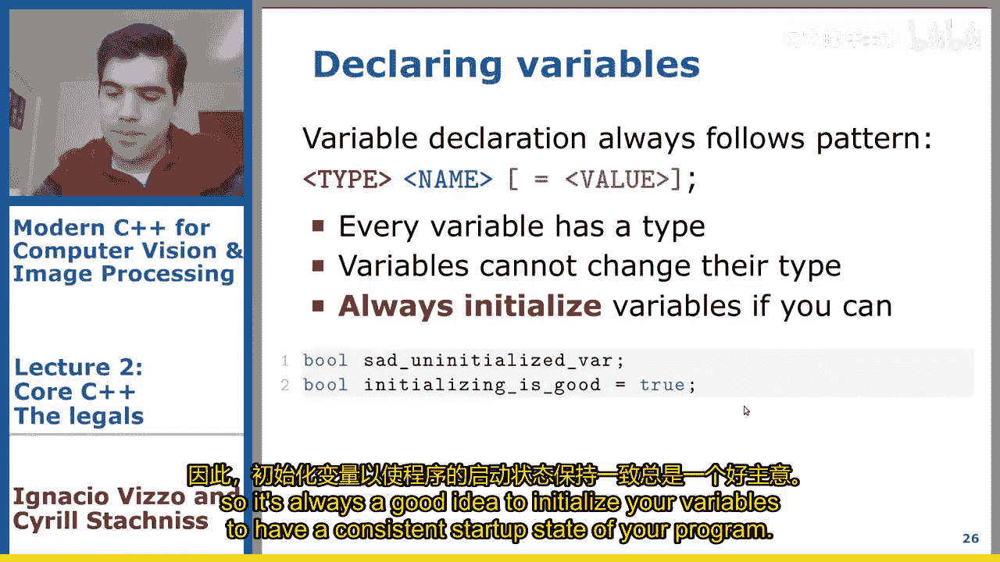

Then for naming Marios。 So we already discussed this also holds for。Any identifier？

The name must start with the letter。 You should try to use meaningful names and then。

This is something that we will be seeing through the slides。I'm not a huge fan of Google style。

 but of course， it's always a good idea to have some style。 And in this case。

 it's to use snake case for variable names and why why we it's a good idea because if you're reading a huge C+ plus program and then at some point you find some variable that is reading on snake case。

 then you would probably know that it's a variable without going and look for the decoration of the variable。

 So that's the idea behind the styles is to make give more information about your program without having to know all the details。

 So that's basically it。Also， we already discussed this but variables will live in scopes。

 so the variable belong to the scopes where it had been declared and all their variables will die after they reach the end of the scope。

So how to learn this by heart is basically just opening the text a and writing some examples。

 try to manipulate variables， declare it in some scopes I know have fun with it and try to to learn that the variables leap within the scopes that have been declared right？

And then lastly， anybody can。Can also be con。 And this is basically is product to protect。

 to protect， sorry， the programmer。Of changing the value of the variables。

RightThis is also key a key concept in any other language。

 Basically if you declare a variable of cons， the compile will guard it from any chances。

 This means that once you declare you give a value。

And then you can not change if you attempt to change it， then you will have a compilation error。

 So this is before run， right。And the Google folks thought that the best way to。

To name this variable is using Caml case and started with a k for constant。

 And then this is something that you will see in S press program like you see this and then say okay。

 this is a cons value， so I will not attempt to change it。 So that's basically it。

And the tip we always give is declare everything cons unless it must be changed。

 So if you are dec a variable and then you don't really know if you need to change it afterwards。

Then just do it con because it's bare for the program itself。

Then we can also use reference to variabless。And for this is basically a reference to a variable。

 It's a way to accessing this variable。 It's a fast way to access this variable。

 That's put it like this。 We will see pointers and memory management at the end of the course so don't get too excited about this。

 but basically。A reference to a variable is。A reference to that variable。

Keep in mind that the reference is part of the type， so in this case。嗯。

This is a type of the variable ref， so it's a floating reference， floating point type reference。

 and then whatever happens to this reference also happens to the variable because it's just a reference to that variable and this will give you performance because you can avoid copying there and we will see this in next lecture。

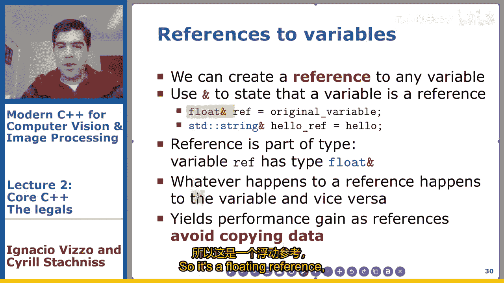

Here is an example， how to use con reference， I will highly recommend you to go check it out。

 compile the example and write。

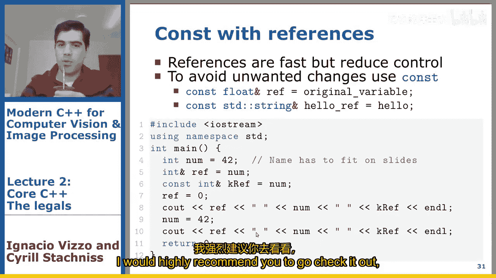

O케이 and then。So for now， we are reached the end of the legal part。That is basically the gloss。

 the victim types， the contra structure， and some ideas about variables。

There isThere is no real like heavy concepts in on all these things。

And then I thought it wasn't super fun enough。 So I added like small。

 we will see a small example on something that is not related to the legals。

 So now we will see how to use string streams and then this is a technique you will be using on your homeworks。

 right。So this is taken from lecture zero， these are basically some ios streams that we already saw that is basically the sea out。

 the standard input and the error。And this is also part of the Cus plus the standard library。

And then I'm sorry， C parameters， but this is。I would like to be on the classroom now and see who can guess what's going on here。

Right。But basically， if you build this program。诶。Actually， if we have time， we can do it。

So if you read this problem， it's almost impossible to read。

It has been a wide inside program in C and then probably I'm not the best C programmer。

 so I should ask some C expert to rewrite this program to make it the best possible。

But if you see the problem itself it's not really easy to identify what's going on。

 but I will tell you what's going on because I wrote the problem and I know the intention。

So let's pretend that I have a file name that actually this is probably a data set that I will have bunch of file names and I have these file name。

And ideas that I really want to split。These find them in two parts。

I want to get the inplifier for this file that is going to be an integer and I want to know the extension for any given reason。

And then the way of doing this on C is basically traversing the string and looking for patterns right one of the disadvantage of this is that it's a bit funky and also it will be really hard to split these two types。

And that are basically two types in different variables。But if you print this。

 you will see on the on the standard output， you will see this string， so you will see 0，0，2，0，5。

Because right now you are printing all these strings and then you will see the second string that is。

B T X T。 But actually， I want this 2 or5 to be an integralteger because I don't， for me。

 this is not a string。 It's not a world。 It's a number， right？ And of course。

 if you move to the C plus plus word。You can use something beautiful that is called string stream。

And if you actually spend few minutes trying to read this program beside if you are used to the syntax or not。

 you can actually guess what is the intention of the program much better than the C counterpart right so basically。

We have the same variable that is find name is all0205 do Txt。

 but then we can split the information in this string in two variables。

 right one would be inte and there will be a string because that's the thing I want to do and how you do this is using。

The streams operator that basically are。Shift operator uploaded。 Don't worry， we will see this soon。

And basically， with this， this operation is defined on the。

On the Iio stream library part of the C+ standard library。

 and it will split pre formatted bios so in this case it's really clear that you have an inte here and the rose is string。

So let's do it with different colors。 So you see it。Look here。So this is really handy to use。

 Of course， if you do the other way around， you will have issues because。

You first have so you traverse the string that's why it's like a string string from left to right and then the first part will be an integer and the second bank will be the string if you try to change this you will get errors right Of course if your string is their away like I know like TxT and then dot and the number then you need to do find them then the operator's extension and then the number。

And then one of the benefit of this is the type。 Now， the the number is an interval。

 and I can do atic operations with this number。😊，Because it's not a string， of course。

 A C parameter will tell me， you can use a string to in。

 but then you have an additional step in order to convert the string 00205 to just 205。

So we will run this program and we will see that basically this number will be a number and no matter what you can do a lot of operation with that。

 let's say you have a database and then you have a bunch of files with this format。

 then you can I know compute whatever with these numbers or something like this。

Let's pretend that you want to only process the files that ends in Txt and not the PN G files for example。

 then you can distinguish using the string X you can compare the PNG or TxT file and take some action on that right and this is like what I want you to start developing this intuition this looks much better it runss at the same speed of the C counterpart and it's easier to read it's easier to maintain because if you for example。

 I know add some part on the stream you just need to add one variable and that see and then you need to post process all the steps the manually steps you did with the C part。

So again， this is the C example and this is the C+ plus example。

 so actually let's go and check it out this。

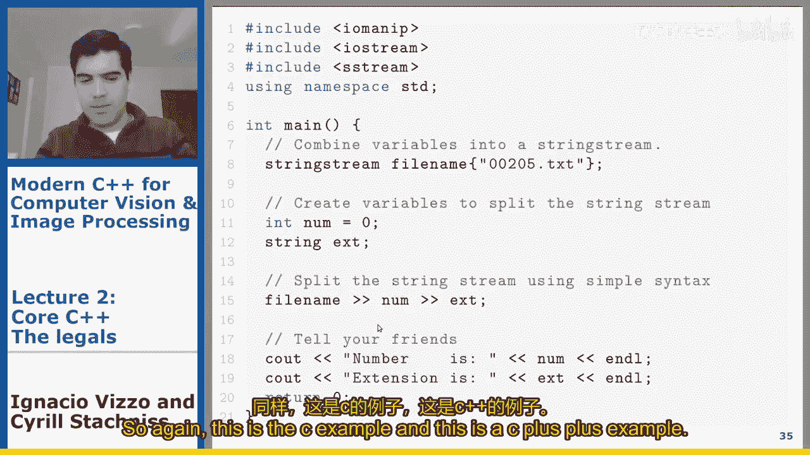

嗯。So。Sts。So we don't have much time， so I would just copy the examples。嗯。This guy。 and then。

So I will open a text editor here and we will just run the problems。

 like build the problems and run it to see the output。

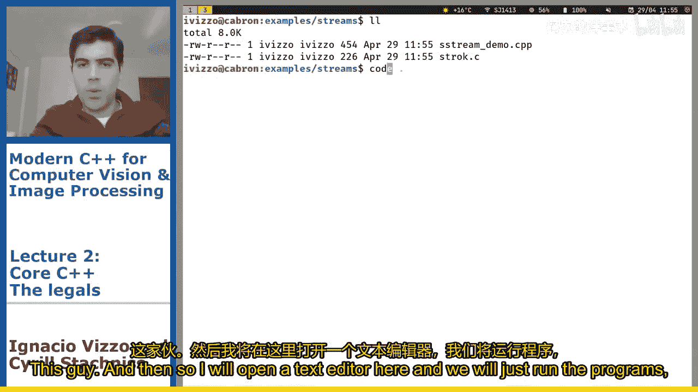

So first we will see the C example。So this is taken from the lecture slides， so。

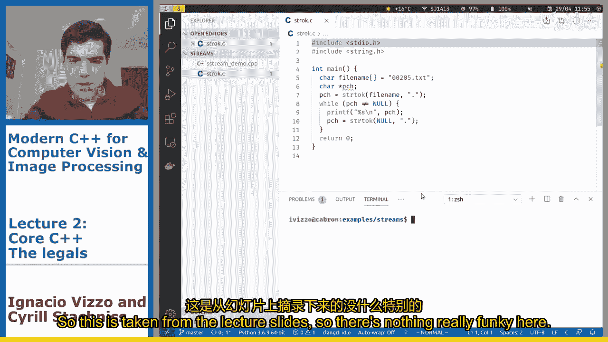

There's nothing really funky here。不不是。And then for this， we will use GCC or client is the same。

And then we will compile just main dots C。I'd call stroke， so。So she see is still doing。

And then we have the executable， and then we have this， so we have。This is big enough。 I don't know。

 we have 0，0，205 that this is a string and I don't I don't really want the first two zeros because I only need the integral。

 but with see it's really hard to split these two types。 and then I have the TXT extension， right。

And if you compare it with the string demo with the C+ plus counterpart， when you run this。

You will see the same output， but it's much better。

 So for that we will use clam plus plus and then main do CPP sorry。Stream。

And then when we run the executable now， we will have number is two or five。

 so it's not a string anymore and then dot TxT is extension， so this is small example。

 make sure that you run it on your computers。

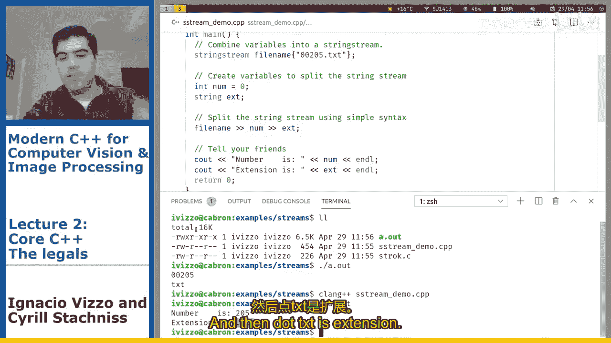

So ideally， on future lectures， most of the lecture will be。Focusing on programs。

And I will try whenever I remember to show you a C example or any other language example on how you will do it on this language and why we C++ parameter thinks we can do it better with C++。

 not because we are better programme this because。

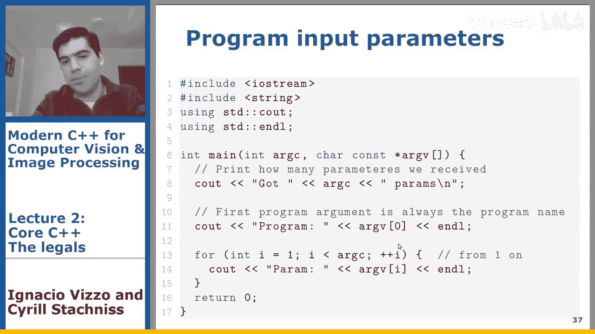

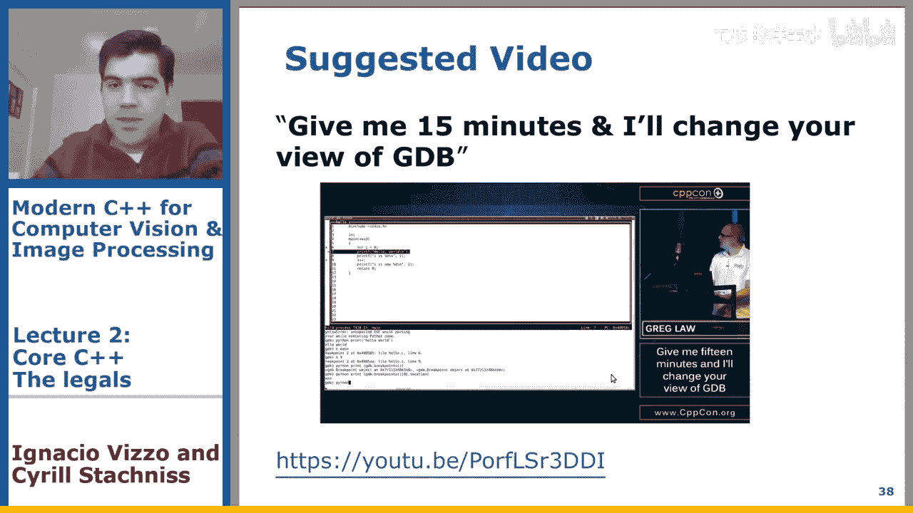

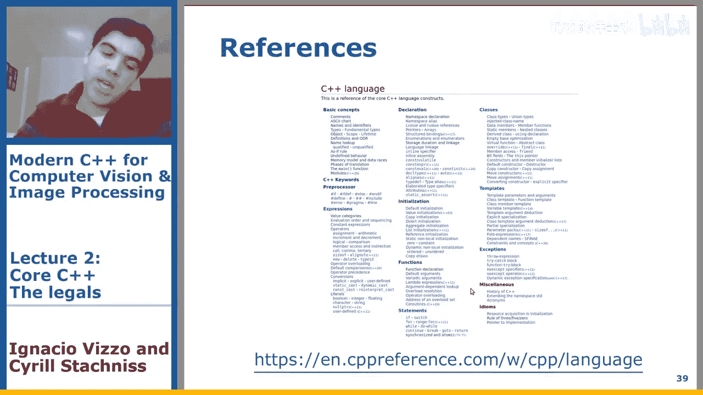