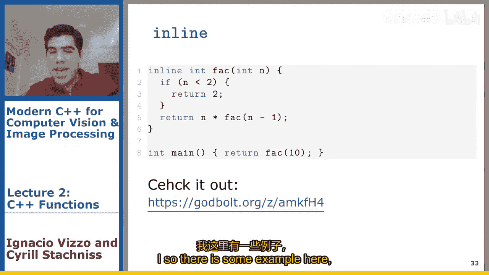
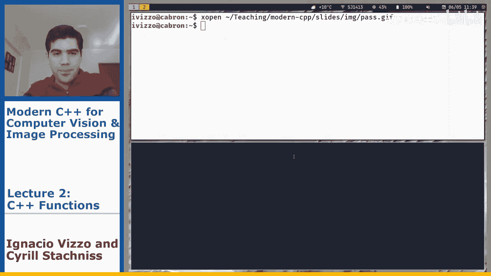
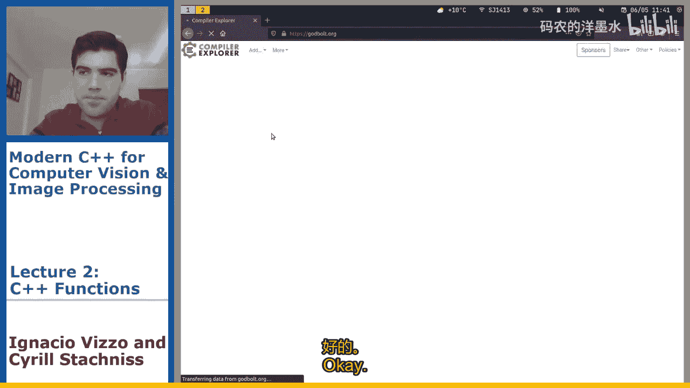
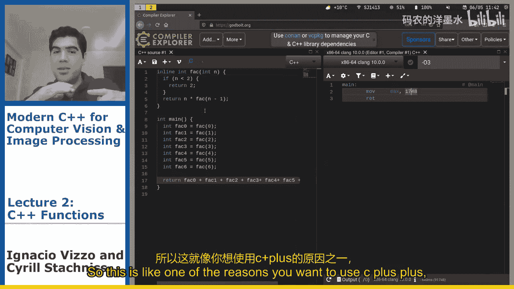
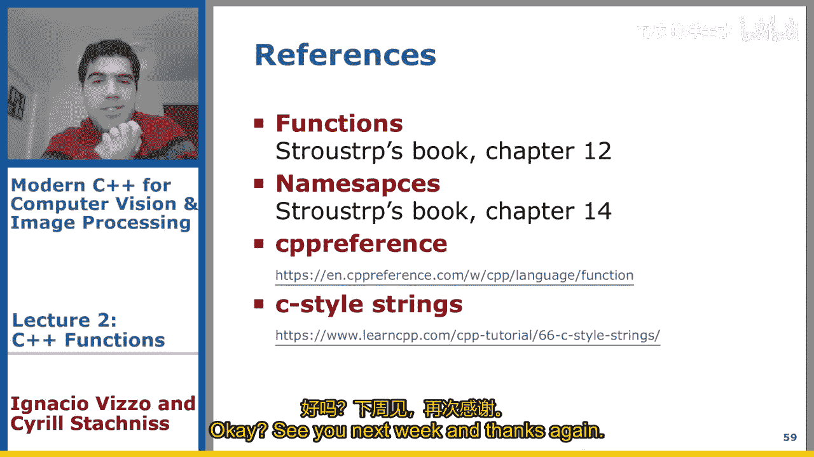

# 【全集】波恩大学 现代C++ CS414 中英字幕 p04 Lecture 3 - 函数 -BV1EYm1B5E2D_p4-

So welcome back to our fourth。Lesson more C plus。Just as a reminder， the number of the lessons。

Start from three and now I am looking in the so in the slide， it's correct， but not on the video。

Okay， that's a pity。 I will not fix it。Anyway， so this is lesson number 4 and starting from today。

 So this is our fourth week， fourth week together。So I guess it's time to start seeing more Cus plus code。

 So ideally， I tried to go from the most basic stuff to intermediate level and then advance。

The idea behind this is I trying not to leave behind people who has no a strong background in computer science。

 but they also don't want to leave behind people who has this background and really want to know like cool stuff。

 cool stuff about C。So that's it。 This is the the end of the。Of your race month。

 So this is the period where you should be trying to learn how to deal with the tools。

 and from now on I will be trying to focus the lectures more on C+ plus concepts。And also。

 if we have the time， I will be doing a bunch of live coding stuff so you can see that I also make mistakes while I'm coding。

Anyway， so let's get started with the lesson So before we start with functions。

 I want to show you a small example on how to deal with strings and C++。

Because this is something that we didn't do on the previous lesson。

 and we should at least comment about this。So sorry， see fans。

 but I think it's good in general to big C to show that we can do better。

So this is how you will copy a string。 So let's say that you have a string that you put copy these into the string。

So this is a string you want to copy， and then you see you will do con chart and then you will do array。

Don't worry if you don't understand the syntax， we are not doing C in this course。

And then you will create a destination。There are better ways to do this in see but the thing is I want to show you that you can actually do this and actually make some mistakes so then you would print the source to show people what is in on the string and then you would call string copy。

And by the way， I am using C+ plus here， but I am using all the C functions。

Everything from C can be used in C++。And this is something that。It's tricky to comment on this。

 but it's something that I don't really like because these made C++ an even more difficult language to learn because most of the time you will Google how to do something in C++ and people in stock overflow which just give you replies using C style code so it's really hard to say that this is C++ code or C code when you see a source 5。

But anyway， I'm just trying to。Show you that you can use everything from C here and that's actually for you might be dangerous So string copies function from C and it's defined on the C string library。

Anyway， you want to copy the string that is insert source to the destination。So， if you。

If you do this and then you try it， so。Let's leave it for the end。

 so you can actually try this on your computer and you will see funky behaviors。

 And depending on the compiler you use， you will actually see。

Cor das and also depend depending on which optimization you pick for this program。

 So this makes is really unsafe。And actually， let's， let's， let's do it。え？嗯。So。

I will show you just really quickly like why this is super， super。Dangerous。Okay， great。

 so this is the example， and I will just visit it and run it。😊，And then。Of course。

 my text editor is already saying there are a lot of errors， but you can actually build this。

 so let's build this。With GCC， no optimization， so O serum， and then let's try this。

The first thing you see is like you see the source and this is working。

 then you will see the destination and in this case apparently it's working。

But then when you try to access the source， something is weird。

And it's even more weird because this was the glorious constant。 So something is really funky here。

 But then let's say that you mo on on your project and then you you enable optimizations because you want to make it run faster。

 and then the same program with different optimizations is crashing。😊。

Because there is an overflow and I leave you as homework to detect why is this an overflow if you know what is。

 what is an overflow， and then you can。Text me like to on the Discord channel that if you found the error here。

 but the idea that I want to show you like how unsafe this might be because you might be developing a super huge codebase and then you have this that is working。

 that is unsafe and then you enable optimization and suddenly it's not working。

This is super painful to the back in this case we have 10 lines so it's easy but if you're working on big projects you will I mean you you will suffer this kind of bug so C++ is a very and ideas that we should try to do stuff easier to read and also safer。

😊，So that's why you should be using C++ strings while you call for this particular course。

In this case， if you want to copy the string that that was the idea of the previous exercise。

 you only need to do this。Destinations equal to source。

 This will copy the string that is in source to destination。 is safe。

 You will have no issues while working with these kind of strings and it's also easier to read。

Of course， while I will so I will be doing call reviews for your homework and if I found if I find a C string style on your code。

 then the exercise consider like completely wrong， so make sure you use Crus+ stuff。

I would love to have a like a compiler option where you cannot compile anything that is C like purey like con charge star。

 but this is not possible to compatibility reasons with C so make sure you use C+ plus strings why you do your homework right and I hope you you get some feeling of why this is intuition。

 why this is better。Then okay someone says that when you Google you just need to add more on C++ this is still tricky。

 so sadly more C++ resources are spread over the web and it's not really easy to find also documentation is not the best one in the world so for me this is something that actually impacts a lot on the C++ community。

So putting more C+ into your query will not fix anything really you will see a lot of more C+ replies that has nothing to do with more C+。

Okay， so people who likes definitions。A function in programming is' a name section of a program that performs a specific task In this sense a function is a type of procedure or routine Some programming languages make a distinction between a function which always returns a value and a procedure that is also called subre which performs some operation but does not return a value so in this case C plus pass does not make this distinction so if your function does not return any value it still called a function。

And then if you go to the book of the C++ outdoor， you will see this definition that I also like。

 that is the main way of getting something done in a C++ program is to call a function to do it。

Defin a function is the way you specify how an operation is to be done A function cannot be called unless it has been previously declared and then this you should know because you did the build system exercise a function declaration gives the name of the function the type of the value returned if any so you can return no value。

 then you have this called subberin and the number and types of the arguments that must be supplied in a call。

So remember in C++ types are really important and people who used to promise C++ like me whenever you go to Python you suffer because you miss your types because in Python nothing has the type。

 so it's just everything is names。And then it's hard to tell what's going now。

So the idea behind function is that your code can be organized into functions。

 so Home number two you should not be using functions。

 I mean you can use functions but they are like really small Cus cluster programs where you can do everything inside main and idea you can organize your code much better if you use functions。

And that's why we did on the first Homeed build system exercise where you were playing with a sort of library because whenever you start working with functions you will need to split your translation units so this is your dot CPP files and then you will need a build system otherwise you will be stuck always using the main function for everything。

Functions will create a scope so this is something really important remember I will be trying to highlight this every time we encounter this idea so when you create a function you will open color braces and this will create a scope。

Or like that is called the scope of the function。Functions will only have singular return value。

 So this means that the return value。To be of one type。

 I will show you an improvement that C++ this C++ did over the years for this。

 but basically the idea is that you can only return one type。

 you cannot do like Python that you can do this duck typing pattern that you can return an inte or a float or maybe a duck or whatever in C++ we keep stuff simple and we only return one type。

And then any number of input variables of any type， so you can fit into the function， whatever type。

 and number of variables you want。And then it's really important that functions should do only one thing and do it right。

The name usually must show what the function does and then there's this Google style convention that you write the functions in Caml case of course so I have a way to check this on your homework and I can enforce you to do it but I am trying to be flexible on this term and if you don't like Caml case then you just don't use it Of course I would try to use it because I'm more used to this style but it's just a style so don't get really frustrated。

Okay， so let's put。Let's be a doctor and see how is the C+ plus function anatomy So basically this is the pattern of how to declare a function。

 so you will have some optional attributes that we will not see on this lecture and not probably on the course。

对。These attributes could be no disk car。No， except。 So there are some optional attributes that。

You will see in like really professional code basiss， we don't need this for this course。

So don't worry you will have always a return type， so let's highlight this is a return type and this case could be integralte string vector whatever you name it。

 you will have the function name in this case is Caml case and then you will have the argument list。

And lastly， when you open the scope of the function， this is what we call the body of the function。

 so whatever inside I hear， we usually call it the body of the function。

So this is where the computation happens。And always， always。

 always defines a new scope that is called the scope of the function。You can access outside wall。

Scopes， this means like different variables through input arguments。

 so if you need to do some computation in your function that needs something from the outside wall。

 then you will need to pass this information through the argument list。

And then this function body cannot add information about implementation outside this scope。

 what is the meaning of this， you cannot put information like how you do the computation on the body of function outside the scope of the function so whatever you need to do in the function must be defined between this scope。

This is example and then there are some comments in here so basically this line here is not part of the body function。

 so maybe anything and this is where you define your function and then this is the body of the function whatever is inside here is part of the scope of the function。

And then again， whenever you reach the end of this code。

 whatever is after that is not part of the body of the function。

Then we go to the second part of the function that is basically the type。Will be any type。

 so there are actually two possibilities， one is to return one unique type。Would be integral string。

 wherever， or boy。When a function returns void， that means that it's a sub routine or procedure and basically does not return anything。

And there are some rules， so if the function has a return type like integer， it must return value。

 otherwise the compiler will give you a warning， but in the case of the homeworks you will have a error and then you your build will fade。

And if returns point must not return any value， so if you declare a function that you say this is boy and then you're returning an integral。

 then basically it's an error。So these are like some examples， for example。

 F1 will give you an error because you declare that you will let's highlight this。

So you are saying here that you will return an integer and you're not doing anything， so error。

In this case， this is spoil and you are not returning any any object。 So this is okay。 And F3。

 you are saying that。But so this is not an error story。 This is the other way around。 actually。

 So the idea is that this is okay。😊，So this is goes with this guy because you're saying you have an integer and then you're returning an integer and this other guy must be an error。

Because you say the this， but anyway you're trying to return any type and you can do as many combination as possible。

 so if you have a type return a value， if you don't have， don't return a value otherwise anyway。

There is something that is called automatic return type deduction that this has been implemented in C++ 14。

So this is something that usually people in who doesn't use Mon+ feature are not aware of。

 So I'm trying to show you on the very first。See you get in contact with functions。

So if you have a really ugly type then in this case you don't I mean you don't need to know what it is the meaning of this type like this dictionary that is STD map blah。

 blah， blah， blah， so you have this could be like as long as you want and this case is not that long but it's ugly then this is redundant and especially in this case it's really obvious that you have this type here so you can actually rewrite this。

And say auto and then auto will like deduct the type of this get dictionary function at compile time。

 so this is something that it can improve your readability。

And then but news is that you can only use one type， we say this many times。

 so you can do like Python's type that you have like a full function where you will return the name of the function and then the value。

And then you can do this syntax here。With a comma， so people who know some Python or people who took sensor estimation1。

 you might be used to this type of syntax。Where you say， okay。

 these functions will give me the name of a body of some variable and then I can access to these two different types。

But then oh， finally， good news，1 C plus is here to the rescue。

So now we can write this and make it actually 20 times faster with a similar syntax。

 but this is starting from C++ 17 This is one of the reasons I moved the course from C+ 11 to 17 so you can actually start using these cool features and make your burn look better。

So let's rewrite this Python code that you know， for a fact that will be much faster and then we will see。

 I think in next lecture， we will be seeing like this guide that is called Tple for now。

 you don't care。 So let's call a function field that is the same in Python and then you will return name of the variable and the value and then you just call auto here。

 So this is like really easy to write and then you can do the same as Python uses to auto and then you say name and value and then you can do name has value。

 So the same example， if you are like doing this after the live stream。

 you can try the Python example try the simple plus plus example。

 you will see you see the same output。With the same syntax almost。 And， of course， it's much faster。

If you're not using C plus plus 17， then you cannot do this。

 But it's because this is something that is called tract binding。 And yeah。

 just be aware that if you're using like all compilers， this is not available。

 So money C plus to rescue will help you。Then there is a huge warning here。This is really vaguegy。

And I will show you one example， so in this case we have a function that is called multiply by 10 and then it will receive a input parameter and number and then what I'm going to do is I'm going to multiply this number by 10 so let's highlight what I'm saying。

Here， and then I will just return this value， right， And then if you。Call this function。

 you will create a new integral variable， and then you will multiply by 1010。 So it's 100。

 and then you will try to print this。Right。But then the problem is this one， whenever you reach。

The scope of the function。 Then this function， red bulk is red bulk is created， right。

And then whenever this you reach the end of the scope of the function。

 this red bulb variable will be destroyed， So it's not accessible anymore。

 But the problem here is that。You're actually。Return a reference to this variable。 So basically。

 you' are creating a variable， and this function will give you a reference to this variable。

 But then when you end the scope as a function， this variable is not there anymore。

 So let's try to see what is， So this looks like legitimate call C plus code。

 But you will see that this actually not work。So， let's。Examples。

 and then let's create a directory called。Don't。Local reference， local reference。And then slide。

Not really。嗯。Okay， so the name of the fire。I will copy just an example and try to fit the lecture in one hour。

So it's called funk。Return？Logo。We have two examples here。ね。Okay， so let's open text a here。ね。

So on past editions of the course， I usually try to type all the code by myself， but then。

We cannot do it in one hour， so sorry。Anyway。So now we have this example here， again。

 the text editor and if you're using the same。Pation I gave to you。I it's big enough there。

You will see some errors， but never mind。 Let's pretend that we， we can't see these errors。

 So let's compile this example。 So C plus plus and then fun return logo， load C P P。

 And then it's called。Example one。Okay， there is a warning， don't worry。

 so the compiler is smart enough say to tell you you're doing something really wrong。

 but then let's try to run this example。And then。This is working。It shouldn't be working。

 why is this working？CPBB。给。I need to show you that this is not working and it's probably do optimizations Okay。

 great， so let's do it again so let's compile this guy but then let's enable optimizations because we want our code to run fast。

And then let's clear the screen and then please tell me that you're not working right。

 you run this example and then the output should be 100。 then every time you run it。

 you have garbage right and this is because you are actually。

Or returning a reference to an object that is destroyed so you're basically accessing garbage that is in the memory。

 but then I will show you something really funky。That is what happened if for some reason。

You just decide to， I know。Say here red ball is red ball。 Yes， I know， yes。

 just debu in and then you want to print the output here and then let's try to run this example again。

Then again， the warning。 but then when you run it。Now it's working。

This is super funky and as a homework， you can try to explain why this is working。

 but this is something something that for me it's really important， so I will make a stop here。

And I will tell you that part of the philosophy that I want to try to teach you is that the fact that something is working doesn't mean that it's right。

 and also it doesn't mean that it will work in five minutes or in one month。

So I have seen this in the past and by no means I will let you do this on the homeworks or on your final project。

So you have a bug here that is really easy to detect because it's a really simple example and actually the compiler telling you that you're doing a mistake and also the text editor。

 right？But never mind。Let's pretend that you omit all this information and then when you're divbuing。

 this is working right， and then you run it and say， okay， this is working。

And then you say I don't need this the information anymore。 so you remove it。

And then you combine buy it again。And then when you run it。

 it's not working because the fact that it's working doesn't mean that it's correct。

 So what you will do what people usually do it just let's keep the print message because yeah if you don't do this it doesn't work then you compile it again and now it's working and then you say okay Nacho you know what if you remove the bug message the program doesn't work please try to explain me why the bug message should impact a number so it has nothing to do。

 it's not related something else is wrong so please please never do something like this never leave a print message just because if you don't do it it doesn't work。

So keep this in mind yes， it will be really funky if you do this type of programming and it will be really hard for you to debug this information so here's the example try that at your place and you will see if you add this line here it will work just remember to enable optimizations or see what you will not see also the。

So all these funky programs will only make your life miserable。But then you would say， okay。

 if I can， I cannot return reference。To local variables how should I pass like a really big object let's say I want I am doing a local computation on the function and then I want to give you a big object if I do a copy。

 then it's going to be super slow and you will be crying and saying how do I do this and I say don't worry the compiler got you back。

So if you have a huge variable， the compiler will attempt to do something that is called return value optimization。

 And then you would do it for you。 If you want more information。

 just go into the link that is on the。Slide， and you can find some examples there， right。

 So I hope I can miss you that you will never should。Just do stuff because if you don't do it。

 it doesn't work。 So you need to step back if you， if you see these。Type of funky behaviors。

 make it work。Moving on， so local variables are also part of functions。

And a local variable is initialized when the execution reaches its definition， so。Basically。

 whenever you reach this function F， the local variable will be initialized and then that's basically it。

 right？Unless the clt， each invocation has its own copy。

 so this is important we have a function F and then we have two variables bar one and bar2。

 and then whenever we call for first time the this function。Here。

Then bar  one and bar 2 will be created。 And then when you we call it afterwards。

 then a new bar  one and bar 2 will be created。 So there are like different objects in memory。 So。

 but this is unless this variable is the a， right。But then you say， okay， I want something。

 for example， a variable like to have a counter like how many times I call this function and if you don't declare this static every time you call the function you will create a new counter so it will always be zero。

So how you can do this is using static variables。Remember， static and dynamic。

 whatever is called static means something that is happening at compile time and dynamic is something that will happen at runtime。

So basically， this will create a variable that will be allocated at compile time and you do this by decing static。

And then， at this point。So you declare the function， right， but you never call the function yet。

 but anyway， because this is static。F the variable counter has been already allocated and it's accessible right so this function it's already there。

 even if you don't call the function， and then the first time you call it。

 then you have an increment here so the counter will be all to one and then you call the function again and then the counter will be equal to2。

So it is easy to understand but easy to misuse。Here is some example。

 but my recommendation is if you are doing unless it's like only a counter or something like this。

 I feel like people tend to use this static everywhere because actually if you're using this means that probably you have an error on your design。

And my recommendation is avoid using it and I put there a link。

 there is something that is called the static in it order fiasco。

 there is a bag that is really hard to debu and to find。

And I've struggled myself in the past with this and I spent weeks hunting this back。 So of course。

 my recommendation is avoid this unless it's extremely necessary。

 so don't get excited with static variables if you are using it。😊。

It's very likely that you have a design error on your program。

 so just don't get too in love with this。So any local variable will be destroyed。Sorry。

 so there is one question that is， why is different between counter plus plus and then plus plus counter。

 I will let you search for this。 and it's really easy。 actually。 It's like counter plus plus。

Will increment the counter So in this case will make no difference。

 but if you are like doing a four loop counter plus plus will increment the counter after the execution of of the loop。

 and if you do plus plus counter， you will do it before so that's the only difference。No。

 not really fun you。Any local variable will be destroyed when the execution exit the scope of the function。

 and that's why you should not。Reference to these variables。And then the last thing of functions of。

 of the body of the。Specation of a function is the argument list。

 So this is how the function will interact with the external world。And also。

All the arguments will have a type and a name as well。

 and these arguments are also called parameters， So it's the same。

 and unless it's the greatest reference， so unless some of the parameters are referenced。

 a copy of the actual argument is passed to the function。So they are like， for example， here。

 you can have like one function that's go over these guys。That has like one the same type。

 but two different arguments， in this case， this will hold a copy of the values。In this case。

 we will pass references， so F holds a reference to the original arguments。

 and F would possibly change the content of these two arguments。

And then if you declare this as con reference， then F will hold a reference to these arguments。

 but will not be able to change the thing。You will get used to this when you start doing your exercises right so there are some examples in here。

And then also with these arguments， you can add the default arguments。

That can accept So when you declare that function， you can say， okay， this particular argument。

We have a value， even if you don't give me the argument。

So the price is that you can simplify function calls。

 like I know this argument should be always a sum number， let's say。

 unless the user of the function gives me the number。

 but the cons is that these are evaluated upon every goal of the function。

 and then the values are actually hidden in the declaration。And of course。

 can lead to unexpected behavior when overused so again， this is easy to use。

 but it is really easy to misuse。And then the style of Google is only used them when readability gets much better and my cell is never used them again I spend weeks of my life hand bags that was related to default elements when you hit like really really large code basis and then you have all these bad practices and this will fire back at some point at some point you will have a bug and then you will have no idea because you have like a layer of 2000 function calls and in some of these calls。

 one of the function， the guy who wrote it thought it was a good idea to have a default parameter and it's not visible in implementation and you don't have to like look the implementation of 2000 functions。

😊，And then。The fact that there is default default argument makes the program compile and run so everything looks to be working。

 but there is a bug in there， so it's really really hard to debug this type of bug so my recommendation is never used so an example here try it that your home。

Then， let's pretend the。You want to pass big objects to C plus functions。And then by default。

 in plus class objects are copied when pass into the function， we say this before。And if。

Objects are big， then the function might be slow because every time you call the function。

 then you need to copy a big chunk of memory。And how you do this， you will pass by reference。

When you pass by reference， you are like sending a small object that is just reference。

 and then we will see pointers at the end of the courses， but for now let's keep it simple。

And it's going to be much faster because it's just a reference， not the huge object。But the thing is。

 we have a new problem now。So we have this function。

There is called do something and then we're passing a string。

 let's pretend that this string is something important for us。

And then we don't really know if though something is actually changing this dream， because when you。

When you pass by reference， you can actually change the huge string object and then unless you know that you see implementation。

 you have no idea if your string is safe with this function。

So what is the solution use cons reference this way when you pass a cons reference to this string。

 if the function should not change the string， then you are safe that the function will not do it and even if you try to do it the compiler will fail and say you are trying to change something that is supposed to be cons so make sure use cons references。

Then here I， I put you a link to a benchmark where you can actually click on the link and play with it。

 And you will see that passing some like small objects。By value。

 it's five times lower than just doing by reference。 and this is like actually not。A huge deal。

 but just adding one am person into your function declaration。

 But you should know like the idea of why you're doing that。

 it will make your program five times faster so。Make sure you do this。

There is an example of what is the intuition behind this， I will show you the gift。So。So， basically。

This is the intuition behind like。嗯。The pass by reference and pass by value。

 so in this case you have a function that is filled cup and then when you pass by reference you will give a reference to the cup here and then whenever you fill the cup。

 the original cup is also being filled because it's the same object。

But when you pass by value you're basically copying this mark here and then you are filling it locally。

 but the original option has no impact on that so in case this helps so there is a pause on panche。

com you can go and search for that and then。Almost reaching the end of like what I want you to know about functions。

There is something that whenever you call a function， stuff will happen on your program。

 I will not give you the details of what's going on underneath。

 but you need to know that whenever you call a function。

 there are some additional steps that the processor like your computer must do in order to call this function so we can say that costs are expensive but they are not that expensive but they are some somehow expensive。

So if your function is very small， you will actually help the compiler to optimize this for you。

So you can use inline inline is just a hint to the compiler This means by no means that youre actually telling the compiler to do something。

 it's just like a compiler， you can actually optimize this and ideas that should attempt to generate code for a call instead instead of a function call so instead of calling the function when you reach the call just try to put code in there。

 but this is only feasible when you have a rather small function。

Sometimes the compile would do it anyways， right， and then again I so there is some example here。

 you can actually check this out。

So I will be doing a tutorial on this web based tool。But for now， let's keep it really simple。

So actually， now there is a even more weird example， this guy。嗯。

You can click on this click on sorry on the slide and then you will see this compile Expr that I will give you a tutorial on this soon。

 but basically in this case we have the factorial function and then we are calling seven times the function and then we want to return the value right and then if you go to the main function so every time you call this function you will have a call instruction right here right so you have one call two callss seven callss so this is computationally expensive let's say。

And because this function is rather small。You can actually it do。

Instead of just doing a normal function， you can do。Why I cannot write here。3 consent。

 because of this。I loveve this。Why aren't you working？Okay， Comp Exper。看。Bs me off really badly。

Let's try it again。I would recommend you to try this。Your computer， can I write here。No。

 maybe it's because it's like read only。系。Anyway， compiler， Expr。 Oh no， I cannot write。

What's going on？That's why you should be using up two tools。Okay。

Those。Okay， then let's use the touching we use。 That is what are you long。Saend， and then。What。

 so we still see this all these calls here。 But then now that I can type， I can just say。

 inline this and then。Whenever you turn optimizations， so you will see something magic。And等잔。Oh。

 come on and do it。 Right， and that's all your program。 So your brand will return a value that is。

1748。And why is this happening because the compiler is in lineing this function called with code and then it's optimizing it with the values you get。

 So in this case you are replacing a whole computation， but just one number。

 So this is like one of the reasons you want to use C++ because at compile time you can actually get really。

 really good results and then it's going to make your much faster。

And then this is the last thing we will see about functions。Today。

Make sure you you check the compiler Exp example。 So you will see like how well you can do with C plus plus。

And then let's again， let's attack C and then let's show how people is still doing overloading。

 So in this case let's pretend that you are。Working with the C program。

 And then you want to use the cosine function。 But then you have different types， right。

 And then you have like a。And how you deal with this in C。

 then you will define different functions that actually inside the function。

 the implementation is the same。And then you will start giving like funky names like cost for one and for the case that you have double。

 the case for flat， you will have like cost F and then cost L for one double and then you can go and on with the list whenever you need the same function that actually do that the same operation you need to have a huge implementation with all copy paste it code and just change the types right and then the the worst part of this is that you need to use different names of the function if you want to so this is the C example you can try it at your place。

But the。The thing with this is that whenever you call these functions。

 you need to know which type you' are using and then cause F if you're using fl and know this thing。

 And then if this type changes， then you you need to also change the function call and pick the one that is proper。

 So it's quite attain thing right And again， we have more simple test to the rescue and we will do。

C plus+ overloading that actually you can use the same function right so the same name so in this case the function is called co in this case costs the same and only changes the input parameters right and this way you can make your prime more readable because you only need to call the function co sign here if you do this you don' need to worry about which type you are passing into the function call that is this guy because double float everything will work right。

And this is how you should be tackling your homeworks if I ask you to provide different implementations right so basically the compiler will infer a function from the arguments。

 so you will define like let's say three or four cosines for different arguments。

And then we will see how to improve this even further when we do generic experiment at the end of the course。

 so we can use templates and just do it once so now let's leave this aside。

And then when the compiler will will look into the elements and then we'll pick the right call for the overloading function right。

 so there's another example here。So let's you can actually do this much further using demand mangling functions。

 but it's pretend you you， you want to know the type of some types and then you would create this function type of。

The name is the function is the same。 So this is when you define a function but it's type off then in this case。

Will receive an integralte as input parameter， and then we will return the string that is the name of the type。

 right？And in this case， you are overloading type of function with a new type that is a string。

 right， And then when you pass a string， you will print a string。

 And then when you pass an integralte， you will print it， right， So this is something you can do。

 if you need to do this。In C， then you need to write one function that is called type of integral and then another function that is called type of string and then blah。

 blah blah， blah， right？With templates， you will learn how to do this like really easily with two or three lines of code and for all the types you might encounter in your program。

Right。So， lastslie。Let's see some good C++ practices and we have 15 minute left。

So I will stop doing like coding because I'm slow apparently， so we can stick with the one hour rule。

So good practices when writing functions in C++ so the ideas are you want to break up complicated computations into mini chunks and name。

 so name is important because you can actually make your program more readable and again if you have one function that is called meaning of life。

And then inside this function you do five or six different computations。

 then you need to write comments and say hello reader。

 this function will do five or six computations。 first we do this and this and blah， blah， blah。

 and then you have a lot of unnecessary comments that you can actually avoid if you improve your design and then you split the functionality of the function in these six different computations and then you have computation one computation2 and so on。

So that's the idea behind functions。So try to keep the length of the function small。

 so basically the length of the code， ideally like a good measure is like if it doesn't fit on your screen。

 then it's probably too long， but this is just depends on the application。Avoid unnecessary comments。

 So please。Stop this paranoia of commenting on everything so the code should speak by by itself。

And one function should achieve one task， this means that no funky behaviors behind。

And if you can't pick a shortname for the function。So if the name of your function。

 if you look into your implementation， you will see， okay， do computation and then return a value。

 but if la la la do， so if the name is really， really long。

 then probably you need to split the functionality。And lastly， and watch out avoidvo C style macro。

And if you must use it， use ugly names like macro bh blah and with a lot of capital letters right。

 so it's very unlikely that you need to use C macros。But just avoid them。

 And I will not show you like why you should avoid them。

 You can Google or check for the ICCBP standard。But please just don't do it。So， this is like a。

Good function example。 We haven't seen vector yet but we will see when we work with containers on next class。

 But basically， this function will create a vector of zero， right？ So the name itself。😊，Says a lot。

 So we' create a vector of zero。 and then the parameter is size。 So okay。

 and then it will return a vector of integral。 So without looking into the implementation。

 So if I do。This so we are looking into implementation of the function。

Then you can actually guess what the function doing doing， right？It will create a vector。

 It will fit it with series， and then it will give you the vector。 right。

 So this is something that it's sort of。Good function。

So this is a really bad example of stuff you should never do so try to guess what is the function doing doing and I will guarantee you that it's impossible so this is a really funky function so the name of the function is funk means snapping。

The name of the variables， also it's A or B means nothing to me。

And the function does not have a single purpose， why， because if B， then it will do something。

 but then it will do all stuff。 So there's like multiple purposes behind this function。

 So never do this。 So this is really， really bad example of a function。This is another example。

 So we have a function is's called create vector and print content。 So the name is too long。

 This means that something is wrong。So you're basically creating the same vector as the first example。

 But you're also。 So the addition for this is that you're。Print to the standard output。

 the content of this vector。 that in this case will be zero。 But then this is the un print content。

 right， So if you raise an un print content， then this means that you can actually split functionality and then create vector and print vector。

 And then whenever you want to create the vector， you create it。

 And if you have you're in the mode of printing the vector， then you call the function， right。

So this is a really bad idea， and this is a good idea。 So names are smaller。

 This means that you can speed functionality， right。

And this is something that I just expect not to see on your homework。

That let's pretend that you hit this function， so you are using a library and there's this square number。

 you receive a number and then you return obviously because the name is saying so the square of this number right and then you you call this function and then。

You receive a call。 and then your aunt is in the phone and say， hey， Nacho， what's going on and say。

 I have no idea。 I receive a call from you and say what。And then you go and check the implementation。

 and then you see this。By the way， you need to call your an at this point or what the brain will crash blah。

 blah， blah Of course this means that there is another huge error on your design right and this also it's a really bad example of how you implement functions because you are basically hidden some details of the function that are not visible to the outside wall right and of course this has no relation to square number so this should not be in here right so keep in mind in this case。

It's going to be hard for you because you will always have the implementation and the declaration of the functions。

 but keep in mind that if you're like working in a huge project。

 you will most likely just want to try to see the declarations and not implementation because looking into implementation takes a lot of time But if someone like caught your run just because in say implementation。

 then this is a bug you will most likely struggle right？Then those are some guidelines for functions。

Homework number three will be out hopefully today and then of course I will give you try to give you much more feedback while I do call reviews with these particular homeworks and functions。

 so those are some small guidelines。So before we end the lectures。

I will just give you a keep overview of namespaces。

 so this is something you will be using as well on your homework。So name sorry。

 namespaces are a way of avoiding name conflicts。And you will help you to group projects into logical models。

 So let's pretend that you have the same name for the same function。

 but actually there are different implementations in there so you can avoid like the conflict of the function by just putting it in different name spaces。

 So there's an example here， you can try it at your place。Under example here。

 let's pretend that you're using the vector container from the Cus specify standard。

 but you don't like it， right？And then。If you try to run this example， this will compile。

And actually， the idea is that you put this vector like your vector on a different namespace， right？

嗯。You should always avoid using using this instruction， so you will see this on the slides。

I'm sorry I'm going super fast， but I want to make it in one hour for you guys。

 so if you see this on the slide， it's not because it's wrong。

 it's because I need to save space on the slide。But you should never do this and there are many reasons of this of why。

 but here is one example， so let's pretend that you are using namespace standard that and inside this namespace there is a function that is called Po that is STD Po that is defined on this error file。

But let's pretend that you don't know this and then you say， okay， I want to define a Po function。

There is nothing wrong with this。But then when you try to run this function。

 youll have an error and see， why an error。And if you try to compile this， you will see this error。

 So cut off ofla，la blah blah， blah blah， blah， blah。 What's going on here is that you're basically。

Clashing two functions because of the using namespace directive so in this case when you do this you're basically accessing whatever is inside the namespace standard right and because at some point in your program that might not even not be in this file maybe it's another file that you include in play bla。

And there is a function that is STD Po， but in this case do when you do using namespace standard。

 then you remove this prefix and then it's just Po and then you have your own function that is called Po and then when when the compile tries to keep the implementation for Po。

It has no idea which one should I pick the one you define or the one that is the final CMmat。

So this is really funky and this is one of the many reasons you should never use using namespace standard。

If you see on the slide， it's because I want to save some space。

And how do you fix this shall use whatever you need to use。Let's say， okay。

 I want to see out an end line without the SD preex。 Okay。

 just do using SDC out and using SD endline。 And this， if you write， it will。

 you will not crush because this pole。It's basically this Po here is the one that we define here。

 and it's not the one defined on C library， right， because it's not SD Po。 So if you run this。

 it will work and it's actually correct， right。So to wrap up namespaces。If you need more information。

 just go and check it out the reference at the end of the slide。

But ideally use namespaces to avoid name conflicts and the idea is that whenever you need to use something from the name space。

 you have two options or you use the pres in this case name my namespace and then you call the function or you just do using my namespace and the function so you using namespace whatever。

So please avoid doing this otherwise it will struggle and then if you do this on header files。

 it's a huge mistake that I will be looking into your homeworks because everyone who includes this header file。

Without even knowing， we'll have the name space you're using there on the translation unit。

 so this is really， really， really bad idea。And then whenever you want to like somehow hide some constants from the outside wall。

 you can use unnamed name spaces。Or nameless name spaces。

 And that this will prevent other parts of the program to access this variable。

 So let's you have a CBP file。 And inside this file， you want to。

Have constant that only belong to the file， so one way of doing that constant or also functions。

 so before you declare static so that's the old style of doing stuff。

But now you can just throw it into an unname name space so you can still access the content。

 the contact。The constant。Without the namespace prefix， but it's also。Only visible to this。

Part we are5。 Okay， and Russian。So the success video for this week is this 50 minutes made but Gitla on how to do a child project management。

Actually you will not be we will not be doing this， I have strong feelings again a child。

 I mean not a child but how people think a child works。

 but ideally so the code reviews process will be made through issues and milestones in Gila。

So I think 15 minutes is a good overview of what's going on behind the scenes and also if it happens that after your degree you end up working for companies。

 it's extremely likely that you will be using these concepts。So it's not something we teach。

 it's not something we will require you to understand。

 but given the fact that I will be using the tools and then you need to also use the tool。

 it's a good idea to spend 15 minutes just to have a kick overview， right？But yeah， that's it。

Nowadays， most of the robotics companies are turning if they didn't do yet into software companies。

 And this is like the way people。Minage projects。So yeah， if you learn some stuff about this。

 it will probably help you in the future because it's what is going on in the industry。

If you didn't understand something from this lecture， go check it out the C+ book。

 there's a much more information there， although there's probably too deep for you at this moment。

And also， there is some reference here on。On functions and namespaces。So。That's basically one hour。

 so sorry to rush， but I think we saw most of the stuff that I care about functions。

Oneward3 will be out soon and will be above function。 So you will be writing a lot of function。

 hopefully。And then， yeah， so。Remember， deadline for homework net 1 is this Friday。

 Then you should be doing homework 2。 I only saw one submission on homework 2。

 just make sure you don't。So try to catch up， otherwise you will have a pile of homeworks。And the。

The the level of the homework of the difficulty will be increasing over time。

 So right now we are like on really easy homeworks。 make sure you don。Loose track。 Any questions。

 Sky。Remember， try to。To try the examples on the slides。

 So the slide is already on ec and on the website。 So get the slide， try to run the examples。

 try to understand what's going on。 That's probably the only way of learning C plus。

 If you just stick to this one hour then。You will most likely not learn。Okay， guys。

 So thank you for your attention。 Yep， any question you can also ping me on the Discord channel。

 Okay， see you next week。 And thanks again。

