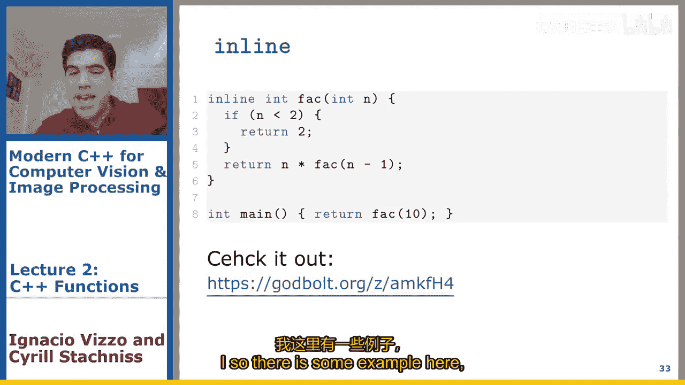
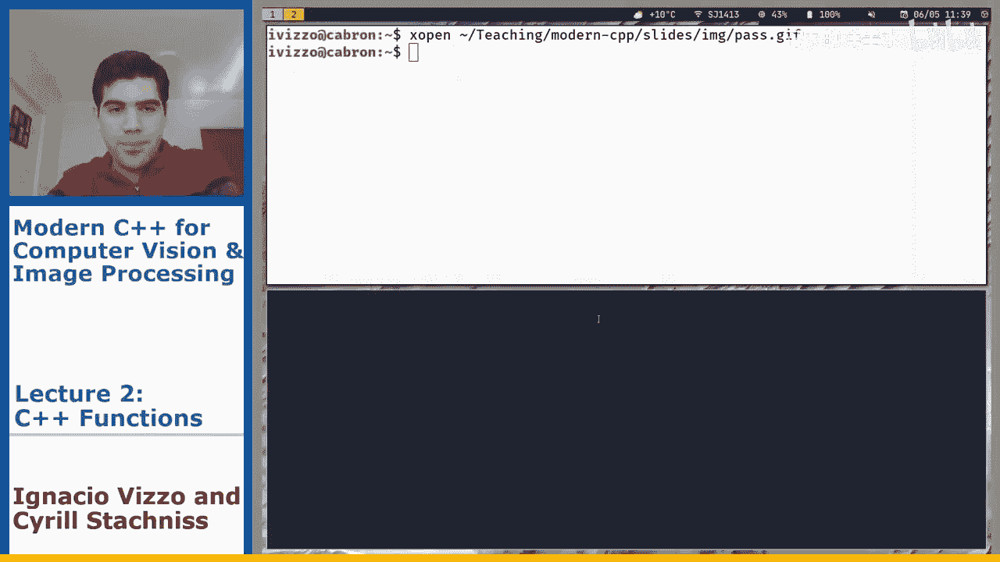
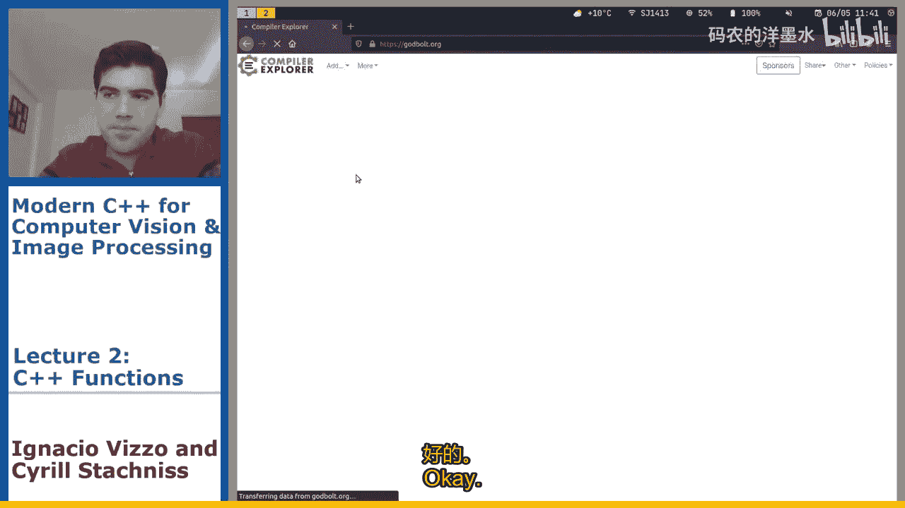
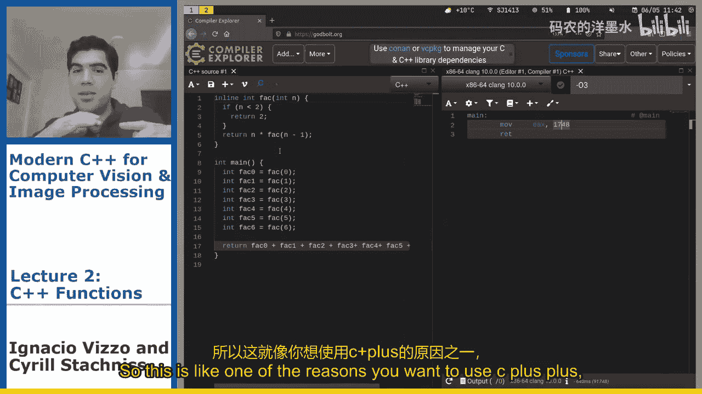
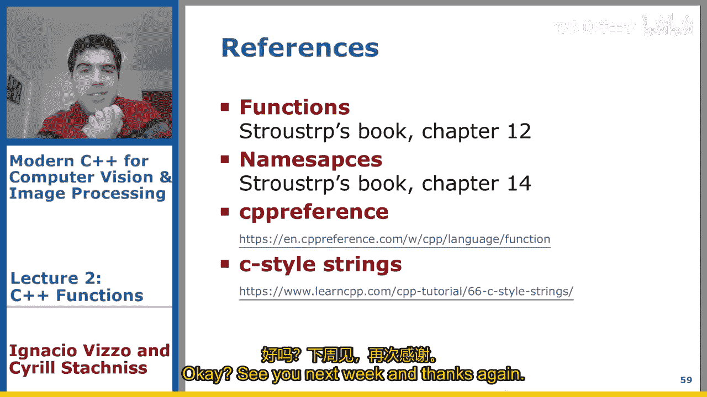

# 现代C++：04：函数

## 概述

在本节课中，我们将要学习C++中函数的核心概念。函数是组织代码、实现特定任务的基本单元。我们将从函数的基本语法开始，逐步深入到参数传递、返回值、作用域以及一些现代C++中关于函数的高级特性。通过学习，你将能够编写更安全、更高效、更易于维护的C++代码。

---

## 从C风格字符串操作说起

在深入函数之前，我们先看一个C风格字符串操作的例子，以理解为什么现代C++提倡使用`std::string`。

以下是C语言中复制字符串的一种方式：
```c
#include <cstring>
#include <iostream>

int main() {
    const char* source = "A string to copy";
    char destination[50];
    std::cout << source << ‘\n‘;
    std::strcpy(destination, source);
    std::cout << destination << ‘\n‘;
    return 0;
}
```
这段代码使用`strcpy`函数进行字符串复制，但它存在缓冲区溢出的风险，行为可能因编译器或优化级别不同而变得不可预测，非常不安全。

在C++中，我们可以使用`std::string`来安全地完成同样的操作：
```cpp
#include <string>
#include <iostream>

int main() {
    std::string source = "A string to copy";
    std::string destination = source; // 安全且易读的复制
    std::cout << source << ‘\n‘;
    std::cout << destination << ‘\n‘;
    return 0;
}
```
使用`std::string`不仅更安全，避免了手动管理内存的麻烦，而且代码也更清晰易读。在本课程中，请务必使用C++风格的字符串。

---

## 函数的基本概念

上一节我们看到了代码组织的必要性，本节中我们来看看实现代码复用的核心工具——函数。

在编程中，函数是一段具有名称的代码，用于执行特定任务。C++不区分函数（返回值）和过程（不返回值），即使不返回任何值，也统称为函数。

函数的主要作用包括：
*   **组织代码**：将复杂程序分解为逻辑清晰的模块。
*   **实现复用**：同一段代码可以在不同位置多次调用。
*   **创建作用域**：函数内部定义的变量有其生命周期和可见性范围。

一个函数声明必须包含其名称、返回类型（或`void`）以及参数列表。类型在C++中至关重要，它帮助编译器检查错误并生成高效代码。

---

## 函数解剖

了解了函数的基本概念后，我们来详细拆解一个函数的各个组成部分。

一个标准的C++函数声明格式如下：
```
[可选属性] 返回类型 函数名(参数列表) {
    // 函数体
}
```
*   **返回类型**：指定函数返回值的类型，例如`int`、`std::string`或`void`（表示不返回值）。
*   **函数名**：应清晰表明函数的功能。常见的命名风格是驼峰式（camelCase），例如`calculateSum`。
*   **参数列表**：定义了函数接收的输入变量及其类型，例如`(int a, double b)`。
*   **函数体**：由花括号 `{}` 包围，包含了实现函数功能的所有语句。花括号也**定义了一个新的作用域**。

**关键点**：
1.  函数内部（函数体）是一个独立的作用域。
2.  函数通过参数列表与外部世界交换信息。
3.  函数体内实现细节对外部是隐藏的。

---

## 返回值

函数通过返回值将结果传递到外部。关于返回值，有几个重要的规则和现代特性。

### 基本规则
*   如果函数声明的返回类型不是`void`（例如`int`），则**必须**在函数体中通过`return`语句返回一个该类型的值。
*   如果函数声明的返回类型是`void`，则**不能**使用`return`语句返回任何值（或只能使用`return;`提前结束函数）。
```cpp
int mustReturnValue() {
    return 42; // 正确：返回int
    // 如果没有return语句，编译错误
}

void mustNotReturnValue() {
    // 执行操作...
    return; // 正确：仅用于提前退出，不返回值
    // return 42; // 错误：void函数不能返回值
}
```

### 自动类型推导 (C++14)
对于复杂的返回类型，可以使用`auto`关键字让编译器自动推导返回类型，这能提升代码可读性。
```cpp
// 传统方式，类型冗长
std::map<std::string, std::vector<int>> getOldDictionary() {
    return {{"key", {1, 2, 3}}};
}

// 使用auto (C++14)
auto getDictionary() {
    return std::map<std::string, std::vector<int>>{{"key", {1, 2, 3}}};
}
```

### 返回多个值 (C++17)
传统上，C++函数只能返回一个值。但从C++17开始，可以使用结构化绑定（Structured Binding）方便地处理多个返回值，类似于Python中的元组解包。
```cpp
// 返回一个包含两个值的std::pair
auto getField() {
    std::string name = "answer";
    int value = 42;
    return std::pair{name, value}; // C++17可省略模板参数
}

int main() {
    auto [name, val] = getField(); // 结构化绑定
    std::cout << name << " is " << val << std::endl; // 输出：answer is 42
    return 0;
}
```

---

## 关键警告：不要返回局部变量的引用

这是一个至关重要且常见的错误。函数内局部变量的生命周期仅限于该函数的作用域。当函数执行完毕时，其局部变量会被销毁。

**绝对不要**返回一个指向局部变量的引用或指针。因为返回后，所引用的内存区域可能已被释放或重用，访问它会导致未定义行为（程序崩溃或输出垃圾值）。
```cpp
// 错误示例：返回局部变量的引用
int& multiplyByTen(int number) {
    int result = number * 10; // `result`是局部变量
    return result; // 危险！返回了即将被销毁的变量的引用
}

int main() {
    int& ref = multiplyByTen(10);
    std::cout << ref << std::endl; // 未定义行为！
    return 0;
}
```
未定义行为的表现可能很“诡异”：在调试模式或添加了某些打印语句时程序可能“看似”正常工作，但开启编译器优化或改变代码后就会出错。**永远不要依赖这种偶然的正确性**。

**如果需要返回大型对象，担心拷贝开销怎么办？** 编译器通常会进行返回值优化（RVO），避免不必要的拷贝。信任编译器，优先编写安全、清晰的代码。

---

## 局部变量与静态变量

在函数内部定义的变量称为局部变量。它们有以下特点：
*   **初始化时机**：在程序执行到其定义语句时才被初始化。
*   **独立性**：函数的每次调用都会创建一套全新的局部变量。
*   **生命周期**：局部变量在函数作用域结束时被销毁。

有时，我们需要一个在函数多次调用间保持其值的变量。这时可以使用`static`局部变量。
*   `static`变量在程序生命周期内只初始化一次（在第一次执行到其声明时）。
*   其生命周期贯穿整个程序运行期间，但作用域仍限制在函数内部。
```cpp
void counter() {
    static int count = 0; // 只初始化一次
    ++count;
    std::cout << "Called " << count << " times.\n";
}
int main() {
    counter(); // 输出：Called 1 times.
    counter(); // 输出：Called 2 times.
    return 0;
}
```
**谨慎使用`static`变量**。过度使用可能表明程序设计存在缺陷，并且可能引发难以调试的“静态初始化顺序问题”。

---

## 参数传递

参数是函数与外部交互的接口。C++提供了几种不同的参数传递方式。

### 传值 vs 传引用
*   **传值**：默认方式。函数获得参数的一个**副本**。修改形参不影响实参。
    ```cpp
    void byValue(int x) { x = 100; }
    int a = 10;
    byValue(a);
    // a 仍然是 10
    ```
*   **传引用**：在参数类型后加`&`。函数获得实参的一个**别名**，修改形参就是修改实参本身。
    ```cpp
    void byReference(int& x) { x = 100; }
    int a = 10;
    byReference(a);
    // a 现在是 100
    ```





### 常量引用：兼顾效率与安全
对于大型对象（如`std::string`、`std::vector`），传值会产生昂贵的拷贝开销。传引用是高效的替代方案。
但直接传引用存在风险：调用者无法确定函数是否会修改其数据。
解决方案是使用**常量引用** (`const T&`)：
*   **高效**：只传递引用，无拷贝开销。
*   **安全**：函数承诺不会修改传入的对象。尝试修改会导致编译错误。
```cpp
void processBigData(const std::string& hugeData) {
    // 可以读取 hugeData...
    // hugeData[0] = ‘A‘; // 错误！不能修改常量引用
    std::cout << hugeData.size();
}
```

### 默认参数
可以为函数参数指定默认值。调用时若省略该参数，则使用默认值。
```cpp
void greet(std::string name, std::string prefix = "Hello") {
    std::cout << prefix << ", " << name << "!\n";
}
greet("Alice"); // 输出：Hello, Alice!
greet("Bob", "Hi"); // 输出：Hi, Bob!
```
**慎用默认参数**。它们可能隐藏逻辑，使代码行为不清晰，尤其是在大型项目中，调试由默认参数引发的间接错误会非常困难。



---



## 内联函数

函数调用涉及一些额外开销（如跳转和栈帧操作）。对于非常短小的函数，这种开销可能得不偿失。

使用`inline`关键字可以**建议**编译器将函数调用处用函数体本身替换，从而消除调用开销。这称为内联展开。
```cpp
inline int square(int x) {
    return x * x;
}
int main() {
    int result = square(5); // 编译器可能会将此处替换为 `int result = 5 * 5;`
    return 0;
}
```
注意：
*   `inline`只是一个对编译器的**提示**，编译器有权忽略它。
*   是否内联最终由编译器根据函数复杂度、调用频率等因素决定。
*   内联适用于短小、频繁调用的函数（如简单的getter/setter）。

---

## 函数重载

C语言中，如果需要对不同类型进行相同操作，必须为每个类型编写不同名称的函数（如`cosf`, `cos`, `cosl`）。

C++提供了**函数重载**功能：允许在同一作用域内定义多个同名函数，只要它们的**参数列表**（参数类型、数量或顺序）不同即可。编译器会根据调用时提供的实参来选择最匹配的函数版本。
```cpp
// 重载的 cosine 函数
float cos(float x) { /* 实现 */ }
double cos(double x) { /* 实现 */ }
long double cos(long double x) { /* 实现 */ }

int main() {
    float f;
    double d;
    auto a = cos(f); // 调用 float 版本
    auto b = cos(d); // 调用 double 版本
    return 0;
}
```
函数重载提高了代码的可读性和一致性。在后续课程中，我们还将看到如何使用模板（泛型编程）进一步简化这类代码。

---

## 良好的函数编写实践

编写优秀的函数是写出高质量代码的关键。以下是一些核心准则：

1.  **单一职责**：一个函数只做好一件事。如果函数名需要用“和”来连接（如`createAndPrint`），就该考虑拆分它。
2.  **简短精炼**：函数体不宜过长。一个经验法则是，函数代码最好能在一屏内完整显示。
3.  **意图清晰的命名**：函数名应直接反映其功能。好的名字胜过一堆注释。`calculateAverage` 比 `doStuff` 好得多。
4.  **避免不必要的注释**：代码本身应该清晰表达意图。注释应解释“为什么这么做”，而不是重复“做了什么”。
5.  **谨慎控制副作用**：函数应通过参数和返回值与外界通信，避免修改全局变量等隐蔽的副作用。
6.  **使用C++特性，避免C风格**：优先使用`std::string`、`std::vector`等，避免C风格的字符串、数组和宏。

**好函数的例子**：
```cpp
std::vector<int> createVectorOfZeros(std::size_t size) {
    std::vector<int> result(size, 0);
    return result;
}
// 名字清晰，功能单一，返回值明确。
```

**坏函数的例子**：
```cpp
int foo(int a, int b) {
    static int c = 0;
    if (b) {
        for (int i=0; i<a; ++i) c+=i;
        std::cout << "debug: " << c;
        callYourAunt(); // ！？
    }
    return c * b;
}
// 名字无意义，功能混杂，有隐藏的副作用和奇怪的操作。
```

---

## 命名空间简介

最后，我们简要介绍命名空间，它是管理代码名称、避免冲突的重要工具。

**命名空间**用于将代码封装在逻辑分组内，防止不同库中的同名标识符（如函数、类）发生冲突。
```cpp
namespace my_lib {
    class vector { /* 我的vector实现 */ };
}

namespace std {
    // 标准库的vector
    template<typename T> class vector { /* ... */ };
}

int main() {
    my_lib::vector v1; // 使用我自己的vector
    std::vector<int> v2; // 使用标准库的vector
    return 0;
}
```

**重要建议**：
*   **避免 `using namespace std;`**：特别是在头文件中。这会将该命名空间的所有名称引入当前作用域，极易引发名称冲突，且污染全局命名空间。
*   **推荐使用限定名或特定引入**：
    ```cpp
    // 方式一：始终使用限定名（最安全）
    std::cout << "Hello" << std::endl;

    // 方式二：只引入需要的名称
    using std::cout;
    using std::endl;
    cout << "Hello" << endl;
    ```
*   **匿名命名空间**：用于使文件内的标识符具有内部链接性（仅在本文件内可见），替代C风格的`static`。
    ```cpp
    namespace { // 匿名命名空间
        const int MAX_SIZE = 100;
        void helper() { /* 只在本文件内可用 */ }
    }
    ```

---

## 总结



本节课中我们一起深入学习了C++函数。
我们从为什么应该使用C++的`std::string`而不是C风格字符串开始，强调了安全性和现代性。
然后，我们系统地剖析了函数的组成部分：返回类型、函数名、参数列表和函数体，并重点讲解了返回值的规则、自动类型推导以及C++17的多返回值特性。
我们严肃地讨论了**不要返回局部变量引用**这一关键陷阱。
接着，我们探讨了参数传递的几种方式（传值、传引用、常量引用），并指出了默认参数需要慎用。
我们还介绍了用于性能优化的`inline`函数、提升代码表达力的函数重载。
最后，我们总结了编写良好函数的实践准则，并简要介绍了用于组织代码、避免名称冲突的命名空间。
掌握这些知识，是编写出清晰、高效、健壮的C++程序的基础。请务必通过练习来巩固理解。