# 【全集】波恩大学 现代C++ CS414 中英字幕 p05 Lecture 4 - STL库 -BV1EYm1B5E2D_p5-

So welcome everyone， welcome back， so on today's lecture we are going to see more about some tools we have on the C++ SDL library。

So whenever you see SDL， so this means the standard template library。 So that's basically the name。

And it's one of the core components of the C++ language。

 So this is a library that has been maintained forever since the beginning of the C++ language。

And we are going to see today how we can take advantage of it， right？So in previous lecture。

 we saw how to write our own functions。 and then from this lecture on， we are going to see。How to。

And。Use functions that are written in the SDL library as well as the containers。

 So I guess that on today's lecture we are going to see like more than half of the slides are with code So that was the idea。

 So this is lecture number four， but it the and。The fifth lesson on the course and we have 10 so we are right in the middle of the course。

 so thank you everyone for joining the course so far and I hope you're more or less enjoying C++。

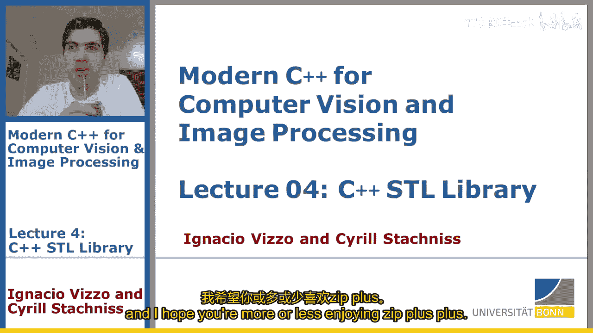

Okay， let's start， so the first thing we're going to see is Crus glass containers。

Basically what is a container is what you see on the screen is something where you can put data。

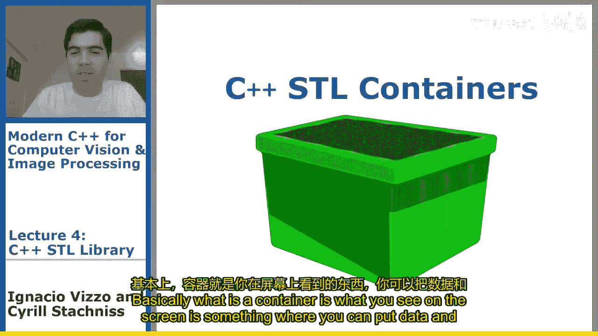

And as usual， so this is something that I guess that I say on all lectures。

The Cus plus world is usually divided into， so we have the static world and the dynamic world。

So whatever is' static， this means that it should happen at compile time。

 so before you run your program， this should be already solve by you or the compiler。

 usually the compiler。And dynamic， whatever is dynamic means that it's something that will happen when your program is running。

As well， we have study containers and dynamic containers。

 this basically a study container is a container that is this。

 so its size is defined at compile time and cannot be changed。Across the。

execution of the program and dynamic means that you can increase the size of this container。

 So the first victim of the day is gonna be STD array。 So this is basically an array of data。

 And there is a really， really small example here。 I will just highlight some details。😊。

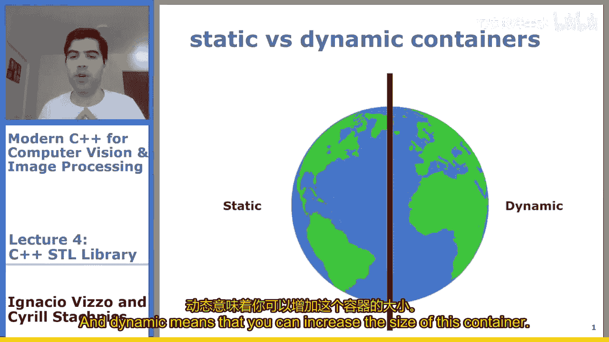

So， first of all， so。In order to use array， we need to include the array header file。

And this is how we declare an array that is called data， right？So we will need to pass two arguments。

 template arguments， so we will see how to work more with this on the last lesson on this course。

But basically， the first one is going to be the type of array and it's unique so you cannot like have bananas in here and floating points or bananas or floating points。

And then the second important thing is the size of the array。 So this is a number。

 and it should be defined at compile time。 So this means that you cannot， for example。

 ask the user for input and then define the array according to this input because this is something that will be happening at runtime。

 So at compile time， you need to say this array is of size three。Good， then in this case。

 we are just printing and the elements of the array that is 10 and1000。

 and then we're going to use some member functions of the array。

And this is something that you will start seeing and using from now on。And these functions。

 so there's just two examples， one is empty that this will give you a boium。

And then this will tell you if the array empty or not。

 and then the size member function will give you the size of the array， right。

 So this is actually easy to use and hard to misuse。So it's a re for arrays。

 so you need to include this color file in order to use it。

Then you will store a collection of items of always the same type。 So remember don't miss the type。

 I mean， you will get compilation errors， so it's not really unsafe so you will not be able to do it。

And then this is how you create an array from data and how you work with the where bracket operator。

 So this is any other primary languages， the indexing start with0， so please。Mdla friends。

 remember that on real programming languages， we always start in this is pro 0。

 So I see a lot of errors on homeworks， usually and the projects。

 because people are used to start with one。 So keep this in mind is always like this。

 except for madla。There are some member functions like how to query the size of the array and some useful addressess。

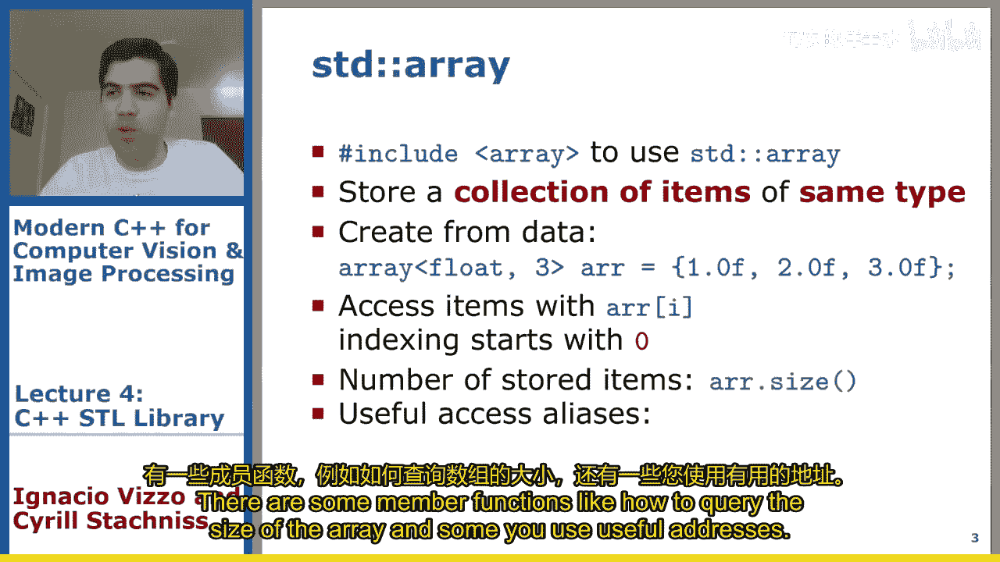

So that's the static container by default fault， but then what happen if you don't know at compile time and the size of your container。

 so then you will be using SD vector So vector is basically the same as an array。

 but the difference is that you don't need to know the size of the container at compile time So in this case when you declare the vector。

 the only argument， the only template argument you need is the type of the container as well。

 this is unique。But then in this case， you will have a container of size 3。

 and then it's the same with the names container， but you can actually increase the size of the container。

 So one way of doing this of many out there。Is using in place back so on this names array you will in place a new name that is called Roberto and then that's basically how you create a new element。

 So this is something that you cannot do with arrays because array is fixed size a fixed size container so if you say it's three so you only have three elements in this case you say I have a names container and then you can put as many as you want actually as many as your memory allow you to do but let's pretend that it's infinite amount of memory。

So this is better。A analogously to use vector， you need to include the vector。Hadify。

 so this is implemented as a dynamic table and then the access store items。

 you can do it just in like in an array with a square bracket operator if you want to remove。

 for example， all the elements is called clear function。And then basically。

 you have two ways of adding new。AndElements to the container。

One is in place back that this is the preferred way of doing it。

 This is something that started to be on the  C plus 11 standard。 And if not。

 you can also use pushback。 that is historically the the most used one。

 But nowadays you should use in placeback instead of pushback， right and then。

The take a take home message use it。 So it's fast and flexible。

 And this should be your default container for any。

Sort of eye collections of items of the same type right So array。 So in our field。

 arrays are great whatever， but usually you will be handling and working with data that comes from a sensor。

 for example and usually you don't always know like the size of the data of whatever。

 So vector is most widely used on our community than array。 so。

Just use the vector whenever you need it。So there is only one drawback about vector。 and it that the。

The fact that the size is unknown and compile time， I mean。

 the implementation of vector needs to do some operations， even when you are using the vector。

 so there are some optimizations you can do in order to speed up your program。

So the vector is unknown， but then they will define so the C+ plus standard define a capacity。

And then the size is not always the same number as the capacity capacity。

 sorry so the capacity of the vector is basically how much items you can store。

 so this is basically the amount of memory you will reserve before using the vector So let's say you the color vector and then it's in it and then depending on the compiler in the implementation you can say okay I will just wrap 100 elements of memory just in case in this case the size will be0 but the capacity will be 10 right and when you start adding elements to this vector。

Then this capacity will increase our time。 this is time consuming， right？

So many pushback or inback operations force vector to change its capacity many times and this will slow down your program。

 so there is a function called Re that will ensure that the vector has enough memory to store end items。

So basically if you know that your vector will roughly 100 in elements。

 so we'll store 100 elements then before adding any element。

 just reserve the amount of memory you actually need and this way you avoid like reserving memory while your program is running。

AndThis parameter n can be approximate。 so if you don't know， but you say okay。

 roughly have 1000 elements， you can just reserve 1000 elements and then if the size increase。

 then the capacity will increase as well。 so it's not an array， so this can change at runtime。

And this is a very important optimization， so if you start benchmarking using reserve and not using reserve。

 you will see that your program like will speed up a lot。

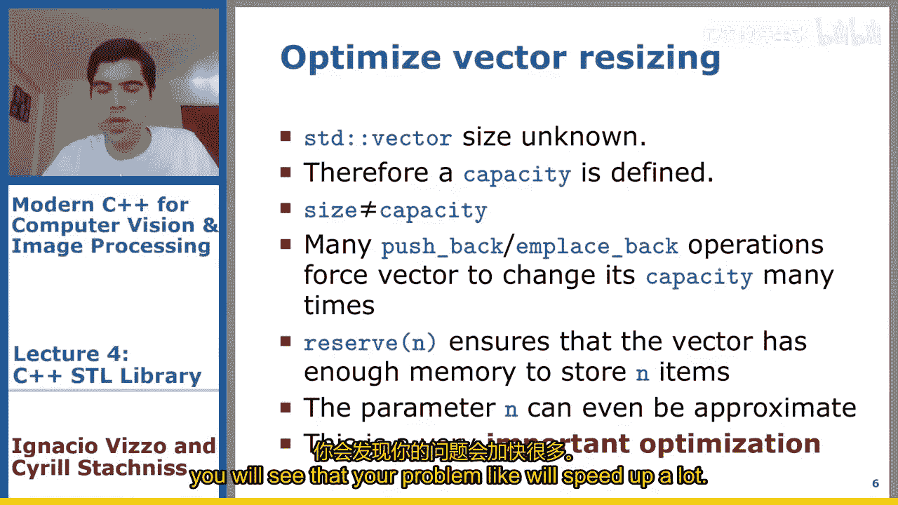

So here's an example on how to do this optimization。 So we have a vector。Lets go back。And then。

Let's highlight some features。So whenever you declare the vector so it's size0 and capacity0 and then in this case you're reserving 100 element so in this case the capacity will turn 100 and then you will em 100 elements on this vector whenever you reach this point so if you print the size and the capacity you will see that now the size is 100 because you added 100 elements but capacity is still 100 right？

And then let's pretend that we don't reserve memory。And then when you declare this element。

 so another vector， vector 2， the size is also0 and the capacity is 0。

 but then you execute the same loop and then when you inspect the element at the end。

 you will see that the size is 100 because again so this is 100 elements on both loops。

 but the capacity is bigger。And actually there is some point in time where you reserve more memory than the one you need here because you didn't tell how many elements you need on this vector。

 so at some point it will just start eating more memory just in case so this is an example of how you can optimize this。

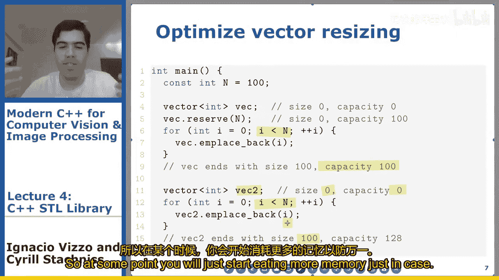

So this is something that I will start hopefully doing starting from now。

 So now we have like we are seeing more real C plus code， so I would try to search。

Examples on real world libraries from our community。And try to show you that people does use this。

 So in this case， oven 3D will be probably the most seeing one on these vectors because。

It's a library that is really well written in C++ so it's a really good place to go and find and search for really good C++ examples for any kind。

So in this case， we have a point cloud。 So there is a。

A type defining the open 3D geometry library and then inside this point level type。

 you will have like three vectors， the points， the normals and the colors right and each vector has an eigen vectorctor 3D that this is basically X Y and set coordinate So you have we will have a container containing like an element with X Y set points right and also the normals and the colors for each point。

 So this is how you can actually use vector in our field right。So there is a question。

 why is' better vector， Okay， so I will not read it loud， but I mean， we can say that it's the same。

 but the first one you wrote is better。Because in Dwin， you will basically do a copy operation， but。

I would say that this is not extremely important， but it's the same。ok。

So one of the questions you might ask now is like why using C++ container like C parameters would say I can do everything with arrays。

 for example， right？And you might be confused， Like， why do you really need these containers？

 So I know maybe you can write your own data types。Anyway， as usual。

 I would try to reply to this question that I ask myself with some small examples。

Remember that you're encouraged to go and try these examples so all the source code you're seeing it compiles maybe you're missing some include headers because I need to shrink the slice the slide sorry but you can try this on your place so basically we want to inspect the size of a container right and then remember that C+ plus is all about writing the intention of the program and then if I read this like this sentence over here it's not really clear I mean experience C parameters will detect automatically what is this about and actually if they really know see。

 they would define a macro and ugly macro to do this。That is size off with all capital letters。

 But anyway， you don't really see the intent of the problem here。

 You want to see the size of the container。And then you have size of data。

 and then you're divided this number by the size of the first element。

 So there is an explanation for that。 I will skip it。 but basically， this is how you will inspect。

And the size of the container on a seat like array。

But then on the C++ word we have a much better way of doing it that is just calling a member function that is called size that we saw it on previous example。

 basically it just call the container and then it just called the function for that specific container is called size and then the intent of the problem is completely clear I want to know the size of this container nothing else。

Moving forward， how we check if the element is is if a C array is empty。

 So there is no really standard way of checking it。So one thing you can do is like。

Comparing for example， if all the elements are like equals to null。

 so this means that there is no memory allocated in there for the array and then you kind of like know if it's empty or not。

 but again， this is not really clear the intention of the program。Again， it as best。

 you can just use。The empty function member function for any container。

 and then you will see so this will give you a boolean variable saying it is empty or not。

 so it's really easy to use hard to misuse。So how。How to access the last element。

 So actually theres a better way of doing this and see。

 but I skip it just to make it look even more ugly。

So we have an array right in C and then the size of this array is n。

 this n is defined somewhere in a huge spar and I forgot， right。诶。

Well in this case you actually see the elements but let's pretend that you don't see this declaration and then you say okay the last element of this array is three because I think it's three right and then you don't actually remember if this is three。

 this is two my hand you don't really know and actually if you do this will compile and it will run but the thing is there's no three third element here so you will access garbage on memory and this is a runtime error。

In C plus plus we can just call the back function that will give you access to the last element of the array。

 so in this case you don't really need to know how big is your container because you just call the back function and then it's really easy to read and you express the intention of the problem really clear。

So I want to access the last element of this container。 It's perfect a rate vector， you name it。

And then lastly， let's see how to clear and array and see。

So one way of doing this is calling the memberAT function that this is already a bit ugly because you're calling a third function。

 so it's not part of the array itself， and then if you read this， it's again。

 it's not really clear what you really want to do here unless youre experiencing it around。

But you're basically trying to clear this array。So if you print the right before and after。

 you will in not of first and then nothing。But the thing is that depending on some variables。

 let's say， if you try to do this with floating points array arrays， this might not work。

 so this is not even super safe。So in C++ what you will do is just call the clear function。

 so you have a container， you want to clear this container， then you call the clear function。

 it's really easy to use atom mis use and the intention of the problem is clear。And by the way。

 please don't do vector of cha unless it's really necessary。

 so if you want a string just use a string， so this is I use these characters just as an example。

 but again a string is sort of container and you can actually call clear size empty all these functions。

 right？

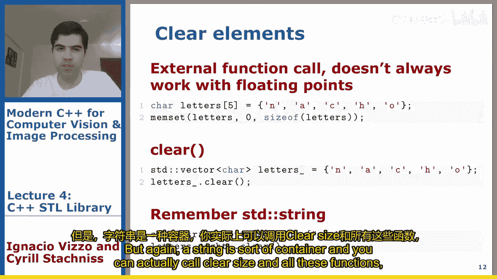

So。Answering your question that you didn't ask of why using C+ container， so why not， I mean。

 they're the same speed as C style arrays， but much more safe， right？

And improves a lot code readability and the usage。 So when you write C+ plus code with containers。

 it's going to be much easier for you than just using C。

And there's much more functionality deal in within the rate at a zero rate。

 so you can call it the size empty， the front， the back。

 you can swap elements and most important you can use STL algorithmism and much more。Anyway。

 so there's much more information。 You can actually check the CP reference documentation link on the description on the link。

And then you will see like how much you can do with these containers。Okay。

 so that was like all about arrays and vectors， take away， don't use C style arrays。

 so this is not allowed on your Home wordss or your final project unless you have a really really important reason that I doubt you will have and then if in doubt just use SDD vector instead of a array or any other thing。

Rightright， so these these were containers that contain the same type of data。

 There's another kind of container。 Actually are many of them， but we will see only two。

On the C+ plus SDL library that is called Asci containers。

The idea of this is that you will associate data within the container。 So one example is a map。

 So the map container is a short associated container。It contains key value pairs。

 so this means that for each key you must have a value。

The keys must be unique so you cannot like add two elements with the same key and the keys will be stored using the less operator because it will be sorted right so whenever you insert a new element on the map it will be sorted right away after you inserted。

So your keys should be comparable and this means that this list operator should be defined for your key type。

The victim types always work。 So if you pick integral float or character as your key。

 this will work by the fall without doing any other。Work。

And we will learn how to make your own times comparable probably two lectures。 So let's pretend that。

Inteeggr is not enough for your key， and then you need to define a new type。

 then you will need to provide this functionality and you will learn how to do it。

And then the value can be any type， so you name it it could be a pair of like integers and bananas。

 integers and string integers and ducks， so you name it it's whatever you want and this type of associate containers they're usually called dictionaries as well as impython。

 so this is the equivalent to a dictionary impython。

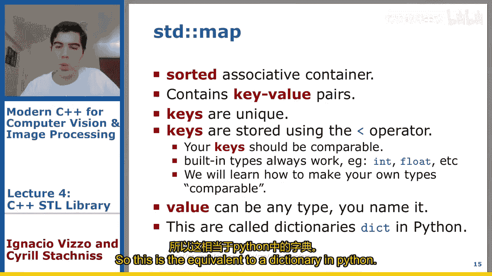

How you grade the container， so。You will need to specify not a container， like a map container。

You need to specify the key type。 So for example， integralte and then the value。

 So this is any type bananas floating points integralte， you name it and remember that key should be。

Sortable， so you should be able to compare if one key is bigger than another one。

 You can check the size of the container with the size function。

 so you will start seeing a lot of these same functions across all C plus container。

You can actually add a new item to the map using the in function。

You can modify an item just using this syntax， so this is the same syntax as Python， for example。

 and then many more。One thing that you can't still do is compare it with Python is like asking in a nice way if a key is contained in in the map so the way of doing this is like using the count function so you have a key for example5 and then you want to check if this is on your dictionary or your map and then you will need to call this function and compare if this is greater than zero。

 so this does not express the intent of the program really clear。

And then the C++ committee already fixed this， but this is on C++ 20 that's still quite new。

And then there's this new function called Cons。 So this is the same as。

When you impython say like if key in dictionary， in this case， you will say if M contains key。

 then blah， blah， bh， so this will express the the intention of the program better。

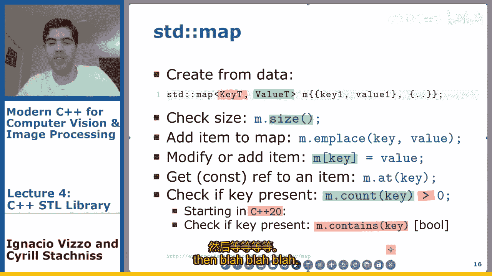

Simple， really simple example， we will go through it really fast。So。One thing you can like。

 I always recommend whenever using associative containers。

 So the type of these containers will be really ver。 So it will be like long types and。Ugly。

 so you can use the using。Statement to say， okay， I will use this student list type as ans alias to this map of。

呃In。And string。So remember， this is the key。And this is the， the value， right。

So I will grade this container。It's called CBB students。AndThen I will insert data on this container。

 So first I will insert like my I， for example， and then my name。

And then I will do the same for two other students， but the thing is map is a sort container。

 so whenever you reach this point on the program。This will be the order of your container。

 so nacho will be the first one that it will be0 and Marcelo will be two right so if you print this information you will see this order of the container because it's being order according to the key right so may keep this in mind so map is for order for getting an associate container with order。

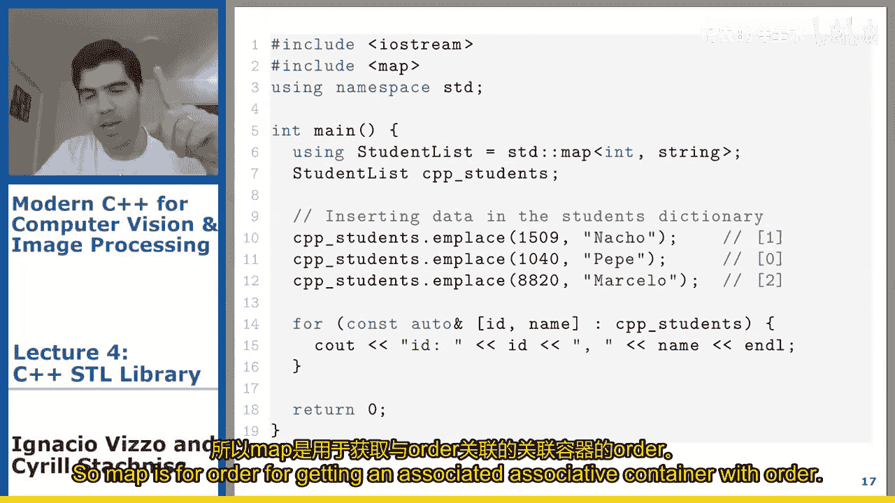

There's another like more popular associative container that is an ordered map。

 but as you might guess from the name is the same as map but the difference is that the key so you will not be sorting your map according to the key。

So it's the same as a map， the only difference is that the key type must be hashable。

 so you need to be able to extract a hash from the key。And then the typical usage is using。

With In or string a scheme， right， the interface is the same as map and it's faster to use than the map。

 And the reason of this is that whenever you insert a new element on a map。

Then you will need to sort your container。 Of course。

 this is really optimized on the C plus Sl library， but it's still unique need to do work。

 And with whenever you insert an order map。So keeping it simple。

 you're not doing anything more than inserting a new， so it's a bit faster。

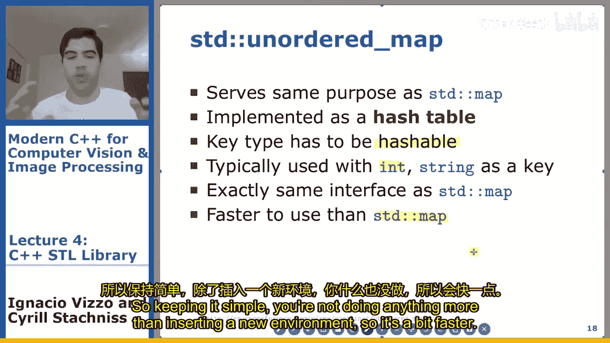

This is the same example。That we saw before， but the only difference is the type。So again。

Actually using this student list trick with the type alias。you don't need to change any of the code。

 So the only thing you change is this then so if using map you will be using another map。

And then if you replace this element， so this will be the first one。

 the second one and the third one， whenever you access this container。

 you will see that the order of accessing this particular example is going to be on this increasing order。

 so Marclo will be the first one， the pepe and then nu。So Sco， so same code。

 remember it's better if you try it on your computer。The only draw of this is that。Thisす。

E type that in these cases， we pick integralte must be hasable。 This means that you need， I mean。

 you should be。Able to provide a hash for this type。 So in this case。Whenever you insert this key。

 you will get a hash for this key and then you will actually insert it with this hash on the container。

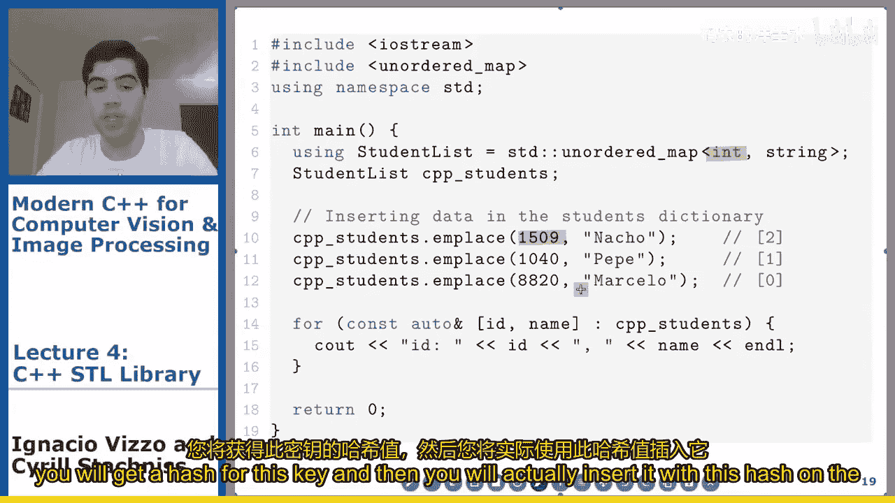

But then the good news is that most of the h types。Have already defined this hash function。

 so if you use any of these types as your key or the anored map。

 then you don't need to do any extra work， so integralte， short， long plot， double。

 whatever you can actually use it。As a key on an order map。The way of iterating over these maps。

 so this is something we saw on previous lecture as an spoiler。

 so usually you would like you would iterate over the container so this is a map for example。

 and then you would use a key value。Vuable and then in order to access the key。

 you need to access the first element of this value and in order to access the value。

 you need to access the second element of this value because that's the pair like the key is the first and the value of the second one。

There's nothing wrong with this， but it's， I mean， it's more code you need to write and then started on C plus 17。

 you can use this syntax and then just say okay for key value in dictionary， just use key and value。

 So this is。Be， much better to read， right。And then as a recap for maps。

Every store element is a pair， so it must always contain a key and a value。 The map has the key sort。

 and then the unor map that is the most common or most widely used has key in random order so you don't know the the real order of your map。

And again， as an example， again open 3D people。 So if you inspect the box cell read in implementation for open 3D。

 you will see that the box cells So in this case。So this is a boxelll read， so as' an example。This。

 for example， this cube right here is a boxer， a boxer grid is the same type of data does an image。

The difference is that it's in 3D。 so if you see the box， the box agreed from one perspective。

 you will see basically an image。So。For example， this is the。The zero coordinates for x。

 this is a 1 and then2， and this will be the zero coordinates for y， and this will be1 and then two。

 and then you have the set axis。So think this box grid as a 3D image sort of thing。

And then how they did it， how they defined the box cells。On the boxes of grid implementation。

 they use another map。 So you can see that it's not something that I am the only geek out there using it。

So。The， the key for this map will be。And a vector of three integraltes， so。

This will be the key for the map and this is basically the X Y set position of the box cell。

 then the value for each pair will be box cell， so this is another structure defineds somewhere else。

 but for now this red thing is one boxel and then if you compare with the previous example you see that there is something weird here and this is basically the function to provide a hash for this vector of three integrals。

If you were using like Integer or any other hashable type that is defined on the C++ library。

 then you don't need to provide this extra function。

 but in this case this vector of Xy set elements that are integers。

 there is no way of like there is no standard way defining on the SDL library of how to compute the hash for is so you need to write your own function and then you can actually go on the open 3D implementation and see how they did it。

So there is a question that can please repeat what do mean by Hashhelel。

I will give you the most simple example， you have an integer and then you will create a unique identification for this integer。

So actually hash itself is a huge topic in computer science。

 so if you go to the PV article you will probably find a better explanation。

 but for some reason let's pretend that you have one integralte and then or one type and then you want to get a unique access code for this element so。

That's the hash of the， of the element。So if you if you actually if you write a C++ program and then you call STD hash and then you provide the integralte。

 you will see a really long number that is a hash for that particular integral I hope that answers your question。

 but let's pretend that it's like a key for the element。In this case。

 for the vector of three integral elements， you need to provide a hash for each different element。

 so this is how you do and there's much more about containers like much more as usually recommendation。

Go to CPP reference。And then check all the containers so in this case you see a array vector where we only saw four containers and there are at least 20 of them on this SDL library。

 so make sure you check that out and then is there any other question about containers or we move forward。

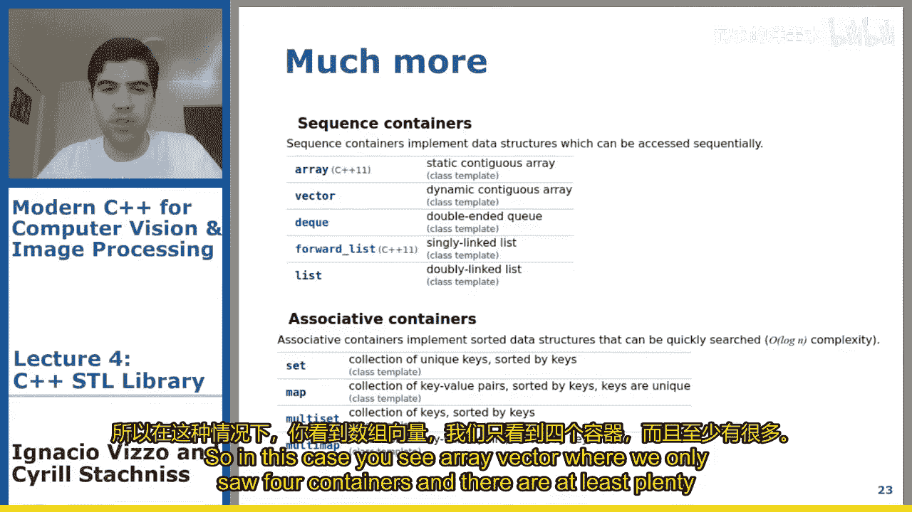

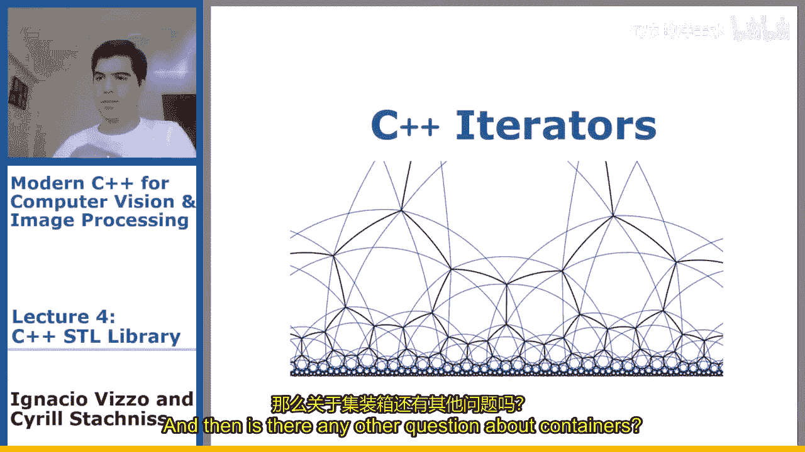

Okay， so let's。Quickly see C+ iterators。So， taken from the。

C+Book iterators are the glue that ties standard library algorithms to their data。

Iterators are the mechanism used to minimize an algorithms dependence on the data structure on which it operates。

 So this is one key concept。It's part of the what is also called generic programming and its have a really good way or mechanism。

To write generic functions or genetic algorithms， right， So let's pretend you want to sort。

Some sort of data。Then the best thing you can do actually is to write a sort function that works on any kind of data。

 not on vector of floats or vector of integral or array of string or whatever。

So the idea is that with these iterators， you will be able to write functions that are strictly independent from the data structure on which you will operate。

So by just inspecting the sort function。You will not be able to see， to know。

To which data this sort function has been applied， right？

We will see much more about or not much more。 we will see more about generics programming whenever we reach the template on C++。

But this is a way of doing generic stuff on C++ and it's using iterators。

 so this is a really key concept on C++。

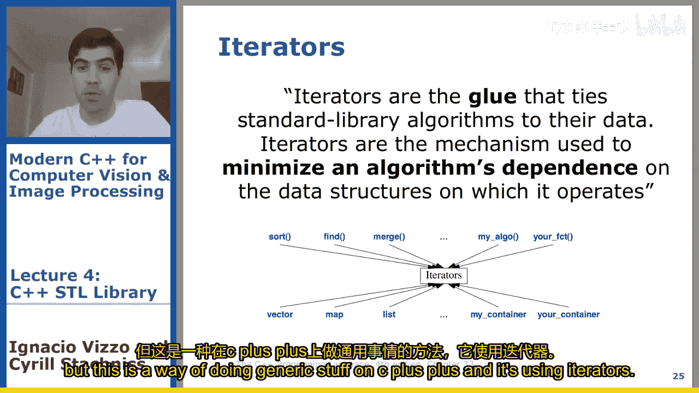

And then the STL library used iterators to access data and containers。

And then the directors are similar to pointers， we will discuss this soon。

 and this allow you to quickly navigate through your containers and most iors in STL use iterators instead of the data itself。

And it's actually there are some amount of its are defined for。All containers and SEL。

Once you have the curator for any container， you can access the element that you are pointing to this curator。

With the star break， you don't really need to know much about this right now。

But there's like a quick overview on the syntax。But it's basically the same syntax as a puner。

 and then you can move to the next element using the increment or decreement operators。

And then the guess that you should be using range follows as we saw on second lecture instead of using this。

 and you can actually compare it characters as it were any other thing。

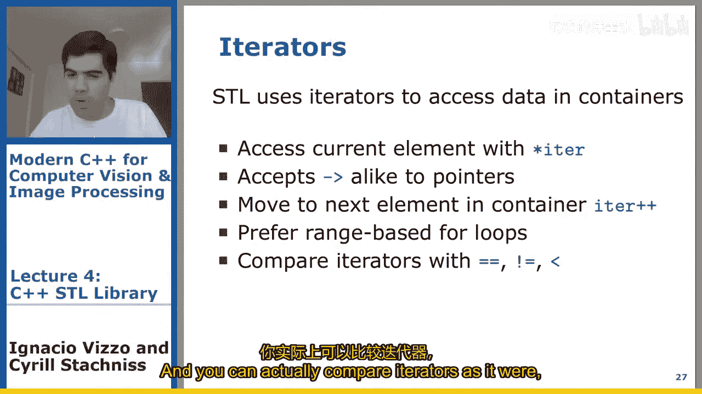

There is something that is called range access iterators， there is one type of iterators。

And these are the most common usage generators， at least for containers。

In C plus plus that are defined for all STL containers。 So if you're using any type of STL container。

 then you already have this trigger defined by default。 So for example， begins。

So this guy will give you an iterator， so whenever you call this function。

 you will return an iterator to the beginning of a container offer or array。Of course。

 this is I mean， the intention of this is expressed on the name of the factor Then theres also C begin that is basically constant iterator to the beginning of the container so you can access the container。

 but you cannot change its value。You can also access n and constant N。

 and then the R stands for reverse begin， and then constant R stands for constant reverse begin and so on。

 right。

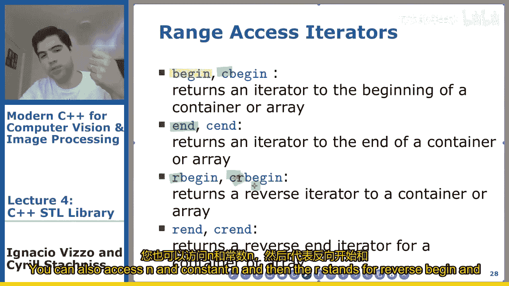

So these range access ins are defined in all these instructors， so array， list， map， set， span。

 string， another map， So the all those containers。have these range access ins and theres one example。

 I will just skip it for now because it might be complex for from the perspective of the syntax。

So we just skip it。So that all the information you need to know about it directorors。And now。

 if you're ready， we will go through some algorithms。

So let's actually go back to the first slide of iterators。So the key idea is that。

Theters will be the glue that ties the standardal layer algorithmthms that we are about to see。

To the data where they operate， right， So doesn't matter if we are using like a vector。So。

It's present then we are using a vectoror， and then we want to sort。

 So we want to call the sort function。 So we will not be calling a sort function。

With from a vector type， right， So we will not pass the vector to the sort function。 Instead。

 we will take an hour path that might be longer， but it's better in the long run， that is。

Instead of praying the vector， we will just provide the iterators and these iterators will be fed into the sort function。

And why we do this， it's because it's more generic。Because if you， if we avoid like。

If we don't do this， then we need to provide a sort implementation for vector。

And then so let's do it with arrows。 So if we don't， if we don't use iterators。

 we need to write a sort implementation for vector， one format。One from list。

 let's pretend in that I have my own container。One for this guy。We are using open 3D containers。

 one for this guy， and then you need to actually overload this source function for infinite amount of containers。

So， and then let's pretend that you also want to。For example， do a find。

 so you want to find an element on theerator。I'm sorry on the container， and then。

Instead of using iterators， you will do。One function for vector， one function for map， one， for this。

 and then and so on。 So you get the point， I guess。

So a much better idea is to use the iters as a sort of interface。Something like this。

 So this will be the interface between。Algoriths and the data， right， So here you have data。

 and here you have algorithms， right。And then you will write one unique sort function。

That will be operating with iterators like so with these iterators。

 you can access the elements of the container in a generic way。

 and then you will call this sort function， but instead of keeping the data to the function。

 you will pass the iterators to this data。 So you will say this is how you iterate over my data and then the algorithm itself will do its job without knowing which data it's using。

 So this way you write one sort function that works for all data containers that have the dataerators right so this is a key concept in。

😊，In C+ plus like how to do genetic stuff to make our life easier and there's also good reason of doing this。

 Once you improve the sort function， let's pretend that you make it 10 times faster than before。

 then you make all the calls for this function for vectoror map， please my container your container。

10 times faster or free without changing any line of code。

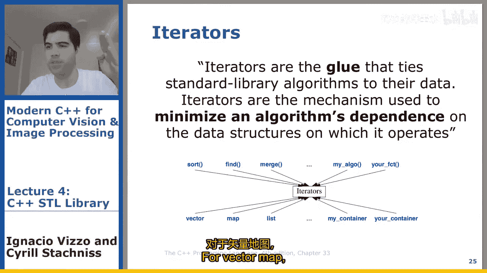

So this is a really key concept in C++。Again。So we have 15 minutes and then we will set a marathon on STL algorithms。

So I pick 15 algorithms and we will go as fast as possible over all of them。

So the SEL algorithms are about 80 or even more standard algorithms。

They are defined on the I library on the H file。It's part of the core C++ library。

 so it's not a third party library， so you already have this。

They operate on sequences of defined by a pair of iterators for inputs or single for outputs。

 depending on what you want to do。

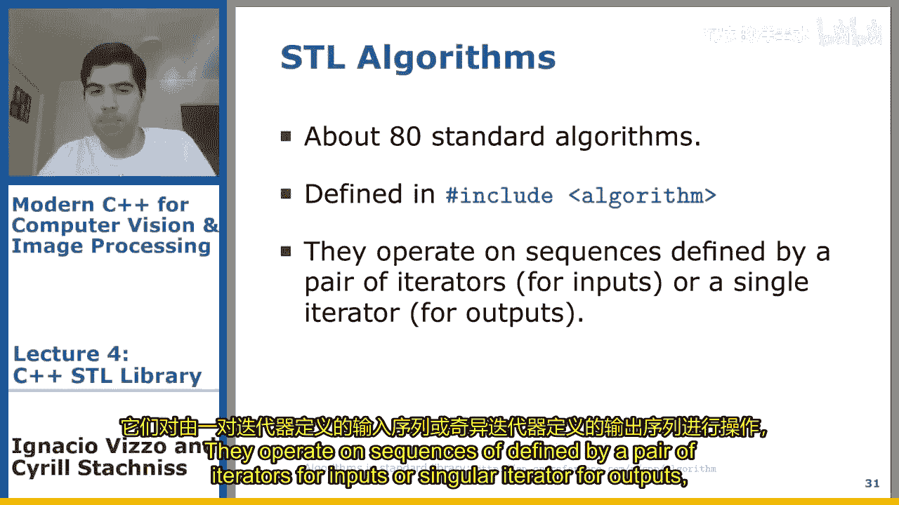

And then the key message is don't re the wheel。 So before writing your own sort function。

 just go and check on CVP reference if it's not there。So， it's very unlikely that。

Incredibly smart people from the C++ standard community and the C++ community is not smarter than you and then you will write a better sort function than these people。

 So basically in this case you need to trust these people and 40 years of C++ programming experience and say okay。

 I will use the sort function provided by C++。😊，Unless it doesn't work for you。

So when you're using any container like vector array or maps。

 please don't write your own algorithms unless I mean there is something that is not on standard library。

And let's pretend that you are not using STL containers for any given reason。

 then just provided implementations for the standard range access iterators of begin N and all these kinds。

You will give access to all。 You will have access to all these algorithmisms for free。

 So you don't need to rewrite sort。Function， even if you have your own data container like I know my container or whatever you name it。

 So if you provide iterators for accessing this container。

 then you rehab or read all this functionality。 So it's really important。

And there is a lot of functions in SD， which are at least as fast as handwritten one。

 So this is the selected ones， so。We go， we will go fast。 There are like100 of them。

 so I will not explain any like all of them and they're like really flexible。

 Maybe the syntax might be ugly on the very first shot。

 but it's because it's meant to be flexible for any data type first sort function really see we have a container。

That is this guy， we have some integral numbers， and then we want to sort this。

 how we do it calling STD sort on the including the algorithm library。This is the。Typical syntax。

 so you need to pass the first element of the container with an iterator and the last element of the iterator。

 and then you will sort your array。So if you inspect the output， so after sorting。

 you will have the sort function。Why why there is no such V as SD sort and just use S like sort this array。

Again。This might be more ugly or or much backward syntax， but is much more flexible。 So for example。

 instead doing the at the beginning and then end you can do the other way around and then you get the inverse sort right so this is why you we use this syntax Check this example at your computer number two fine。

So we have a vector， for example， with five elements and then。

We want to find if this element is on the vector， so we will call SDD fine and then we will provide the beginning of the container and then the end iter of the container and then the element we want to check。

And then this result will be actually an iterator。 So if this iterator is different from the N。

 so let's do it with different colors。 if this。This is basically the same as doing this this means that it contains the element because it search through all the elements and it find it like at this point and if it's equal to the end this means that it went over through all the data and it didn't find it。

Next feel。Let's pretend that you want to fill this vector with a -1， then just called SD fill again。

 the beginning of the container， no the type and the end。

 and then the number you want to put you want to use for fill you try it。

 you will hit this words is super fast。Count， for example， let's pretend that you want to count。

How many times the number three appears on this container？So。We have it once here and once here。

 so we is called STD count and then again the beginning of the deterator， the container。

 the end of the container and then the number we want to count in this case n1 is3 so three is two times and then5 if you search5 it's not here5 so whenever you count for5。

On the same container， you will get0， right。그一요。As you see。

 like most of these examples are really easy， I you can try all these examples at your home。

There is some weird thing right now I will show you。

I tried to avoid the usage of Lada expressions on this that this is actually how you would do it and how you must do it。

But you to keep stuff more simple for you。 Its just the Tom hugs on the。On the go。So count if。

 let's say， okay， I want to count。All the elements that are divisible by three。

So I provide a small utility function that will give me a volume variable。

And will tell me if this number， I is divided the bicycle by3。And then， I want to count if。

These like how many items on this array are divisable by three。In this case。

 so how many we have we have one that is3，2，3 and 4， that is 9。

 So all these elements you can divide by3。 So the output should be divisible by3。 it's4， right。

So you can see that there is a pattern， so most of this stuff if you actually need to do it handwritten。

 you will write for loops and there is a much better way of doing this that is calling this standard eye So instead instead of doing a full loop over all the items and say if this item and is the three。

 then add a new element incrementalement account， you just call this standard function。And that's it。

So there is a question that instead of begin and end it's possible to only check a subset of the array and the container。

 that's actually a great question I'm glad you asked depends on the algorithm so。

I will show you now like how I check for algorithm items。

And then you would some algorithms provides like a way of using a subset of the array， but yeah。

 this is possible， of course。For each， I lost the count on the examples。

So there's a small Lada expression here， so this is basically a function， so don't worry。

It will print。Wherever you provide to it。 And then let's say that we want to print all the numbers on this array。

 And instead of doing a full loop， we want to do a for each， right， This is an algorithm。 Again。

 we provide the beginning of the。Container the end of the trailer and what we want to do。

 This is also called the predicate， right， So this is the function we want to do over all these elements。

 and then you will get the output。All the elements on the array without writing any forward loop super fast。

All of more examples。So。In this case， we will have a vector with 10 elements that has two。

 so if you print this vector you have 2222222。And then this case， will populate， repopulate。

This vector with partial sound。 So go and check it out the thing， but basically here。Doing a sum。

 So if you after this partial sum， you have the print and then you will see。

How you start adding the elements in increasing order。And this is the the numbers we want to check。

 And then we will be using this of algorithm again， the beginning， the beginning。

In the end and then they predicate in this case， it's the even function that will tell me with a Boolean variable if the number is even or not in this case。

 if all are even then well print all numbers are even so among all these numbers。

 all numbers are even。There is no one single for who this is super fast and besides the syntax of if you're not used to see syntax with iters。

 the intent of the code is really clear。 I want to check if all the numbers are even。

 This is super fast。 We only need to write for loops。 It's super good use it。Rotate， for example。

 Let's。 So this is a shipped rotate operation。 So we have this element。And then， for example。

 we want to rotate this array。So let's use arrows in this case， so these。

This element right here will be the second element from the beginning of the container。

 so you can use this syntax with iterators。So， this is basically。

Pointing to this right place in here。 And then you will rotate shift from this point。

 So if you see this。The output after the rotation， it will start from3，4，5 bla and then one， two。

 and then if you try this at your place， you will see that the results are correct。

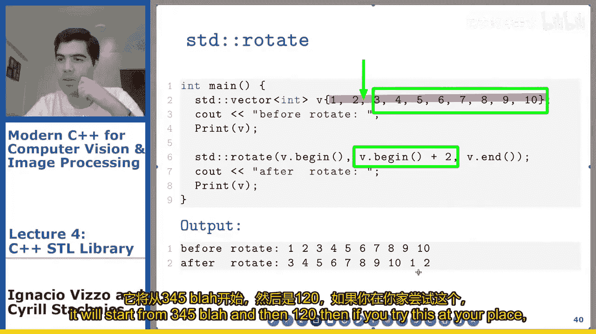

I'm going super fast because the idea is to give you a quick overview on what you can do and not to really explain like how this is implemented and blah。

 blah， blah。In this case， we have a transform algorithm to convert any string to an upper case。

So the syntax in this case is a bit more complicated， but again。The beginning and the end of the。

Of the input array。And then we will create a second array。 that will be the output  one。

And then we only need the beginning of this array that is going to be populated with output and then the predicate for calling this transform function on each of these element hello is uppercase。

 that is a function that would basically return the uppercase letter for this character and then if you try this it will convert hello from hello and capital letters。

So again， no four loops easy to use hard to misuse。I估木累。Again， let's pretend that we want to some。

All over these elements， how you will do it， how I will do it。

 I will write a follow loop and do for all elements in vector then sum plus equal to bla bh la。

 just use Ac。Just keep the beginning of the I'm tired of saying this。

 but I will keep doing it the end of the container。 and then this is basically the offset。

 and then if you sum1 plus2 plus blah， blah， blah， you will get 55。😊。

Let's pretend that you actually want to use。You want to calculate the product of all the elements。

 then you do the same this is the predicate so STD multiplies and then with one， if you do with two。

 you will get one times2 times2 times two times three times two just try it on your home and you will get the product of all the elements in the right really easily。

Maximum， there is nothing to explain about this， just calculate the maximum between two members。

Minimum element。 So with this， you will get the minimum access to the minimum location of the element。

Minimum mean max element。 So you will get a pair of the minimum element and the maximum element。

 There are many of them there is minimum maximum minimum element max element。

 Just go and check it out on the CBP reference。😊，Clamp， this is something new on C plus 17。

 and in my case， its a function that I always tend to write for any given reason。

 especially if you are writing like P A V loops and then you want to do wind up operations。

 You always end up doing a clamp function。 and it's usually wrong。 It's two lines of code。

 but it's much better to use the one product in the C plus system。😊，So in this case。

 you will clamp the value between two minimum and maximum valuables。

So it's going to be between 0 and1。 And then if if you， for example。Sorry。Where it is with O5。

 then this is between the range it's going to be fine。

 This exceeds the range a match so it's going to be truncated to one and then you see it here this stays the same and then this will be truncated to0 and then you see it here so use this algorithms and lastly sample this is something that you might use on or field that will do a lot of probabilistic stuff so let's quickly see this so you have a string。

AndThat is simple plus plus it's cool。 I I'm hoping to convince you。

 And then you have another thing that will be out。 and then you will create a random device using this random device。

 So it's defined on the random library。😊，And then we want to randomly pick five letters from this string。

 Then we will sample。Again， the beginning， the end of the string that is called in that is C+ plus school and then you need to use these syntax。

 don't worry about it， but it's basically you're giving access to the back of the out variable that is a string and then how many samples you want and then the random device and then if you see this particular example it's probably different from the slides you have because it's completely random。

So in this case， the five characters that pick is C plus plus and C。

So see it from cool and the elk as well。So probably you have different output on your slide。Okay。

 so keep in mind， use STV algorithms。I hope I convince you that it's much better to use this type of generic programming techniques than just writing your your own functions。

 much more information on the C plus book。 and also let's click。

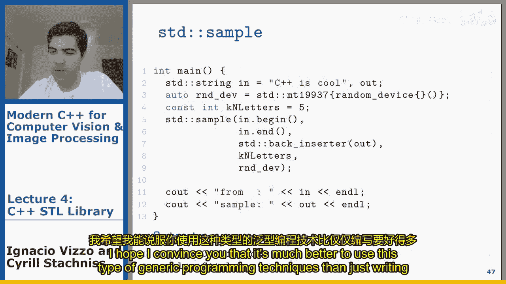

Quickly， here。嗯。Let's see， for example， a lot of information。If you go to the CB reference。

 so here you have a list of all the available algorithms， for example， we saw transform。

 I think this is the uppercase example。And then the syntax is quite ugly。 so I'm sorry。

But actually if you try to read this whenever we see templates it's going to be easier for you to read。

 but it's not that hard， so dont don't worry if you don't understand it right away but this are all the function prototypes for the transform function so if we do transform you will see that there are many types of calling this and this is the explanation on the。

Onで。Sorry on the arguments and usually you have an example here that might be the same as I use or different on the slides。

And one， one， for example， let's pretend that you only want to do upper case of the first two letters that I think this is also。

Part of the question。 So if the I audit doesn't provide you。With some sort of mechanism。

 one way of doing this is calling begin and then， for example， begin plus2 instead of the n。

 and this is also one of the reasons。You want to use。

Iterators because well give you a lot of freedom on how to operate with your data if you want from the beginning to the end from the middle。

 so you lose all this capability whenever you just call sort and then you pass an array or in a container because then you are。

The only thing you can do is just sort this array， but maybe you just want to sort the first 10 elements so you will use begin and then begin plus10 I think this is a better answer for your question the last question。

Okay， that's it for now。

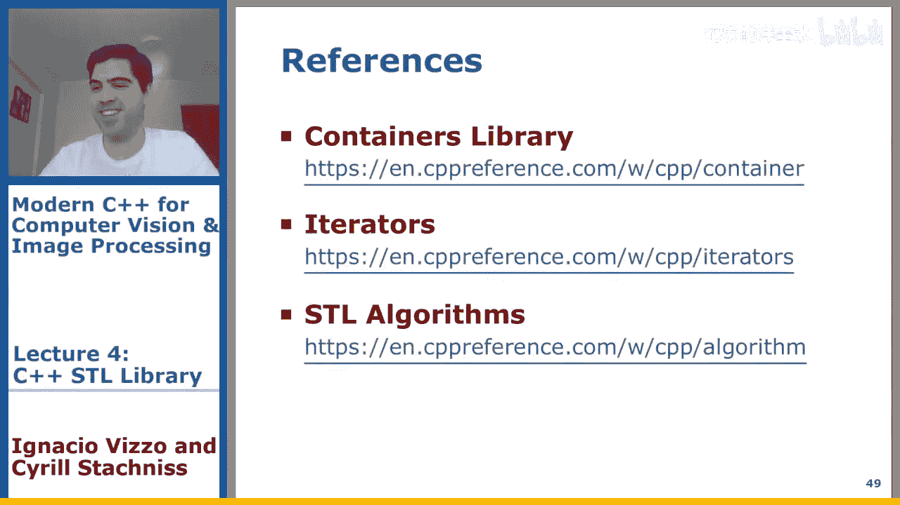