# 【全集】波恩大学 现代C++ CS414 中英字幕 p06 Lecture 5 - IO文件 -BV1EYm1B5E2D_p6-

So I was saying that I wanted to remind you a bit about the schedule。

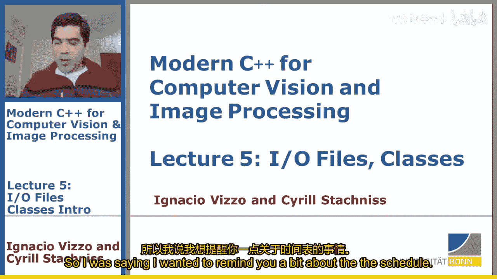

嗯。So basically we are on the midpoint of the course。

 so today's lecture is going to be probably the last lecture on like C++ core language。

 so there is nothing there is no such thing so that's the name I came up with the idea of these names is to split up the course in two parts。

And actually I was trained， I was postponing all the object oriented programming techniques and classes and so on for the second part。

 because of many reasons， one of the reasons is to try to convince you that C++ is much more than see with classes。

Because if I start C+ plus just talking about classes then probably you might have this feeding。

 So for now we have seen a lot of tools， a lot of functionality today where we're going to see the last part I care that you learn。

 and there is no object oriented programming involved so far。 So the idea of this is that you。

You get to know the core basics of the language that are not related with classes itself。

And study from this lesson and so on， we're probably going to move a bit faster。

So as a narrow reminder， so on previous editions of this particular course。

 the whole lectures and ended by 29th of May so if you want to compare again like all editions so you should be comparing against the fact that all these lessons where end up we're ending in the fourth week of the semester so I'm trying to speed up the concepts so you also have more time to learn to learn chunk by chunk。

As a reminder， also， so if you haven't， it's a really good idea to catch up with your homeworks。

So homework4 is already out and during this week I will release homework number five。And also。

 Home number 5 as Home number 3 is related to the final project。

 So the best you can do on these Homers is it's going to be better for you because if you remember。

 you only have like four weeks。 So this is one month for the final project。And it's going， I mean。

 it's going to be painful if you wait for the last minute to do it。SoThe idea is that you go。

 you start doing steps for your project。During the semester， right， Okay。

 so today's lecture is going to be half of the lecture。

 about like some more functionality of C plus plus itself。 but I'm not not going to go really deep。

 And then we will see an interaction on classes。 and then you have some homework to do after this lesson。

 Okay， let's get started。 So utilities。 So this is something that usually not all developers of C plus are super aware of。

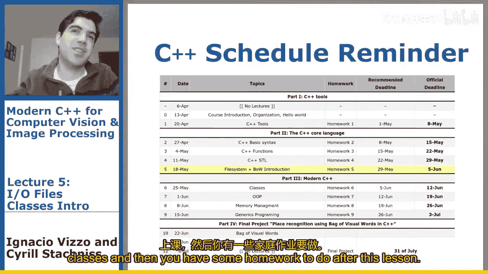

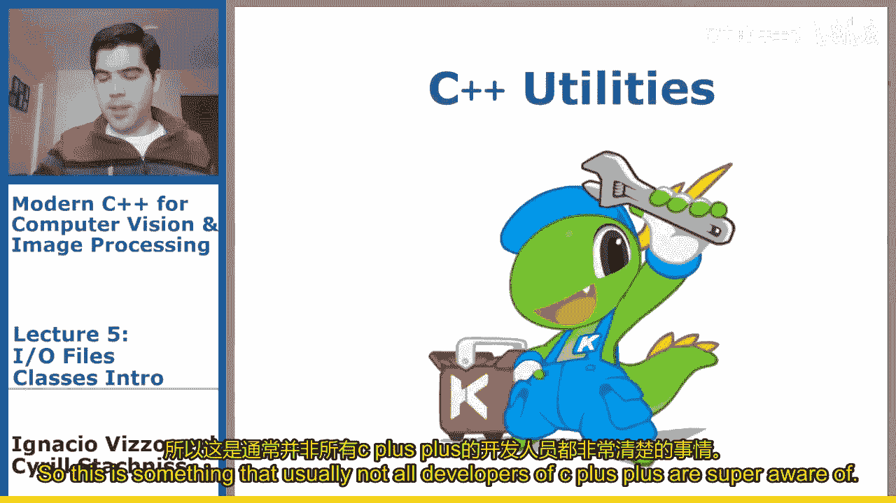

So the C++ standard comes with an utility libraries that includes a variety of libraries that provide functionality ranging from bit counting to partial function application。

 so this means you can do a lot of stuff and these libraries can be broadly divided into two groups so the language support library and the general purpose library so the language support library is basically so the set of libraries that interact closely with the language。

So these will provide classes and functions that interact closely with all the features of the language like the types。

 for example there is a type super library as an example， there is size tea。

There's also a dynamic memory management library。And we will discuss about this on on when we see memory management。

 but ShaPoer， unique pointer is all part of this dynamic memory management library。

There's also error handling。There's initial list， so for example。

 whenever you do vector and then you do cali races， you're basically using this。

Pction from the library and much more， right？Theres also some general purpose utilities。

 and this means basically the。These are utilities that will add a layer of functionality on top of the language。

 so it's not intrinsically related to the language。A board might be one example， so for example。

 date and time is a great example of utility libraries so。The timing is not part of the language。

 but there is a libraries for doing this， so you need to go and search forterpart libraries。

There is also starting from C++ 17 optional variant and any we will see some examples of these utilities。

 and there's also pairs and apples， so we have seen topples a lot because I think they are right and also they provide similar functionality as spython related code。

So if you go to previous lecture and then you search for the table。

 you will see some examples of this particular Giili。

 and theres also one example on homework number three， I guess。On how to use this double。

 there is also swap forward and move。 So whenever we see move semantics。

 this is probably in two or three lectures， we will be using these utilities。Also hash。

 So we discussed about hash on previous lecture。 It's also part of this library。

 and then there will be a formatting library that is basically FMT。

 but this is coming in the next release of the standard。

 So basically there are a lot of tools you might want to use。嗯ん。That already come with the language。

 so if you have already a compile installed that to port C plus 17 for example。

 then you have all these utilities for free。So swap is the easiest example。

 so basically you have two variables A and B， you can swap these variables so no need to write a swap function。

 So if you ever want to do swap just go and use this usually to use these utilities you need to include the utility library so include utility and that's all。

そです。New crazy examples， so we will just discuss briefly how to work with these utilities。

And also my recommendation is whenever you feel like you have the need to to do some utility or use some utility。

 So go and check it up on CPP reference on the library。

 Maybe there is already something for you there。 So in this case， this is variant。

 So this is new on C plus 17。And then basically， a variant is。

Something that can be anything like between integral and float。

 So I create an object of this variant and then B B1 actually can be an integral or a float。

 but not the both。And then for example， whenever I do this。

 so basically I'm assigning an integral value to this variant。

 so basically I'm saying this variant is going to be of integral type and in order to access this element。

 then I will be using another utility function that is called STD get。

And then I will ask for the integral part of the variant， and then I can access this element。

Of course， if I want to access the plot part of this variant， I will get an error。

But there is an easy way to catch this error， so there is also examples from the CBP reference。

And then for example， I have another variant that is going to be of type float。And in this case。

 I will initialize this variable with this number。 And then I can also get the the floating part of the。

Of the variant using the this syntax1 because basically the0 part is the integral part and the one part is a float。

 I can also put float there。诶。And there is also， so these three examples。

 these three lines here has the same meaning。So let's use this。 So basically this all is the same。

 so I can do B2 and then copy the the integral value of B1 or the serial value or just B1。

 because it's now we are talking about an integralte。

And I can also access the integer like of B2 like this。 And then if you try to run this example。

 this is the output of the program。So that's basically a bar。

 It will depend up to you like where and how you should use it， but just a it's just an example of。

What are the utilities of the C+ language So usually maybe you want to create a new type and then inside this type you want to have an integer and a float and then you will have some Boolean variables to use any of these types。

 but maybe using just a variant is a better example。

 So this is something that Python parameters will like。

So whenever you get used to the type safety of C++ like me。

 you have really hard times trying to use Python because you never know the types。

That basicallyically any is basically any type。So in this case。

 there will be some syntax involved as usual， so it's never as simple as a Python syntax。

But if you have an any type it can be any type， and in this case， whenever you do one。

 you will have an in inside this type。Of course， you can， for example， C out and then a。

Because A itself is just。A class of type any。 So it's an object of the any class。

 So you need to cast it to integralte。 And that's why there is this function called any class。

 So the synt is not super good， but。At least there is something。

 then you can put a bubble without doing any further step。

 and then you can access this bubble with the same cast function。

 and then you can use Boolean or any type you want。 So basically any and hold an object of any type。

 That's quite the name， right。Option option is something also cool， so this is usually。

Something we can solve using like E finals， but optional， it's an optional value， right？

So on this particular case， we have a string factory function that this is a function I'm talking about。

 And then depending on on an input parameter， like it's create。I can return a string or nothing。

 so basically the view of this is to return an empty object if there is。For example。

 if the grid variable is false。And this save me one ifs statement， for example。

 if I want to create this more in plus is awesome， I just call the this function。

 and then I shall say true and then how to how I access the value of the optional value I just calling value。

And also for example， so this is a trivial example， but you can work like bare examples。

I can also do something like this like value or this basically means give me the value of the optional。

 but in case the optional hasn't been created， so I will put this value。So basically。

 this mean if the string is empty， then the string value will be a set face that is down here。

 So this is like some utilities you might want to use while writing your program again。

 this will help you to express the intent of your code much better than if you just。

Feel your brain with if and else， if and else， if and else。So make sure you， you。

You at least take into account the utilities of the language while you write progress。

Tempple is a really widely used utility。Again， we have seen these examples on previous lecture。

I really like Tbble， sort of say。One big chunk of advice is that with topples。

 the types are going to be really verbals。So in this case。

 you will have a tuple that is basically an tuple of a double， a car， a cha and a string。

 and then you can also use a new type and just call it student and then okay this is a student this way you can create objects of this table with a much better syntax like in this case we are saying。

I will create a student， and then this student has this GPA， this gray and this is a name。

 for example， and they can also make tables on the fly with make table。Thank you。

I can use structured binding to get a GPA grade and name of this particular example。As usual。

 the recommendation is that you write this code down on your computer and then you try it and then make sure you try to understand all the steps involved。

Pronno is another utility， so in this case there are much better ways of doing benchmarking。

 but let's say that you want to。Benchmark a particular function。

 so you have this fi function and then here you will have the start and the end of the function。

And here is the function call， for example， Fina and the integral is 42 and then you can actually。

Read how much time eapps between these two steps。 So this is a really naive way of doing benchmarking。

 but if you want to know how much time you spend on a function， this is a good way of doing it。Again。

 this is all part of utility libraries， so ideally you will go to this link and first like try to I mean it's not a book so it's not something you can read。

But you can check like what do you have in there for you？

And as a so I have like bad news in terms of utilities。 So we are using the C plus plus 17 standard。

But if it happens that you go and work for a company in let's say one year it's very unlikely that the company is using more compilers so there are many reasons of why this happens。

 one is that it's really slow for companies to do migration so if you have like products that are working worldwide you can just change the compiler like for every release that is like every one or two months。

So， as a。So as an alert and warning， I want to warn you that。

In our courses we have the freedom to choose the standard but so keep in mind that if you enter the industry like in one year。

 it's very unlikely that you will have all these utilities at your hand unless on the company you work。

 they are using more compilers， but most of the utilities like the good one can with C+ plus 14 and 17 So if you're using like something like C+ plus 11 there's already 10 years old standard。

 then you will probably not have much of these。So I will skip this part now so we can basically。

Get to the meaty part of the lecture， but basically here you can see how to do error handling using C++。

So I'm sorry we just skip this。But basically the intuition behind error handling using tri catch blockss is that you only use this for exceptional behavior。

 so I saw a bunch of submissions for homework number two that were using Tricach。

So it's not really wrong， but actually an exception。

 it's something that it's an exceptional behavior。 So if， for example。

 a ground parameter should not lead to an exception。

 make sure you go and check it out this part of the lecture。

 this also I can also give you the link for ego's explanation on this in case you want it。

But basically， so it's often misused because people tend to do try catch everywhere。 And of course。

 this makes your call impossible to read and then it's not。

The idea of this try catch for error handling。 So only use try catch。

 if you really need to handle an exceptional behavior。 So if the input parameter is not correct。

 then you can print an error message of whatever there is that's not exception up。

 So it's something that might happen。So ideally， you should never use exceptions unless you are writing libraries or doing like some。

Yes some really robust library， so in our course it's really unlikely that you need exceptions but if you want to use it go ahead so I don't complain。

But Google people shall say， okay， don't use it， it's going to be M mess。

Then the last part of this half of the lesson will be like about the input output library， as usual。

 CBP reference has all the information for this， and then we're going to see how to work with files。

But why I am putting this here is because it's the last part of the core language without talking about classes and memory money management and also because you need to use it for your homework。

So how we read and write files so we have been doing this or the see out see error and C in so basically the syntax will be exactly the same with the angular racks。

 but the difference is instead of redirecting streams to the standard output that is basically a file in Linux but never mind we can do this right into files so if you take as an example the homeboard limit free。

Then what were doing， we are trying to create an image browser using HTMLl language and we are throwing all information to the standard output and then redirect into a file of course this is a really bad idea and it's really prone to errors it's very likely that this might fail in the future for now do it like this because that's the homework using the standard output because by the time of Home number three we haven't seen this read and write of files。

But of course， ideally， you will want to write the output of your functions to a file that is called index。

html， not to the standard output and then redirect into this file。

So basically you have like a whole library that is you get it by including this F stream library。

On the standard template layer。And there's also some modes we will see。

But there are like pre examples here。 So in this case， is file in。 So we will read a file。

 So this will create an input file stream and also the counterpart is， the output file。

 So with this file stream， we can output。Sts to the file and of course there is an input output file that is rarely used。

 but you can also do it like this using Fstream。So basically， if you want to read a file。

 then you will use input file stream and if you want to write to a file。

 then you would use a standard output file stream。 So how will you do this。Oh sorry。

 So these are like the modes you can open。 So when when you create these objects， so。In this case。

 for example， we are creating an object of so we' creating an output5 stream and then you need to use some parameters。

 the first one will be the file name of course， and then the move。

And then the mold can be any of these or any combination， so you can do a pen。

 you can do binary mode， you can do in out， so there are many modes of how you can deal with files。

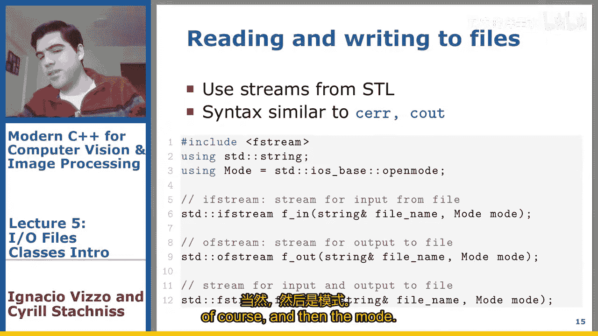

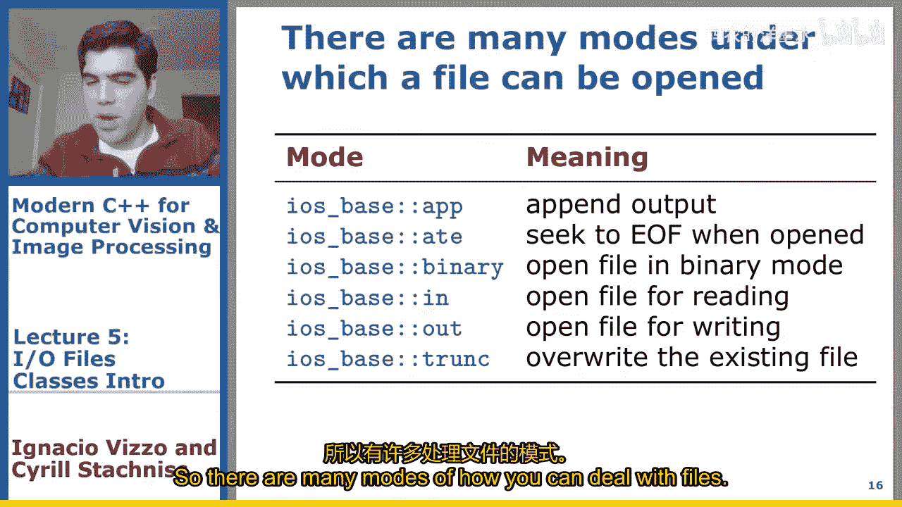

As a really Mo example， so let's say you are working with ASCI files。

And then it's really easy to use this output five streams。

Actually using the same syntax as string streams， so remember lecture one or two， I think two。

 when you have structured formatted data， you can use these string strings syntax really easily So you can say from this stream like put it on an integer So in this case we have。

嗯嗯。It's。Use this color so we have an integer and then a floating value and then a string and then another floating point value。

 So with this particular structure format， it's really easy to use five streams because the syntax is quite nice。

 let's say the only problem is that the same way of string streams it will fail if you have so if the format is not correct。

So keep in mind that if your files have some errors。

 then you will need to deal with this error or use another approach， like we will see now。

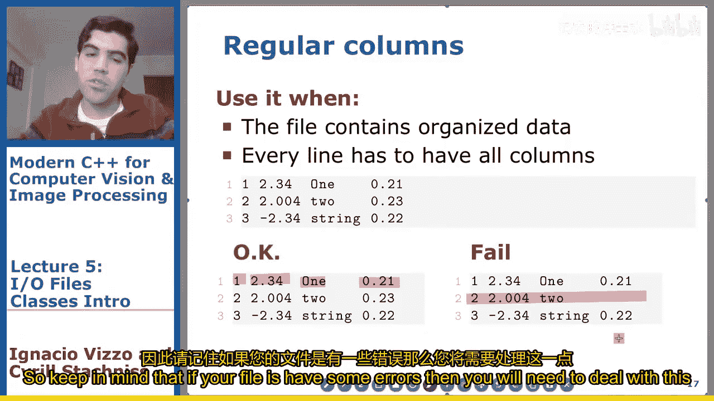

So this is the example we were talking about， so again， you can create this file and try it at home。

But basically， the syntax is quite easy。So the first thing you will do is you will create this standard input file stream。

Then you need to provide the file name you want to read and then the mode， in this case。

 you only want to read， so you will use the iOSos base in。And then how you read data。

You basically output this input5 string and then to the structured data form。 So we have IA， S and B。

 not the best names， but it doesn't fit on the slide。

 So I is basically an integer the a is a double and then S is the string and then the B again is an hour double。

 So if you so this is the five we're talking about。

 So probably having the file there would be better。 but again so we have。嗯。

On integral floating point， string and floating point。不是。

And then here we have the same so this way you can read files really really easily and the syntax is like going so passing the string through all these variables if you have any error。

 then this Y loop will fail otherwise it will until we will read all these lines until it reaches the end of the file。

 so this is the way you can use to read files。But。Let's say that you don't have the format or it's not really structure。

 like you don't always have the same lines。So you will do it like using the getline function。

 so this is， for example， another file you want to read and this is a source code on how to read this file。

So basically you will get this line and populate a string ideally， you can try this example at home。

How we write text files using this output file string is basically the same syntax as。

As the input file string， But using the other mode and the other object， that is the oil string， so。

Here。We create a file stream and this is a finding it's going to be out the XT。

 and in this case by default default， we don't specify the mode that is going to be basically to write。

In this case， we want to just write one level。The only brain with this is that we are writing an ASI values so this will be a string。

 so we need to specify the precision of this double and of course we will lose some precision if we want to write floating point values to string format that is basically this ASI。

Again， if you pay attention， the syntax is exactly the same sea out。So in this case。

The the output fight is acting as the C out， and this is what you will do if you were doing this image browser exercise。

 but in a good way， but remember just use the standard output for the homework。And then lastly。

 about reading and writing files。We have seen weekly two examples how to read a text file and how to write text file or askI format。

 but there is also a better way of doing this that is called serialization。Where're basically。

We will try to put all the binary information from our data into a file。

 and this is also called binary file and there are many ways many reasons why you want to do this。

So instead of writing like ASI data， like for example， 1。56， whatever。

 we will write the sequence of ptes that represent this data。So the document must have a structure。

 because。If you open the document， you will see zero and1。

 so basically you will see binary information so it's nothing you can read so you really know to know you really need to know the structure of your document。

Naturally the writing and reading of this type of filess will be really fast because that's basically so you need to convert to an intermediate representation。

 so if you have like one byte that is8 bits and you want to write it to the file。

 you just need to put those eight bits in the file and you need to represent this particular byte with a character or whatever。

There will be no precision loss for floating points because we are going to put for our floating points。

 for example， the four bytes that represent the floating point will be directly written to the file so there is no conversion to one dot。

 whatever。And then it will be actually quite smaller than just askqui file and why is this because the binary data is much lightweight so it's basically zero and1 and if we want to represent a double with a string then we need for example。

 for a position of 20 we will need 21 characters so 21 character is 20 times 8 so it's a lot of bytes for representing just one double so there will be much smaller。

The think that its going to be a bit ugly， but we will discuss it a bit right now。

So let's say I have， for example， an image， right like an image that has like really small one。

 we have two rows and two columns。And then basically this spec will represent that like the data。

And in this case， it's going to be full of serious because it's basically a damn image。

So how I do this， how I write this image into a binary format。Then。The first thing again。

 is to open and output file stream and then I will pick the name in this case will be image dot DAT with image dot B IN。

 it's up to you。's the name is not relevant。And then I will take two modes。

 so the first model is going to be out， so I want to write this file and also I want to do it in a binary form。

And then instead of using the Ostream operators， as we saw with structure data and ASI format。

 like with the Angular brackets， we need to use these sort of eyease syntax。

So there is no remedy for this。But basically we want。

 so let's say the first thing we want to do is to write the rows and the columns。

And this is part of the structure of the document。 So the first。

This amount of data will be a row and then this is basically an integer and then it will be a column and all these binary dit will be all sticked together on the file and of course we will run the example and we cannot see the data。

So how we do is we will call this member function of the output five scene that is called right。

 and then we will use this ugly syntax that you will most likely understand in two or three weeks。

 but basically this re interpreter cast。We get the information of the integer value and well basically return the bits so if you have it's like openbuggger and you have like an integer value that is4 so if you inspect the memory you will have actually four whites that is or yes' four bys for integer。

That is basically 32 bits of information， so this basically is converting from an integral format to a binary format。

 and then we need to specify the size of this particular element so we know okay。

 I will start writing so you need to specify where is the element and then where this ends so I can get this amount of diits basically series and one and put it into the file。

And then the same holds true for the vector。 The only difference is that it's a vector。

 so the data is a bit longer。So first we will specify the first element because this is where the vector we start and then we need to write all the binary dits for that represents this particular vector。

And for doing this， we will use the size of the vector。 and then the size of float Y float。

 because the vector is holding floating point values。 So a floating point value will have four bys。

 And then the size of the whole vector will be the amount of members you have。 in this case。

 two times 3 is6 as far as I know。 And then 6 times4 B is going to give you the。

The size of the Chang you want to write。So one thing I want to show you really， really quickly。So。

Thisす。配戦。Yes， so for example， if we out them bin。So this is basically the example we are seeing on the slides。

 So the time constrain that's compiled。And then run it。 So if we。So。Be out。で？

So if I run this example。Then I would create this image dot date that is basically the。

The binary form。 And the first thing you can do is like try to inspect the file。Actually。

 let's do one thing。 Let's remove this image so you know， it is not there。

 and then we run the program and then the image is there。So if you want to inspect this file。

 this is what you get so it's all binary data， so it's the same if you want to inspect the binary executable so it makes no sense it's basically chunk you cannot get sense of the binary form but something important is that this file is 32 bytes so this is the amount of files of the of the file and it's 32 because if we。

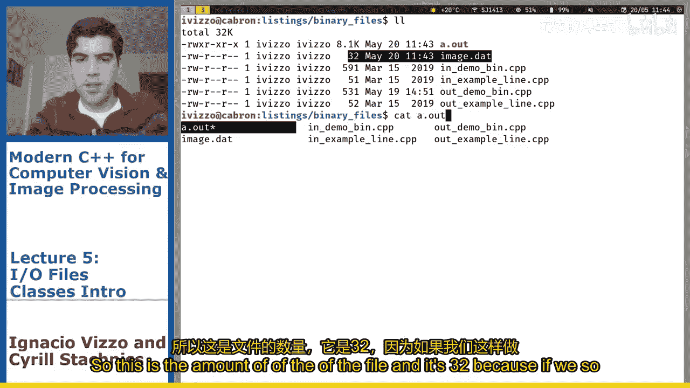

系。So it's going to be four bytes plus four bytes， so we have8 and then six。

 so this is six times4 it's going to be 24 so 24 plus 8 is going to be 32 bytes so the binary form will store exactly the amount of there you have in memory and if you want to try this let me see how them。

Out sample。Okay。I forgot to do the， but if you do this with characters， then of course， you know。

 it's not going to be 32 bytes， it's going to be much larger。So how to read from binary files。

 this index is ugly and is actually the same you do。

 I mean you will provide an address to the variable you want to populate with the binary data。

This is an example， my recommendation is you try both examples at home and actually you try to do both。

 so you try to do write this image D image。On a text form also an ASI using the Angular bracket syntax on the stream operators and also you do it in binary form and then you compare the sizes blah。

 blah bh， so that's actually a really good exercise。So it's actually super easy to work with this。

 but the thing is syntax， it's bit ugly。So that's the only draw。

So the process of using in binary files is that they are faster than ASI format。

 both reading and writing， the size is drastically smaller， so as you saw if you have 32 lit。

 then the binary representation on a file is 32 lit and nothing more so unless you do some sort of compression you cannot go lower than these value。

Another point is that there are many libraries to facilitate seilization。

 so both seization is a really good library and it's widely used everywhere。

So you don't actually really need to write all these small function codes by hand。

 you can use a library on top and make it much easier。

And some consists that the syntax is a bit ugly， but this is basically true for most of C+ plus code。

Then the fight is not readable by human， so this means that if you are debugging， for example。

 and then you want to inspect what you have written to the fight。

 then you cannot make sense because it's just binary。

Then also you need to know the format before reading。

 so let's say you write this image to a binary file and then you want to read it。

 you need to know exactly the format so first you need to read an inte then another inte and then the vector you cannot do like their way around because you would read data but it's going to be junk because it's going to be so the file has no structure like a stream of one and zeros so you the reader need to exactly know how is' the structure of this file。

And then the last but not least on ourist you need to use this for your homework so Homeboard number five will be all about writing and reading into binary files so basically you will be computing see descriptors and then you will save this descriptor as binary format and this is used for your final project。

And then lastly， the P system library again。This is something that it came with C++ 17。

 so if you're working for a company， it's very unlikely that you will be able to use this。

 but there are another workaround for using this。So ideas of this library is that now that you know how to read and write to files。

 you also might want to perform operation on paths on regular files and directories so for example。

 you want to create a directory ask if certain file is created or not and if there is no file there。

Then you can create your binary file for example， so it's like a utility library on top of the input I library to help you to work with files in your system so it's inspired basically in boost file system as many of the standard libraries where you incubating the in boost make your legs much easier。

And again， all the information is on CPP reference。

We will see some examples on how this is important。

 So forget for a moment that you like how to create or read files and in this case we want to basically use the language as a shell。

 So on this particular example。I want to bring all the files here in a particular directory。

So the first thing I will do with this example is to create a directory。

 so this basically is the same as doing make dash P sandbox slash A and B。

 and then I will create two file streams， so basically two files。

When it's called51 Txt and2 will be basically empty just ami5。

 and then I will use this directory iterator， So this is really cool because you actually can iterate through the directory and then you can do with this syntax so this would be a path and then call the directory iterator for this sunbox directory and then you just print。

All the the paths you find on this director。 So in this case， we found a that is basically this。

Phi1 and P2。 So these are all the files you can find inside this directory and B is not here because B is basically a directory and there is no apparent or some explanation of why it's not being pop out into the output。

 but for now the idea is that you can you know you can iterate through directory。

 So if you're reading P and G5， this is something you can do。

 you can iterate through the data image directory and then get all the P and G5， for example。

Then there's also utilities for findings。This example， again， I recommend you to， to try that home。

 but basically。So using the path object from the P system library， you can for example。

 ask for the file name of this particular file， no matter where it is file， the name is bar Txt。

So for example， for homework members。Reri， that is the one from the image browser。

 This is something you can do because you will have the image on the data。And then。

You only want the the the file name。 So there is a question that is。

 is in this in experimental file system。 The answer is yes and no。

 actually it a really good question。 So the problem is that if you need to do this。

 it's because you didn't install LLBM to and properly。😊，So the five system library is quite new。

 so it has been here since C plus plus 17。 And for example， if you're using。

The default compilers that comes with you to 1804， then it's not on F system。

 it's on experimental file system because four years ago this library was on the experimental section but now it's a race table。

 so actually this is a really good point to know if your setup is working properly。

So if you cannot compile this example， then this means that the setup is kind of wrong and I can help you so you can we can discuss it offline on Discord。

But actually when when I did the example the first tutorial when we did like how to set up the De box。

 so just running a heller wall is not really smart because any C+ plus compiler can compile Heer wall。

So it maybe for future editions， I need to compile a five system color wall and this way you make sure that you have the combining style installed and it's a modern one。

I will help you offline， it's very likely that there is a really small error， but this is， I mean。

 if you're struggling with file system， then it's a matter of how you install the tool chainin。

More examples here on P names。And also an extension。Maybe you want to know， for example。

 you want to use the directory Terator through a directory， and then you have PG files。

 TXT file and whatever files。And then with this， you can actually ask for this extension for all these files and if。

 for example the extension is equal to P and G， let's do something。

 So this is really cool utility libraries that you can use。

To work with advice on C plus plus more examples in here。 Also， you can take the stamp out of the。

Of the file。 So if you， so if this is the path to your your files。

 then the final will be bar T X T and then the stem will be bar。 So if you ask for the stem。

 then you will get bar。 So this is really， really useful while working with five system。

 And also you can do exist。 So let's pretend that you want to。See if any files exist。

 so there's new demo here that basically you can ask。

So there is a small utility function and then you do five system exists and then you ask for the pad and then if it's true。

 then you will print exist and then if not you will print doesn't exist In this case we are trying to see if this exists of this other one exists and here is the output so it's really simple the of these examples is that if it examples are on the slides then you will probably read it and then you should try it at home all these utility libraries are meant to make your life easier。

So good luck we're doing this with plain C or just doing everything by hand and also if you read like the five system API like this five system exists。

 it's really English， right？If you don't know the file system library and then you see these syntax like P system exist。

 then you can guess that you are asking if a particular path in the five system exists。

 then it's really easy to use。O。Sorry for the delay。

So we reach one of the most important moments on C++。So I would say that if you have any question。

 you can ask it now。It's probably going to be a good moment for。Asking question。

I'm sorry I had to rush。都。Connectivity issues。Anyway， so who are we。

 we are simple press programmemar， and we always want more types。

So this is going to be a really high level introduction on classes and the type system of C++。

 so basically this is not going to make it into Homebro number5， so don't be scared。

But the gifts that you get you start getting the sense and the intuition behind why we want to use types。

Like not the built in types， but the ones we write。And also。

Just like the bad news is that this course is not about object oriented programming。

 So usually so if you really want to learn this particular topic。

You will need a full semester and just object during the programming。

And then we will use some of the techniques， because that's。Part of the core C+ plus ideas。

 but then the bad news is that I won't be able to explain you all the concepts on object or in programming。

 so it's really really good if you know something from Java or Python because we are not going to dive deep into the concept but how to use this concept with this language。

So C++ and classes are basically a big thing。So when C++ came into the game 40 years ago。

By that time was C with classes， but now it's a much different language。

 it's much more robust and general。So types are indeed important。

 so there is one example here that I actually took this example for Pr， the creator of the language。

Notice this little guy。That is called the Mar Climate Orer。And actually， so by 1999， and believe me。

 there is plenty of these cases on the。History of science。

 so the NASA sent this guy to the orbit to Mars。And then when when he went he。

 it when he was about to reach its orbit。Something happened and we never saw this guy again。

 so the little poor Mars orbiter was lost in the space and there are two drawbacks of this。

 one is that we are throwing chunk in the space and this is really a bad idea。

And the drawback is that a lot of。Really bad stuff happened on NASA so a lot of promotion didn't happen。

 some PhD students didn't get the PhD just because they lost billions of dollars with this robot。

So this orbiter were about to reach the orbit and what happened by that time is that two functions or two interface were interaction to each other and one send a double to the other one So a double is just a built in type right so it's 8 bytes can be any floating point value with no extra meaning。

But the problem of these two interfaces is that one was expecting to work with the metric system and the other one with imperial system。

 So when one sent the variable to the other one it scaled this value at exactly 4。65。

So why did this happen， Because there were no types in there。

 So it was basically a double Doub can be any kind of。

Can have any unit right so there were no many on the types and that's why we lost this poor guy。

 So types are indeed important and this is the motivation behind the type safety system of C++。

So this is a bad example， for example， let's say we want to blink LED and then we have this function that is called blink LED and then I put it bad so you know this is the bad example。

 the bad guy， and then we say time to blink。And then my question is like， okay。

 why are the units of time tooling， It's just an integralte value can be 1 hundred1000。

 So if it's a milliseconds， maybe I want 1000 milliseconds， but if it is in seconds and to do 0。

1 So it's really hard to tell what is the unit of value when I would detect the error So this is really important this is the type of question as a simple plus parameter。

 you need to start asking yourself， it's like when I will face the error So is this something that I will deal with at compile time or at run time because if it is at compile time。

 then it's pretty good because I can fix it before I ship the little guy to Mars But if it's a run time。

 then I am not sure when I will face this error。Because it's something that will happen at runtime。

 So all the type safety ideas of C++ are meant to happen at compile time。

 and that's why it's also a really safe language。What is a good counterpart of this example。

 then write a same function， but instead of using integer。Use milliseconds。

 milliseconds can be anything。 So on the utility libraries， there is this type already defined。

 but let's pretend that it's not there。 Then you can define this type by your own。And then first。

 when you read the function。You see that you need to pass milliseconds， and second。

 you have two options。So， in this case。If you don't specifyifies the units。

 then you will have an error and this will be a compile time error so you won't be able to ship the robot to Mars unless you solve this compilation error and this is really good news for you。

And then if you use， for example， seconds， that is not milliseconds。As specify on the syntax。

 the type safety system of C++ will abort compilation and also will give you an error at compile time。

 Again， this is really， really good and makes C++ really type safety language and all these kind of errors can be detected at compile time。

 So this is before shipping any program into the real world。

 So this is what we really want to do with types。😊，And let's pretend there is another example。

 go and check it out if you want more flexibility， you can also use write same function but use multiple types like seconds and milliseconds and also when you use the interface。

 so when you call this function here。It's clear that you want to do two seconds and then 150 milliseconds again。

 if you don't specify the type， then you will get an error compile time， you're safe。

Like type 60 in our field like just an example so RosOSs1 so actually people from Ross is doing a lot of work to migrate from Ross 1 so when Ros 1 started to be a code base for robotics this was I guess before C++ 11 there was not much expertise on the language itself within H people and also。

I mean， probably the tools were not there。 So Ro1 has a lot of。Drawbox。

Not only with type safety but this is one example， so if you go to the heller wall example from Ross you from Ross1。

 you will see actually the link is here on the description so go and check it out。

 you will see this toqueal note that will just print to the standard output and then at some point you will see this statement basically says loop right and then 10 and then the question is like 10 watts 10 hertz。

 10 milliseconds， what is this loop right？For people who know Ros1。

 you know that this unit isn't hurts， but what happen if you don't know this？If you put 100。

 it will also work， if you put 100， it will also work。

 so there is no guarantee on the units and on the type of this particular volume，'s just a number。

 an integral number with nothing with no real abstract information built on top of it。

As a good example， now Ross is moving to a better C+ plus usage。And for example。

 the same hello world example， now it's using milliseconds。

 so you will create a wall timer so the syntax is a bit different because the ro change itself。

 but now instead of doing 10。They are using 100 milliseconds， so you know it's 10 hertz。

And the period of the timer is going to be 100 milliseconds for sure。

 you know this it's at compile time， it's guaranteed to be this no problem， you can be safe。

 you can sleep this night knowing that your timer will be working at 100 milliseconds of period so this is really really good usage of the language。

It's the same functionality as the previous example， but much better code。

 better readability and safer， and it's also going to to run every 1100 milliseconds。

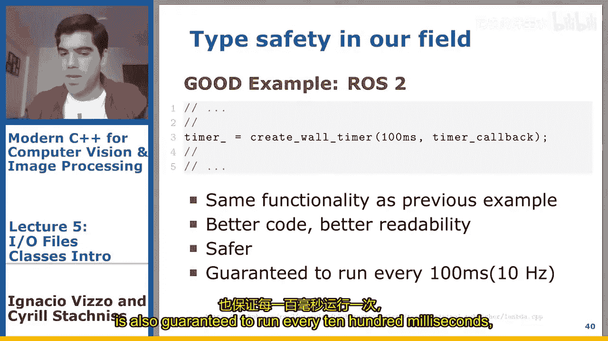

Right so this is one of the many motivations behind classes and the type system。

 so just to confuse you a bit more， I would be using the name the word class and the word type intly so whenever I say type I can be talking about the class or whenever I say class I can also be talking about types so classes and types are exactly the same in C++。

And I like much better idea of types because when you do classes。

 people automatically think in object oriented programming and actually using create types that are not meant to use for with object oriented programming So the idea of types is much broad and it's better for me to think it the language to create new types instead of classes。

So if you go to the book， you will see that C class classes are just tools for creating new types。

That can be used conveniently as the built in types， in addition。

 the arrival classes and the plates allow the programmer to express。

 and this is really important idea relationships among classes and to take advantage of such relationships。

Ideally， the problem that expressed this relationship。

Relationships closer to the real world will be easier to read and easier to maintain。

A type or a class is a concrete representation of a concept， an idea， a notion， whatever for example。

 a class can be a banana can be a fruit can be an image。

 can be a point log can be whatever a program that provides types that closely match the concept of the application tends to be easier to understand easier to reason and easier to modify so that's one of the key concept of C++ So creating new types will allow you to write better problems。

 maintain this better and make it run faster。So if you have an image type。要跟。

Use this type on your program and then when I read your program。

 I will know that you're working with images。If instead of using image types， you use just an array。

 like when this is how you do it in C so you have an array。

 then if I see an array of integral values， I don't know if this is an image。An array of whatever。

 So it's much better to use types than just plain types。A class is an user defined type。

 so floating point values are not user defined types， image， for example， is a user defined type。

This will consist a set of members， the most common kinds are data members and member functions。

 so all the syntax on classes will be taught in next lesson， So as a reminder。

 I want to give you like a quick overview of the main ideas behind the concepts。

And then the member functions can define the meaning of the initialization。

 this means whenever you create an object of this classp and copy。

 move in this object and clean up that this basically means destruction。

And then the member can be accessed using dot， but this is basically the syntax。

Also something really cool is that operators such as plus operator can be defined for a class So let's say for example。

 you have a point cloud so a point cloud basically consists of a set of x and y set points right and then you have another point cloud and then you want to merge these point clouds together then one thing you can do is to define a point cloud class it means a point cloud type and then define the operator for this particular type and then when you do for example point cloud3 equals to point cloud1 plus point cloud2 then you will get the merge operation and the meaning of these will be provided by you the parameter so it's not magically happen it will for example do okay。

Merching these two point clouds just doing the plus operator means to append all the points from one one of the list to the other one。

 I don't know so this is actually depends up to you and it's up to the designer。

 but this will give you really good usage of the language because if you see like this last operator it's much easier to understand rather than if you color a function saying function that merge point loads and then you pass the two parameters and then this will return you a third point load this is basically much better to spread with plus operator and then we will see this exactly on next lecture。

A class is a namespace， so as usual， whenever you create new entities on C++。

 you will create a new namespace。So it has all the same information。

 meaning that a function name space or an empty name space。

The public members provides the class interface to the outside wall in the program and the private members provide implementation details that shouldn't be shared with other parts of the program and as strike as a class where all members are public much more details on next lecture so don't really worry about this。

So because we're doing computer vision， the most trivial example will be image。

So this is how you will file an image class。Much of the of this class is not there because it doesn't fit on the slide。

 but basically you will create an image class and then you will have the public members and the private members。

So in this case， we will have rows and columns。And then we are initializing this with zero and this is what is new in C+ plus 11 and also with this we are providing a way of create images that is not implemented here。

 So this is the same as defining a function and then you need to implement a function and let's pretend that there is a draw function that would draw this image on the screen So basically。

There will be an implementation that might be on image dot cB。 We will see how to do on next class。

 but basically this is how you create an image so you create a new image， the name。

It's the same as naming any other variable。And then the type if is's going to be image。

 And then if you inspect the constructor， you need to provide the file name。 So you say， okay。

 my file is in some image dot P andM。 And then I want to draw this function， this image to。

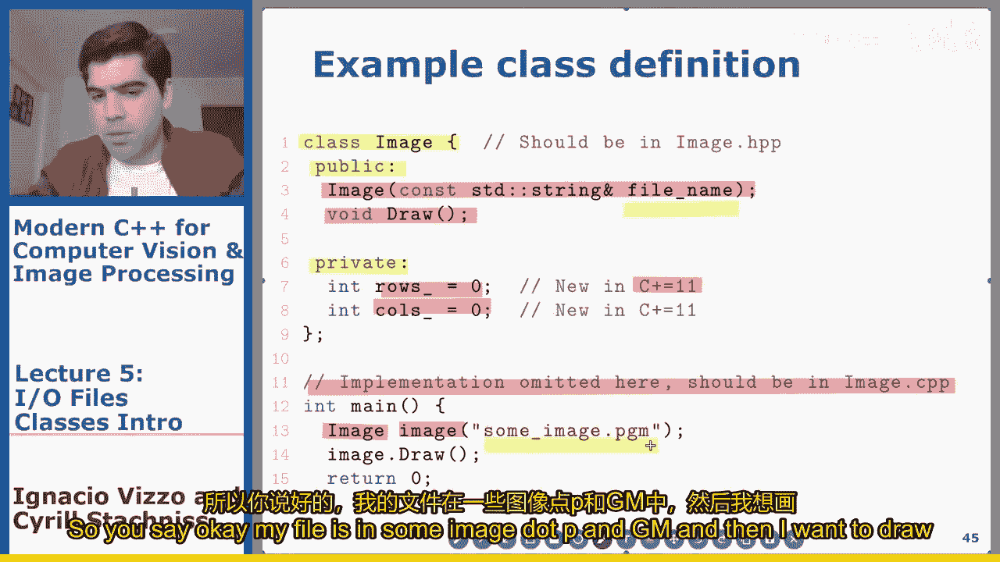

To the screen。Okay so some examples on types or classes in our field。

 so for example will be something like this， so these examples are taken from the open 3D library again it's a really good library to see how to work with C++。

With real good Cus plus， so we have the image library。That we will see this。Really soon。

 but it's basically a type of geometry on 2D。 Then they also define 3D entities。So this is wrong。

 so this is shouldn be here， but for example， you have a mesh base that is going to be a 3D entity。

 you have a point cloud that is also going to be a 3D entity and then you have also box of grid that we saw an example on previous lecture that is going to be 3D entity So this is basically some examples on classes you also know that people in our field does use this and it's really important。

And as to finish the lecture， so as a small example。

 this is the abstraction mechanism you you should drive your mind when you think in classes so we have the real world entity that is going to be an image in this case it's going to be an image for that has 512 columns and 512。

Ross。The is you want to create an abstraction that represents closely with the real world entity。

 this image。And then， basically。One thing you can think， so this is c， so this is not real。

You want to define the number of rows that is going to be integer。

 the number of columns and then the number of channels。 So if this is an RrgB image。

 then this would be three。 and then you will have the data that is basically all the data in the image that is going to be you can put it as a vector of bytes。

 so each pixel will store one byte for the three channels so you will have all this information in one vector So this is really common to do with images。

And then you would like to use this abstraction in a way your program shows the intention of what you want to do with the image。

 so for example， you want to create a Linux picture object that is an instance of this type image and then you want to do again go and search the Linux P andG file。

And then for example I want to draw to screen and to visualize the image and also for example with this picture I want to convert it from Rascale so let's say you have an Nt image and then you want to compress everything into one channel and convert it to Rascale so this is all the so this is a wish so you have a image and then you want programs to model these real world entities with abstractions and then you want to use it this way so let's see we can more or less do this。

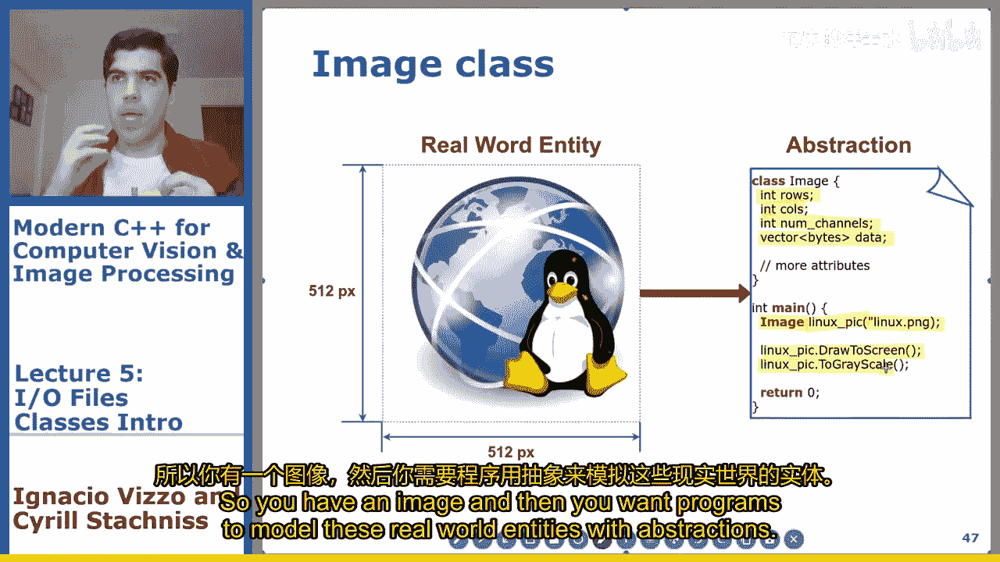

So this is one possible realization of the image class。Again， Dick from Pin 3D。

So in this case you will have a width and a height that is basically the rows and the columns you will also have the number of channels and a vector with this type that this is basically one byte so this is8 bits and this is going to be the buffer with all the image information so this is how these people's soul and it's actually it's really common to do it like this So these are all the private members of your class of your new type called image。

And this is the implementation， actually this is the non implementation。

 the definition of some functions that you might want to use with this particular new type。

 so one for example could be clear so you want to completely clear everything that is on this image。

You also want to my want to do is empty so you have an image type and then you want to you wonder if this image is empty and then this is going to give you an abstraction so it's really if you do Linux peak dot is empty and this keeps you a volume variable。

 then you can really ask if this is empty and then you can express intention of the problem really easily。

Then for example， you want to flip horizontal， do a horizontal flip on the image and then return this new image。

And then for example， you might want to filter this image out。

 and also this is another member function you might want to use。And lastly， for example。

 you want to allocate memory so you we saw that it's really good idea to reserve memory。

On vector buffer。Whenever you create a new image， maybe you want to allocate memory。

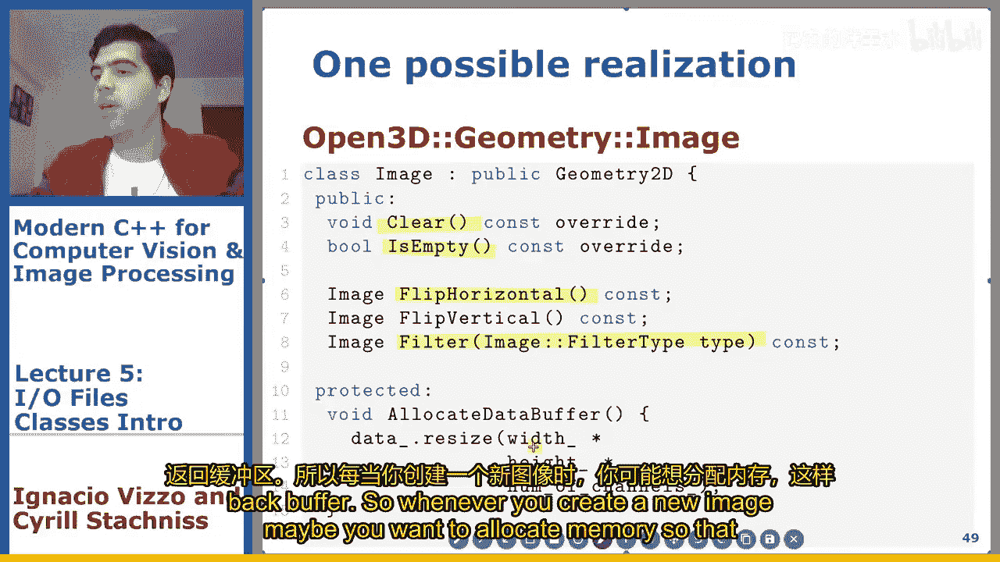

So that yes， did we achieve this goal so we have a reward entity and then we want to convert this reward representative entity with an abstraction and then this is basically what we have after defining all these steps on the image class and this is how we would use it and let's see if more or less like we reach the goal So I'm creating an image。

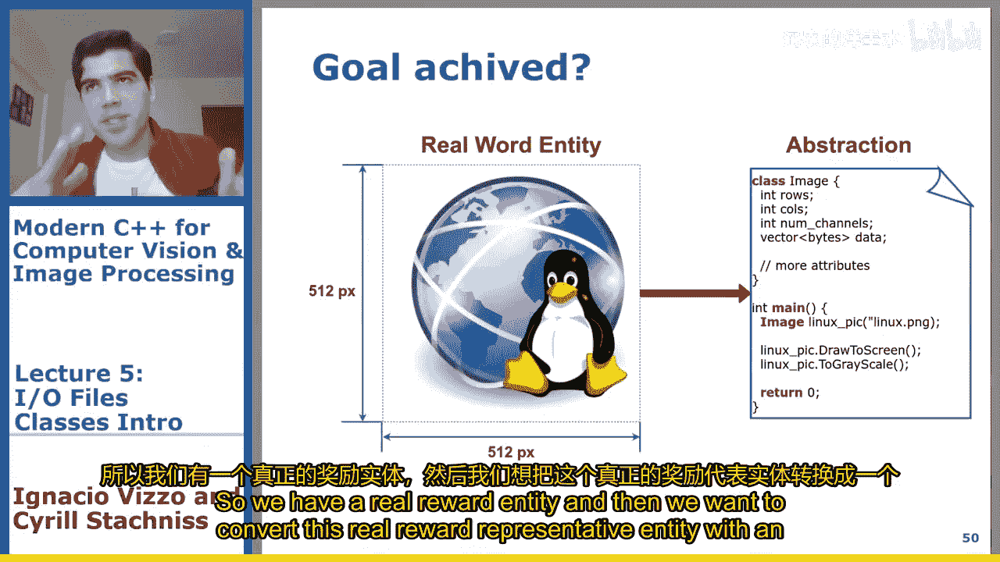

So this is real goal actually， so you can build it and it will work。An image type。

 this is the name of the variable and then I will create it from this particular P and G file then for example。

 I want to create a new image。That basically this auto replace the image type。

 and I want the same Linux picture， but flipped。So I can call this function and I will get the fleet image。

And then for example， I want to filter this Linux image。And then I would call this filter。 and then。

 for example， I will use this type of filter that is also defined on the image class。

 and then I will get the filtererate image。 So if you try to read。This program。

 it expressed really well the intention of what you want to do。 So it's basically plain English。

 So you're really， So this is really a really good model of the real world entities using abstraction mechanisms。

For example， if the fgerate Linux is empty， so let's say that there was an error while filtering I want to print an error and couldn't filter your image。

 so it's really really plain English right so basically the idea is to represent this entity with an abstraction。

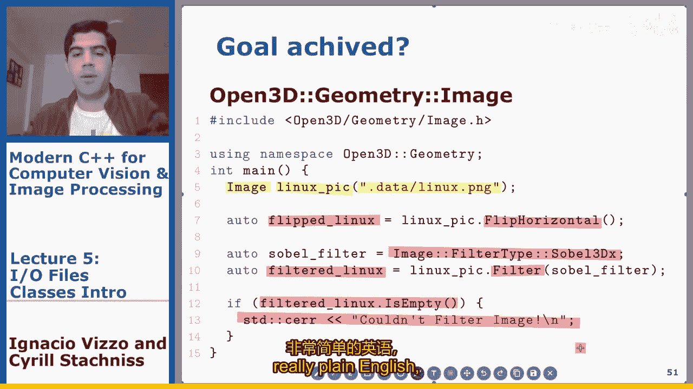

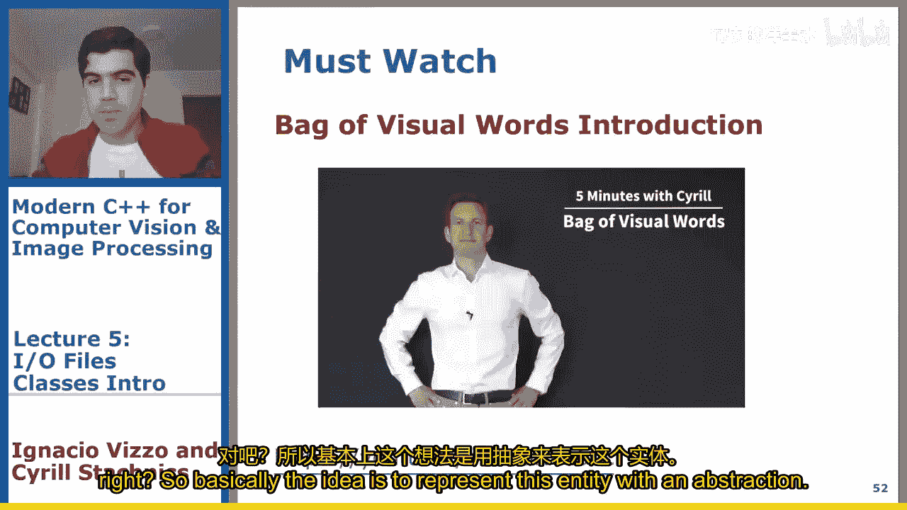

And that's basically it for now。 So that's the quick overview of of classes right we will see much more starting from next week on。

 but I want to start like injecting you ideas on your real minds。

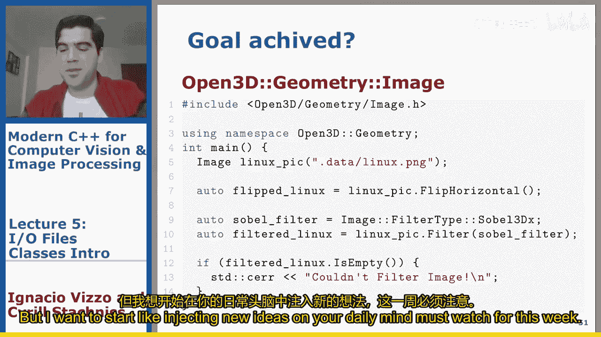

Must watch for this week so before you get to do the homework you need to watch this interaction so it's a five minutes interaction of bug of visualual reward so you have no excuses for not watching it it's only five minutes。

The Homeboard number five will be out soon。 you still need to submit Homeboard number three and number four。

 so make sure you catch up with the homework boards。And also。

 there will be an open C tutorial that because you also need to use open C for this homework。

 So a lot of things happening with this homework。 So the lecture wasn't heavy on。Concepts。

 but you have to do a lot for your homeworks。 and actually， the homework is really easily。

So the solution can be providing again， 20 lines of code， and then you have the full solution。

 but you need to know everything on the like all the concepts involved。

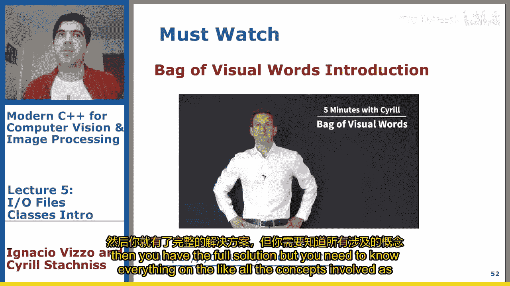

As a recommendation， you can do this feature descriptor video so still has a lot of videos on see and visual feature descriptor。

 So this is one of them if it happens that you have no idea what a see descriptor is then you probably want to watch this video before getting to to do the homeworks。

 but I guess that most of you already are familiar with the idea or at least know where to find information The references and it's also an outline for this。

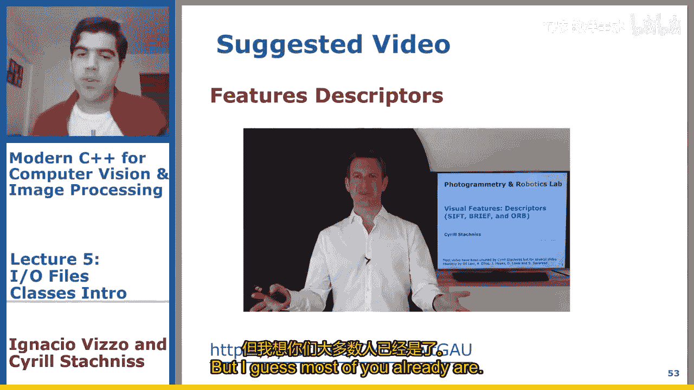

Lcecture is the utility library， the error handling that we skip because of times constrain。

 and also the input output library plus the five system library on last leak classes。

So classes is going to be the topic that we will discuss through the rest of the four lectures we have。

 and it's really important that you get to know how to model all these ideas。

That's basically it from my side， if you have any question。

You can write in the chat or we can discuss it offline through Disc code。

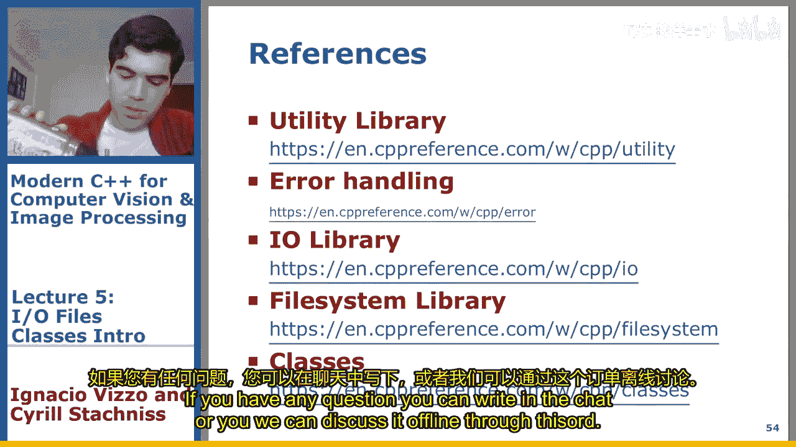