# 现代C++：5：输入输出与实用工具库

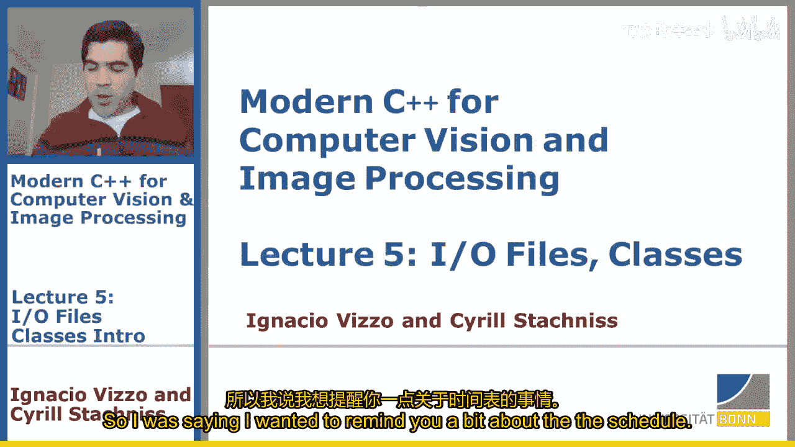

在本节课中，我们将学习C++标准库中的实用工具，并重点掌握文件的读写操作。这是C++核心语言部分的最后一讲，之后我们将进入面向对象编程等更高级的主题。

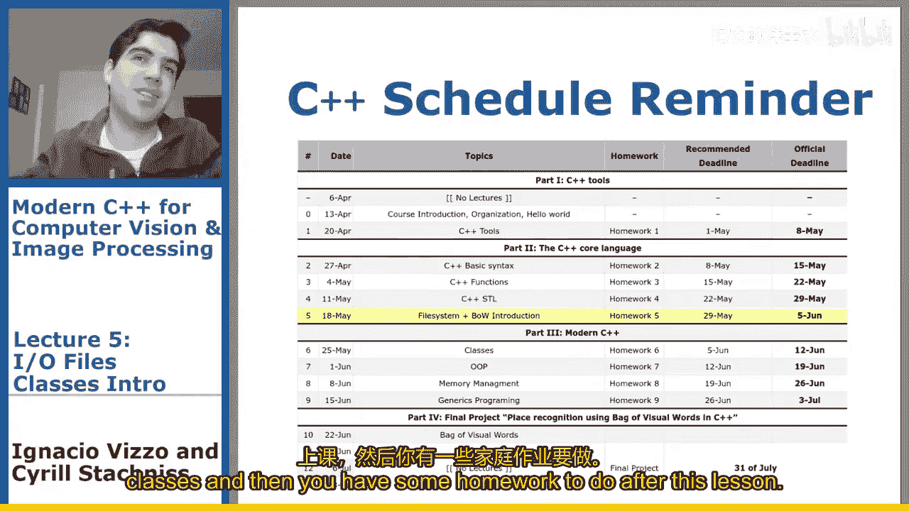

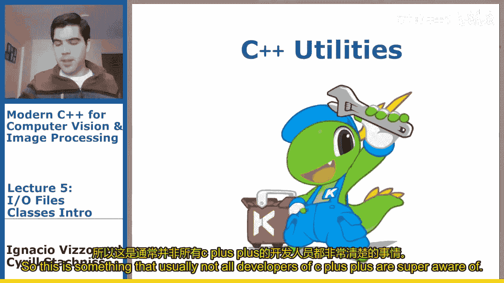

## 课程概述与进度提醒

上一节我们介绍了C++的一些高级特性。本节中，我们来看看标准库中提供的实用工具，特别是与输入输出相关的功能。

首先，提醒一下课程进度。目前课程已进行到一半。今天的讲座可能是关于C++核心语言的最后一讲。我将课程分为两部分，并有意将面向对象编程、类等内容安排在后半部分，目的是让大家理解C++远不止是“带类的C”。到目前为止，我们已经学习了许多工具和功能，今天将看到我认为你需要掌握的最后一部分，并且至今未涉及任何面向对象编程。

与以往课程版本相比，我正尝试加快概念讲解的节奏，以便大家有更多时间分块学习。请务必跟上作业进度。作业4已发布，本周内将发布作业5。作业5和作业3一样，与最终项目相关。最好现在就开始为最终项目做准备，如果等到最后一个月再做，过程会很痛苦。

## C++实用工具库简介

C++标准附带了一个实用工具库，其中包含多种功能，从位计数到部分函数应用等。这些库大致可分为两类：**语言支持库**和**通用工具库**。

**语言支持库**与语言特性紧密交互。例如：
*   `type_traits`： 提供类型相关的元函数。
*   `size_t`： 一种用于表示大小的类型。
*   动态内存管理库： 包含`shared_ptr`、`unique_ptr`等。
*   错误处理库。
*   `initializer_list`： 当你使用`vector`并传递初始化列表时，就在使用这个库。

**通用工具库**则在语言之上增加了一层功能，并非与语言本身内在相关。例如：
*   `chrono`： 日期和时间库。
*   `optional`、`variant`、`any`（C++17引入）。
*   `pair`和`tuple`。
*   `swap`、`forward`、`move`（移动语义相关）。
*   `hash`。

许多工具随语言标准提供。例如，如果你安装了支持C++17的编译器，就可以免费使用这些工具。使用这些工具通常需要包含`<utility>`等头文件。

### 实用工具示例

以下是几个核心实用工具的简单示例。

**`swap`函数**
交换两个变量的值，无需自己编写交换函数。
```cpp
#include <utility>
int a = 5, b = 10;
std::swap(a, b); // 现在 a=10, b=5
```

**`variant`类型 (C++17)**
`variant`可以持有多种指定类型中的一种。
```cpp
#include <variant>
std::variant<int, float> v;
v = 42; // v 现在持有 int
int i = std::get<int>(v); // i = 42
// float f = std::get<float>(v); // 错误！v当前不持有float
v = 3.14f; // v 现在持有 float
float f = std::get<1>(v); // f = 3.14， 使用索引访问
```

**`any`类型**
`any`可以持有任意类型的值。
```cpp
#include <any>
std::any a = 1;
int i = std::any_cast<int>(a); // i = 1
a = false;
bool b = std::any_cast<bool>(a); // b = false
```

**`optional`类型**
`optional`表示一个可能存在的值，用于处理可能返回空值的函数。
```cpp
#include <optional>
std::optional<std::string> create_string(bool create) {
    if (create) {
        return "C++ is awesome";
    } else {
        return {}; // 返回空 optional
    }
}
auto str = create_string(true);
if (str) { // 检查是否有值
    std::cout << str.value() << std::endl; // 输出: C++ is awesome
}
auto empty_str = create_string(false);
std::cout << empty_str.value_or("default") << std::endl; // 输出: default
```

**`tuple`类型**
`tuple`用于将多个值组合成单一对象。
```cpp
#include <tuple>
// 定义和创建tuple
std::tuple<double, char, std::string> student1(3.8, 'A', "John Doe");
// 使用 make_tuple
auto student2 = std::make_tuple(2.9, 'B', "Jane Smith");
// 使用结构化绑定访问 (C++17)
auto [gpa, grade, name] = student1;
```

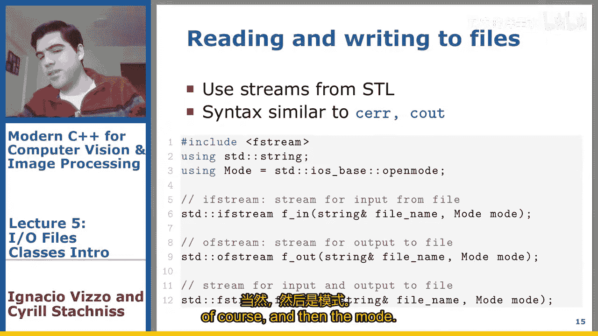

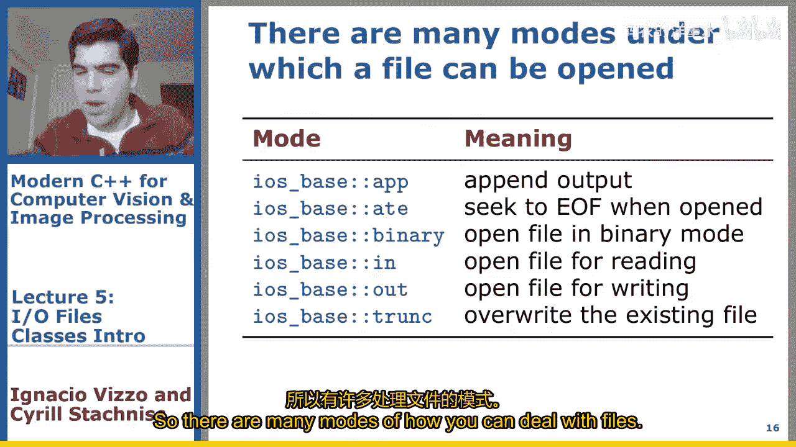

**`chrono`库**
用于简单的时间测量和基准测试。
```cpp
#include <chrono>
#include <iostream>
auto start = std::chrono::high_resolution_clock::now();
// ... 执行一些操作 ...
auto end = std::chrono::high_resolution_clock::now();
auto duration = std::chrono::duration_cast<std::chrono::milliseconds>(end - start);
std::cout << "操作耗时: " << duration.count() << " 毫秒" << std::endl;
```

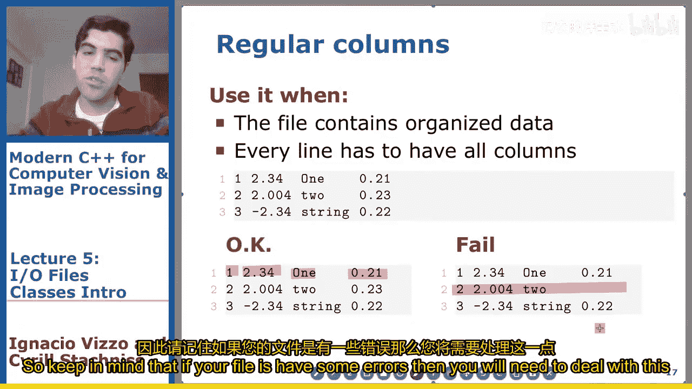

> **注意**： 工业界迁移编译器版本可能较慢，因此你未来的工作环境可能不总是支持最新的C++标准（如C++17）。许多优秀工具在C++14和C++17中引入，而C++11已是十年前的标准。在课程中我们有选择标准的自由，但需了解这一现实。

## 输入输出库与文件操作

现在，让我们进入本节课的核心部分：输入输出库和文件操作。我们之前使用过`std::cout`、`std::cerr`和`std::cin`，它们是与标准输出、错误流和标准输入交互的。文件操作的语法与之类似，但数据流指向的是文件而非控制台。

例如，在作业3中，我们生成HTML代码并输出到标准输出，然后重定向到文件。更理想的方式是直接写入名为`index.html`的文件。为此，我们需要包含`<fstream>`库。

### 文件流类型

主要有三种文件流对象：
*   `std::ifstream`： 输入文件流，用于读取文件。
*   `std::ofstream`： 输出文件流，用于写入文件。
*   `std::fstream`： 输入/输出文件流，可读可写（较少使用）。

打开文件时可以指定模式，例如：
*   `std::ios::in`： 读模式。
*   `std::ios::out`： 写模式（默认，会覆盖原有内容）。
*   `std::ios::app`： 追加模式。
*   `std::ios::binary`： 二进制模式。

### 读写文本文件

**写入文本文件**
写入文本文件与使用`std::cout`语法相同。
```cpp
#include <fstream>
#include <string>
int main() {
    std::ofstream out_file("output.txt"); // 默认模式为 std::ios::out
    if (out_file.is_open()) {
        int i = 10;
        double d = 3.14159;
        std::string s = "Hello";
        out_file << "Integer: " << i << "\n";
        out_file << "Double: " << d << "\n"; // 注意精度损失
        out_file << "String: " << s << std::endl;
        out_file.close();
    }
    return 0;
}
```

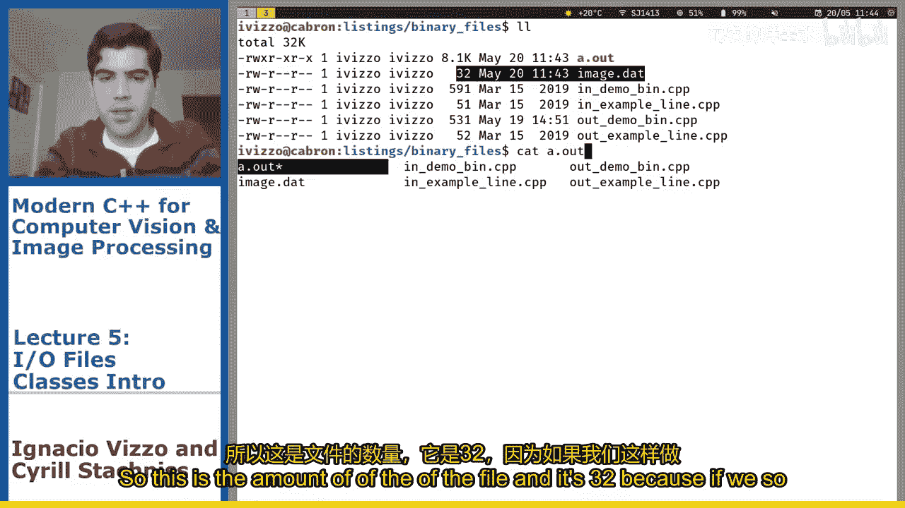

**读取结构化文本文件**
如果文件格式规整，可以像使用`std::cin`一样读取。
```cpp
#include <fstream>
#include <string>
int main() {
    std::ifstream in_file("data.txt", std::ios::in);
    if (in_file.is_open()) {
        int i;
        double a, b;
        std::string s;
        // 假设文件每行格式为: int double string double
        while (in_file >> i >> a >> s >> b) {
            // 处理读取的数据 i, a, s, b
        }
        in_file.close();
    }
    return 0;
}
```

**读取非结构化文本文件（逐行读取）**
对于格式不固定的文件，可以使用`std::getline`。
```cpp
#include <fstream>
#include <string>
int main() {
    std::ifstream in_file("unstructured.txt");
    std::string line;
    if (in_file.is_open()) {
        while (std::getline(in_file, line)) {
            // 处理每一行 line
        }
        in_file.close();
    }
    return 0;
}
```

### 读写二进制文件

二进制文件以原始字节序列存储数据，而非人类可读的文本。这种方法有多个优点：速度更快、文件尺寸更小（无需字符表示）、对于浮点数没有精度损失。缺点是文件不可读，且读写时需要确切知道数据格式。

**写入二进制文件**
写入二进制文件使用`write`成员函数，并需要`reinterpret_cast`进行类型转换。
```cpp
#include <fstream>
#include <vector>
int main() {
    // 假设有一个2x2的灰度图像，数据全为0
    int rows = 2, cols = 2;
    std::vector<float> image_data = {0.0f, 0.0f, 0.0f, 0.0f}; // 2x2 = 4个像素

    std::ofstream out_file("image.dat", std::ios::out | std::ios::binary);
    if (out_file.is_open()) {
        // 先写入图像的行数和列数（文件结构的一部分）
        out_file.write(reinterpret_cast<const char*>(&rows), sizeof(rows));
        out_file.write(reinterpret_cast<const char*>(&cols), sizeof(cols));
        // 再写入图像数据
        out_file.write(reinterpret_cast<const char*>(image_data.data()),
                       image_data.size() * sizeof(float));
        out_file.close();
    }
    return 0;
}
// 生成的文件大小为: 4 (int) + 4 (int) + 4*4 (4个float) = 24 字节
```

**读取二进制文件**
读取是写入的逆过程，使用`read`成员函数。
```cpp
#include <fstream>
#include <vector>
int main() {
    int rows, cols;
    std::vector<float> image_data;

    std::ifstream in_file("image.dat", std::ios::in | std::ios::binary);
    if (in_file.is_open()) {
        // 按写入顺序读取
        in_file.read(reinterpret_cast<char*>(&rows), sizeof(rows));
        in_file.read(reinterpret_cast<char*>(&cols), sizeof(cols));

        image_data.resize(rows * cols);
        in_file.read(reinterpret_cast<char*>(image_data.data()),
                     image_data.size() * sizeof(float));
        in_file.close();
    }
    return 0;
}
```

**二进制文件操作总结**
*   **优点**： 速度快，文件小，无精度损失。
*   **缺点**： 语法稍显复杂，文件不可读，必须预先知道数据格式。
*   **注意**： 作业5将涉及二进制文件的读写，用于保存特征描述符。

## 文件系统库 (C++17)

`<filesystem>`库（在C++17中从实验状态转为标准）提供了操作路径、常规文件和目录的功能。它极大简化了文件系统操作。

**基本示例**
```cpp
#include <iostream>
#include <filesystem>
namespace fs = std::filesystem;

int main() {
    // 创建目录
    fs::create_directories("sandbox/a/b");
    // 创建文件
    std::ofstream("sandbox/file1.txt");
    std::ofstream("sandbox/file2.txt");

    // 遍历目录
    std::cout << "sandbox/ 目录内容:\n";
    for (auto& p : fs::directory_iterator("sandbox")) {
        std::cout << p.path() << '\n';
    }

    // 操作路径
    fs::path p = "/usr/local/bin/foo.txt";
    std::cout << "文件名: " << p.filename() << '\n'; // "foo.txt"
    std::cout << "主干名: " << p.stem() << '\n';     // "foo"
    std::cout << "扩展名: " << p.extension() << '\n'; // ".txt"

    // 检查文件是否存在
    if (fs::exists("sandbox/file1.txt")) {
        std::cout << "文件存在\n";
    }
    return 0;
}
```

> **设置提示**： 在一些较旧的系统或默认编译器上，`<filesystem>`可能位于`<experimental/filesystem>`命名空间中，并且需要链接额外的库（如`-lstdc++fs`）。如果编译失败，请检查你的开发环境设置。

## 类型与类：动机与简介

现在，我们进入C++中一个非常重要的概念：类型和类。作为程序员，我们总是希望有更多的类型来表达我们的想法。

### 为什么类型重要？

类型安全是C++的核心思想之一。1999年，NASA的火星气候轨道器因一个简单的单位错误而丢失：一个软件模块使用公制单位（牛顿秒），而另一个模块预期的是英制单位（磅力秒）。两者都使用`double`类型传递数据，但`double`本身不携带单位信息，导致导航错误。如果使用了带有单位信息的强类型（如`Meters`、`Feet`），编译器就能在发射前捕获这个错误。

**反面例子**
```cpp
void blink_led(int time); // time的单位是什么？毫秒？秒？
blink_led(1000); // 是1000毫秒还是1000秒？
```

**正面例子**
```cpp
// 定义强类型（假设已有，或自己定义）
void blink_led(std::chrono::milliseconds time);
blink_led(std::chrono::milliseconds(1000)); // 明确是1000毫秒
// blink_led(1000); // 编译错误！需要指定单位
// blink_led(std::chrono::seconds(2)); // 编译错误！类型不匹配
```

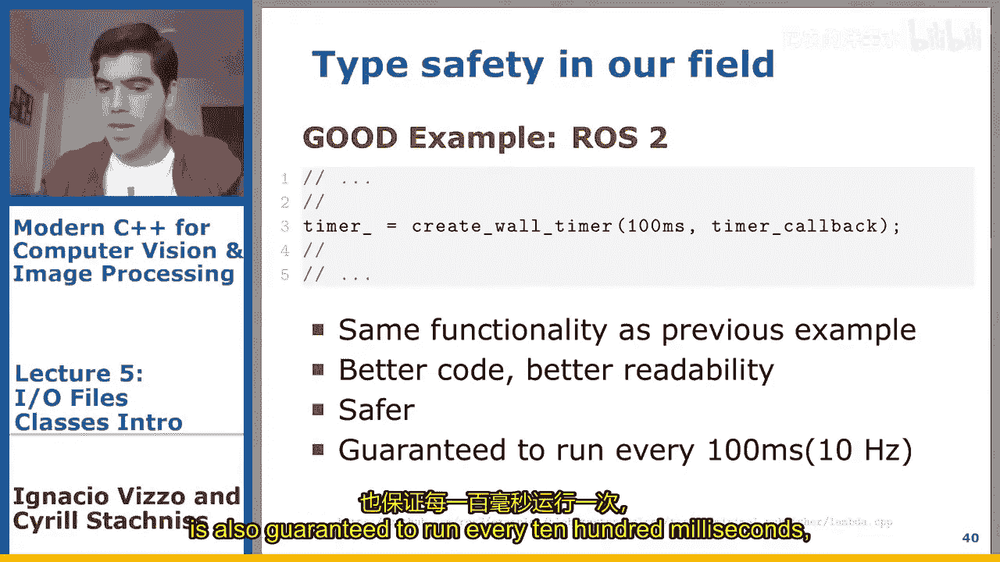

ROS 1到ROS 2的演进也体现了这一点：ROS 1的API常使用原始`int`表示频率，而ROS 2使用了`std::chrono::milliseconds`等类型，使代码意图更清晰、更安全。

### 类与类型

在C++中，“类”和“类型”的概念在很大程度上是相通的。类就是用户定义的类型。创建新类型（类）允许我们编写更匹配问题领域概念的程序，这样的程序更容易理解、推理和修改。

一个类是一个用户定义的类型，由一组成员组成，最常见的是**数据成员**（变量）和**成员函数**（方法）。成员函数可以定义初始化（构造函数）、复制、移动和清理（析构函数）的含义。成员通过点运算符（`.`）访问。

一个关键特性是，可以为类定义运算符。例如，可以为`PointCloud`类定义`+`运算符，表示合并两个点云，从而使代码`cloud3 = cloud1 + cloud2;`非常直观。

类也是一个命名空间。`public`成员构成类的对外接口，`private`成员则包含不应对外公开的实现细节。`struct`是一个所有成员默认为`public`的类。

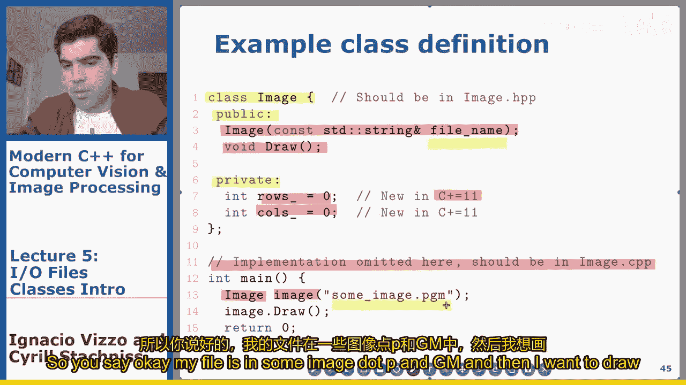

### 一个具体示例：图像类

在计算机视觉领域，一个自然的用户定义类型就是`Image`。

**现实世界实体**： 一张512x512的RGB图像。
**抽象表示**： 一个`Image`类，包含行数、列数、通道数和存储像素数据的向量。
**程序中使用**：
```cpp
Image linux_pic("linux.png"); // 从文件创建图像对象
linux_pic.draw_to_screen();   // 绘制到屏幕
Image gray_version = linux_pic.to_grayscale(); // 转换为灰度图
```

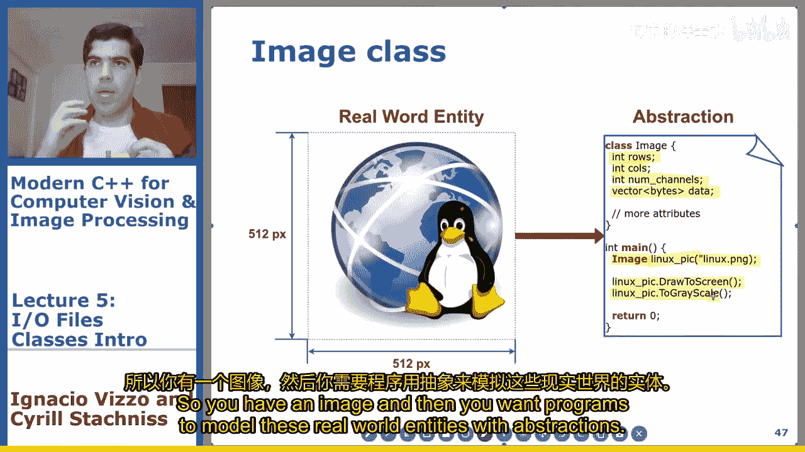

**可能的类定义框架**
```cpp
class Image {
private:
    int width_;
    int height_;
    int num_channels_;
    std::vector<uint8_t> buffer_; // 存储像素数据
public:
    // 构造函数
    Image(const std::string& filename);
    // 成员函数
    bool is_empty() const;
    Image flip_horizontal() const;
    Image filter(const FilterType& type) const;
    void clear();
    // ...
};
```

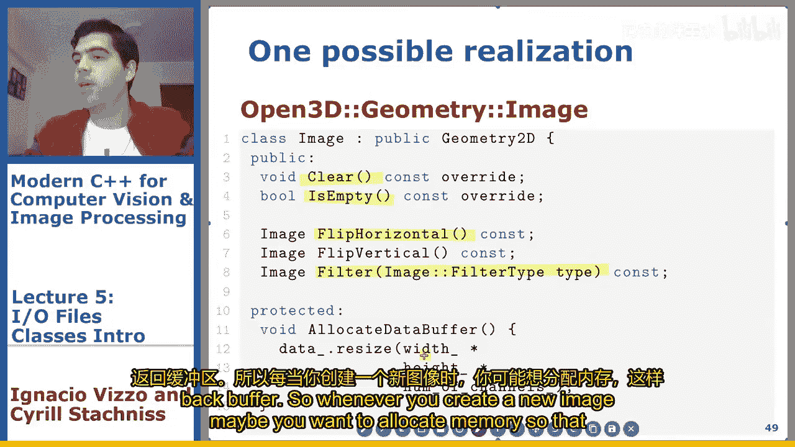

**使用示例**
```cpp
Image linux_pic("linux.png");
auto flipped = linux_pic.flip_horizontal();
auto filtered = linux_pic.filter(FilterType::GAUSSIAN_BLUR);
if (filtered.is_empty()) {
    std::cerr << "Could not filter your image\n";
}
```
通过创建`Image`类型，我们的代码几乎像英语句子一样清晰地表达了意图，这是使用原始数组（如`vector<uint8_t>`）无法轻易实现的。

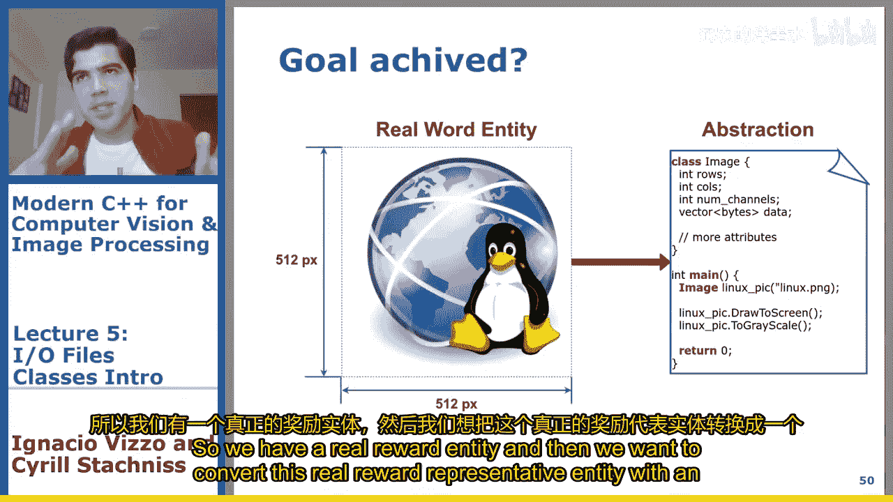

## 总结与作业

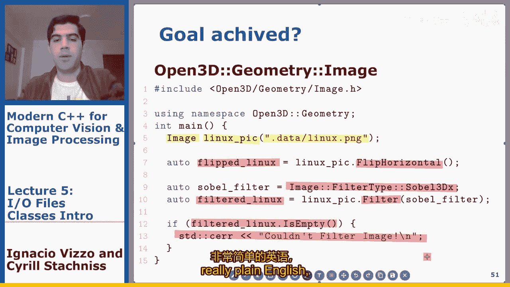

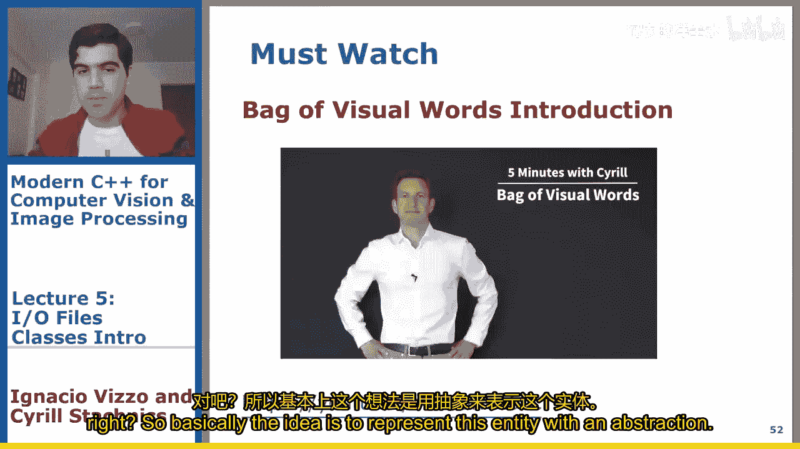

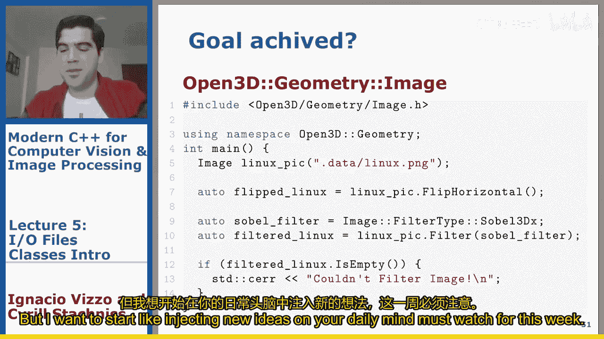

本节课中我们一起学习了：
1.  **C++实用工具库**： 包括`swap`、`variant`、`any`、`optional`、`tuple`、`chrono`等，它们能简化代码并提升安全性。
2.  **文件输入输出**： 如何使用`ifstream`、`ofstream`读写文本和二进制文件，并比较了它们的优缺点。
3.  **文件系统库**： C++17引入的`<filesystem>`库，用于便捷地操作路径和目录。
4.  **类与类型的动机**： 通过实际案例了解了创建强类型用户定义类型（类）的重要性，它能提高代码的安全性、可读性和可维护性，并介绍了类的基本概念。

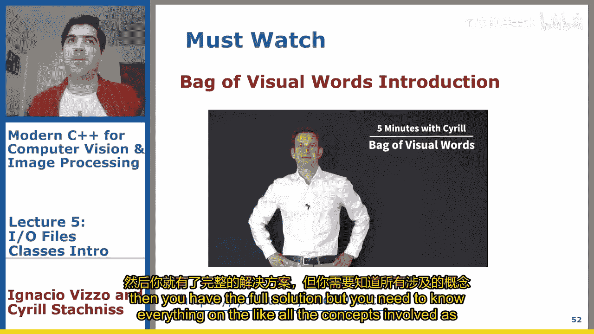

**本周任务**：
*   观看推荐的5分钟“视觉词袋”互动教程。
*   完成作业3和作业4的提交。
*   准备迎接即将发布的作业5，它将涉及OpenCV、特征描述符以及二进制文件读写。
*   如有需要，观看关于特征描述符的背景视频。


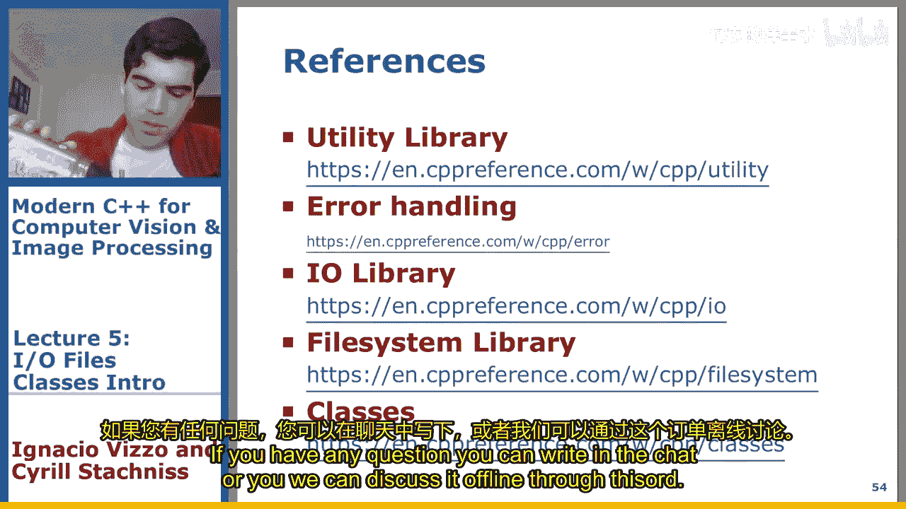

从下节课开始，我们将深入探讨类的细节，这是后续课程的核心主题。如有任何问题，可以通过Discord等渠道讨论。