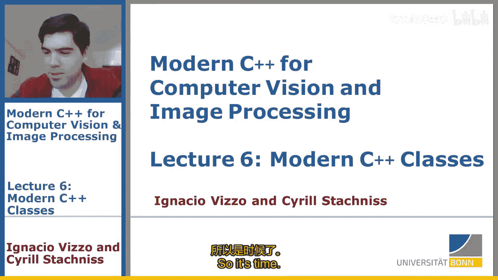
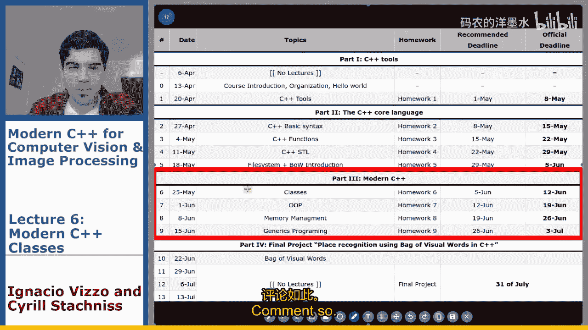
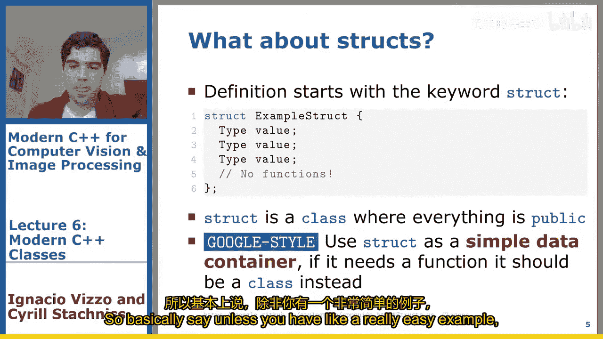
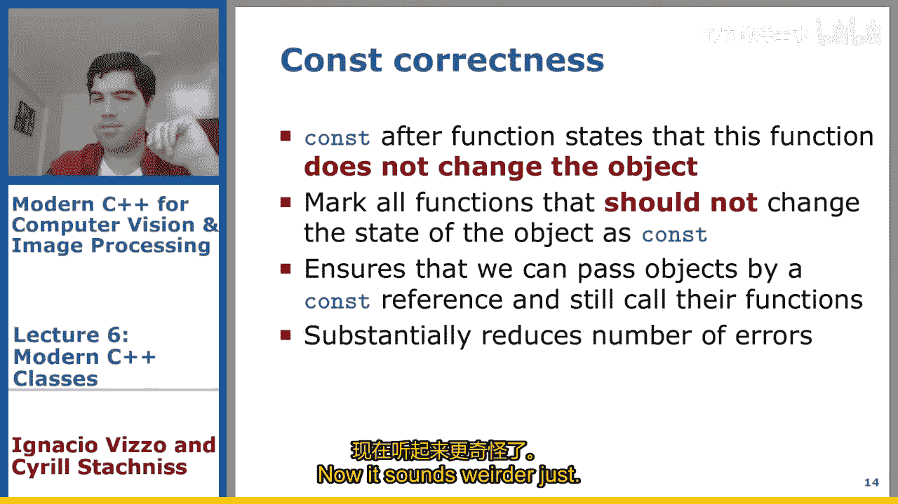
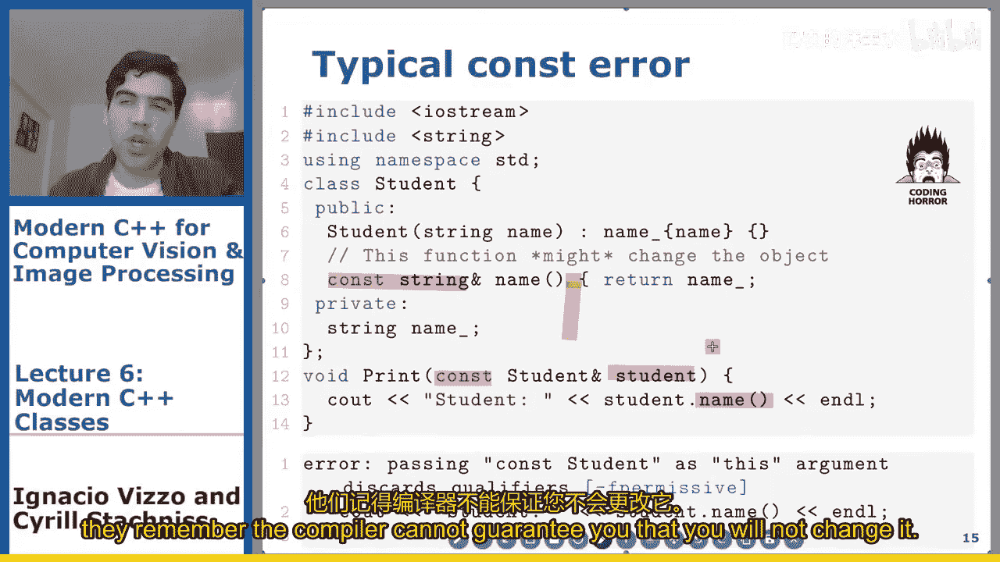
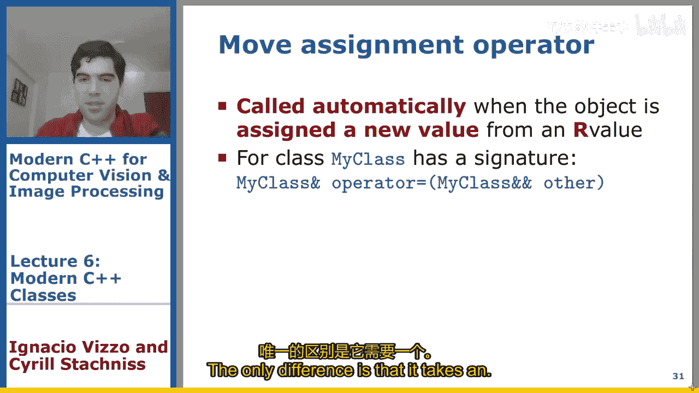
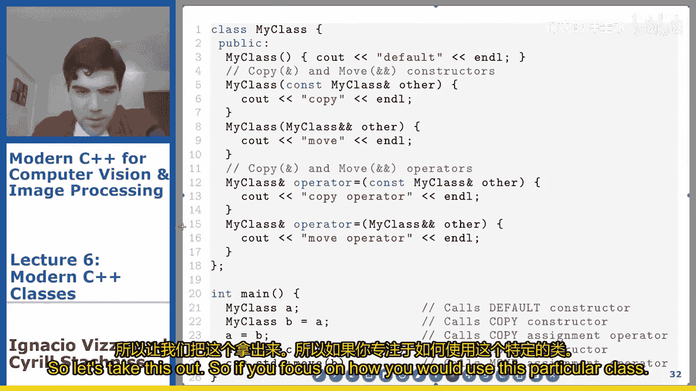
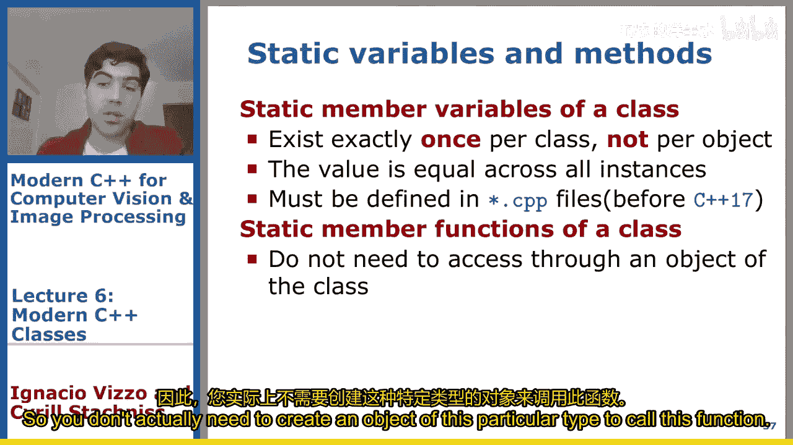
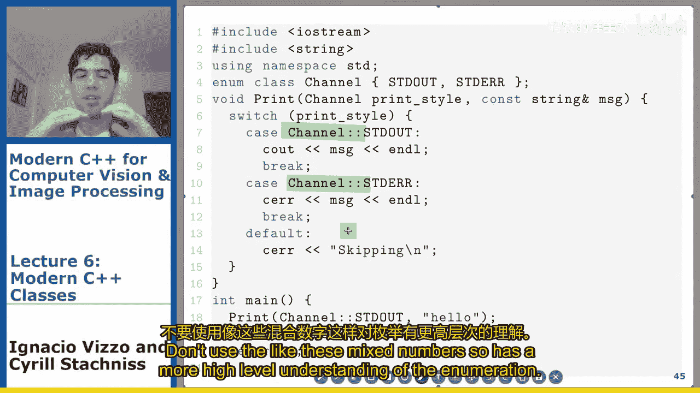
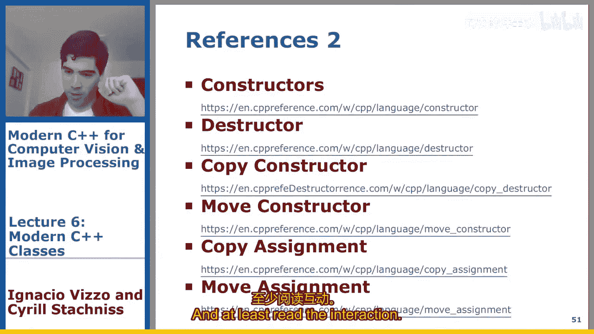

# 【全集】波恩大学 现代C++ CS414 中英字幕 p07 Lecture 6 - 类 -BV1EYm1B5E2D_p7-

So it's time， so it's time to start with a lesson。 So first of all， I want to re up the schedule。

So。Right now， this is the first lesson of the second module of the。C plus plus course。

I won't be great。So we are entering entering phase number three of the course。

 so the first one was about installing an operating system easy， the second one was even more easys。

 the C+ plus core language。Now we are going to dive deep into what I am calling more and C+ plus。

As to give it a name， but today we are going to see classes that classes has been in C+ plus since day zero。

 so it's not extremely modern， but the way we will approach。These topics。

 I will try to make it as small as possible。So。Starting from this week on。

 so the homeworks will be a bit more difficult from previous homework in terms of I will will be giving you less pointers。

So they will be more like。High level instructions for doing the homework and you will be in charge of designing the API and the implementation of the classes that I will ask you to do。

So it's just。1。Comment， so。

This homework， like number 7 and number 8。Will be about the final project。

 So this is the same as homework 5 and homework 4。 So these four homeworks are the most important homeworks in the class because they will be used on your final project。

 Okay， that being say， let's start with the lesson with a really small example。

That I will try to motivate more or less why we should be using classes and new types in C++。

But of course this is just small introduction so in 10 minutes I will try to convince you that there is a better way of writing this example so let's start so on this application let's pretend that I want to model an image like a RGB image like a picture and for now let's keep it simple and short so it fits on the on the screen。

And let's pretend I want to have some functionality over this data， one would be like save image。

 so in this case I want to save a given image to the file system to the disk。For example。

 I would also like to load images from the file system and for some given reason。

 I also want to check if some image is empty， right so。By the way。

 we are not going to implement this functionality， so this is a high level example。

 as you already know this is so if you really want to implement this you need to open color brush key and blah blah blah start calling right but for now let's keep it simple and just declare the prototype we declare the function but we don't do the implementation。

So how can we start working with these images so first we will define a new vector of bytes so how you can do this is using unsed integralte of8 so this is basically eight bits。

That we mo one by。This would be a vector， so each bike will represent one pixel for the given channel will have a number of rows and columns by the way we saw one example of this on previous lesson and then we want to populate the image。

So let's say that we have the Lenna image on the file system and then we want to load the image and then we need to pass a reference to where we want these data to be filled in the number of ros and colos will be deducted from the files that you're reading so when you call this you basically you will go here。

And then you will populate this data member and also the ross and the column。

 That's why there these are our non cons reference。

 So these are like input data to this particular function。

And then we want to check if this image for some reason is empty。

So we can check like this and actually， we can also add like our rows are0。And。Calls。Are zero。

 for example， so if any of these two elements are zero or the image or this function returns empty for some reason。

We can say okay， there was anarrow， so I will print the user and actually here we can return anarrow and skip the pro。

Let's pretend that the image is not empty， so we do something something here。

 whatever filtering processing， you name it， and then we want to save these results to the this so we will pick a new find name so we don't overwrite the。

The previous one and then we will pass the data to this function and then the rows and the columns of this particular image。

Okay， that was a easy example。Explain like this， just like it's innocent。

 and actually there is nothing wrong with it。 there are many， many wrong things with this Excel。

So one of the big issues that this example has is that it's a C style C plus plus code。

 and it's something I am tired of seeing。And actually， it makes me really mad。

So I'm seeing some likes on my feedback， so if you can't see the video properly。

 just let me know in the comments so we can see how to solve this issue。Okay， I was saying。

 so this is something really common on C++， so you have STD vector。

 so this is something that one combine on C， so this is a C++ feature。

But the rest of the code is written as if you coding in C and this is really wrong because you're not using the language。

 you're just using the vector， right， This is one of the many reasons why this is wrong。

This is something I will be checking on your homeworks from starting today and also on your final projects so。

This is now how you will design a C++ code base。Then the second thing that is wrong is that here we have data。

 so these three members data， rows and columns belong to each other， right？

They model an image type on the real world and they should be packed together so but right now there are like three variables that has no interactions with each other。

And then you can you cannot not like associate these three members right So there three variables one can be so if you change one。

 the one will not change and so on。 So you are not encapsulating the data right so it's spread over your program That's program number two。

Second problem is that every time you do need to do something with images， you。

 the programmer are in charge of passing all the arguments properly， so in this case。

We need to pass the data that we want to populate the rows on the columns。

But maybe I am for a distraction error。 I am doing this， right。

And this wheel compile will run and will not give you an error， but there is a conceptual error here。

 so you're misusing the columns twice。But there is nothing in the in this program that prevents you for doing this error。

 So this is unsafe unless you're a really experienced program， right， So this is error number three。

 program number three。And lastly， something that is really important in Crus+ is type safety。

So this data， this data member here， this guy is just a vector vector of bytes。

 This can be anything in your program。 Right now， you see no nacho。

 This is the the data for the image。 So it's quite clear。 But actually if you pay attention。

 this can be anything in your program。 Maybe you have a large code base and you also have vector of bytes with some other data。

 And then when you， for example， save the image here。

 you you can pass another data member that it's not an image and then what is the expected behavior of this。

 Maybe it's I don't know。 there's no type safety， nothing in this program will prevent you to pass a data that does not belong to any inch right So this are like。

Maybe the four weird are most important things that this code us。

Like the errors and we can fix it using more and C plus plus using classes so let's go quickly。

 let's try to rework this， I will try to do it fast as fast as I can。

And then we will see the benefits。 So first of all。

 we want to encapulate this data so we will move this out。

And then we want to create a class that is called image， right？For now， let's。Make this public。

 We will see more about this， and then let's。Rename these。Just， it's just a naming， right？

Now we have a class image that encapsulates three data types。And in this case。

 whenever you create an image， you will have some data inside and rows and columns and they are all sticked together so they are all in the same object right so now we have encapsulations。

The other thing we want to do is how to， let's put this out of screen for now。

Is how to create this image。 So I would like to， for example。

 create an image type from the file system。 How I do this， I will just。

Forget about this explicit word image and then I want to grade this from the file system。

 so I need a string that is the file name。And that's it。 So I will not write the implementation here。

 it's just the the prototype， right？So this is one way I would like to create images as keeping the file name and then trying to to populate an image and inside this implementation that this is a special function that is called constructor。

 I will populate these three three members， so actually I can reuse。The code that I did here。

 So this goes away。And then also， for example， I would like to print an image， an empty image。

And then for this， I will use a default constructor provided by the compiler， in this case。

 whenever I create the image， it will be completely empty。

So these are many ways of breaking the images。Then， for example。

 every time I destroy an image I would like to save the results to the file to the file system。

 sorry， why because I don't know， I just want to do it。

 how I do this its like I will express how I want this particular object to be destroyed with with the image de。

 This is another special function so this is another stream。And then it's called file name。

There is a type of here。Good， and then whenever I destroy this image， I will I will。

When there is an error， I will save this image to the that's true。That's， for now， let's。Now。天在？

So now let's keep it like this， you cannot pass variables to the construct。So that's one thing。 So。

 and then。This will be public to any user。And then lastly， I want to provide。

Some functionality to this image。So， for example， I want to see if this image is empty and without having to pass the correct data members to any function。

 So one thing I can do is I can reuse。This function。 but in this case。m， I。

 I don't actually need this。Me right， and I can actually mark this as cons。

 we will see this in detail。 So whenever I call this is image empty。

I will notice the given image is empty without having to do anything else and then lastly so。

I also want to provide a function to save this given image。 and the only thing I need right now is。嗯。

This the name。Because all the other members are。Inserted inside the image class。

So now we can actually rewrite our application and it's going to look much better and it's actually more correct so first we create an image for example let's called it image and then we want to use the constructor of this particular new type using like the one that accepts a file name as input argument and then we say Lena dopNG that's it。

Right。Then we don't need to do this anymore。 And then if is image empty， we can change this。

Like this， we can do if image is empty and actually we can change the name of this。AndLet's put it。

Empty。Then you bring an error and then inside this image empty。

 you can do whatever you want to check rows， columns， the data， you name it， right？

And then when we save the image。😡，Then we don't need to specify anymore。

 Where is the data that row on the columns because everything is encapsulated within the image。

 So now the only thing we need to do is image and then save image and then。Lner new dot BN G。

 and that's it。 That's all。So if you compare this example with the previous example。

 it's easier to read， it's safer to use and it's conceptually correct， right？Of course。

 you will never want to implement your own image class because there are libraries out there。

But this is just a small example。O。With this 10 minutes example。

 let's try to quickly navigate through what I want you to know about C++ classes so we will not be able to do everything in one hour and I will go as far as I can and then it's your responsibility to finish the slides and to study the topics。

You're not going to learn everything about C++ classes in one hour that's for sure otherwise the world will be different and I won't be as crazy as I am The idea of this is I want to give you the pointers of the most important topics around C++ classes so if I name bananas then ideally you will see the one example about bananas in the slides and then you you will ideally go to CB reference or the C++ book and look around bananas and try to understand more in detail the concepts right so this is just like like pointers to give you a kick overview。

So classes are used to encapsulate data along with methods to process them。

 so in our example we encapsulated the data of the image and the rows and the columns and the methods were like save image and asking if a given image is empty。

Every class or extract defines a new type and this is super important because you cannot mix types。

 so when you call the save image method from the C++ implementation。

 you cannot save a banana type only images right that's the type safety system of C++ we saw it on previous lecture。

So a type or a class。Its the name we will be using to using to talk about a defined type。

 I will probably be using more type than class because I like the idea better than just a class。

A variable of such type is an instance of a classic or an object。 So when I created this。

 so this guy called image。Right here， it's basically an instance of the class image。

 so probably let's rename this， it's not a good name。And then， Lena。

Lena is an instant of the glass image。Or just an objectick。

And then classes will allow you to use C++ as an object orientient parameter language。

 so this is not the only paradigm behind C++ it's one of the many paradigms it supports so if you want to do OOP you can do it with C++。

And for example， string vector， all these types on the C++ system are defined as classes， right？

So let's see a crash course on anatomy so。This is basically， let's highlight some stuff。

So this is where you define a new type with a keyword class orstruct is the same this special function that has the same name as the class。

Will be called constructor and instructors， this is how you create members of this class or how you destroy them。

There's also something called member function that are basically all the functions defined with H class。

And you can also use define operators。So when you define your own operators you will give a high level usage to this class。

 we will see some examples later on and then whatever is these variables inside the class will be called data members and this is basically what the data that the class is encapsulating。

As a quick reminder， like everything else in C++， whenever you open this。Cly racists。

 so this guy here and this guy here you are defining a new namespace So basically whatever is inside here will be on the namespace of the class So this a is' basically my new type column column a right。

 just a reminder。Some keywords we will be using， so class definition。

 it's basically this guy is whatever it's like the the interface of the class without implementation。

 so this is analogly to function definition and decoration。

The class implementation is where you define how you would do all the functions。

 the construct and the instructor， so this is where you put the C+ plus code。

The class data member is which data you encapsulate。

 the member function is how you use this data within your class。

The constructors are special functions that are used to create members of this class。

 the instructors to destroy them。 There's also something called class sets that are all type of functions that will change the。

 the data members for your given class。Also， we have class getrs that are members that will access these member types。

 for example， if you want to access the data for the images。

There's also class operators like how to work with different members of the class。

And there's also static static members so class operators is one of the most fancy features because for example。

 you can have two images and then define the plus operator and then you can write your own function on how this operator should work so you can do image C equals to a plus B where A and B are images and then these plus operator is basically a function and maybe you want to define these sum to be the sum of all over the pixels with a clamp function I't know it's up to you。

And there's also called something called class inheritance that we will see on next lesson。

So the syntax is quite easy actually so the definition will start with the keyword class and then the classes have three access modifiers。

 private protected and public， so wherever is is public it can be accessed by any other part of the program。

 wherever is private cannot be accessed outside the class and。

We will probably see some examples on the homeworkboard。By default default。

 everything is private unless you specify。 So if we see this example here， we say public。Otherwise。

 this will be。Private。And then when I mean accessing。 So if， for example， I do。Lna dot data。

Then I can blah， blah blah， I can do something。Right now I am outside the class scope accessing a member。

 and this is doable just because this member is public。If I would have like a private member， oops。

那丢。Here like private and then I know int private。Then if I want to do Lena。t private。I actually。

 I cannot even auto to complete and you see here an error that you' are trained to access。

Private is a private number of image。 so you cannot do this like quite easily。

 So that's basically the idea behind have。Private and public。

So you can access any member with the dot operator and。

The any class will have always two special function。

 one is called constructor that is called upon creation of the instance under the structure this will always have the same name of the class and the the structure will have the IO。

对。Sorry。This still here， the neookki， I know how to call this。

 so that's how you define this as a structure。And then it's just a recommendation。

 Google style says use Caml case for the class name， this is not strict so the compiler doesn't care。

 but if you see a CAl case， then it's probably a class。So what about tracks。

 So this is for C parameters this will be confusing。

 so the meaning of track in C in C++ has nothing to do with the meaning of the keyword track。

On the C language， right， So in C+ plus a track is basically a class with all its member public。

 That it it's as easy as it is。And then the idea is that you should be using extract only as a simple data container。

 so it's like a class that only contained data。But if you need any type of function。

 then you should be using glass instead。 So basically and unless you have like a really easy example。

 you should be always using strips。

The idea is that you should always initialize these type of tracks with brace initialization。

So whenever you define。For example， this type of truck。Unless you do something weird。

 the compiler will generate a constructor for you， and then you can use this。

Brace in sitation syntax。What about the data so the data of the classes can store any type so you can have vectors integers member of another classes so an image can have I know a filter type inside。

Ially， all this data I must be private， so this is a matter of style so there is something in object or in programminging that is called datacapsulation and that's why you should always mark this as private。

This is how you would use it。 So this is。I also do like this。 you're not forced to do it。

 but all the members I will always do on。Moong letters I'm going to underscore at the end this way I know and I'm talking about the data member。

And all the data should be set in the constructor。This means whenever I construct this this an instance of the class。

 I need to populate all the members， all the data types。

 the data members inside the constructor and clean up in the instructor。

So the classes will always have at least one construct and exactly one the。

 so you cannot have like multiple theors， there is always one the。

Well the constructor basically functions with no explicit rotantile。

 and actually this is sort of true。The name will be exactly as the class and there can be as many constructor as you want。

If there is no explicit constructor and implic default for construct will be generated。

 so if you don't define your norm， the compile will do it for you。

And the same holds true for the constructor。 So this is， for example。

 like a damn example where you have。This some class is the name of the type。 And they you have like。

嗯。Three different constructors， right？The constructor that has no arguments will be always called the default constructor。

 so if you don't specify any constructor while creating the object。

 this is the one that you will recall calling and here you have any other two guys， right？

For example。This some class so you are not passing any arguments to the constructor then you will be using this constructor in this case you're using one integer。

 so this is the one that will be you will be using and so on right so there are more examples there you can play with it。

So ideal you will be using initialize list to initialize data。

 so whenever you use Spec you're probably using this。

The name of together functions usually will be the same as the private member。

 so if you want to retrieve data from the class， then you will need to provide a function so as a small example let's pretend for now that this is。

Private。And then now if I want to access the ros the columns and blah， blah blah。

 I cannot access because this is private then I need to provide cutters so in this case。

I can do a vector door of。うん。And then data。And in this way。

 whenever if I want to access this data member， I will do Lena and then dot data and this is how you access the vector and so on。

 so this is called getter。So get there。Right？And then avoid setter。 So ideally。

 you will want to set the data in the constructor。 So one other type of function you can use is setter methods and then。

This would be boiled and set data， for example， and then you provide a。You in 8。And then other。

And then for example， this is as easy as doing this right and then other。

 and then youre basically copying the data inside the class， but this is like not a good decision。

 So ideally you will want to send this data。Here within these two constructors。An example here。

So the declaration definition so data members belong to the declaration。

And the class methods can be defined elsewhere。 So one thing you can do， for example。I that's。

Forget about these guys。Let's remark this as spellly。Oops。I do great， so this is the data。

 the class definition and implementation。Let's implement oh where is the is empty here。

 let's implement this function。How I do this， I will do image， and then empty。

AndThen this returns pool。 And here is the class a member class implementation。 And then I will。

 for example， return data。Mty。Just an example， right。

 remember you need to access the namespace image， otherwise you will get an error。

This should be markederscons。And that's basically why I can access this data private member。

 because inside the image name space， I can touch my own things， right？

The class name becomes part of the function name， and then there is another example here。

So some key points about this is C+ allows to initialize variables in place， so this is basically。

終わりです。Mentioning this is new in C+ plus 11。Do not initialize this in the constructor so it's super easy。

 so if you want to always initialize this from zero。

 do it like this otherwise you will need to do it on the constructor。

And there is no need for an explicit default default constructor if you have like these E members。

 so if you actually try this example at your place。

 you will see that you can construct members of this class without providing the constructor。

And then， there is a small。Tip that is leave the members of Strs and initialize。

 because if you define them， then it will forbid using initialization as we saw in the brief example。

Then the idea behind the class is also like modular software。

 so the ideas you would prefer to encapsulate information that belongs together into the class。

 this is an example encapsulate data rows and columns altogether inside the class。And also。

 you want to separate the declaration and definition。 So you will have one head file to provide。So。

 this usually will be。On image dot H P P， and then。Sorry。Oops。No。Iage the HBB。And then。These will be。

Image。Right so this is how you will split it。And yeah。

 so something that is really important about classes is something that we call con correctness。

 that is if any member function should not change the data of the class。

 then it should be marked as cons。嗯。Oops。So cons after a function states that this function does not change the object。

 So the example here is， you know what I will。Turn this the link off because it's driving me crazy。

はコんす。嗯。So。Glan the。I love you， but now， let's disable。We need to inspect this code。

 you be now it's cleaner。Anyway， so I was saying so this empty function does not change the state of the class。

 so then it should be marked as con。This way you guarantee that whenever you create a con object。

 you can actually call this function。Mark all functions that should not change the state of the class as cons。

 so unless you need to change like a set method， any member of the class mark the function as cons。

And this will guarantee you that you can pass objects by cost reference and still call these functions。

 You will probably start with this with the homework。 Now， it sounds weird just。

you you will struggle most likely。 So this is， this is a typical constant error。

 So you have a student class。And then you have one data member that is called name。

And then for example， there's a typo here。You will have this getter method and then you want to access this function。

 right？The thing is there is this weird error there is always constant bla as argument discards quaifiers what is supply with this is that this print function is taking。

A con reference to the student。And then the problem is that you as a compiler need to make sure that no one changed this student member right。

 and then when you call name， there is no cons here。So this cons here is part of the type。

 so this is a cons reference to a string。So this is not part of the cons correctnet。

 but here you're missing this and even when you're not changing this name they remember。

 the compiler cannot guarantee you that you will not change it so it will stop the compilation and say this name function is dangerous it might be changing something that you declare cons because here you say this is a cons reference to a student。

So this is really a really typical error when using classes。Yes。Okay。

 so we are going to weekly discuss a topic that is called move semantics。

 so this was introduced on C+ plus 11 and was one of the big missing parts of the language。按的意思。

You can see that this changed the story on the C++ wall。I'm watching the time right now。

 and I think so we will most likely。Miss half of the slides because I'm going too slow。

 but I will drop after one hour and I will ask you to complete the slides on your place。

So to talk about Mo semantics we need to have an intuition on L values and error values。

 this is actually really easy， it sounds more complicated than it is。

 basically L value is left value and r value is right value so it's quite easy。

There are some examples here。So。A is an L body because it's on the left side of the wall。

And this is usually split here。So whatever is on this side is considered left value and whatever is on this size。

 consider R value， right？So， these。嗯。This is L value， L value， L value， L value。

This is going to be our value， our values， our values。

 So whatever is to the right is going to be an R value。

So L values can be written on the left of the Simon operators and r values are all the expression。

If you want to explicitly use an error value， then you would use the use the double a person。

 and this looks weird， but it's part of the syntax。 So it's part of the rules of the。

Language there is one utility function on the utility standard library that is smooth that will explicitly convert any L value to an r value。

For example， in this case。A， so oops。嗯。This a here is a left value。

 but for some reason we want to convert them to an r value。

 then we will use this utility and then we will call this function over a and then we will get an r value definition。

So SD Mo is used to indicate that an object T might be moved from。 This actually means that allowing。

Efficiency on transferring resources from one other one object to another in particular。

 you will produce an X X value expression that identifies its error density。

 It's exactly equivalent with a static cast on an error value reference type。

 So this is a definition it's impossible to understand。 So there are some examples here。

So this movie is part of the center library utility。Standard utility library。

The idea of hand mops is that I will give you an left value and you will give me an error value to this reference。

And then this is something really important the move function does not move anything。

 so don't think this as taking like you have two objects and then when you move it you actually move it from one place to another。

What is talking what is the behind move is taking ownership， So we have two objects A and B。

 and then for example， B wants to takes ownership of a， then you will use the move function。

 but the object still remains the same so there is no moving。In bold， there's one example here。

 Let's quickly go through it， then。So we have one print function that takes us input argument or error value and the same function and then with this we saw on the overloading examples on the function lecture that you can use the same name of the function with different arguments。

And here you use the double amperserson to say， okay， this is an error value。

 And then if you try this example， you， I mean， you will actually do it。 It's， I mean。

 you will buy a run and it will help you to。诶。To understand the concept。

 the big advice here is do not access hello after you move， because in this case， so。

Below it's on the left side of the equal operators， its a left value。

 and then when we call the move function， we are converting this into an error value。

So this print function will take ownership of this string。 So you're like losing。 you say okay。

 this is my child。 just I left it。 It's it's already old enough。 you just release ownership。

 So now the print function can actually own this string and then its undefining behavior。

 What will happen after you call this function。 There is an example here make sure you try the at home。

 And also there is another example here that I will skip。And actually， there is a link here。

 you can click and see the performance。 So if you compare like a copy from a move operator。

 you will see that it's actually faster。And then to summarize and this is like five minutes of Mo semantics。

 it's not enough， so we will should we should have one lecture on Mo semantic so this means one hour。

 so remember these are just pointers。To point you where you should be looking information。

Whenever we talk about a move， you should think about ownership。

 so an entity owns a variable if it deletes， if it deletes。

A function scope onces a variable defining it and then moving a variable transfers ownership。

 So whenever you call move on a variable， youre transferring ownership to this new member。

When designing your prime， you should think who should own this thing and then you will know if you should be using Mo or not。

If we benchmark this， the randomtime is better than copying。

 but it's worse than passing by reference。And now we reach this point that I don't want to skip that is operator overloading。

Is any question popping up so far？Okay， so。Operators in Sus+ are basically functions。

So you can actually do overloading on these operators， and this is really handy for classes。

So this is a signature of any operator， so you will have the keyword operator and then the name is basically the symbol。

 so for example the plus symbol， you can take input parameters as any other function and then you have a return type。

So you can define the less operator， the greater operator， the equal operator。

 the assignment operator， and many more。So a list of operators are on this link and this is one example。

 so we have class a class human， and then this is actually a dummy example， but it's worth it。

So this is a class human and then for some reason we want to define like when a human is less than other human and how we do this is define the operator less。

Then this operator will take a input argument， another human。

And then this is also marked as cons because it should not change the the objects behind within this class and then you will see okay。

 if the kindness of the the object you're talking， it's less than the other kindness then I am。

I am less than this order guy， so that's basically the idea。

You can call this like you can this is a boolean operation。

 so you will have two humans and then you say if human A is less than B， then you do something。

All your option will be sorting， so if you want to call the SD sort function。

 then you need to have defined this operator。And then that's all you need to to do to reuse the SDL sort function。

 that So this is one really good advantage of having these templated functions。And generics。

 So you need to write your own sort implementation for classes。

 The only thing you need to know is to say， okay， if you want to compare if this is less than the one。

 that's the only operator you need to know。 You can run this example， and you will see that it works。

 Another really cool example is using the。Left shift bit operator。

 so in this case this is the operator overloaded for Austria streams。

And then you probably want to use okay， see out and then just call human。

 So this is an instantiation of the class human。 And then instead of like writing your own like okay。

 human dot， whatever， you can just overload thebra for Austriastream。

And then you will basically print this message。 This human is the kind， whatever。 And then you。

 for example， call the kindness that will。Give you the the value of this data member。 Again。

 it's very if you try in your place to understand。The function。

 So this is actually really important because it's really handy to define the plus operation for point clouds。

 Let's say。 So you have two point clouds。 And then you want to add these clouds。

So you have like on really behind the scenes， you will have a list of X Y set points and another list and you just want to add all those points together so you will want a new vector with both members from both sides。

So you can write a plus operator overload in your point cloud class and this is going to make your code more read if you do this in see what you will need to do is to create a add point cloud function and that takes as input Ar to point cloud and returns a third point cloud。

So that's basically the idea behind all these operators to make much better call。

So there are some class special functions。This is something that people struggle a lot with because there are rules that no one wants to learn。

Well， let's go quickly through it。One of these special functions is the copy constructor。

So this is called automatically when the object is copied。For a given class。

 the signature of this copy constructor is like this。And there is here an example of user。

 So when you create a new instance of my class and then you。Use the the parenthees operator。

 Then you're basically calling this copy constructor。

 So maybe you want to define your own implementation on how you should copy data。 So in this case。

 it's even from the。In the slides。There is a copy assignment operator that is equivalent to the constructor。

That is called automatically when the object is assigned to a new value from a left value and the signature is this one。

 So you overload the operator equal and there is。Here are an example of usage。

So in this particular case， you are calling the copy not the call。 No。

 you are calling the copy assignment operator。 So this is another typo on the slide。

if for some reason， you want to overload the copy assignment operator， you might have some。

AndRe of why you should do this， you will see some example on next lecture。

There is also some something called Mo constructor， So this is special special function number three。

 it will be called automatically when the object is smooth。

 So the prototype is like this and this is the interface as well。Again， this is the for one。

 there is something called Mo segment operator， this is the interface。

 it's as similar as the it's super similar to the copy a segment operator。

 the only difference is that it takes an error value as reference。

And there is one example here。Under this， all those four。Os define it here。

 so this is an example that you should try。Try to type it by your own and then you will see like when you're calling each one。

 but basically if you， for example， focus on the usage。So。

Let's take this out。 So if you focus on how you will use this particular class。

It's basically using any other title， so you create a member， then you assign it。

 but behind the scenes， theres a lot of stuff going on。

And then this is something that you should start paying attention when writing C++ program So in this is usually trivial because you are basically assigning built in types。

 but in your case you will be defining your own types and all these single operations like an innocent equal can be a whole function implementation so just keep in mind that there is something always behind the scenes in C++。

And then so while many function much scary。 Do I need to define all of them。

So the constructor and operators will be generated automatically all so constructors。

The default construct， the default construct and these four special functions make six functions。

 so it's a lot of code to write。But this will be generated automatically by the compiler。

Under some conditions。So this is the rule of all of anything。

 So if none of them I define the compile will do for you。 So this is， for example。

 what you should be using for Home number  four。 So don't define any of these。

Six specialial functions。But if you， for some reason， define any of these six special functions。

 then none and are auto to generated。 So let's pretend that for some reason。You say。Okay。

 I will define the instructor。Okay， then all these。

PhiR functions are not defined by the compiler anymore， but if you don't define any of them。

 the compiler will do it for you。So the is that's the rule of all or nothing。

 so try to define none of the facial functions because usually the compiler will give you a better implementation unless you really need to do it if you must find one of them。

 then you need to define all of them。And then for if you want to， for example。

 just define the structure and then need you don't want to write the implementation for the other five special functions。

 then you just call this equal default and then this will tell the compile okay compiler just use the one you were expecting to use I trust you So this is how you should use it。

And then lastly you can also delete functions， we will see how to use these when we study the single term pattern next lesson that will be also using on your homework number seven。

But basically any function can be marked as deleted， and then when you try to call this function。

 then the compiler will say， okay， this function for some given reason is not implemented and it's deleted so you are not allowed to call this function。

And then there's this singleton page example and we will see like I will copy the slides when we see the singleton page。

And then almost lastly， we will see static variable methods。 So let me check one thing。

We're going with time。So this is something that is usually confusing for a lot of people again I feel like this is a lot of information for one hour。

 but ideally this will be the glossary for searching other times or to googling stuff or watching tutorials on CBP reference。

哎Yeah。Okay。So remember that whenever you see or think。As the word static。

In C++ this means something that is somehow related to compile time processes。

 so if it's marketer static is something that should happen at compile time right and wherever it's dynamic is something that will happen at runtime。

So you can have static variable on your class so this means something that will happen so will be created at compile time and not at run time and will be only one for class so we saw an example of static variables on lecture  three I guess。

 but this is basically the same。The value will be the same across all instances and actually before C++ 11 you need to give this value on the CPT function file。

 but now on C+ 17 you can create a hair file and say static variable and give the value there。

Then you also have static member functions that this is something that might be useful when you're designing your own types。

Do not need to access through an object of the class so because this is a static。

 then it's created this function will be created at compile time so you don't actually need to create a new object of this particular type to cause this function that's the idea and can also access private members but need an object。

So the syntax is you use the class name， namespace。

 and then you use double column and then you call the static Me。Example here is static variables。

On this case， we have this。Inteegger variable。 that is static。So we want to keep like how。

 how many objects are created。 So whenever and here we're defining a custom constructor and a instructor and whenever。

We， we create an object or thestruct。 We will increment or decreement this function。

 So you can use it like without doing anything more。 just make sure you。You try this example。

 so this particular thing here。嗯。So。This is now yes。

 this is basically given a value at compile time to this static variable。

 This is not needed in C plus 17。 So on C plus 17， you will put here。

On the declaration you will put here equals20 right and then you have count objects and every time you create an object or you destroy it。

 then you will see how many times it will be this incremental try at your place。This is， for example。

 another example on static members， member functions。 So for example。Is distant function。

 So let's say you have a class point。 and then you want to compute the distance between two points。

 So it's actually weird。 Let me。Yeah， it's actually weird。If you call this function。

 because you are saying if you are calling a list member function。

You have actually compute a distance between P1 and P2 but the syntax is where。

 then it's not really clear what's going on， so you will actually want to call a distance function on points so that's why now it belongs to the class。

And it's not like a floating function somewhere else。

 And then you pass as arguments two points this distance。Function that is mark static。Does not need。

To instantiate an object of the class so you can call this without creating any object then it will take two points as reference and then it will compute the distance and then return a floatinging point value so if you find yourself on this kind of situation so static member functions are ideal for this case。

lastly， there's this using keyword that is replacing the type Dev from C。

 so ideally you should not be using type Devs for some reasons。But with this。

 you can create type alias so we saw some examples on the homeworks。But basically。

 the syntax is using and then you type and then you create the you mark the old type， for example。

Uing vector float equals two SD vector Angular brackets float， right？

So this using word is quite versatile， so you can use it for namespaces， for types。

And when used outside of functions， declare a new type alias。

 and when you use inside the function will create a type Is， but within the scope of the function。

So this is something that you should start using from now on to make your code more readable。

 So this is basically has no impact on the。Sorry， on the runtime and actually improves the the code readability。

 So in this case， we have an image that takes us input as template input arguments。To。Two types。

 and for example， I want to use an image flow that will be this class image。

With the type float and then with a given size， right， this is some type I in。

 There is some examples here， the ideas that you should be using this to reduce verbosity of your classes in C++。

And then lastly super quickly enumeration classes are a new feature in C+ and nu types are from C。

 but not classes。 So this is what what is also called scope in armss。

 you can have an enumerative type but scope within a class name space So the example here is like。

So you have this Num class channel and you have SDD out and SDD error。

There are many reasons why this is better and just using plain enams。For now。

 just take this as granteded， use enumeration， scope enumeration instead of plain enumeration and then whenever you want to。

 for example， you want to switch。And then according to the channel， you print， for example。

 a message to the C， the standard error or whatever。And then， you can do。

Case and then channel SDL that is the first enumerate enumeration and then SD error。

 And then the difference here is this little guy。So you have。

This enumerated type is names is under the namespace of the class channel。

 So SDR and SDR is basically0 one in this example， so this can be anything so you can ideally put case1 here。

 but when you send scope enumerations， then the compiler will guarantee you that you actually don't access Don't use the like these mixed numbers so has a more high level understanding of the enumeration。

You can also add specific values， Okay， one hour。So that was a lot of information。 Most likely。

 the summ is that we saw the。Basic anatomy of C++ classes。

 how to work with K's correctness and move semantics。Again。

 it's impossible that you actually learn this in one hour， So this is basically a pointer。

 So after this lecture， so you probably don't even need to rewatch the lecture。

But you should know what you should be looking for。

If you just type in Google C++ classes there will be a lot of information so ideally I am trying to give you like what is most important about all this information if you want to dive deep on classes then go to CPP reference there's a lot of examples and theyre actually selfcontain and it's actually really easy to understand from those examples。

Also make sure you remember there is something called operator uploading so don't write add image functions。

 you can use the plus operator and define the function there and then also remember the class special functions there are six constructor the。

 copy assignment operator， move assignment operator， copy constructor。

 a mo constructor if you define one of these six guys then you need to define all of them you can use the default flag to the compiler to tail okay these you will define yourself and if you find yourself relying on methods that should not be called from objects itself you can add static variables and methods to your classes。

Right。Videos for this week there's a 10 minutes interaction to S+ classes so I actually like this channel on Sy+ the only thing I don't like is that this guy uses the Microsoft which was studio IDD and then half of the things he do is like blackm that no one understand besides Microsoft but the concepts are explained clearly and there are like 10 minutes videos so not one hour so you can actually go and check it out then there's a small interaction unit testing so this is something that was planned for this week so you should look at least this 10 minutes interaction and if I have time between this week and the following I will be giving you a tutorial on unit testing that is something that I will ask you to do starting from next from Home 78 night and then the final project so it's something you should learn how to use is not super complicated。

And then there are a lot of references that I've used across the these slides。

 so there are two slides with references。 so make sure you click on all of these links。

And at least read the interaction。

Thank you for your attention。