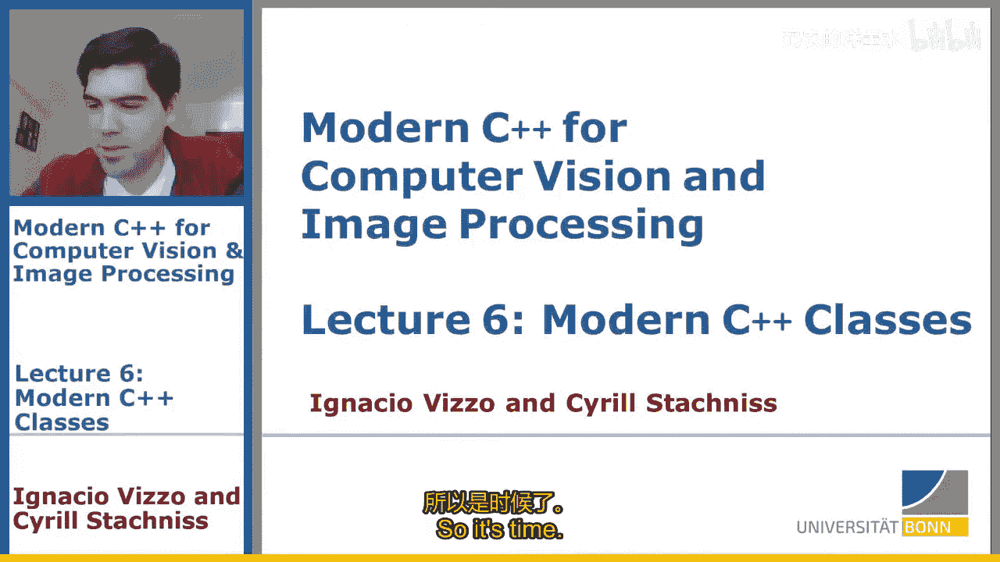
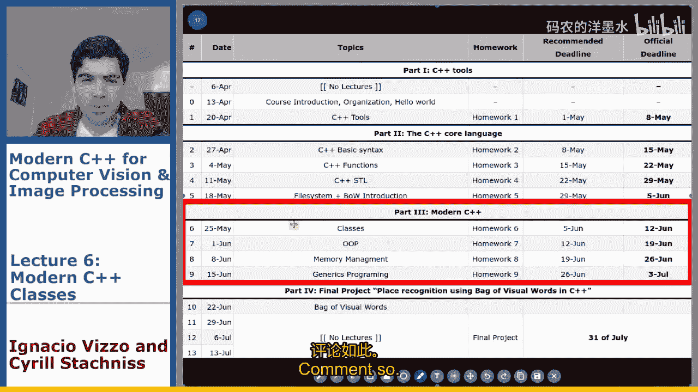
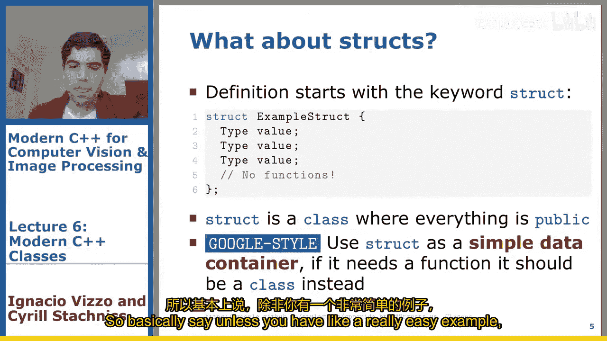
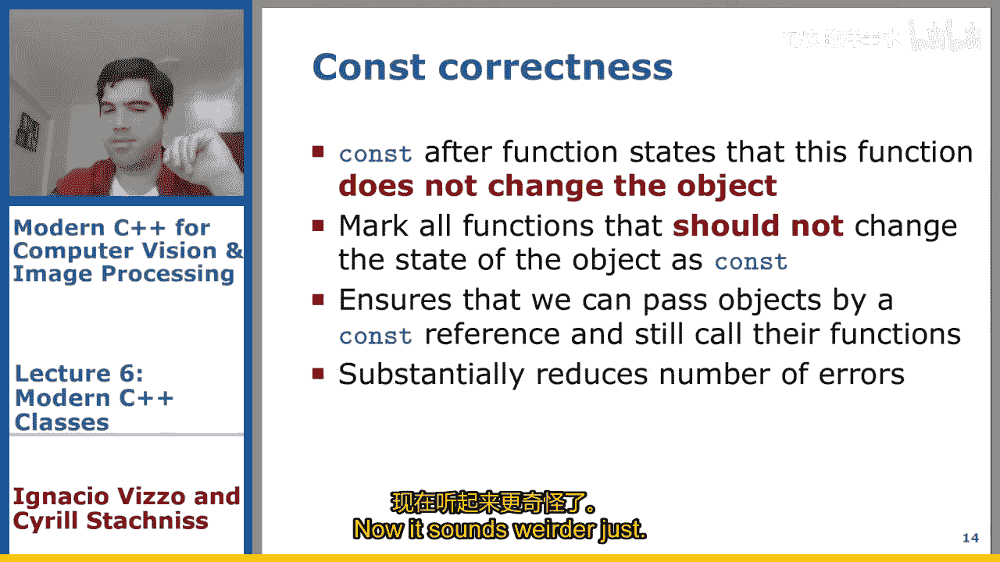
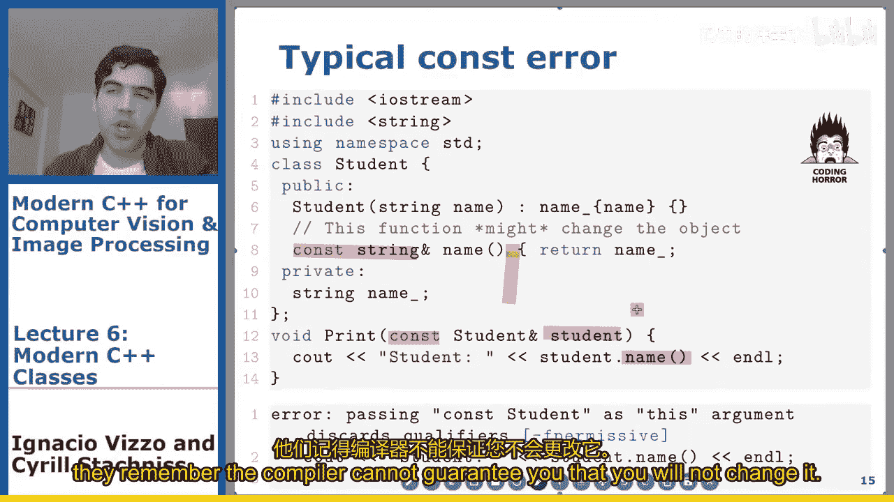
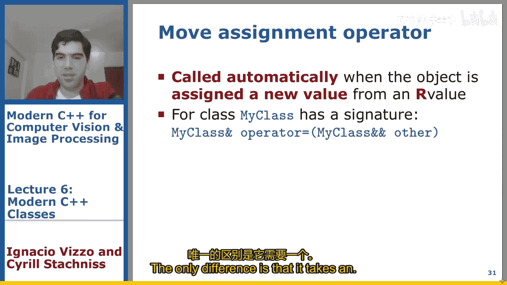
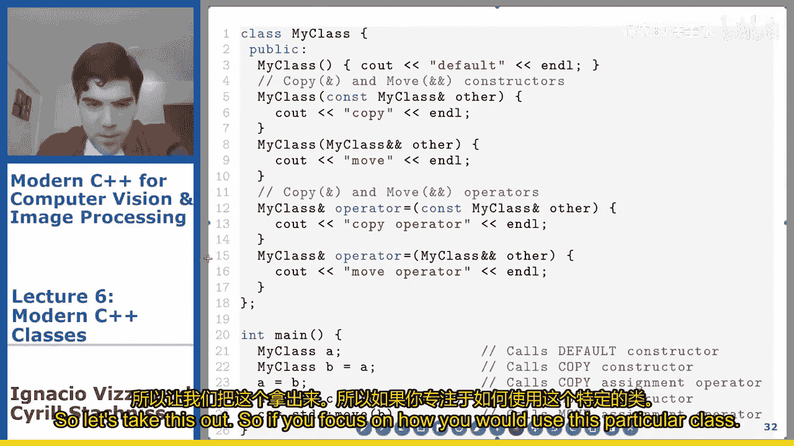
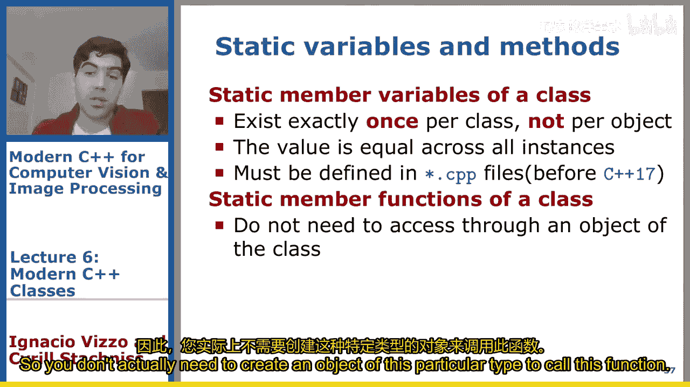
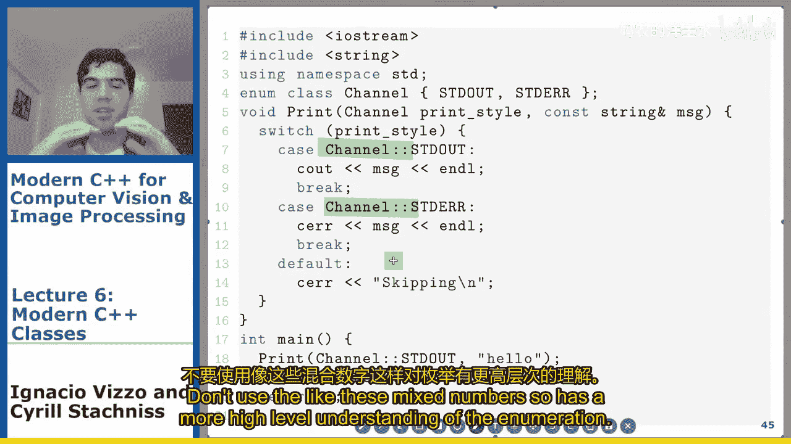
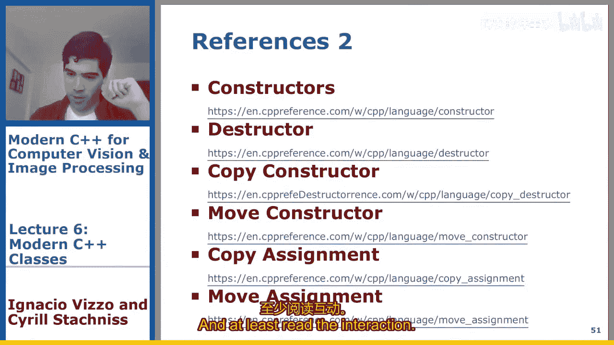

# 现代C++：6：类





在本节课中，我们将要学习C++中类的核心概念。类是一种将数据和操作数据的方法封装在一起的强大工具，它允许我们创建自定义类型，从而编写出更安全、更易读、更模块化的代码。

## 为什么需要类？

上一节我们介绍了课程安排，本节中我们来看看为什么需要类。让我们从一个简单的例子开始，这个例子展示了不使用类时可能遇到的问题。

假设我们想处理一个RGB图像。我们可能会这样写代码：

```cpp
std::vector<std::uint8_t> data;
int rows;
int cols;

void load_image(const std::string& filename, std::vector<std::uint8_t>& data, int& rows, int& cols);
bool is_image_empty(const std::vector<std::uint8_t>& data, int rows, int cols);
void save_image(const std::vector<std::uint8_t>& data, int rows, int cols, const std::string& filename);
```

这段代码存在几个主要问题：
1.  **C风格代码**：虽然使用了`std::vector`，但整体结构像C语言，没有充分利用C++的特性。
2.  **数据未封装**：`data`、`rows`、`cols`这三个本应属于同一实体的变量是分散的，没有逻辑关联。
3.  **易出错**：每次调用函数都需要手动传递所有相关参数，容易因疏忽而传错（例如，将`rows`和`cols`传反）。
4.  **缺乏类型安全**：`data`只是一个字节向量，它可以代表图像数据，也可以代表程序中的任何其他字节数据。没有机制防止你将一个非图像数据传递给`save_image`函数。

使用类可以解决所有这些问题。

## 类的定义与基本结构

现在，让我们看看如何使用类来重构上面的图像处理示例。

```cpp
class Image {
public:
    // 构造函数：从文件加载图像
    Image(const std::string& filename);
    // 默认构造函数：创建空图像
    Image();
    // 析构函数：销毁图像时自动保存（示例用途）
    ~Image();

    // 成员函数：检查图像是否为空
    bool empty() const;
    // 成员函数：保存图像到文件
    void save(const std::string& filename) const;

private:
    // 数据成员
    std::vector<std::uint8_t> data_;
    int rows_;
    int cols_;
};
```

重构后的使用方式如下：

```cpp
Image lena("lena.png"); // 从文件创建图像
if (lena.empty()) {
    std::cerr << "Error loading image\n";
    return 1;
}
// ... 进行一些图像处理 ...
lena.save("lena_new.png"); // 保存图像
```

通过对比，我们可以看到使用类的好处：
*   **封装性**：数据（`data_`, `rows_`, `cols_`）和操作它们的方法被捆绑在一起。
*   **安全性**：创建对象时通过构造函数初始化，避免了无效状态。调用方法时无需再传递分散的参数。
*   **类型安全**：`Image`是一个明确的类型，编译器能防止你将其他类型的数据当作图像处理。
*   **易于使用**：代码更简洁，更符合直觉。

## 类的核心组成部分

### 访问控制：public, private, protected

类通过访问说明符来控制其成员的可见性：
*   **public（公有）**：任何代码都可以访问。
*   **private（私有）**：只有类自身的成员函数可以访问。这是实现封装的关键。
*   **protected（保护）**：允许类自身和派生类访问，用于继承（下节课内容）。

**默认情况下，`class`的成员是`private`的，而`struct`的成员是`public`的。**

```cpp
class MyClass {
    int private_member; // 默认是 private
public:
    int public_member;
};

MyClass obj;
obj.public_member = 10; // 正确
// obj.private_member = 5; // 错误！无法访问私有成员
```

### 构造函数与析构函数

构造函数和析构函数是特殊的成员函数，用于管理对象的生命周期。

*   **构造函数**：在创建对象时自动调用，用于初始化对象。函数名与类名相同，没有返回类型。
*   **析构函数**：在对象销毁时自动调用，用于清理资源（如释放内存、关闭文件）。函数名是在类名前加`~`。

一个类可以有多个构造函数（重载），但只能有一个析构函数。

```cpp
class Student {
public:
    Student(); // 默认构造函数
    Student(const std::string& name, int id); // 带参数的构造函数
    ~Student(); // 析构函数
private:
    std::string name_;
    int id_;
};
```

### 成员函数与const正确性



成员函数是定义在类内部的函数，用于操作类的数据成员。

**const正确性**是C++中的一个重要概念。如果一个成员函数不会修改对象的状态（即不修改任何数据成员），就应该将其声明为`const`成员函数。这允许你在`const`对象或通过`const`引用传递的对象上调用这些函数。

```cpp
class Student {
public:
    // const成员函数：承诺不修改对象
    std::string name() const { return name_; }
    // 非const成员函数：可能会修改对象
    void set_name(const std::string& name) { name_ = name; }
private:
    std::string name_;
};

void print_student_name(const Student& s) {
    // 正确：name()是const成员函数，可以在const对象上调用
    std::cout << s.name() << '\n';
    // 错误：set_name不是const成员函数，不能在const对象上调用
    // s.set_name("Alice");
}
```

### 数据成员与初始化

数据成员可以是任何类型，包括内置类型、其他类的对象、容器等。

在C++11及以后，推荐使用**类内初始化**或在构造函数的**初始化列表**中初始化数据成员，而不是在构造函数体内赋值。

```cpp
class Point {
public:
    // 使用初始化列表
    Point(int x, int y) : x_(x), y_(y) {}
private:
    int x_ = 0; // 类内初始化
    int y_ = 0;
};
```

## 深入特性

### 移动语义（Move Semantics）



移动语义是C++11引入的重要特性，旨在避免不必要的深层拷贝，提升性能。要理解移动语义，需要先了解左值（Lvalue）和右值（Rvalue）。

*   **左值**：可以取地址、有持久状态的表达式，通常出现在赋值号左边。
*   **右值**：临时对象、字面量（除了字符串字面量）等，通常出现在赋值号右边。



`std::move` 是一个标准库函数，它将其参数转换为一个右值引用，**表示资源的所有权可以被转移**。它本身并不移动任何数据，只是做了一个类型转换。

```cpp
std::string str1 = "Hello";
std::string str2 = std::move(str1); // 移动构造，str1的资源被“移动”到str2
// 此时str1状态是有效但未指定的（通常为空），不应再使用其值
```

移动语义的核心思想是**转移所有权**，而非复制数据。对于管理大量资源的类（如动态数组、字符串），实现移动构造函数和移动赋值运算符可以大幅提升效率。

### 运算符重载（Operator Overloading）

C++允许我们为自定义类型重载运算符，使其用法像内置类型一样直观。

运算符重载的本质是定义一个特殊名称的成员函数或全局函数。

```cpp
class Human {
public:
    Human(int kindness) : kindness_(kindness) {}
    // 重载小于运算符，用于排序
    bool operator<(const Human& other) const {
        return kindness_ < other.kindness_;
    }
    // 重载输出流运算符，方便打印
    friend std::ostream& operator<<(std::ostream& os, const Human& h);
private:
    int kindness_;
};

std::ostream& operator<<(std::ostream& os, const Human& h) {
    os << "Human with kindness " << h.kindness_;
    return os;
}

// 使用
Human alice(10), bob(5);
if (alice < bob) { ... } // 调用 operator<
std::cout << alice << std::endl; // 调用 operator<<
std::vector<Human> people = {alice, bob};
std::sort(people.begin(), people.end()); // 使用 operator< 进行排序
```

### 特殊的成员函数与Rule of Five/Zero

C++类有6个特殊的成员函数，编译器会在需要时自动生成它们：
1.  默认构造函数
2.  析构函数
3.  拷贝构造函数
4.  拷贝赋值运算符
5.  移动构造函数（C++11）
6.  移动赋值运算符（C++11）

**Rule of Zero**：如果类不需要管理资源（即数据成员都是能自己管理内存的类型，如`std::vector`, `std::string`），那么你不应该声明任何特殊的成员函数，让编译器为你生成一切。这是最简单、最安全的方式。

**Rule of Five**：如果一个类需要显式定义析构函数、拷贝构造函数或拷贝赋值运算符中的任何一个（通常是因为它需要手动管理资源，如原始指针），那么它很可能也需要定义其他四个特殊成员函数（或者明确禁用它们）。

你可以使用 `= default` 让编译器生成默认实现，或使用 `= delete` 来禁用某个函数。

```cpp
class NonCopyable {
public:
    NonCopyable() = default;
    ~NonCopyable() = default;
    // 禁用拷贝语义
    NonCopyable(const NonCopyable&) = delete;
    NonCopyable& operator=(const NonCopyable&) = delete;
    // 允许移动语义
    NonCopyable(NonCopyable&&) = default;
    NonCopyable& operator=(NonCopyable&&) = default;
};
```





### 静态成员（Static Members）

静态成员属于类本身，而不是类的某个对象。所有对象共享同一份静态成员。

*   **静态数据成员**：在类的所有对象中只有一个实例。必须在类外定义（C++17后可在类内初始化）。
*   **静态成员函数**：不依赖于任何对象，可以直接通过类名调用。不能访问非静态成员（因为没有`this`指针）。

```cpp
class ObjectCounter {
public:
    ObjectCounter() { ++count_; }
    ~ObjectCounter() { --count_; }
    // 静态成员函数
    static int get_count() { return count_; }
private:
    static int count_; // 静态数据成员声明
};

int ObjectCounter::count_ = 0; // 静态数据成员定义

// 使用
ObjectCounter obj1, obj2;
std::cout << ObjectCounter::get_count() << std::endl; // 输出 2
```

### 类型别名（Type Aliases）与 `using`



`using` 关键字可以创建类型别名，提高代码可读性，特别是在模板编程中。它比C语言的 `typedef` 更清晰、更强大。

```cpp
// 为复杂的类型创建别名
using ImageData = std::vector<std::uint8_t>;
using Callback = std::function<void(int)>;

// 在类模板中常用
template<typename T>
class Container {
public:
    using value_type = T; // 标准库常用模式
    using iterator = typename std::vector<T>::iterator;
};
```

### 枚举类（Enumeration Classes）

枚举类（有作用域的枚举）是C++11引入的类型安全的枚举。与传统的C风格枚举相比，它们不会隐式转换为整数，并且其枚举值位于枚举类的作用域内，避免了名称污染。

```cpp
enum class FileMode { Read, Write, Append };
enum class StatusCode { OK = 200, NotFound = 404, Error = 500 };

FileMode mode = FileMode::Read;
// int i = mode; // 错误！不能隐式转换
int i = static_cast<int>(mode); // 正确，需要显式转换



if (mode == FileMode::Write) { ... } // 清晰，不会与其他枚举冲突
```

## 总结

本节课中我们一起学习了C++类的核心知识。我们了解到类是将数据和对数据的操作封装在一起、从而创建新类型的强大工具。我们探讨了：
*   使用类如何改善代码的组织性、安全性和可读性。
*   类的基本结构：访问控制、构造函数/析构函数、成员函数和数据成员。
*   **const正确性**的重要性，它保证了代码的健壮性。
*   C++11引入的**移动语义**，它通过转移所有权而非复制来提升性能。
*   **运算符重载**，它让我们自定义类型的使用像内置类型一样自然。
*   特殊的成员函数和 **Rule of Five/Zero**，这是管理资源生命周期的关键规则。
*   静态成员、类型别名和枚举类等实用特性。



掌握类是深入理解现代C++面向对象编程和泛型编程的基石。请务必通过实践练习来巩固这些概念。