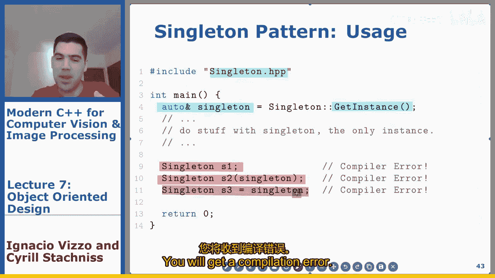
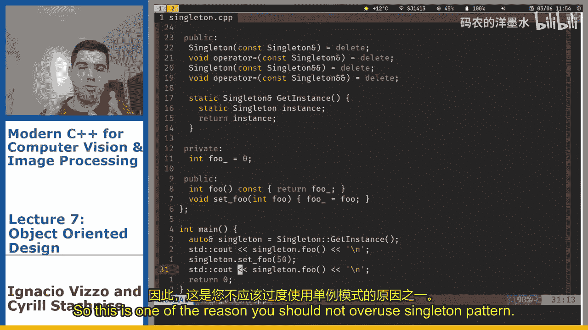
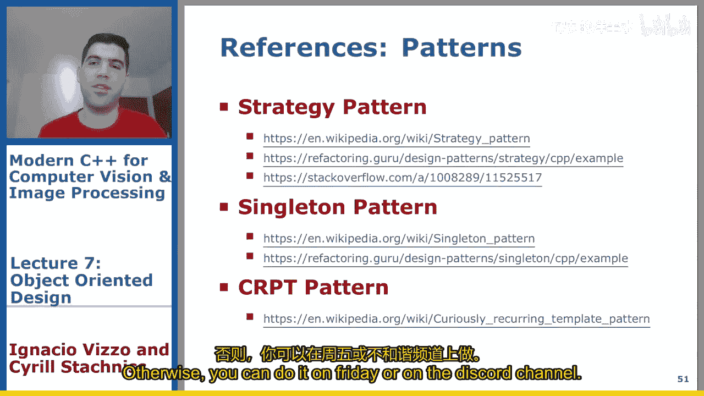

# 【全集】波恩大学 现代C++ CS414 中英字幕 p08 Lecture 7 - 面向对象设计 -BV1EYm1B5E2D_p8-

Okay， so it's time， so let's start with the lesson。

So today we're going to see object oriented design。

 it's going to be a brief lecture as usual on this topic。So ideally。

 so if you ask me if I have to start from scratch C++ course。

 this would be probably the first lecture。This is probably one of the reasons why we don't dive really deep into some topics。

Because for me， it's also important that you can get on track with C++， but if I have to choose。

I will actually expect from you that， you know， the first five or six lessons。

 and we can start from here because this is basically the。The core ideas behind all C++ programs。

 and this is how the language evolved。Nowadays， it's not everything about object or in the design。

 so。The language evolved a lot。Actually， now it's multipartticing so you can use this。 You can use。

Genetics programming， procedural programming， whatever you feel in the mood of using。

 but this is basically the foundation。 So we're going to see like the most important things and ideas about object oriented design with C+ plus。

As a disclaimer。呃。98% of these ideas。are generic for any programming language。

 so actually if you try to find books about object orient design。

 they don't focus on the language because that's the implementation of the ideas。

 it's more on like how to work with these ideas。And also we are going to see two or three patterns today that they are not super cool or fancy。

 but I feel like you also need to see that you can use the DSS behind object or in the design to make some patterns that you can reuse along your code。

So let's first start with a really stupid example， so I wanted to actually rework this example。

 but I didn't have time， so we need to stick with this。But let's pretend you for some reason。

 you want to model some vehicles on your city。For whatever reason right。

 and then typically you will start coding and trying to model this on separate models so you will have for example。

 a bus， a car and a track。The idea behind object during design is usually to reuse code and to group objects that belong together in a class hierarch right so for example in this case we are going to design this with an object during the design mind saying we have a class vehicle will be our base class that this would somehow model all our vehicles in the city。

And then for this class vehicle we need three particular methods。

 so we have three capabilities for this class Why is going to be the fuel amount there ones going to be the capacity like the number of seats that this particular vehicle has and there ones applied rights so these are all vacant examples。

And that's for the sake of。Trying to explain the concepts So and then we are going to have three other classes that will derive from this Ba class and each class will implement its functionality in a different way。

But now we have some sort of relationship between these objects because we know for sure that at least they all stick to the same interface。

So lets do let's try to see a really quick example on C burst to C++。So， let's open the。

Inheritative example。Let's open the editor。No， not here， actually。So。うんす。We want to跟 this one。うん。嗯。

Hi， this is maybe's。Why this not working， I have no idea。Come on。I can't open the folder。

 It's not that difficult， right。Okay， finally。So let's see the seat example。

So we see you don't have this type of inheritance， right。

 so you don't have this way of expressing relationships between different classes。

So we are forced to write a bunch of types and a bunch of。Sorry， a bunch of。

Fs that are related somehow but they are not expressly related in the code so in this case so these examples by the way are on the web page so there is an example zip file with all this code so I encourage you to go and try examples。

So we will have a type that we will call Ba and this is how you define types in C it's quite ugly and then we will have like three sort of data members。

And then we will have like three functions that will try to somehow pretend to be the get function of this particular vehicle。

 and then we will have two or three derived types from this vehicle class it's going to be a vast for example。

 a car and then that's basically it。But the thing is you cannot express like explicit relationships between these types in C and then you need to start to compose this type saying。

 okay this fast it's a vehicle then you have a vehicle and then if you see this example you will see that it's quite complex to read and follow why because it's seen。

And then if we try to。Moel the same behavior， but with C plus plus。

 we can get much better code and actually express these relationships between the classes。

 So we will have a class vehicle this define a new type with some particular information。

 And then we can derive from this vehicle and implement the different type of functions for each type of vehicle within C plus plus with really small code。

 And then here I will explain what is the meaning of this right now that here we expressing explicit relationships between this type。

 Basically， you are saying here a class， a car is a type that is a vehicle， right。

 So it derives from vehicle。 So it will inherit all the information from this class。😊，So。

In order to make the lecture short， well keep moving forward， but again。

 you should download these examples and try it on your place。So the idea behind inheritance。

 that is what I am trying to explain is that a class and a abstract can inherit data from functions from other classes right and this way we can。

Express relationships between the types and also reuse code。

There are basically three types of inheritance in C+ class when it's public that is the one we use that is like if you have a derived class from a based class and you say I am doing public inheritance you will basically all the methods that are public will be public on the derived right class and not the protected one will be protected and the private and so on There are two other types of inheritance that we don' actually use and it's not commonly use。

So for now let's stick to public inheritance。Pollic inheritance will keep all access to specify or the best class so what I said before。

 and this is basically how it looks on the syntax wise。

The idea behind this type of inheritance is that there is an is a relationship。

 So a class derived inherit from publicly from a class base。

 And then we say that the right is a kind of base。 And how we do it with this particular syntax。

 So when you express the。😊，The relationship， you use the column operator here and then you say public and then you specify the type that you are deriving from。

So this allows the right to use all public and protected members of base right and the arrive still gets its own special function so you can add more specification to this derived type and then you can use your own constructor。

 thes and so on。 so you don't actually need to。呃，所以跟。Augment the information within this class。

 It is a really damn example， but it's worth to move through it。 So basically。In this case。

 so first of all let's see what we already know， so let's keep this aside。And then in this case。

We will have a type that is called rectangle and this type will have two members that is protected and now it's this new keyword that is protected。

 So protected is the same as private。 This means that if I create an object from this class。

 then I cannot access these data members but。Classes who derive from this type will be able to access these members if we mark these private these two members。

 whenever I want to derive this type into a more specific one like a square for example。

 then I won't be able to access this to member， that's why we use Proor。

And then we have the width and the height for the rectangle。

 and then we have one constructor that takes us simple the width and the height and then it sets these two parameters。

And then we have two getters metal。 so the width and and the height。 so far there's nothing new here。

 but what happen if we want to refine this concept。Of rectangle and say， okay。

 I can do better with some particular metals like square Well actually the width and height are the same right。

 and then that's where it gives this idea of inheritance you will create a new type called square and then you will publicly inherit from rectangle。

 This means that you inherit all this information here。

Because it's public and protected with the same access specifier， right？What you're going to change。

 for example， because you want to refine this concept is the constructor。

So if you pay attention to the constructor of the type square。This is the new constructor。

 You will only take one integral as input parameter。

 and then you will initialize the base class using the same parameter repeated because the width and height for a square is the same。

 and this is how you do inheritance right you want to refine a concept from a given class and then you will add more specification。

 This is dumb example again try it。What we just did is something that we call function overriding。

And this is one of the most common use mechanism to provide functionality across base class and the right class。

 so any function can be declared virtual， So the idea of overriding is that we are we have one actually this is not overriding。

But it's similar it is that you have some function within the base class and then when you derive you change its functionality in this case we are changing the functionality of the constructor so we are changing the prototypes so it take different input of arguments and also how it works。

So that's the gift behind over。 So any function of any class can be declared virtual。

 So this is a keyword of the language so you cannot use it for your purposes。で三にスキルにね。

So let's try to do like this。And then。If a function is vertical in the base class。

 so in our example the rectangle that it can be over overridden in the right class and how we do this with a specific keyword that is overriding so this is another keyword from the language。

 so this is something you cannot do so these are keywords， right。And then base class， in this case。

 rectangle can force all the right class to overwride a function by making it pure virtual。

 so when you declare the function in the base class and then you delete it。

 so you basically use equals to zero means to delete this function。

 then at compile time we are forcing all the right types to implement this function。

 and this is called pure virtual function and it has some meaning。

One warning is not con function overloading with overriding。

 so remember when we did overloading a few classes ago， lectures ago。

We were basically picking from all functions with the same name， but different parameters。

 for example。네三 function究。Some two integraltegers to floating points， three， I don't know， bytes。

 whatever， and you can have the same name but with different parameters and then you overload this function。

And then depending on how you call this。At operation at compile time， the compiler will say， okay。

 you are calling this function from all these possible functions， right？And if do these。

 the functions don't have to be in a class so there' are just functions。So overriding。

 it's quite similar to word， but it's completely different the meaning。

So you would pick from function with the same arguments and names in different classes of one class hiarchy right。

 So if you overwride a function， depending on which object you are using。

 you will pick this function and this is something that will happen at runtime。

 so it's dynamically solved。There's this notion of abstract classes and interfaces。

 so this is basically a name。To some specific classes， this is not a key word of the language。

 it's basically an idea an object during the design。An abstract class。Let me close this because。

Something is weird with the presentation see the margins were wrong， okay， now it's better， sorry。

An after class has at least one pure virtualual function。 What is purebit function again。

 is just a name for a given syntax。 So if we go back。This is。

Pure virtual function is' going to be whenever you mark a function from a class as spiritual and then you delete it。

And then an interface will be a class that has only pure virtual functions and no data members so that's then a name for a given class so there it's not something that is on language or something that you need to define so if you see a class that has all its members with pure virtualual function and not data members then you call this oh this is an interface but it's the same so the compiler doesn't care about these names it's a way of modeling。

How virtual works so a class with virtual functions has a virtual table I'm going to go quickly over this because it's bit boring and then whenever you call a function the class will check which of the virtual functions match the signature that matches this signature should be called like if you have like a overriding function which the class you say okay you have a square and you're calling these function。

 then you need these from the virtual table。This is what is' called runtime polymorphism。

 and this costs sometimes but it's very convenient， right？An the idea behind interfaces。

 so remember this is chs name when we have a class with all its function members equals to0。

 this means deleted。We call this interface so that yes。

 you must enforce our classes to implement some functionality and we will see some examples with the patterns。

So if you use an interface， whenever you derive from the interface。

 the compiler will force you to implement those functions。

 so if you derive from an interface and then you don't provide an implementations for the deleted functions。

 then you will get a compilation error。This allow thinking about classes in terms of abstract functionality and also hiding implementation from the color。

 So this is a common way to provide。A sort of API。 and these allow to easily extend functionality by simply adding a new class。

Here's one example， right。Let's go quickly through again， try it。

So we have a class that is printable， track and class is the same。 You know this。

And then we will define one unique virtual function that is called print。

 and then we will equal this to0。 This things we deleted。 We are making this。Member function。

 pure virtual， this means that whenever we derive from this class。

 we need to provide an implementation。So， let's。Go， for example， the type A。

 whatever will publicly inherit from principle。 So we need to define the same print function and then override it。

So we need to specify this print function is actually overiding this guy that you are forcing me to implement。

And then in this case， I shall spin the name of the class， I can do the same with B。Right。

And then you can print A or B， and then you will get the output on the console。

 So this is like a really damnmy example。One example of inheritance in ourfib， as usual。

 I like to go to open3， Open 3D。Because it's a good good base， so you can use it as example。

And in this case， for example， they define the newtype that is called geometry 2D。

 so this is I called an interface。In terms of there is no real data members inside。

And all the functions are marked as virtual， pure virtual， so they're all deleted， right？And then。

 you are forced。To implement this functionality within the whenever you the right。

 So this is a way to say， okay， all of these to these geometry types we must conform needs to conform to this particular interface。

 So， for example， if given an image， you need to override all these methods。Actually。

 these two methods are not Marcus as virtual， this one and this one。

So it's actually not an interface， it's an abstract class， but in this case， you also arrive it。

For the sake of the example is the same， so you have over right here， over right here。Here and here。

 they basically implemented。Providing a full specification for this particular derived right plus。

And then of course you will have different meanings for different types of geometries。

 so whenever you want to see if an image is empty you can for example do okay if the rows and the columns are not zero then it's not empty。

 but for other 2D geometry like a range image for example， then this might be different。

It all depends on your type， so this is like an example of how we use it in our field。🤧嗯。

Then there's another concept that is based。Is it part of the basic of object or in the design that is called polymorphism。

 right？This work， it's just a fancy word that came from the Greek language。

That apparently this I have no idea polish means many or match and morefa means the shape。

 so it's many shapes。So the behind polymorph phing is that you can have different objects that can behave differently and take any sort of shape。

So I have one question， I guess， for。This example， sorry。There is a bit of delay。

 so how would this example be different if it was an interface？So， the only difference is that。If。

 for example， you don't provide， so let's say that。

You don't provide an implementation or these so in this case。

 if you don provide an implementation for these two functions。Then at compile time。

 you will not have any error right， unless you want to call it。

 but you are not forced to do this for these two particular functions because they are not virtual。

But for these all functions。You are forced because of the spiritual。 So you are forcing。

Whoever inherited from geometry to D to overine function。Why， maybe because。

For some reason you want in some part of the library， for example。

 you always want to have access to these two methods right the get mebound and get Maxs。

 you always need this so you say okay everyone guys just please implement this function even if you don't care just do it because I will need to use it for I know writing the images or the geometry to this to the file system。

If we want to make this an interface， then we should mark this as spiritual and then now we will be forced to implement also these two functions here。

RightAnd if you don't do it， youll get a compilation error。 That's the only difference。

 It like how you guarantee at compile time that someone will implement a given function。

we will see like some examples of this。In few minutes。

 So polymorphicing going back allows morphine derived classes into the base class type， right。

 This sounds weird， but sometimes it's very convenient。 So， for example。

 we have a base class that in this case could be geometry to the。

And then we have the right class that this is the image 2。We can。

Make this image behaved as a geometry to the object right so we are having many forms of the object because the object can be a geometry to D and also an image。

 of course you cannot do this with I know fruits and images because theres no real relationship between these two objects。

Let's start with a simple example and then again we have this class rectangle with the same two data members。

And for example， we have a class square that we already saw this。

 which is overwriteide the constructor。And then use one only parameter， right。

 So theres no real bodymorphing on this example， because if you want to use these。

Two types then you have a square and a rectangle and every time you need to， for example。

 print the width of the rectangle and height you need to use each specific object and call each member function so you are not really morphine any object into another one so this is objects that could be related or not。

Then there is another example to say， okay， I want to improve my code how I can do this better。

Then you say okay， on the class rectangle， I will define a new member function， not virtual。

 a normal one just a function within the class， and then I will print this guy， right？And then。

In this case， I will also。Define a member function and then I will provide a different implementation Yeah so far nothing new So this is better than manually calling together gather methods like we did on example number one。

 but this still needs to explicitly called the print function so how you can check that you are not doing polymorphism because when you need to print this then you have a square here and a rectangle here So again we have one object of each class and we are using it independently。

Nothing like newer放。But then we can start using virtual and try to make this like implement this idea of polymorphism。

So the rectangle will have a class that is s that will be marked as spiritual right。

 so this means that any the right type can implement and overwride this particular function。

If we go back to example number two。So in this case。

 this is not function overriding but function overloading。

 so this is basically two different functions that are not related to each other。

 so there is no relationship within the class hi hierarch with for these two functions。

And then we mark this as spiritual。 and then on the square， we overwride this function。

 And now there is a relationship we are saying， remember the print function you have on your your base class。

 Then I take responsibility for this implementation and then overwrite。😊，The base implementation。

And then for example， we can have a print shape function like this is outside the glasses which a normal function that take as input argument rectangle。

While rottangle， because this is a base class， this could be also a be geometry to the。

A square is a rectangle， so it can be。Morth into a rectangle and act as a rectangle because it is a rectangle。

A square is a rectangle but a rectangle is not a square， that's the relationship。

 so you can actually pass a reference to a rectangle no matter if you have a rectangle or a square。

 and then you just call the pin function。And then this is example so you have a square and rectangle and then now you're using polymorphism because you're just printing shapes and it's quite abstract just print shape I know these are the objects just printed and then you need to really care like if this is a rectangle or a particular square so if you go through I recommend you to implement these three examples。

On your computer and you will see like the difference while coding right so congratulations now we are using runtime polymorphism we are printing shapes to the standard output。

 deciding at runtime which type of shape it is So this what happened at runtime is that whenever you call the print shape for example square square is a rectangle so you call this and then you say okay this object is a square or rectangle I mean this is not an if else right but think it as this for now and then okay it's a square so whenever you call the print function use this one。

If you don't use B2 or overide here， then there is no relationship between these two functions and then this you cannot do。

Another step， if you want to try it。But for this， you will need to use pointers that we will see in our next lecture。

Is you say， okay， I want to have a vector of shapes。

 and I just want to eat through this vector and print it。 If you copy this example on your computer。

 you will see that this work。 And again。 So let's hide the。The we are part for now， so。Yeah。

 so we have our rectangle。 So I was just。Hide the pointer types。Basically。

 we have a vector of rectangles and we call this shape。And then， we will put。Actually。

 I need them place back， so。Let's hide this and then making it just hide this。

 And now this is the syntax you' are used to。 and then you will place back into this vector two shapes。

 one rectangle and one square。 and this is quite generic。

 you don't care like if it is a rectangular square。

The only thing you need to care is that they all conform to the rectangle or the base class， right。

 because that's the vector that you have。 And then you can。

Later on you can itate through all the shapes and theis shape print。

 and then you will be calling at runtime you will be picking which function from the virtual table if it's a rectangular square。

 which one it is， and then you will call this one This is really convenient and if you inspecttacle is quite abstract right。

And then you might wonder， when is this useful？Basically when you need to encapsulate the implementation inside a class only asking scheme to conform to a common interface。

 so you can have a particular interface and then you can you actually want to hide for some reason implementation of this and say okay this is the interface This is the API of the classes like this is the geometry to the classes They all do this method you can all clear this geometrymetries。

 you can get a bonding box for this geometry whatever don't look to an implementation that's my problem Just stick to the interface。

It's often used also for working with children of Sundays classes in a unifierman year。

 so if you go back， so shape print， you basically are using con members。

From the base class and children classes or the right classes and only five man so you use the same syntax and this usually avoids the mess that a C parameter will do like if this type is this type then do this if not do this and maybe you can do this it's a mess。

 you have an unfi man of working with different types。

This also allows you to enforce an interface in multiple classes。

Like forcing them to implement some functionality that's basically the pure virtual functions and there's something that is called strategy pattern that you will probably be implementing on homework 8。

And where some complex functionality it's outsource it into separate classes and it's passed to the object in a modular fashion。

So some thoughts on class hi hierarchy。Difficult work。

 Sometimes classes must from a hierarchy and ideas that you should distinguish when you design your code between is and HaA。

 So remember。To like these two phrases。 So whenever if if a square is a rectangle。

 then you need to the right right， but there is another idea that is has that is called composition。

But for example a square is a shape so a square can inherit from shape student is a human so can inherit from human for example car has a wheel so there is a composition so let's say you have a type wheel and then the car does not inherit it from a wheel because it's not a wheel it has a wheel so you should not inherit from each other you just need to inside the car class you will have one data member that is going to be one wheel or a vector of wheel or whatever right。

The idea at Google also。ARecomments to prefer composition and then my recommendation is don't get too excited with this object or the design。

 So particularly in our field， we don't we don't need to do like really abstract modeling with sourceco。

 So if you I mean you can go to so if you start like going deep into the class hierarchy。

 then you can go infinite right because。An image can be a geometry 2D。

 but the geometry 2D can be a geometry and then the geometry will be a math space and then you can go like infinite amount of levels in the class hierarchy and then it' get really complicated。

 it's going to be slow and then if you need to actually inspect a code it's impossible。

 So if you need to see something from the base class and then you are inherited from 50000 classes then it's impossible then you need to click click。

 click go over all these source code files until you get to the base class。

So don't get too excited with oh， I have a wheel， a wheel is also a shape and just don't get too excited whenever you feel like this will improve the code performance and readability。

 use it， just be careful。😊，Okay， so the last thing about object oriented designing C class that we were discussed before diving into patterns。

Is something that is called typecasting。 So now we can create our own types。

 and we can also express relationships between these types so we can do inheritance， for example。

And then we can also do composition so we can put an object inside another class。member。In the code。

 and then we have all these new types。 So one natural question will be how to convert。

From one tape to another。 So this is called type casting。So every variable in a C++ pro has a type。

 and then the types can be converted from one to another。

 like not always but usually the type conversion is called type caing and there are five ways to type cast in C++。

The first one is static cast。 This is the most widely used。

 then there is also reinterpreter cast you should be using this or might be using this for homework number5。

 There is also cons cast dynamic cast right and lastly， the P1。

 the fifth one sorry is a C static cast。This the simpleus class programmer， we also call Anaicast。

 Why is this？By the way， after this lecture， you're not allowed to use this C style cast and this is the reason why。

If you do this like between parent this is cast， so you have a variable。

 you will see a syntax and you say this is flow。Then the compiler will first try to do a con cast。

 then a study cast。 And then if these fail， you will do a study cast and then a con cast。

 like after the study cast， then I interpreter cast or our interpreter cast and then a con cast。

Why is this insafe Because whenever you use this C style cast。

 then you have no idea what is going on， but it could be any of these five possibilities and you you don't get to pick which one you use。

 right？Now I'm going to be fast with this， so there are only two pro casting type methods that I care is static class。

 you know， whatever is static it happens at compile time So whenever you say static cast to a new type dis variable。

 it's something that it should happen at compile at time。

 So it's not something that it will happen at runtime whenever you compile the problem。

 this will happen。So with this， you can convert type of variable at Comp time。

 it's rarely needed to be used explicitly because this can happen implic for some type。

But it's never have bad idea to use it。 And for example， for classes you can。

Pointer to an object of a derived class can up cast to a pointer of base class。 So for example。

 you can do static cast rectangle and then you cast a a square right the full specification it's complex。

 but this is probably the one you might be using。Dynamic cast is something that it will happen at around time。

 so it's something that while the primary running will happen。

 so you will need to use pointer for this and it's used to convert a pointer to a variable of the right type。

To a pointer of a base type。So the ideas that you should be avoiding to use dynamic apps because this is cost。

 so this costs time at run time。And unless it's necessary。

 it's very likely that you can express these ideas in a better way。

 but in case you need it at runtime， you can change the types of your classes。

Only when they are related， right you have， for example， a base class and the a right class。

This one is the one we saw collects ago， so you just reinterpret the bytes of a given variable from another to another type and this is extremely unsafe because the compiler say okay。

 you know what you're doing if you have eight bytes and you say this is a floating point it's up to you so this is really a low level casting cast that is you should only use this whenever you write binary files and then the cast is basically to add or to conify any object。

Some comments on this。 And then I will skip it。 You can watch it later， or read it， so。

That was basically it， So that's all I care for you to know about object oriented design like you should know roughly what it inheritance how to inherit from one class you also would like to have this idea of bodymorph and also like how to define vertical function and overwride those functions on the right class that's basically it's not all of object oriented design。

 but it's what I care we would see three patterns right now and depending on the time I will go fast or not So let's start with something that is called strategic pattern。

So if I given class， so the idea of this pattern is that I want to show you that these ideas from object or in the design。

 you can also use it for nice patterns that are not necessary oh I have a vehicle that is an object in the world so this idea of modeling everything with inheritance is good up to some point。

 but you can also use the underneath。Inra to create new patterns that are not strictly related to these objects and classes and whatever。

 right？So the strategy pattern is the is that if a class relies on complex external functionality。

 you can use this pattern and this adds。Or switch functionality of the class without。

 without changing its implementation。 That's why its called strategy。

So you have a class and then you want to write three strategies for this class。For a given thing。

All strategies must conform on one interface and this is one example。

 so we have a class strategy that is pure the function is only one so we have only one pure vector function this make this class interface right and then we can have two strategies that are different that will inherit from this strategy。

But not in the sense of like oh， a strategy a is a strategy， but in the sense of okay。

 I need to implement a new strategy and I want to conform to this API。

 I need to overwride this print function， right？So far in Nafinu we the source code。

 which has defined an interface that is a strategy and the right two classes from this interface implementing the virtual methods。

The strategy pattern comes into this place， so we have another class that is the source like the sync sorry class of this strategy pattern。

And then we we will use composition and we will store a reference to the strategy， right。

 So if you see here。嗯。We are not storing a reference to strategy A or B just strategy， right。

 and then we will provide a function that is print that we basically call the print method from this strategy。

And then this class has a con reference to the object so it cannot change it。

 and then the strategy will be picked when we create the object of my class so you can create a new object of this class and say。

 okay， I want you this strategy and then you use A or B。And because C++ supports polymorphism。

 this strategy A can can form a strategy， not A or B， just the base cluster this interface。

We need to hold a reference to all types of available strategies。

So how you can see that someone does not know how to use this just test language because with this type of patterns。

 you will spectacle and then you will have if blah， blah， blah， then spray this strategy A if blah。

 blah， blah， blah， blah else， then this variable do strategy underscore underscore B。

 and then you have like multiples objects within Hnder class and you pick like with some。

I if I else at run time， and there's much better way of doing this with these type of buttons。

 So you have one strategy。You have that is the base and then you have as many other strategies as you want。

 and then you stop there with a high guarantee with inheritance。And then whenever you want to use。

 I want to create。I want to use this particular strategy， then you create。

This my class type with this given strategy。 and then you don't need to do if else whatever。

 This is much better， right， It's better to read also。

 and then the print metal has nothing to do with the one that we define。 So this print here。

So don't be confused this could be called bananas。 I like bananas。

 It has nothing to do with this guy， right？Try this example。So for example。

 this is how we would use it， so we create strategy G A and B。

And then we will have object one and two， so it's all fake names and then we pick which strategy to use like passing the strategy to the constructor right and then whenever we call print so we can do this in a loop。

 we will pick different strategies， right。So the is that you should not overuse it。 So this is。

So all the buttons are usually nice。Again， you should not get really， really excited。

 so just use it whenever improves code performance or reability。

If your class should have a single method for some functionalityity and then we need to honor implementation。

 then don't make it bit well and then use it mostly to avoid copying coal and to make classes smaller。

 right？喺。1， go over to it。 But on the。On the files that I provided to you。

 there is this this is one example of one whistle project I did some time ago。

So hopefully this works now， so don't even try to compile this code because it doesn't work so this is like 5% of a big project but I just cherry pick the files to give you an idea of when you can use this。

So in my case， I was doing ICP for point clubs and then I had different implementation for this ICP。

And then， for now。It's the ceal it's already， great。And then。

In order to pick these different strategies。I have this ICP strategy that is basically an abstract class。

That has an interface that all the derived types that will be the different strategies needs to conform to this particular interface。

 So besides details， so we have one function that is called process first cloud。

 So you need to provide an implementation if you want to be a strategy for IP or history a new cloud the name of the strategy and so on。

 so you can inspect this So it's a big less so don't worry。

And then here I picked like three of the strategies I was using。And in this case。

 if you see this one， for example， there is this below one thing and it inherited from this strategy。

 so I am now providing a full specification for this particular strategy for ICP。

And then we need to provide an implementation for process first cloud， Re new cloud and so on。

 how with the override keyword， so all these override function are overriding the IP strategy functions if you don't do it。

 then you get a compil error， Don't even try to compile this because you're missing most of the files。

And then here you can also see like the actual implementation of these things and there's another Nf ICP using Nf key pointss again。

 the same interface with different implementation。And then， for example。

 I was using Ros for this example， and then you can pick like。

🎼With this registration note that I think I also give you the the。The implementation。

 which strategy you want to use。 And actually with this。

 you can also change this functionality at runtime。 It doesn't make much sense， but you could do it。

 And here on the note， you can see that basically you're holding a reference to this ICP strategy。

 So this is an example， if you really want to see how you will also use it for IP， for example。

Then singleton pattern， just be careful with this because it's quite easy to understand。

I guess and then if you start to use it everywhere。

 then it you it's not a good idea to overuse this pattern。

 so it's easy to use and also easy to misuse so be careful。So second pattern that we can use。

 Let's pretend that we want。Only one instance of a given class for any reason。

 have one class for example the bug of Vi word dictionary you might want to use for your final project and then you want one object of this class you don't want people to create multiple objects for example this for a rectangle doesn't make sense because you probably want bunch of rectangles in your per for any reason but for a dictionary in your per there is only one unique dictionary and then you don't want anyone to copy this or create new ones then you will use a single pattern。

Without simple+， this would be an if else mess right， youll see okay。

 if objects are created then don't do it， it will be a mess right。

 but we have the compiler and then we can use it in our favor。

RightAnd then we can make sure that nobody creates more than one instance of a given class at Comp time。

 right？And do not overuse it， it's easy to learn but usually hides a design error in your code Sometimes this is still necessary。

 but it makes your code better， but just be careful。One disclaimer， this singleton pattern。

Does not use any idea of object or the design， but it's part of the patterns I want to teach you。

 So that's why it fits into this lecture。A by the way。

 you need to use this for homework number seven， so pay attention。

How we can do this so we can delete any class member function as we saw it with whenever for example you have these virtual methods and then you equals to0 then you delete this function。

 we also saw it on previous lecture， this also holds true for special functions like the constructor。

 the copy constructor， the copy seminar operator， the move constructor。

 the move as operator and the the structure， the special function also holds true you can delete these functions。

And then just remember that any private member， this function or data member can only be accessed by a member of the class。

So someone outside the class cannot access。This嗯。This member and also if you inherit。

 you could not access this member as well。Neither。So how we implement this single term part。

 we want one unique class across the program。 So first of all。

 let's hide the default construct and the instructor with this， we say okay。呃。Actually， yeah。

 so here。I've even forget it。 So we are saying we have one singleton class let's call it and you have the default construct and the default instructor right。

 so you don't provide a specific implementation， but you make this private。With this your。

Forbidding anyone to create a singleton object， so for now you just hide the construct this if you want to create that object。

 you will have a compilation error， right？This completely disables the possibility to create a single object or to destroy it。

So good， first of all， we are going good。 And then let's。Delete all copy capabilities。

 so no one can copy objects of this graph。 So for this。

 we need to attack the copy constructor and the copy assignment operator。How we do this。

 we just delete this function。 This is the same of doing equals to0。

Basically here you have the copy constructor and then the copy assignment operator you should just say delete if anyone wants to call this special functions compilation error。

 it's not allowed， right？And then you will start hating the compiler， but believe me。

 it's your friend。This completely disables the possibility to copy any existing single object。回 done。

Not dreaming。 So now we cannot create objects of the singleton class。

We cannot copy objects how do we create the unique instance in my program because it's not allowed anymore。

So how compiler to the risk， as usual， C+ has a powerful compiler， we should use it。

We can create one unique instance of the class and probably you might be guessing that this should happen at compile time。

 I will do this with static， right？So we will provide one member function that is static and with this we are allow him to access this function outside objects of the class。

 So if you go back to the static explanation from previous lecture。

 you can just call singleton double column and then this function。

We will call this function get instance， so this is a name you pick it。

 this is quite common and we will return。A reference to a single object， right， And the idea。

 the key here is that。And let's pick this color。You are creating an instance of this class at compile time and aesthetic This means that when you compile the program。

 this object will be created and will be part of the data of your program， and that's the unique。

Object you create from the class， right？And because you disable the copy capabilities and constructing and distracting。

 this object will be lie across the whole duration of your program and you cannot touch it。

 you cannot delete it， you cannot copy it nothing。 It's one unique instance， so it's quite nice。

 let's say。So this is the full pattern There are much or better ways to implement this pattern。

 but I will say this is the most easy single term pattern in C++。How we would use it。

 So we provide this on a H file， for example。And then so let's throw this on singleton dot HPP。

And then we cannot create objects， but we can call this get instant function。

 right with this synt because it's a static member function of the singleton class。

And then we just get the reference to that object inside this class that was created at Comp time。

 So we are referring something that is already a lie， right？😊，And then， for example。

 if you forget about the fact that you're using a singleton。

Then this will provide this will give you a compilation error because youre in this case you are calling the construct and it's private and you are not in so this main is not part of the scope of the class so you cannot call it。

 right。If you want to copy this， so basically you are calling the copy constructor here and no comp error。

 you are not allowed to do this。And then if you want to do the copy a seminar operator， again。

 you cannot do this， You will get a compilation error。

And here， I have like a。Make a small example for you。啊。And singleing thumb button。So basically。

 the only difference with the slide is that I either this private member， there's just an in。

And then here I provided a set and getter method so you can actually access the data members inside the singleton class。

 but through this get instant function。And in this case。You create this reference。

To the instance and then for example， you call F and first you will have zero because that's initial cellation value value and then you will set4 to 50 and then you print it right so you have one instance across all the program and then you can use it everywhere So why this might be complicated because everyone who has access to this interface will have access to the same object so on a movie training scenario this will be a mess because you can have multiple tracks of your program accessing the same object in memory so this is one of the reason you should not overuse singleton pattern but for now let's say that for the dictionary for your final project you want only one dictionary and then that's it and then you want to guarantee that no one else create dictionaries right so。

따 되 신교빠。No real inheritance， so no object or the design， just another page。

There is a funny pattern that is CRRPT， CRRPT， that is curiously recursive team pattern。

So this is one another pattern that you can use。But this involves inheritance again。

 it's not a matter of like if this object is a whatever it's a matter of using the underlying infrastructure to provide better patterns and then for some reason let's pretend that you want to create new types but every time you create a new object of your new types for some reason you want to print to the standard output the name of the type。

How C people will do it or how C plus people without knowing patternsants will do it。

You just implement a bunch of functions like with you on the first examples。

 so if actually if you see the print examples， they are similar to this。And then you should， okay。

 you say， okay， for this example， then print this。 And then you type all the types。

 you basically read like copy paste code。 There is no compilation guarantee for this。 And it's。

 there is a much better way of doing this。 So you， you will first define。

A base class that is called Pri。 So this is。What I am calling， basically。

And then this will be not really a class， but a class template。 We will see template soon。

 but you already have some idea I respect right， So this class principle。

 we have a public constructor。And then it will be explicit because it's not the default one。

 so it's something that we provide and then whenever you create any object of this printable class。

 then you will print to the standard output that I would do this with Bo called the mans So this is part of the Bo libraries you just call this function you get the name of the type at compilation time that's basically。

And then the r here of the recorded pattern is that you can actually use this and say， okay。

 I have one type that is called example one， and this could be any name that will be inherited from principle that it this class member and the type will be example one right so here's the recursion of the template so it's。

It's a reant thing， right？AndWith this you saying okay。

 I want to inherit from this type publicly and because I don't provide any implementation。

 I will be always calling the constructor for my base class so whenever I grab an object of example one I I will get into the standard output。

 the name of the type and then the same four other types right。And then if you use this。

 if you try this at home， you will see that if you create object of these particular types。

 then when whenever you create the object， you will get this print message on the standard output so you will have like type rate whatever。

 So this is something that。You might find useful to use at some point。So a summary。

 we reaching the end of the electron。 So we saw some small ideas on inheritance and polymorphism， so。

These are basically the pillars behind object or into design again I don't expect you to create a class a hierarchy for like the wall and the humanity。

Just。Use it whenever it's convenient like， for example。

 forcing the right types to conform to a particular interface Also we saw briefly type casting so whenever you need to convert from one type to another and we saw three patterns So the the singleton pattern is something you need to use for homework number 7。

Strategy pattern will be most likely used on homework 8， and then a CRRPT might be used or not。

 but the is that you see this pattern on how to use the language to get like to create your own tools to work with。

There are two videos for this week， like 10 minutes videos。All the pilots of object directed design。

 so encapsulation， abstractions， inheritance and polymorphism。

And there's also one specific view for polymorphism and then。You need to watch this video。 So next。

 this is something that。嗯。ItsFor people who don't have experience with T it's pretty going to be challenging so next week we are going to dive deeply into memory management with C++ and for this is a prerequisite to no pointers so I already so the one who teaches this class before me here already a good lecture on memory raw pointers and memory management with T this in C++ so this lecture is a prerequisite for next week lecture right so you should watch this it's about one hour。

You should try the examples either dust there and try to get some understanding on this because otherwise next lecture will be quite difficult for you and I know pointers is not an easy topic。

And actually it takes some time to get used unless you have an electronics background engineer or electrical engineer or you already have experience with C So if this is not your case。

 then you should probably start looking into it， just watch videos on YouTube。

 just get information into your brain so your brain start adapting to this idea of pointers， right？

There's some reference as usual on CPP reference about object during the design。

 so how to direct classes， what B means， of write， whatever。

 and then all the type casting we covered the reference are there you just can click and see more information and there's also like some links about the three patterns we saw on this class。

 the strategy pattern， the single on pattern and so on。

And then that's basically from my side if you have any questions， this is a moment to ask。

 otherwise you can do it on Friday or on the Discord channel。

