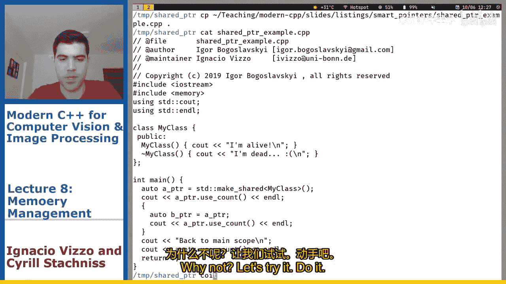
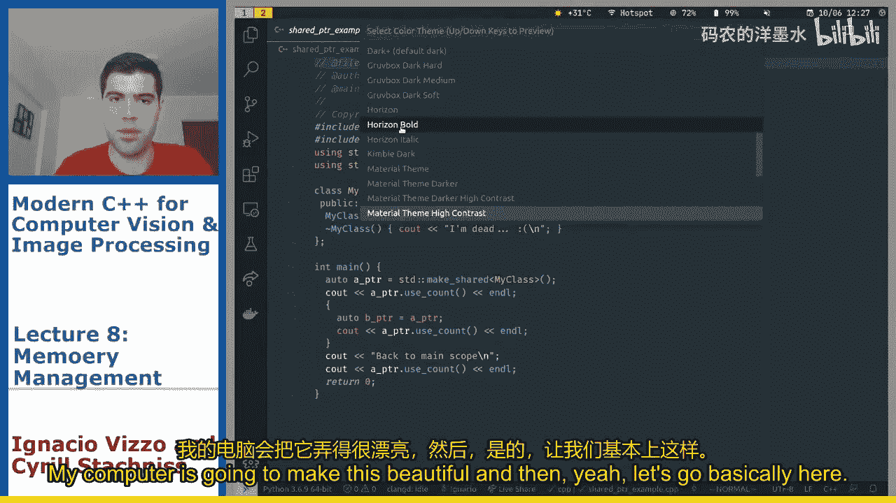
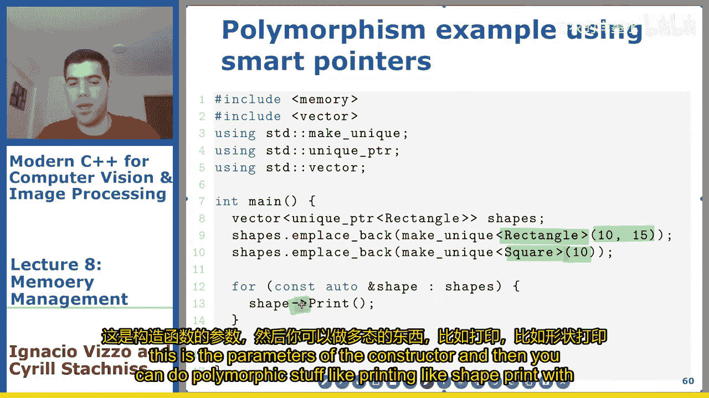
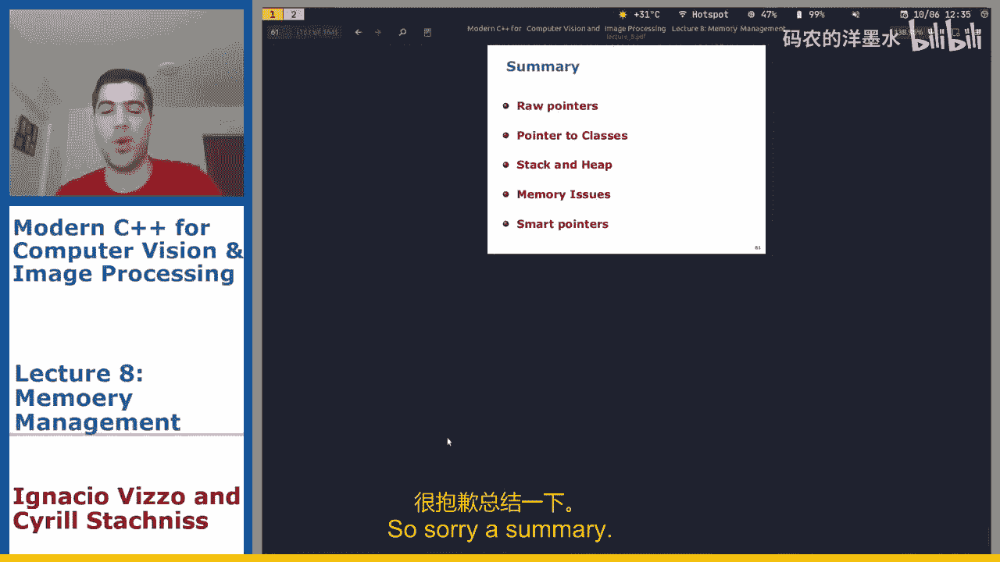
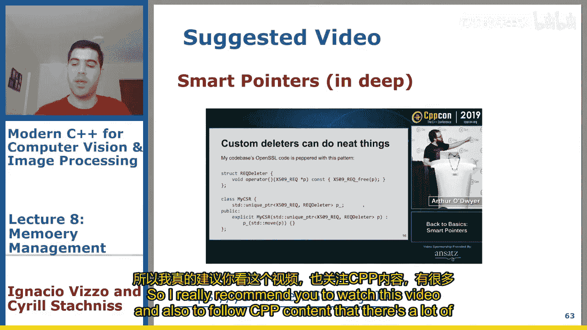
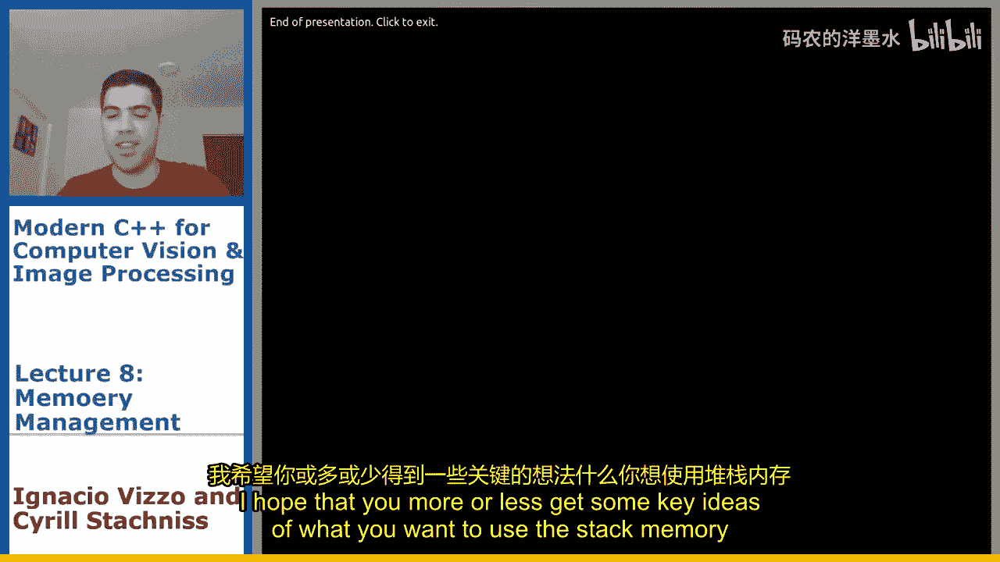
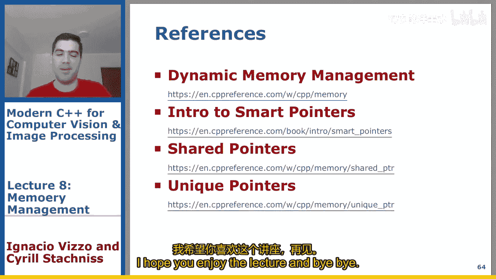

# 【全集】波恩大学 现代C++ CS414 中英字幕 p09 Lecture 8 - 内存管理 -BV1EYm1B5E2D_p9-

Okay， so let's continue with this。So the idea of pointer is that you will have some sort of valuable that will allow you to。

Point to some particular address in the memory。 And I was saying that it's actually so。To young。

 but I know if you remember some time ago we have 32 bit systems and then in those systems the pointer variable was only 4 Bs。

 This means 32 bits that's why it's 64 bits long because it's pointing to an address of memory that can be 60 bits so so far it's easy to understand but there's nothing。

We are in in this。 So there's another example here that you have a pointer to a pointer。

And there's some guidance here and that's basically so I will skip these row pointers。

And we will jump right into the point of two classes， but before I want to show you one example， oh。

 hello Nacho。So。I prefer here。One example。So。What is this？Yeah。MakePoers。But it's not here anymore。嗯。

I， and then。Create pointers， CBD。And let's do it really， really easy。So this is probably too big。

So we have the name function here。 and then let's do one variable that has five。

Then and then let's create a pointer to an integral variable。

And then let's call it pointer to full and then we will store the address of full so this is like a really stupid example again you should try it on your place。

It's beliefs。Pointers and then let's call it pointers that's see， not the O。

And then one thing I want to show you is that I didn' in。Manad to make the buging tutorial。

 but one of the ways I learned to use pointers was using the vggs， so I admit and。The funky ones。

 so this is eclipse thebuggger， so you can install this without installing the whole eclipse thing。

 But why this is like easy to learn because you have like your program here and then you can inspect the variables。

And let's set through this point where all the variables are set and my recommendation is that you try this bugger or any other bug you like。

And do some sort of like dummy examples with pointers like the address of these and blahlah。

 and this way， inspecting these two lines program， then you will get intuition behind the and addresses and so on。

Also， so here you have full。 and then you can own expressions。 You can say okay。

 tell me what is in full， and you can also say okay， tell me the address of full， for example。

 and this is a value。And for example， if you print the pointer， that is pointer to full。

It will get the same value because inside this variable。

 you're storing actually the address to this memory address。And also， you can， for example。

 do full and then view in memory。You can open this memory thing。 And then， for example， you can say。

 show me integers。And the last thing I will do is reformat。 It's a lot， but don't worry it just。

And this way， now we are seeing all your memory。And if you see。

 so the full variable is on all this blah， blah blah and 51，8。

 So if we find this address of memory here， you will see this five。Here， please。So。Anyway。

 so this is something I wanted to show you if there are like a lot of interest from you guys。

 you can let me know on the Disc channel and I will create。A more step by step tutorial on this。Okay。

 so youve seen pointers in the real world， so this is where our lesson starts。

 so pointers can point to objects of any type on C++。So on this case， for example， you have a。

A vector and then you want to do you want to point to this vector。

 So if you're doing this it' basically there's something else that is wrong。

 so you don't need to do this。 There's no reason why you should be pointing to vectors。

That's another story。 And then let's say you have a type that is called my class。

 and then you can create。An object pointer is a star to this particular object。

 and then you point to this getting the address。 Yes， so we no how big is this object。

This object pointer will be always 64 bits， this means for8 bytes， sorry。

 so this will only start where it is on the memory。You can also from the pointer。

 you can access what is in the memory， so。The way you know how to do is you create one object and then you call it with the dot operator or the function。

 But what happen if you have a pointer to this object to this class。

 then how to call this function through the pointer is using the this the reference operator。

 So you have the。The dash and then the angular bracket。 So this is like the arrow。

 And then you that's how you call this function。 So the syntax is slightly different， but on on the。

Behind the scenes， it's the same idea。 So this is。Nothing thank you to worry about。Of course。

 so this is basically what's going on。 So when you do this operation。

What is happening behind the scenes is that you are dereferencing the pointer， the object here。

And when you do this， you basically get the object， so when you reference a pointer。

 then you get what you're pointing to and this is when when you start thinking like this you will get into this。

All sort of trouble。 So take it easily。 and then you just call the function normally。

 So this is basically a syntctic sure for this call。And then pointers are just like references。

 but have additional useful useful properties。So they can be reassigned to each other to different pointer variables。

This kind point to nothing。 So you， you cannot have a reference to nothing。

You can store pointers on any sort of list on C++。And you can use pointers for polymorphism， right？

So。To text object。He pointer last slide， so。Plutex object is object pointer。Yes， yes， yes。

You're right， So this is this should be pointer。 So from the example。

 this is object underscore pointer。 and yes， you're right you're right y thanks yessh。Good got。

So with pointers， you can do bodymorphism， so we saw some sort of bodymorphism last lecture。

 I believe。So you can have a derived class that this can be an image， for example。

 that is derived from a geometry to D。And then with a pointer to a geometry。

 you can actually point to an image。 So from you can have a pointer to the base class and point to any derived right class from this particular base class。

Of course you cannot point to other classes so there must be some relationship between the classes。

 but this is something you could do and why you want to do this is because you want your problems to be polymorphic and maybe you want to work on on pointers of geometry 2D types to do some sort of operation and you don't want to worry about that if this is an image or any other type of。

variableable so as an example for implementing the strategy pattern。

 you would store a pointer to the strategy interface and initialize it with new pointer and check if this is set before calling any of the metals。

So we saw a strategy pattern last time， so you can store a pointer to the strategy and then just work with the strategy without knowing which strategy you are picking。

And then the only thing you need to worry is that you should check for no pointer before using this pattern。

诶。The example is here because you need to do it for Home number8， so make sure you。Both it。

Here's an example of a strategyhi pageant sort of thing。 So let's go quickly through it the。

So you have an abstract shape， so you have a delete function and this is spiritual。

 so anyone who inherit from this must implement this function。

And then we have a square and a triangle， both are public shapes。

So they both inherit from this and because this is deleted。

 then you need to implement the print function with an over right keyword。

So you just basically print in the name of the class。

We actually saw how to do this much cooler with the CRPT pattern。

Wah what I want to do right now I want to have a vector of abstract shapes。

 so that's one of the reasons of why you want polymorphism because you want a vector of shapes and you don't want to worry about like if this is a triangle。

 a square， a circle， whatever。And in this case， we want to use pointers。

So we can hold pointers to abstract shapes right and then this is like we just initialize the data here and the most important and most polymorphic let's say part is this where you have a look and then it just called the shape so for each member on this vector it is called the print function。

And you don't know if this is a triangle as here bit forhand。

This shape will be polymorphic and this is something that will be solved at runtime Also the classes so each class in C++ has this this pointer。

 so this is a keyword of the language so every off shape of a class or a chart that is the same holds a pointer to itself for many reasons。

 but you always have this pointer even if you don't use it。So this pointer is called this。

And allow objects to return reference to themselves so for example。

 let's say you're implementing some class and then you want to return a reference to yourself then that's how you do it。

Preak copies of of themselvesse。An explicitly show this is sometimes for read that our members belongs to the current object。

 so this is on you have a class function and then you say okay。

 you do some operation with X and then there's some other x flying around。

 if you do every time you do x， you're actually doing this x behind the scenes。

 but sometimes you want to express it to show the reader that you are talking about this x like the x that belongs to this particular object。

And also， if you want， for example， you have this x variable。And then you want to set X。

 so you write a set matter。Then you maybe you want to use the same name on the argument of the set so you can have an x there。

 but then when you do x you will have like x equals to x so this will not compile and then that's why you do these x equals to x that is the the one So something like this you can also do。

So this is funny， so。Pointer is variable and all the rules for variables， lifetime cons。

 whatever holds true for pointers， so there's just another type of variable。

Let me check how much data we have。So。Pointers can point to a cons variable。

 This means that the variable that were pointing is con。

And then the type of the pointers should be cons。 So I'm missing the variable actually here。So。

 this is。This is not a cons， a cons pointer， So the variable， the pointer variable is not constant。

 but is pointing to a cons type。 This is a mess。 So this there is a bar here。

 There is the curve somewhere here that this is cons。And if I want to point to this。

 whenever you do cons， the cons。Becomes part of the type of the variable。

So if you want to point to this variable， then you need to con my type。

 So you need to create a pointer to to con my type。Yeah， that's the example。

The pointers itself are variable， So this can also be cons and how you do it。

 So you me this is funky。So you have a pointer to my side and this pointer is cons and now this becomes part of the pointer。

 So and this is the name of the pointers or bar cons pointer。Then this， for example， you cannot do。

Now yes， this you can do because a is any variable。

 what you cannot do is to change the value of the pointer so this pointer is now con so the address that is storing cannot be changed。

And then pointers can do both at the same time。 So you have。

 you can have a constant pointer to a constant type sort of thing。 So just。

Don't get really frustrated ideally you should spend five minutes with these lights at your home and try to make sense out of the four sentences。

And if you have doubt， let me know。But this is basically， it's like a toish twister。 So that's。

 that's it。 Nothing else。 Okay， so that post introduction。嗯。Again， if I need to be really。

 really honest。Pointers took me a while to understand back in some years ago。

And I guess I finally understood it when I was working with really with low level hardware。

So I don't even know how people who never program like microcontrollers manage to understand this。

Because you're always doing this abstraction， so you draw the memory。

 but you have no idea what is this， So in my case was easier to understand when I really knew what was the power I was using。

But maybe so my expectation is that you don't really need to know much about this so if you more or less understand the memory model and what is an address and whatever。

 the only challenge here is to get through the tongue twister so pointer to pointer。

 con to pointer point to con so all this we stuff it's basically not really complex but it's like it's like a lot of information concatenated each other so。

That's brought in my advice， though。But yeah， let's go for seconding hit because this is the moment where you should be asking yourself why in the world you want to use pointers。

So let's quickly discuss about stack and hipIPA。 So whenever you're working with the program。

And this actually only holds true for operating system。

 so programs running on an operating system like Linux， Windows， Macs， you name it。

So this is not true if you are using like a low level microcontroller。But for now。

 let's pretend that we are using Linux。So you have two types of memories。

 so actually you have one memory run。But the way you manage this memory， so you have like one chip。

 it will be separated into two。One， is' called a stack memory。

And there one would be called a heap memory。 So the stack memory， you should think is like a stack。

Of variables that you put every time you need a new one。

 you just put new variables and new variables and new variables。 and when you need this variable。

 you just pop it。On this tag。 So it's。Fast access memory type of thing and the hip memory。

Is you should think it like， like as a bag of variables。

 So the hip memory can be as big as your memory on your operating system。

 And it's a bag of variables that are spread everywhere。

 So you have the back here and then you have a lot of。😊，But it was inside the bag。

 but you have no idea where is's each one。So you actually， if you want to use this bag full of coins。

 you somehow need to manage this memory。And believe me， this is the key concepts。

Behind all memory management in C++ and it's important。 So for me。

 it's more important that you get this idea。That how to work with a pointer to a pointer to a constant pointer that is there referencing and blah。

 blah， blah。 So that's the technique。 That's how you do it。

 That's how you would suffer and bleed to do it。So let's discuss a bit about the static memory。

 so this is a static memory。So I guess you know at this point what is the meaning of static So it's something that will happen at compile time。

 So this memory will be allocated at compile time。 So you I mean not everything in the memory will be allocated at compile time。

 but where you place it on the memory rank will be this will happen at a compile time and if you know some some assembly。

 you know that there is some particular section of the binary that refer。

Reference to this particular memory。This will be available for short term storage。

So this is basically the scope of any function or class。And it's actually small。

 And this is important。 So on a Linux system， this is small。 So how you check this just open a shell。

Let me。嗯。You do U limit and then dash a， and then if you see now where it is stack size。

So it's 8000 kilobys， so this means this is 8 mebys that's all you have。

 So whenever you create a new program you start the execution。

 the kernel will give you okay here's 8 bytes for you Use it wisely because you don't have it more than this。

And what is one of the implics of this that if you want to store？

A variable that is more than8 mebytes。Let's pretend you're working with an image or a point cloud。

Then you cannot use the stack， right， So this is important。 It doesn't fit on the stack。

 So you can't put it there and you will find errors that it will be hard to solve because there will be a conceptual error right there。

So， keep this。On the loop。So memory location is fast。

 so this is a stack so it's like you just put the variables and you take it out。

And the structure is a lethal， so the last in， so the last in is the first out so if I put this on the stack。

 the first one to go out is this one。And then yeah this push pop， don't worry， here's an example。

 I would not go through it， but basically I would do it。

So when when you start when you start the main program。

 so this will be the the stack for this scope of the the Alilib with。

We identify this stack frame and then you say okay。

 please create an integral variable and then just push it to the stack and then you put it here。

Then you say， please。Create a pointer to an integral variable and just initialize it with nothing。

 So new pointer。 and then you you put it to the stack and then you go into new scope。

 This means that the the stack frame。so whenever you end this scope， the lifetime of these variables。

Will end， so you will need to take it out from the start， So you create a sea array here。

So you have two allocation here and then you change the value here it changes and here it also changes and then this pointer you want to point to this array。

 So you just point to these two is these others so it's。Actually， this should be an exismmal address。

 right， But then when you reach this point， you just pop all the elements you just pushed because it's the end of the lifetime for this scope。

 So you take this out from the。😊，From the stack open， that's how or more or less this works。

And every time you create a variable， so you're working on a program and you have the function I say。

 okay， floating point B， this variable will go to this stack， right？Keep this in mind。

 And then the hip memory is something that we call dynamic memory。

So this will be also a dynamic means， it's something that happens at runtime。

And this will be available for long time。So it doesn't。 so the C plus there is no edge f。

 so the kernel， the Linux kernel will not remove these variables like we did here with the stack when you reach the end of the scope。

 So whenever you allocate memory on the stack will be there until your program dies。

And then you can do raw modifications with new and delete。 So how to work with this memory。

 you will need to use these two operators。 So allocation is slower。Then then the stack allocations。

 because this is not more a stack。So when you actually do do new。

This is a call to the operating system and then the operating system needs to go to the memory Ram and look for where it can put these coins。

 you want to allocate it on the memory。So this is a really rule good rule of thumb。

 So whenever you doing allocations， keep in mind that this is costly， so this is expensive。

So if your problem do new， new every time， you will be slow。

 but not because it's doing calculations because the operating system will be busy trying to allocate memory for you。

 So new and delete is something that you you don't want to do like a lot。

So the users control the memory location so that's the idea behind the hip memory。

 Now you have a huge memory So in my case I think I have four or8 GBte I think I have only four gigyte so I have a lot of memory it's much more than8 mebytes but now I am responsible for this for managing this memory or this the language keeps me two operators that is new and delete that is basically mylo and the one on C。

So you will use news to allocate the data and here it's something really， really important。Daリす。

This is a pointer to integer and this is a variable， so this pointer variable will be on the。

Keep this in mind。But it will have address to the heap memory。All these hours。

 So at the end of the day， they are all on the same memory chip， so。

But the operating system will not allow you to access any kind of memory there。

And then with this pointer， you say， okay， new integral。You return a pointer。

 so this means an address to a memory in the hip， so the pointer itself is on the stack。

 but the address that is on the pointer is pointing to a memory to a hip memory address。

And then this will also work for array， so let's say you want to allocate an array on the memory because you want more data。

 you do the same， but you just use the angular rackets and then you specify。How much memory you want。

 so how much floating points in this case you want there。

So keep in mind that you might want to do this for your homeworks。

New origins and address of the variable in the hip， and then we will see how to use smart pointers。

The problem with this is you are in charge of allocating the memory。

And then once you allocate memory。It's like you telelibrating system。

 go and reserve some of the coins on the back for me because I want to use it。

And then the kernel will go there and say okay， I have these coins for you。

 but then those coins will be reserved for you until you say you know what。

 I don't want this anymore that that's enough， so I already use this memory just free it。

So delete is the equivalent to the free operation on C。

 and this will free the memory in terms of that in terms of that any other program can now use this address of memory。

So the memory is not fit automatically， so C++ does not have a garbage collection， so Java。

 for example does it so if you locate memory at some point the Java camera will go and do it for you。

 but you never know when this is happening。And the user must remember the free the memory。

So this is really important， so let's go to the example again。

And now we have this pointer to integralteger， and then we allocate one integer on the hip。

And then after we use this memory with this in， we need to free this memory。

 So we need to call the delete operator and this inter pointer。So inside here。

 there's an an X X decim address when we delete this address。

 were not deleting like there is like now you lost your memory。

 you's just say now you can use this for any other purpose。 So these others。I'm fine with it。

 you can use it for any other thing。The same holds true for arrays again。

 we will see how to deal with this with smart pointers。And then here's a small example。

On the hip memory， just try it。Okay， so brace yourself。 The memories issues are common。

 So far we saw stack memory， a hip memory。 So with the stack。

 we don't need to actually care about the memory。 so we just put objects there。

And you have been doing this without even knowing since day zero on our lectures。And then that's it。

 It's safe。 But then you say， wait。What happened if I want to use data that is more than 8 mebytes。

 for example？Then， you will need to。And to use the hip memory。And you start reading and you say。

 okay， but wait in order to use a hip memory。I need to manage the memory myself because the C+ pass does not do it for me。

 then that's why you want to use new and delete operators and that's why you want to use pointers。

Sometimes there's a lot of confusion and believe me if you can distinguish this fact。

 you will know more than 90% of the parameters I know of C++。So when C started。Many years ago。

The way of passing objects between functions was pointers。And this is。No matter heap or stack。

 why is this because C didn't have references like C++？So if you want to， you have a function full。

 and you want to pass an object。Well actually see you don't have objects。

 but you want to pass a variable to this function。You need to pass and you don't want to copy this variable。

 Then you need to give the pointer to this variable。

 You need to to you need to pass a pointer because you need to say， okay。

 the reference is here on this particular others of memory。 And this for me like made a lot of。

Provoke a lot of confusion on on people because nowadays。

 if you start runningm simple path with references。At some point you will say why you need pointers？

And people just start using pointers just because。And in your case， my friend。

 the only reason why you will want to use pointers。It's not because it's passive。

 you want to do low level stuff， whatever。 it's because you need more data and the only way of putting the data。

On the hip memory is through pointers， that's the key concepts behind these hip memory and the pointers。

You should never use pointers to variables that are on the stack because makes no sense at all if you can reference this this variable。

 if you have an integralte variable and you want to pass the reference to this variable to a function。

 just pass the reference， you need to create a pointer to this variable and then send a pointer which is crazy。

And before we dive into the issues， let's go through a quick example。

 So this example is on the slides dot tip on the campus。🎼So， let me go here and then take。Daanger。

 It know。嗯。嗯。O。Let's。I am doing it faster。 let's see for the issues。 and then we we see the example。

 Is there any question at this point。Okay， so let's go through the memory issues。So first one。

 the first speaking of managing memory by programmers， so people who program people like me。

 it's like dumb people， so you will do mistakes。So the first thing that could happen is the memory leak。

 so this can happen when working with hip。And if you're not careful。

 so the idea is that a memory leaf is a memory that was allocated on the hip。

And the access to this memory was lost。So we have a program and then we have two pointers。

To any type of object and then we do new and new right so whenever we do new。

 the operating system will go to the hip and allocate memory for us。And then for some example。

 we say， okay， now the second pointer， you know what。

 for some reason I want to point to the address of the pointer one。

 So for some reason I want the two pointers pointing to the same memory。

But the problem here is that I didn't free this memory。

This means that the braking system reserved this memory for me， allocated for me。

 and that memory is still there and no one can use it so people。

 so other programs running on their bra system。Cannot go and use this memory because I am using it。

 But the thing is， I lost the reference。So which is the difference， So I lost the number。

 the exact number。And I cannot access it anymore。And this is the most common mistake ever So memory leak is the language of Windows。

 for example， that's why you reboot your machine every now and then because there are memory leaks everywhere and at some point your computer stop working it just reboot it that's Windows style。

And this particular memory was leaked， so you will not be able to access until you kill this program or the problems terminate if you're talking of the bra system is until the bra system is rebooted。

So here's an example， but let's。Sit here。So the example is on the slide。

 so make sure you wont check it out。So these are like all these banners and roots。

 just utility functions。 the important thing is the main function。

We have how much she ice we want to consume。 So we ask the user for this。

And then we print some information and here we will do the allocation， so we will have oops。

Da member here， not the member pointer to double that is called data。And then。

We will have this size variable。 It's basically1 gyte of data。 So here's the map。

And then we will enter a follow loop。Depending on how much gigabytes we want to consume。

 and then we will allocate memory So every and each iteration， with telelibrating system， allocate。

This amount of memory。In this case will be1 gig per allegation。

And then this feel is not we're not doing anything， we're just feeling this memory。With one number 1。

723 because otherwise the compiler will optimize it and you will not see the behavior of the expected behavior of the program and then you print to the standard output。

And then that's it， right， and because you attended to the lecture。You say， okay。

 now I need to delete this array。Right， and then let's see what， what's happened with this。

 So let's compile this。Meor leak， and then。オッケー。By the way。

 I will not do it like I do on the lectures on the lecture hall。

 but usually I try to consume all my memorymorogram with this program and the computer just crashes。

So my recommendation is you should try on your place and try to put as much chigaytes as you can until your computer has crashed So it's believe it's fun。

 but if I do it then we need to do the stream again it will be an so let's keep it simple for now。

So hello Haer， how many gigabytes of memory you want to consume， so I have8 gigytes。

 so two will be good， I guess。And then okay， all right，2 GBytes will you consume。

 so one GBte has been allocated，2 GBte has been allocated， and then now it's waiting for my input。

 So if you actually see an H top。If you see the me link here。

 so I am now using with this stupid program， 26% of my memory。嗯。Actually。

 so there's this ugly command， so don't worry memoic。Oops， the word。So， is this。You up。咁为师最近。嗯。

これ  nameーオフ thisす。嗯。H， the name is bad， so let me change the name because this I like。

So this is memory。Oops。啊哈。So we do it again。I did a mess， sorry。Okay， and then。Good， and then be。

Two giggaytes。嗯能。If you see this example， so this will give me so with Tom black mash will give me how much cigaretteettes I am consuming。

 right？And then。Let's see the program again。 So the memory。 So here is the delete operation。

 So after this delete， we should have0。0 GB consumed。 So again，2 GB。And then press enter to continue。

And if we inspect after the delete。We are still using one chila。

RightSo this is what is called a memory leaf。 So after you even think that you finish and if you continue just aboard。

 right？Frering your memory， you're not。 So what is the problem here is that every time you enter this loop。

 you're allocating one triabitete。And here， you're only deleting。Also known was free 1 GB。

 So they promise that this delete should be here。And not there and why is this because all you put here like you do a follow loop here and it's just called delete five times。

 but this is stupid。You never do a program like this。

 but my recommendation is try to play with this problem at your place。

And actually try to use each top and you will see that。When you do the allocation， to do 8 gigabyte。

 you will see that the CPU usage is 100%， so it's costly to allocate memory。And here I have。

One other example， just try it。But with this thing， so there is something very important。

 I also don't want to forgot。Forget to mention is that you might say natural wait a moment。

 you're telling me that even if I leak memory when the program terminates then that memory will be free and you say yeah。

 that's true。But there is one problem with this。 You're not thinking big。一个是。For robots， for example。

 the program never ends。 So if you running a robotics application。

 the main problem will start when you boot the robot and then it will never stop。

 So if you leak memory。During your program execution。

 you're losing memory that cannot be used by any other programs in the robot or even the application like any other trace。

That's the important idea of memory leaks， So you have a memory link on your Chrome browser。

 you open the browser and you start surf into the web until you don't close the browser。

 the memory leak will be there。 This means that you're consuming more memory， more memory。

 more memory for no reason。So it's important to understand that on this example。

 after you return here here， all the memory will be free。 so even if you don't delete anything。

So for stupid small examples， you don't get a lot of memory location because after one millisecond。

 the memory will be free because the problem will end。

 the point is when you are doing long time running processes。And believe once I spent。

 we spent because it was a full team deicating on hunting memory leaks because this is a much 59 programs。

 it's easy。But when you get to 50，000 lines program with all these sort of things。

 it's really hard to detect this memory leak。So believe me， it's really。

 really bad idea to do this sort of management， memory management by hand。

So memory lipss was one of my biggest headaches across my programming time。

I hope that you never suffer this。And it's the most common mistake， I will say。Of course。

 there are tools to help you with this。So if you run this problem and then you use these sanitized others on the。

On the for the compile flag， there is something that is called Bgra that will help you to detect these errors。

 So this is the example weshau。And that's it， so be careful with memory leak。So it's 12。

 we should start now and stop now， but I really want to get this done。

So let's do a five minutes break。Okay， so let's finish with memory issues。

 so there is another issue that is also really common that is called the dangling pointer。

So you have two pointers and for some reason you are pointing to the same address。On the hip。

 of course， and one of。One of them we delete this address， so after we call this line3。

You delete this pointer， then you free this memory。

And then pointer2 is still pointer to the same memory address。So。I have no idea who is。

The video is going to be for 30 more minutes。Anyway。So， once you delete this。This memory。

 then this is free and then you cannot use pointer2 anymore because the behavior is undefined。

 so yourre pointer to a memory address that you don't own so you have no idea what could happen with this。

So this is basically when you point to a free memory。

And this is actually like the opposite of a memory lake and the referencing a dangling pointer will cause and define behavior so you don't know what to expect so no one can tell you how your problem will behave when this happens。

So here's an example of the wranglegling pointer， again just try it。

 I will not good go through it because it's super easy。And here。

 for like an even worse example when used switch functions。Okay， thank you guys。So。We， we had the。

The memory leak so far， and then。Also the div pointer that is sort of the opposite。

 I would say that the most dangerous memory leak again。

 because your program might run more than two seconds。And there is also something called right。

 there is resource allocation is initialization， so this is something that C++ people loves to say。嗯。

嗯。Mout your video down spell， okay。New。It's must allocate memory and when you remove the object you must free memory so you say okay。

 I know class， I know how to write construct and the instructor all these new and delete thing that Nacho tell me that is complicated I will do it because I'm a smart guy。

It's easy whenever you have a class。So let在 your。Holding a pointer to another class that this。

For some reason， this class must lie on the hip memory because it's a huge object。

And then whenever you call the constructor of my class。Then you were called a new operator。

 and you say。No need to do it manually and whenever you call it the structure。

You will delete this memory， this means you will free this memory for someone else。

And then you will just point to a new pointer to clean up a little bit so we could stop the lecture now because you say oh that's it。

 so we already solve this new and thing， which is wrap it into a class and then were ready to go。

And I say yes， but what happen if you want to copy this object， for example。And then， let's。Oops。

 spoiler alert。Let's go through this example， so first we have this class that is the same that from previous slides。

 so this didn't change。And then。For some reason， first， let's create an object of the class A。

 and what will happen is that。I will do my best to right here， so let's try thispen so actually it。

So you will call the construct right of my class。But whenever you create an object of my class。

 then you will call this constructor boom， you're allocating memory。Right。

And then because you didn't define a copy construct。

So when you copy this object through this its copy constructor。

 remember the compiler will generate this for you， so even if you don't define this it will be there so when you do this sort of with distinct syntax you're creating an object B that will be a copy of a what is the meaning of this you will basically copy all the data from a to B and what is the data in this case we only have one data member。

And copying this data， it's a pointer。So this is a variable pointer， a pointer variable。

 So inside data underscore， it's only one memory address。 So when you copy this。

 you will have the same memory address than a here。So far， now。

 there is no problem at what happened when you reach this point？

Because when you thought that you were smart， you did the， the let's。C this its too much colors。

 so what happens when you reach the end of the scope of the pra？You thought you were smart。

 and then you define these。De structureor。 So you say， okay， I have a， I will destroy a。

 then I will call the structure and then I free this memory。 It's good。

 but then you have B and B was a shallow copy of a。

 So it was pointer pointing to the same memory address。

 So you will try to free a gain the same memory address。

 So this is a problem and you will get an error that is called double free or corruption。

The good news。About this is that this will happen on this example。

This will happen when you end the burn。So you will see all the expected behavior。

 And then at the end， instead of finishing smoothly， it will just crash at the end of the program。

 And why is this， Because you' are doing a shallow copy。 So when you。

Because you didn't define a copy construct， you're just copying the pointer data that is the memory address。

 and that's it。What you should do instead is to do a deep copy that this will basically。

Means copy all the data that is pointing from this object and then。How to do this。

 So there's basically。If you do resource allocation is memory aboutla。

 then you will basically end up on this thing that is a dling pointer because you are pointing to a memory that is already free。

And then the how to fix this is using the rule of all or or nothing。 So remember。

 if you define a custom constructor。Then you need to define the six special functions。

 so the copy S operator， the copy constructor， the move same operator， the move constructor。

 the structure and the constructor， so there are six。

Special function so and when you do when you overload sorry when you define the copy constructor then you will need to copy the data so on this you will just need to get the data that is on some other class and allocate new memory for the copy of a into B and that's how you solve this issue but there's a much better life since C+ plus 11 so C++ after 30 years almost they work striving with this but now there's something that is called smart pointers that will somehow do this for you。

So， this is the last。A topic of the lecture of today。So you already know or knew about row pointers。

Then we motivated the fact that we want to allocate more memory。the on the hip。

 and that's why we need to manage this memory with new and lead。

And then we realized that there are all sorts of errors we do this by hand。

And what is the meaning of this is that we will struggle， we will have memory leaks。

 Londoning pointers， and you will spend more time divgging than actually implementing ideas。

So people already encounter this fact， this error。And trying to make it better so that's the idea behind smart pointers with C++ with the core language with core techniques and really simple ideas。

We can improve this and make the language safer and easy to use。This has been there since 2011 on。

On the standard， but on there is something called boost share pointers and unique pointers。

 so the boost smart pointers are there since 2005， I guess。

So it has been 15 years since the smart pointer idea。What is the meaning of this。

 I don't want to see。Handcrafted memory allocations on your code because you're actually writing 40 years old code if you do this。

This still happens。 You go to open source libraries， cuttingage，bleach research paper。

 people still do it。 and it's something that drives me crazy because。

There is no real good reason to do it。 It's just because you don't know how to use smart pointers and the problem with smart pointers is the name makes this look smart and it's just like a raper to a pointer。

 So if it's the same idea on of a vector。So but instead， also a picture， by the way。

 this is important。SDD vector will allocate always memory on the hip。So keep this in mind。

 Sos just a little advice。Or your homeworks。So a vector。

 So instead if we call so a vector is basically a smart array。

 but they didn't call it smart array or a wise。So I think the name is not the best one。

 So instead of smart pointer， I would put like manage mock pointer or something like this。

Because it's not really smart， right， it's the same as a vector。

 a vector underneath if you open the SCD vector implementation is an array but with some functionality and we didn't call it that smart vector or smart array。

So anyway， let's go deeply into this。 So row pointers are really hard to load。

His declaration doesn't indicate where it points to a single object of an error or an array。

So you can point to an array or an a variable with the same pointer。

 its st reveals nothing about where you should destroy with when it points。

Or about the ownership of the pointer， so whenever you see the pointer in the program。

 you know if you need to free the memory， so there is no real information about memory management on this。

And then if you determine that you should destroy what the pointer points to。

 there is way no way to tell how you should use the or is there a different distraction mechanism like a educated distraction function to the pointer wherever So this is really hard to define And if you manage to find out that the is the way to go Re one means it may not be possible to know where to use the single object delete or the array form delete So depending on this is an array or wherever you don't know which delete to call you say natural you can see it on implementation Yes and no。

 remember if you have really big problems， this is not straightforward to find and theres typically no way to tell if the pointer vanangles this means a points to memory that no longer hold the object or we saw the language pointers。

And then naing pointers arise when objects are destroyed while pointer still point to them， right？

So we say we have C square parameter， we can do much better than this smart pointers。

 so smart pointers were a raw pointer， so there is a row pointer underneath of course。

 into a class and manage its lifetime with ArO。Resource acquisition is makes decision。

Smart importances are all about ownership， so you always need to think on the ownership level。

And always use smart pointer when the pointer should own hip memory again， if it's a small object。

 just throw it to the stack。 if this variable should not be alive during the runtime of your program。

 just throw it to the stack。 It's fine。 You should use this stack。

 there' is nothing but with the stack。 But if you need this variable to be shared across multiple threads across your program。

 then you probably need to throw it on the hip because it will be there until you free it。😊。

And only use thing with hip memory， right， never point to a stack memory。 There is no real ad。

I don't want to find you in your programs， pointers to staing a memory。

 which is completely ignore your homework， just don't do it。

And these still use raw pointers for non only pointers and simple other storing。

 so I have no idea why I want to put there。And to use memory just include the memory here file that is part of the C++ standard library。

嗯。So C++ includes four types of pointers we are only focusing on two。

 so unique pointers and share pointers， the rest just ignore them and this is the only pointers you should to use them。

For now， then smart pointers will manage memory for you。

 so smart pointers apart from memory location behave exactly a row pointer。

 so that's why it's smart pointers， it's still pointers。

So you can use the D reference operator to get what youre pointing to。

 you can use thearrow operator to access any methods。The smart pointers are also polymorphic。

 so you can do the abstract shape example with the vectors as well。

And there is additional functionality， So this is the same as the vector。

 So you will throw a pointer inside the smart pointer class and then you will provide additional functionality。

 So there is one get method that will return to row pointer。That the smart pointer is managing。

 So the smart pointer is a class。 This is a new type。 It's not a pointer itself。Of course。

 because the C++ language allows you when you do this， it's not because it's a pointer。

 it's because there is an over load for the D referenceence operator inside the smart pointer class。

 the same holds true， there is an over load for the。A operator inside the smart pointer class。

 And for for some reason， you really want the raw pointer So the8 bytes of information with with the XM address。

 then you can call。PPter。get that will give you the address of this pointer。

No the answer is the pointer。And then you can also do reset that this is basically doing like equals to new pointer。

 this is top using currently managed pointer and free in its memory if needed。

And then set pointer to row pointer。 So these are like methods from the raw point。

 the smart pointer class。Again， I wanted to change this vehicle example for real stuff， I'm sorry。

That's what you get。So。We have unique pointers and smart pointers。 So in this example we。With great。

 and。Unique pointer。嗯。Here to a vehicle type。And this will be called Baal1。

 and then we will call this utility function is called make Uni。Sorry。

 make unique and then we will say this is a vase because pointers are polymorphic so we can point to a vehicle and create a vase and that's basically so all this stuff is so when you call make unique inside make unique。

 there's a new memory location So there's a new vase。

 whatever So this is happening you are allocating memory on the hip。

It's not something that you stop doing it， but the thing is all this functionality is now manage inside the make unique class。

So this is makeer sorry Uni pointer class。And there is another example here instead of thus we would use car is the same。

 and now you can have fun， a lot of fun as we had with row pointers。

 so we can do they one and then call the raw operator and call print and whatsoever。

 So that's basically the syntax。😊，The first type of pointers。 So there are two pointers。

 smart pointers， unique pointer and share pointer， but unique pointers are unique。You guess。

This means that we can move stuff， but not copy。What is idea behind unique is that whenever you have a unique pointer。

 you only can point to one memory location， so you own this memory location and there is only one pointer who can access this memory location unless at some point in the program。

And that's why we saw Mo semantics two classes ago， two lectures ago， you say。

 you know what this unique pointer I own， I don't want it anymore and then you move it to somewhere else that basically you're not moving anything。

 remember that STD Mo will take ownership of the object。So Bael 1 is a unique pointer。

 for some reason， you don't want to use it anymore， but you cannot copy， so you cannot do Baal one。

 So if we had this， if you tried to do this like Bael 2， it was the Bael 1。

 that remember these were pointers。Unique pointers。

 then you will get a compilation error because you cannot copy。

The content of Baker1 because it is unique that you can move， this means you can take ownership。

 This means Baker 1 will not be used anymore。 I will take ownership of this object with STD move。

And then this is an example of the others of the pointers of before the move again。

 you can try it there is source code。For theFor these examples。Just try it。 So before the move。

 like both pointers have some address， So 70 and C0。

 and after the move now Bael2 is uniquely pointing where is the highlighter。呃。To this memory address。

 and then Ba1 is 0。 So Ba 1 was free because now Ba2 took ownership of this pointer。 and actually。

 let's。Check yeah， so Bael2 so first it was let's compare the last two Xa and then this is 70 and now Bael 2 points to Ba 1 because here we took ownership of Bael 1 of this Phoenix pointer。

And then wait a moment。 you didn't use new on the。 No。

 that's the idea that unique pointers are smart， right， So we you do this。

 but inside the unique pointer class so you don't。Worry about new and lead。

 So a really good rule of thumb is that if your program has the new keyword。

 So if you grab through the program and there is something saying new or delete。

 there is an error there is a memoryic for sure， maybe not so they're like really stable libraries out there that if you do this properly。

 then there is no real error The promise that if you have the chance to make the error and no one will stop you。

 then it's very likely that you will do it。 But if you use unique pointers。

 then the compiler will stop you whenever you want to do something stupid。

 So why don't use unique pointers or smart pointers whatever。So again。

 if you have new or delete on your perm， then it's more likely an error。

So the constructor of Uni pointer takes ownership of a provided row pointer。

 there is no runtime overhead， so if you benchmark row pointers and unique pointers the speed is the same this means there is no real good reason of not using unique pointer。

And this is the syntax and there is another thing here。Before C+ plus 14， you had to do new here。

 but just forget about this。 just let's's do this， let's ban this。Uly and all。

 and now you just do make unique and then you specify the type as a template argument and then you specify the parameters of the constructor here。

😊，What makes this unique that has no copy constructor？This means that you cannot copy compiler error。

 but can be moved。 So there is a move constructor and move assignment operator。

And there's a guaranteey by the compiler that the memory is always owned by one unique single pointer。

呃 then。The idea of Uni pointer is that this should be your default pointer。

 so if you are lost and then you know which pointer to pick from share pointer Uni pointer。

 just use this one because at least it's the same there's no overhead of using row pointers。And then。

It's much better because you don't have the memory leaks and dling pointers whatsoever And then lastly there's this thing called Share pointer that is basically another type of smart pointer。

That will be shared across instances on your program so an object can be accessed through chair pointers and its lifetime will be managed by those pointers through the share ownership this means。

每年。Many part of the program can。Somehow participate on this ownership， so one function。

 one object of a class and so somehow participates on the ownership of this share pointer。

So no specific sharePoer owns this object， so it's not like a unique pointer。

 so you don't own an object through a share pointer， you should somehow share this ownership。

And when the last one standing， ShaPoer。Gets deleted。

 then the share pointer will destroy the object that it is pointing to。

The construction is the same as unique pointer。 This can be copied because it's a share reference。

 so you can copy this。This stores a usage counter and a row pointer， so inside the class。

 so if you go to implementation， you will see a row pointer and a storage use。

So every time you copy this share pointer， then the counter will increase by one and every time you destroy it then you will decrease by one after you are the last one on the list you need to free the memory。

 actually the share pointer will do it and then can be initialized from a unique pointer。

So there is here is a syntax and of made unique， you would just make sure the same syntax， right？

And here is like one simple example that yeah， actually， yeah。

 so the example is easy so you can try it on your on your home。So let's just highlight it。

 So we have one class， and then you have one the structure and one。

AConstructor and one the structure。So we will allocate this on the hip memory。Through a pointer。

 So we have a pointer to a。A pointer sorry and then you will make sure and then you will call my class under the default construct。

 so this will allocate memory in the hip。And then the pointer， this share pointer。

Has this use count method， so you can actually see how many people is accessing。呃。

You know why let's try， It's verytu。See， sorry。So share pointer。爸爸爸爸。对。

Why not it's straight？对 it。But。My computer is going to die。

呃。Good。Let's make this beautiful。And then yeah， let's。到你是 here。

So let's compile this program and then share a pointer example。You need standard C plus plus 17。

And then we have here a out and then this is the open right so let's go step by step so here you create a pointer and just to let you know so if you are using cly you can autocomp all these functions。

So the first here， soo。Let's change this and put a pointer。Pointer count。🎼Then。Let's copy this。Oops。

Okay， let's compile this again。And right， so first when you create。

 you call make sure you will call this constructor and you say I'm alive。

And now you increment the counter of the share pointer by one， so when you call this use count。

 you get pointer count equals to one。Then you enter a new scope here and then you can copy this pointer。

 and this means B， that is another pointer shares increasing。Reconing and successful。I'm back online。

 right， yes。啊，妈 mum咪呀，an。So whenever you reach this point you will call the SharePoter structure and you will say okay。

 just be careful there's another guy who is also pointing to this object so you just decrement the account and leave it like this you don't free the memory because someone else is using it。

And then when you call this， you count。You will see that now it's one and when you reach the end of the scope of the program。

 you will call the SharePoer structure， you see okay the count is one and I am justing this pointer this means that I am the last one standing so I need to free the memory so I will go and call a delete operation for this memory others and I will free this memory。

 but if you see here there's no new and delete。Whatsoever on the slide on the code。

 so this code is correct and will always work and will never give you any error， memory。

 whatever again， try it， de bag it， do whatever you want。When to use what。

 basically use smart pointers when the pointer must manage memory。

By default default use Uni right so if you need to start using something。

 just using it and then in worst case you've change it to SharePointer， the syntax is is the same。

 so you just need to rename the unique for share。If multiple objects must share ownership or something。

 use the Sha pointer to it。And then think of men of any free new or delete as a memory leak or a dling pointer。

 So if you see new on the go， you say okay， this is going to be a memory leak。 Maybe not。

 Maybe the parameter who did it did it properly， but this is not so common and believe me。

 even real experience parameter will can do this mistake。 So just use。😊，Smart pointers。

 don't use delete bad guy， don't use new， allocate memory with make unique and make sure。

I only use new in a smart pointer constructor。If you cannot use the functions above。

 let's say that for some reason， the unique pointer。

Or make unique or make sure you cannot use it actually you will never so unless youre not using C++ 14。

 you will never see the word new on the code so thats you should not use it so for reason。

And then this is a typical beginner error。 So if you I didn't convince you。

Although the difference between the stack and the memory， you can do something like this。

So first of all。You allocate one variable in the in check。And then you will create a pointer。

Do this variable， and then you take the address of this variable。First error。

Why you're creating pointers？To memory that is allocated on the stack。

 So there's no real good reason of doing this。 If you want to pass this variable as a reference to a function or an object。

 just pass the reference。 So you don't need to point to these type of variables。And then。

You say I'm smart。 I know stuff about pointers。 So you create a unique pointer。One integer type。

 and then you can initialize actually this pointer。 So if you already have a row pointer。

 you can theres a。Constructor， unique pointer constructor that takes as input argument， a pointer。

 and then you use this pointer to a that is the guy over here， right？

And then you try to do the same with a shareper。And what will happen here， it's a really funky error。

😡，Right so you have this boom map chunk bh blah， blah blah blah the problem here that you' are creating a smart pointer from a pointer to a stack managed variable and then the variable will end up being on both but the smart pointer and the stack and gets deleted twice right so you are deleting it twice。

 the share pointer will deleted and when you when you reach then the end of the scope of the problem。

 you will also deleted。 So remember that's why you see parameter permitted correctly。😊。

You will see this message and then a down right Why is this is because there is a conceptual error。

 right that you should not point memory to stack variables。Yeah。

 to variables that are on the stack memory， I'm sorry I'm tired。

And then the last example is that we actually saw this on lecture 1 or 6。

So you can create a vector of unique pointers of rectangles and remember this is the example of the abstract shapes and then just in place back the rectangle and the square and then you call make unique and this is the parameters of the constructor and then you can do polymorphic stuff like printing like shape print with the arrow operator So that's basically it So sorry a summary。

So， row pointers。F button I event want to see this in your code。

 So we saw a really quick introduction。On how to point to classes and how you how people were doing this before row pointers。

 we also saw an interaction and this is super important to me that you understand the difference between the stack memory and the hip memory two type of memory on your system。

 we also saw that if you think you are smart and then you just。Manage the hip memory by hand。

 then you will end up with memory issues and even when you try to。

Wrap up functionality into classes you will see errors。

 memory issues that is one of the most common issues on S+ programs and then we saw how to solve all this mess with smart pointers but actually you need to do anything they are there for you you just need to use it so no new no delete no mylock no free on your programs。

I don't want to see this， right。And then finishing， this is like 10 minutes video on smart pointers。

 If you want to see it， I highly recommend this。 And also this guide。😊，At you Owire。

 It's really cool guy。 And there's like a one hour lecture sort of thing on smart pointers that it much deeply。

 So I really recommend you to to watch this video and also to follow CPP content that there's a lot of information。

There the reference here， I hope I convince you to use smart pointers。

 I hope that you more or less get some key ideas。

Of what you want to。Use the stack memory or the hip memory。

 why the memory link is a real problem on real applications and whatsoever。

 sorry for the mess with OBS on YouTube and whatever。

Next lecture is going to be all about  template0s metapmamine and really， really fun stuff。

Hmer 8 is out， and then I need to close the stream because I need to rush and leave。

 Thank you for your patience。 and thank you for staying with me。For one hour and 40 minutes。

 I really appreciate it。 I hope you enjoyed the lecture， and bye bye。

