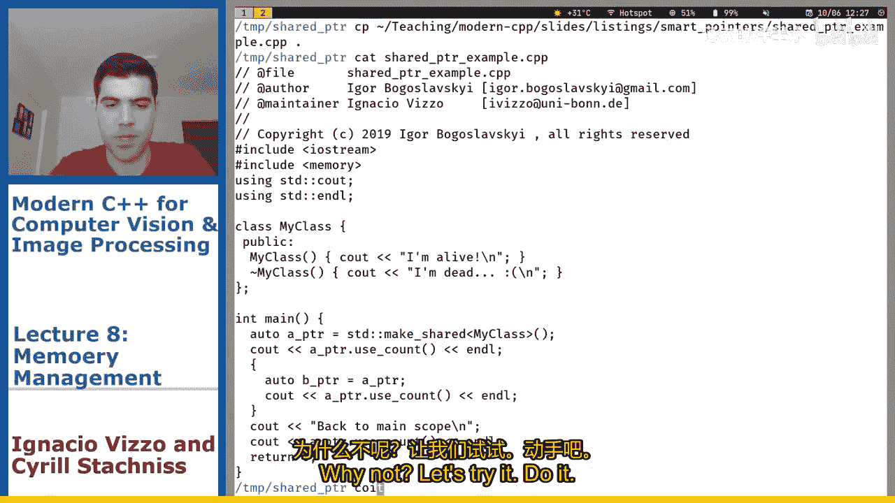
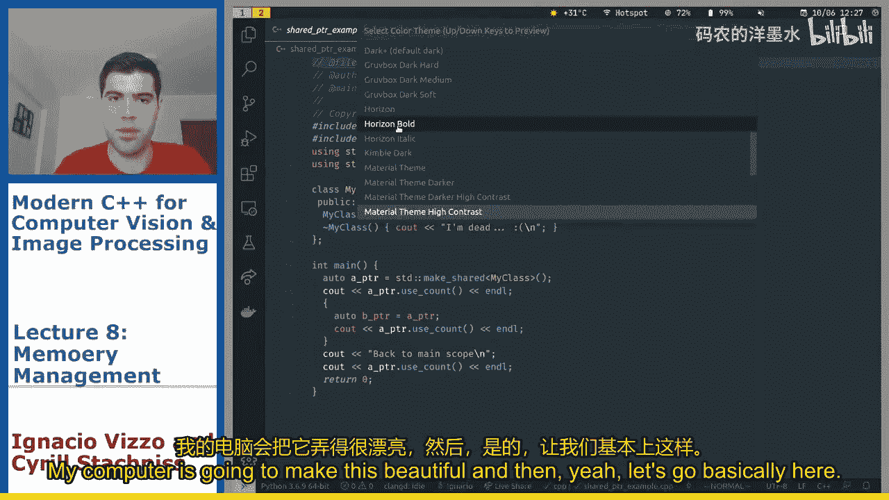
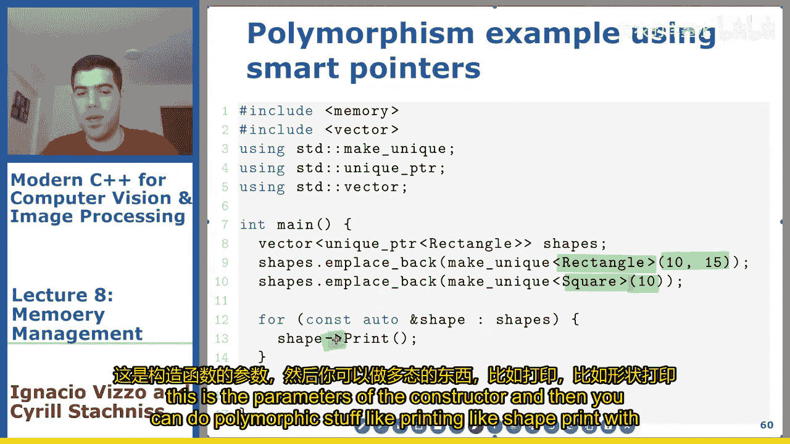
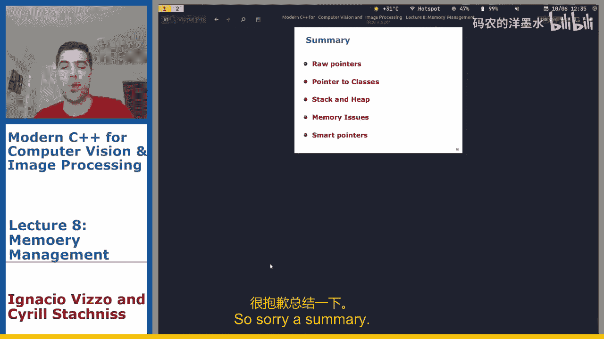
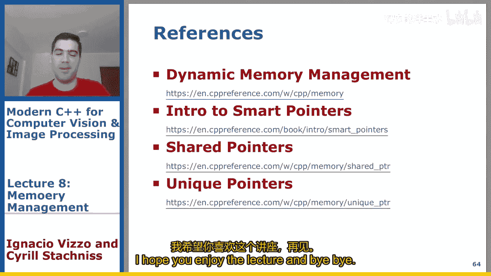

# 现代C++：第8讲：内存管理 🧠

在本节课中，我们将要学习C++中至关重要的内存管理概念。我们将从指针的基础知识开始，逐步深入到栈内存与堆内存的区别，并最终学习如何使用智能指针来安全、高效地管理内存，避免常见的内存错误。

## 指针基础

指针是一种变量，它存储的是内存地址，允许你间接访问该地址处的数据。在64位系统中，指针变量的大小通常是8字节（64位）。

**核心概念**：指针变量存储的是地址，而不是数据本身。
```cpp
int value = 5;
int* ptr = &value; // ptr 存储了 value 变量的地址
```

上一节我们介绍了指针的基本概念，本节中我们来看看指针的一些特性和用法。

指针可以指向任何类型的对象。例如，你可以有一个指向自定义类对象的指针。

**核心概念**：通过指针访问对象的成员，需要使用箭头操作符 `->`。
```cpp
MyClass obj;
MyClass* objPtr = &obj;
objPtr->someFunction(); // 通过指针调用成员函数
```

指针与引用类似，但功能更强大。它们可以被重新赋值、可以指向空值（`nullptr`），可以存储在容器中，并且是实现多态性的关键。

**核心概念**：多态性允许基类指针指向派生类对象。
```cpp
class Base { virtual void print() = 0; };
class Derived : public Base { void print() override { /* ... */ } };
Base* polyPtr = new Derived(); // 基类指针指向派生类对象
```

每个C++类都有一个名为 `this` 的隐式指针，它指向对象自身，用于在成员函数中访问对象自身的成员。

指针本身也是变量，因此它们也可以是常量（`const`），或者指向常量数据。

以下是关于指针和常量的一些组合：
*   **指向常量的指针**：指针可以改变指向，但不能通过它修改所指向的数据。
    ```cpp
    const int* ptrToConst;
    ```
*   **常量指针**：指针的指向（即存储的地址）不能改变，但可以通过它修改所指向的数据（如果数据不是常量）。
    ```cpp
    int* const constPtr;
    ```
*   **指向常量的常量指针**：指针的指向和所指向的数据都不能改变。
    ```cpp
    const int* const constPtrToConst;
    ```

理解这些组合需要一些练习，建议花时间编写简单的示例来加深理解。

## 栈内存与堆内存

理解了指针的基本操作后，一个自然的问题是：为什么我们需要使用指针？答案与程序可用的两种主要内存区域有关：栈（Stack）和堆（Heap）。

在操作系统（如Linux、Windows）中运行的程序，其内存通常被划分为栈和堆。

**栈内存**用于短期存储，与函数或类的作用域紧密相关。它的管理是自动的（后进先出，LIFO），访问速度很快，但容量通常较小（例如，在Linux上默认可能只有8MB）。所有局部变量通常都分配在栈上。

**堆内存**用于长期存储，其生命周期由程序员显式控制（通过 `new` 和 `delete`）。堆的容量可以非常大（可达系统物理内存大小），但分配和释放速度较慢，因为涉及操作系统的调用。如果需要在多个作用域或线程间共享大型数据，就必须使用堆内存。

**核心概念**：`new` 操作符在堆上分配内存并返回其地址，`delete` 操作符释放该内存。
```cpp
int* heapInt = new int(10); // 在堆上分配一个整数
delete heapInt; // 释放内存

int* heapArray = new int[100]; // 在堆上分配一个整数数组
delete[] heapArray; // 释放数组内存
```

**关键区别**：栈内存由系统自动管理，安全但容量小；堆内存由程序员手动管理，灵活但容易出错。在现代C++中，应避免手动使用 `new` 和 `delete`。

## 手动内存管理的陷阱

既然堆内存需要手动管理，那么我们就来看看如果管理不当会出现哪些问题。这是理解为何需要智能指针的关键。

第一个常见问题是**内存泄漏**。当在堆上分配了内存，但后来丢失了指向该内存的所有指针（即无法再访问或释放它）时，就会发生内存泄漏。这部分内存会一直被占用，直到程序结束，在长时间运行的程序中，这会导致可用内存逐渐耗尽。

第二个问题是**悬空指针**。当多个指针指向同一块堆内存，其中一个指针通过 `delete` 释放了该内存，但其他指针对此不知情，仍然指向那个已被释放的地址。解引用这样的悬空指针会导致未定义行为，通常是程序崩溃。

第三个问题出现在**将资源管理封装在类中时**。如果你在类的构造函数中用 `new` 分配内存，在析构函数中用 `delete` 释放内存（这称为RAII，资源获取即初始化），这看起来是明智的。但是，如果你没有为这个类正确定义拷贝构造函数和拷贝赋值运算符，那么当发生对象拷贝时，只会进行“浅拷贝”——即只拷贝指针值（地址），而不是指针所指向的数据。这会导致两个对象指向同一块堆内存。当这两个对象析构时，同一块内存会被 `delete` 两次，造成“双重释放”错误。

**核心概念**：解决类中资源管理的问题需要遵循“三/五/零法则”。如果你定义了析构函数、拷贝构造函数或拷贝赋值运算符中的任何一个，那么通常需要全部定义它们（或使用C++11的移动语义），或者使用智能指针让编译器为你生成正确的行为。

## 智能指针

鉴于手动管理内存如此容易出错，现代C++（C++11起）提供了**智能指针**来自动管理堆内存的生命周期。它们将原始指针包装在类中，并利用RAII原则确保内存被正确释放。

智能指针的行为类似于原始指针（支持解引用 `*` 和箭头 `->` 操作符），但增加了自动内存管理的功能。使用智能指针时，应包含 `<memory>` 头文件。

C++主要提供两种智能指针：`std::unique_ptr` 和 `std::shared_ptr`。

### `std::unique_ptr`

`std::unique_ptr` 表示对堆对象的**独占所有权**。一个对象在任何时刻只能由一个 `unique_ptr` 拥有。它**不能被拷贝**，但**可以被移动**（使用 `std::move`）。当 `unique_ptr` 离开作用域时，它会自动删除其管理的对象。

**核心概念**：使用 `std::make_unique` 来创建 `unique_ptr`，这是最安全、最高效的方式。
```cpp
#include <memory>
std::unique_ptr<MyClass> uPtr = std::make_unique<MyClass>(constructor_args);
// uPtr 独占管理这个 MyClass 对象
```

`std::unique_ptr` 应该是你的默认选择，它没有运行时开销，并且能防止许多内存错误。

### `std::shared_ptr`





`std::shared_ptr` 表示对堆对象的**共享所有权**。多个 `shared_ptr` 可以指向同一个对象。它内部维护一个引用计数器，记录有多少个 `shared_ptr` 共享该对象的所有权。每当一个 `shared_ptr` 被拷贝时，计数器加一；每当一个 `shared_ptr` 被销毁时，计数器减一。当最后一个 `shared_ptr` 被销毁时（计数器归零），对象才会被自动删除。

**核心概念**：使用 `std::make_shared` 来创建 `shared_ptr`。
```cpp
#include <memory>
std::shared_ptr<MyClass> sPtr1 = std::make_shared<MyClass>();
std::shared_ptr<MyClass> sPtr2 = sPtr1; // 共享所有权，引用计数+1
// sPtr1 和 sPtr2 都销毁后，对象才会被删除
```

### 使用指南与总结

*   **默认使用 `std::unique_ptr`**：除非需要共享所有权，否则优先使用 `unique_ptr`。
*   **需要共享所有权时使用 `std::shared_ptr`**。
*   **避免使用 `new` 和 `delete`**：在你的代码中看到 `new` 或 `delete`，应将其视为潜在的错误信号。使用 `make_unique` 和 `make_shared`。
*   **永远不要用智能指针管理栈内存**：智能指针是为管理堆内存而设计的。将栈变量的地址交给智能指针会导致双重释放等严重错误。
*   **智能指针支持多态**：和原始指针一样，你可以用基类的智能指针指向派生类对象。





**示例：多态容器**
```cpp
std::vector<std::unique_ptr<Shape>> shapes;
shapes.push_back(std::make_unique<Circle>());
shapes.push_back(std::make_unique<Square>());
for (auto& shape : shapes) {
    shape->draw(); // 多态调用
}
```




本节课中我们一起学习了C++内存管理的核心知识。我们从指针的基础开始，理解了栈内存和堆内存的根本区别以及为何需要手动管理堆内存。我们深入探讨了手动管理内存带来的三大陷阱：内存泄漏、悬空指针和资源管理类的拷贝问题。最后，我们学习了现代C++提供的解决方案——智能指针（`std::unique_ptr` 和 `std::shared_ptr`），它们通过RAII机制自动管理内存生命周期，极大地提高了代码的安全性和可维护性。请记住：在现代C++中，应尽量避免直接使用原始指针和 `new`/`delete`，转而使用智能指针。